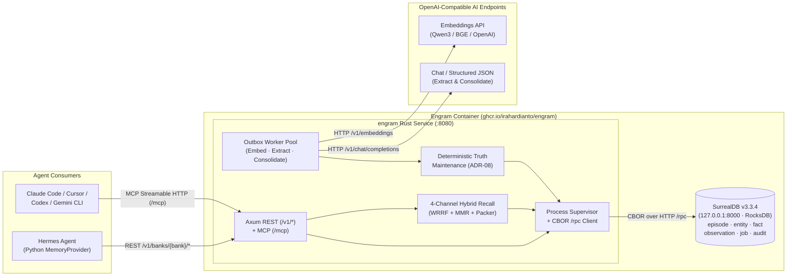

# Engram

**Unified, single-engine long-term memory for autonomous AI agents — built in Rust on SurrealDB.**

[](LICENSE)
[-orange.svg)](docs/spec/11-rust-implementation-guide.md)
[](migrations/0001_init.surql)
[](CONTRIBUTING.md)

---

## Why Engram?

Most AI agent memory stacks either:
1. **Stay flat and bounded** — markdown files (`MEMORY.md` / `USER.md`) and raw transcript FTS that silently overwrite past state and cannot answer *"what changed since last Tuesday?"* or *"why did we switch from Envoy to Pingora?"*, or
2. **Explode into a fragile poly-store** — stitching together a relational DB, a vector store, a graph database, a full-text engine, and a Python worker queue that drift out of sync on partial failures and require gigabytes of RAM just to idle.

**Engram** collapses the entire memory stack into a **single ACID database engine (SurrealDB 3.3.4)** supervised by a **single ~7.4 MB static Rust binary (`engram`)**:
- **Episodic documents (`episode`)**, **canonical entities (`entity`)**, **bi-temporal knowledge-graph relations (`fact`)**, **consolidated entity summaries (`observation`)**, **transactional outbox jobs (`job`)**, and **provenance audit logs (`audit`)** live inside the same database and commit atomically.
- **Native 4-channel hybrid retrieval** runs HNSW vector similarity, BM25 full-text search with English/Indonesian stemming, 1-hop knowledge-graph traversal with hub damping, and temporal/recency scans inside one multi-statement SurrealQL round-trip, followed by Weighted Reciprocal Rank Fusion ($k=60$), Maximal Marginal Relevance ($\lambda=0.7$), and hard token-budget packing in Rust.
- **Deterministic truth maintenance** (never delegated to LLM whim) enforces a closed 15-predicate vocabulary, source-trust hierarchy (`user_stated` > `user_implied` > `assistant_stated` = `tool_output` > `inferred`), world-time vs. transaction-time intervals (`valid_from`/`valid_to` vs. `recorded_at`/`expired_at`), and explicit conflict tracking (`conflicts_with`).
- **Dual first-class consumer surfaces:**
  1. **Hermes Agent** via a native, zero-extra-dependency Python `MemoryProvider` plugin (`integrations/hermes/engram/`) with 1,500 ms live prefetch deadlines, curated `MEMORY.md`/`USER.md` mirroring, and offline JSONL write spooling.
  2. **Coding & desktop agents** (Claude Code, Cursor, Codex, Gemini CLI) via **Model Context Protocol (MCP)** Streamable HTTP (`POST /mcp`) exposing five sharp tools (`engram_recall`, `engram_remember`, `engram_forget`, `engram_entities`, `engram_status`).

---

## Architecture at a Glance



---

## Key Design Highlights

| Capability | How Engram Solves It | Governing Spec |
|---|---|---|
| **Single-Engine Multi-Model Storage** | HNSW vector indexes, BM25 full-text search, `TYPE RELATION` graph edges, and transactional outbox queues inside one SurrealDB 3.3.4 namespace (`engram`) with one database per memory bank. | [`00-decisions.md` (ADR-01, ADR-02)](docs/spec/00-decisions.md), [`03-data-model.md`](docs/spec/03-data-model.md) |
| **Clean-Room Apache-2.0 Binary** | `engram` talks to SurrealDB over HTTP `POST /rpc` using `reqwest` + `ciborium` (CBOR Tags 6, 8, 12). Zero BSL-1.1 Rust crates are linked into the binary (218 normal crates default / 245 with `otlp`). | [`00-decisions.md` (ADR-02, ADR-16)](docs/spec/00-decisions.md), [`11-rust-implementation-guide.md`](docs/spec/11-rust-implementation-guide.md) |
| **Bi-Temporal Truth Maintenance** | Separates **world time** (`valid_from`, `valid_to`) from **knowledge time** (`recorded_at`, `expired_at`). Supports point-in-time `as_of` queries, strict-later functional supersession, authority guards against assistant hallucinations, and predecessor reopening on `forget`. | [`00-decisions.md` (ADR-08, ADR-09)](docs/spec/00-decisions.md), [`04-ingestion-pipeline.md`](docs/spec/04-ingestion-pipeline.md) |
| **Single-Call Batch Extraction** | Primes existing entities with compact integer handles (`E1..En`) and extracts entities + bi-temporal triples across a session window in **one** structured LLM call (`prompts/extract.v1.md`). | [`00-decisions.md` (ADR-07, ADR-10)](docs/spec/00-decisions.md), [`04-ingestion-pipeline.md`](docs/spec/04-ingestion-pipeline.md) |
| **Zero-LLM-Call Fast Recall** | Retrieval never blocks on a generative LLM call: query analysis, bilingual (EN/ID) temporal parsing, 4-channel SurrealQL fan-out, Weighted RRF, MMR diversification, and markdown packing target **p95 ≤ 150 ms** service-side. | [`00-decisions.md` (ADR-11)](docs/spec/00-decisions.md), [`05-retrieval.md`](docs/spec/05-retrieval.md) |
| **Resilient Hermes Integration** | Live `prefetch()` bounded by a 1,500 ms deadline with circuit breaker; `sync_turn()` spools failed writes to `$HERMES_HOME/engram/spool/<bank>.jsonl` (0600 permissions, 10 MB cap) and drains automatically on recovery. | [`00-decisions.md` (ADR-13)](docs/spec/00-decisions.md), [`07-hermes-plugin.md`](docs/spec/07-hermes-plugin.md) |

---

## Repository Structure

```text
.
├── docs/
│   ├── spec/                        # Normative v1 Engineering Specification
│   │   ├── README.md                # Reading order, document index & milestone map
│   │   ├── 00-decisions.md          # Single source of truth: ADRs 01–19 & Canonical Registry
│   │   ├── 01-prd.md                # Product requirements (FR-001..075, NFRs, M0–M5)
│   │   ├── 02-architecture.md       # System topology, concurrency & failure modes
│   │   ├── 03-data-model.md         # SurrealDB 3.3.4 schemas, invariants & Query Catalog (Q-*)
│   │   ├── 04-ingestion-pipeline.md # Redaction, priming, extraction & truth maintenance
│   │   ├── 05-retrieval.md          # 4-channel hybrid recall, WRRF, MMR & prompt packing
│   │   ├── 06-api-and-mcp.md        # REST API (/v1/*), OpenAPI 3.1.0 & MCP (/mcp) schemas
│   │   ├── 07-hermes-plugin.md      # Hermes MemoryProvider plugin specification & reference code
│   │   ├── 08-deployment-operations.md # Supervision, Docker, backups, CLI & runbooks
│   │   ├── 09-observability.md      # OpenTelemetry spans, Prometheus metrics & audit trail
│   │   ├── 10-testing-evaluation.md # 49 deterministic CI scenarios (S01–S49) & LongMemEval_S
│   │   ├── 11-rust-implementation-guide.md # Cargo.toml, module layout & Rust reference code
│   │   ├── 12-prior-art-learnings.md # Lineage & anti-patterns from Hindsight, Cognee, Mem0, Graphiti
│   │   └── verification/            # Historical point-in-time spec verification archive (VS1–VS5)
│   └── research/                    # Phase 1 prior-art & stack research + verification (V01–V07)
├── migrations/
│   └── 0001_init.surql              # Canonical SurrealDB 3.3.4 schema migration (148 statements)
├── prompts/
│   ├── extract.v1.md                # Versioned batch entity & fact extraction prompt + JSON schema
│   └── consolidate.v1.md            # Versioned entity observation consolidation prompt + JSON schema
├── Dockerfile                       # Multi-stage all-in-one image (Debian slim + tini + engram + surreal)
├── docker-compose.yml               # Default single-container deployment (+ optional Ollama profile)
├── docker-compose.external.yml      # External SurrealDB two-container topology
├── DISCOVERY_HANDOFF.md             # Phase 1 → Phase 2 architectural handoff record
├── CONTRIBUTING.md                  # Contributor guide, milestone roadmap & guardrails
├── LICENSE                          # Apache License 2.0
└── NOTICE                           # Third-party attribution & SurrealDB container binary notice
```

---

## Quickstart Preview (Target v1 UX)

### 1. Run the All-in-One Container

```bash
# Start Engram (supervising embedded SurrealDB 3.3.4 with persistent data in ./data)
export ENGRAM_LLM_API_KEY="sk-..."
export ENGRAM_EMBEDDING_API_KEY="sk-..."
docker compose up -d

# Retrieve the auto-generated Bearer API key (on first boot)
docker compose exec engram engram key show
```

### 2. Connect an MCP Client (Claude Code / Cursor / Codex / Gemini CLI)

```json
{
  "mcpServers": {
    "engram": {
      "url": "http://127.0.0.1:8080/mcp",
      "headers": {
        "Authorization": "Bearer <ENGRAM_API_KEY>",
        "X-Engram-Bank": "default"
      }
    }
  }
}
```

### 3. Connect Hermes Agent

```bash
hermes memory setup --provider engram
```

---

## Contributing & Implementation Roadmap

Engram's v1 architecture and specification have been empirically validated against live `surrealdb/surrealdb:v3.3.4`, Hermes Agent `v0.22.4`, `axum 0.8`, and `rmcp`. We are now building the implementation across six gated milestones (`M0`–`M5`):

- **Start here:** Read [`docs/spec/README.md`](docs/spec/README.md) and [`docs/spec/00-decisions.md`](docs/spec/00-decisions.md).
- **Pick a milestone:** See [`CONTRIBUTING.md`](CONTRIBUTING.md) and [`docs/spec/01-prd.md §10`](docs/spec/01-prd.md#10-milestones--acceptance-criteria) for milestone scope and exit gates.

---

## License

Engram's source code, specifications, migrations, and Hermes plugin are licensed under the **[Apache License, Version 2.0](LICENSE)**. See **[NOTICE](NOTICE)** for details regarding the unmodified `surreal` binary bundled in the optional all-in-one Docker image under SurrealDB's BSL-1.1 Additional Use Grant.
