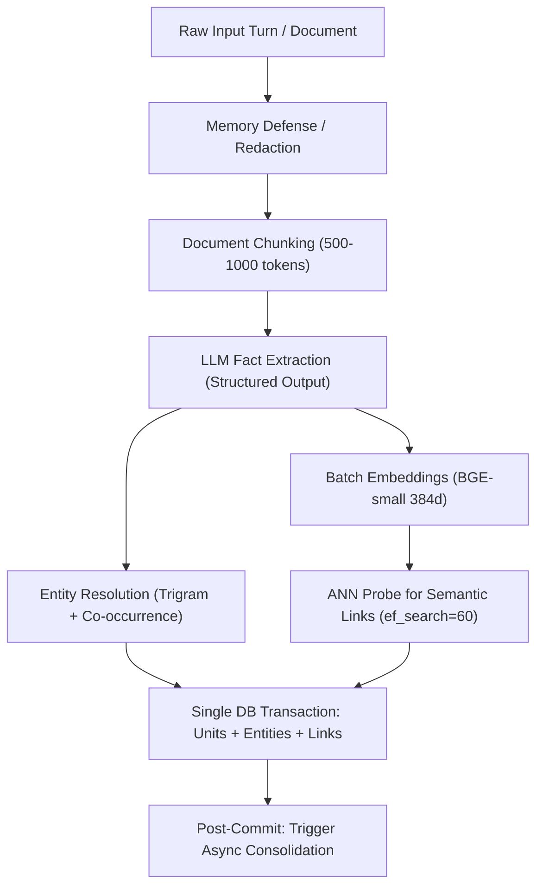
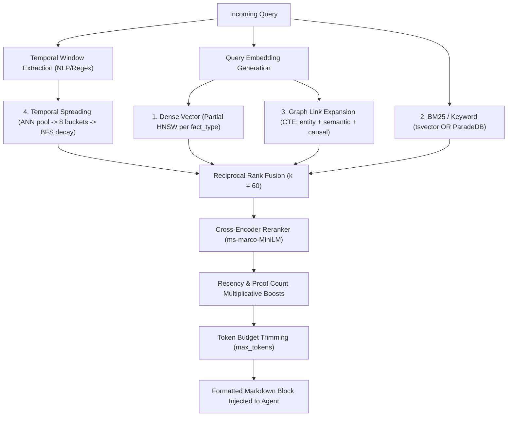

# Deep-Dive Research: Hindsight Architecture & Patterns for Engram

> **Verification status:** PASS-WITH-FIXES — corrected on 2026-10-24 per [V01 report](verification/V01-hindsight.md). Corrections are marked with *(corrected)*.

**Target Project:** Engram (Long-Term Memory System for AI Agents, Rust + SurrealDB)  
**Reference Subject:** Hindsight (`vectorize-io/hindsight`)  
**Source Path:** `vectorize-io/hindsight`  
**Paper Citation:** *Hindsight is 20/20: Building Agent Memory that Retains, Recalls, and Reflects* (arXiv:2512.12818)  
**Date of Research:** October 2026  
**Author:** Sovereign Research Agent (R1)

---

## Executive Summary

Hindsight is an open-source agent memory system designed to address the catastrophic failure modes of naive vector RAG (semantic blindness to time, relationships, and contradictions). It structures agent memory into a multi-layer cognitive substrate using four retrieval strategies (dense vector, BM25, graph link expansion, and temporal spreading) combined via Reciprocal Rank Fusion (RRF) and Cross-Encoder neural reranking.

While Hindsight achieves top-tier benchmark results (94.6% on LongMemEval-s, 92% on LoCoMo, and #1 on BEAM at 10M tokens *(unverified)*), its underlying storage architecture is fundamentally relational: PostgreSQL with `pgvector`, `pg_trgm`, `tsvector`, and SQL CTEs with non-recursive LATERAL joins and iterative Python BFS simulating graph and temporal traversal *(corrected)*. In this report, we dissect Hindsight's conceptual models, database schemas, ingestion pipelines, retrieval algorithms, consolidation logic, API surfaces, Hermes integration, and deployment patterns, providing an actionable blueprint for adopting, adapting, or rejecting each design pattern in Engram's native Rust + SurrealDB architecture.

---

## 1. Conceptual Model

### 1.1 Memory Banks
In Hindsight, a **Memory Bank** is an isolated cognitive container (a "brain" for an agent, user, or project).
- **Isolation:** Strict tenant/bank boundaries. All queries operate on a single bank per request (`/v1/default/banks/{bank_id}/...`). Multi-bank aggregation is the client's orchestration responsibility (`CLAUDE.md:307-316`).
- **Configuration & Dispositions:** Each bank carries its own mission (`mission` / `reflect_mission`), personality, and **disposition traits** (`skepticism`, `literalism`, `empathy`, integer scale 1–5, defaulting to 3). Dispositions influence the *reflect* reasoning agent, but deliberately do not distort the objective *recall* retrieval path (`CLAUDE.md:308-315`, `hindsight_api/engine/response_models.py:270-285` *(corrected)*).
- **Templates:** Banks can be bootstrapped from declarative templates specifying extraction instructions, entity taxonomies, and scheduled mental models (`hindsight-dev/hindsight_dev/generate_bank_template_schema.py:1-40` *(corrected)*).

### 1.2 Core Operations
Hindsight is organized around three biomimetic primitives, plus consolidation:
1. **Retain (`retain`):** Ingestion path. Ingests raw conversation turns or documents, normalizes relative time, extracts factual statements, links entities, computes embeddings, and persists nodes and edges.
2. **Recall (`recall`):** Read path. Parallel 4-way hybrid retrieval (dense vector + BM25 full-text + graph link expansion + temporal window spreading) fused via RRF and reranked with a cross-encoder under an explicit token budget.
3. **Reflect (`reflect`):** Synthesis/reasoning path. A disposition-aware agent equipped with native tool-calling (`search_mental_models`, `search_observations`, `recall`, `expand`) executing a hierarchical search ladder to answer complex queries traceably.
4. **Consolidate (`consolidate`):** Truth maintenance & synthesis pass. Runs in the background post-retain or on-demand, clustering unconsolidated facts, updating or creating observations, and tracking evidence.

### 1.3 Memory Types & Networks: Evolution from Paper to Code
In the original arXiv paper (arXiv:2512.12818), Hindsight described memory as four logical networks:
1. *World Facts:* Objective external statements.
2. *Agent Experiences:* Personal actions and first-person interactions.
3. *Synthesized Entity Summaries:* Structural entity profiles.
4. *Evolving Beliefs / Opinions:* Subjective interpretations with confidence scores.

#### Crucial Code Evolution: Deprecation of "Opinions"
In the actual production codebase, the concept of "opinion" as a separate fact type was explicitly deprecated and completely purged:
- **Migration `g2h3i4j5k6l7_remove_opinion_fact_type.py:1-55` (2026-04-02):** Dropped `opinion` from the `fact_type` check constraint, dropped opinion-specific indexes (`idx_memory_units_opinion_confidence`, `idx_memory_units_opinion_date`), deleted all rows where `fact_type = 'opinion'`, and dropped the `confidence_score` column from `memory_units`.
- **Reasoning:** In production, assigning arbitrary floating-point confidence scores (e.g. 0.72) to LLM-generated opinions produced uncalibrated noise and index bloat. Instead, subjective thoughts and consolidated beliefs were moved into **Observations** and **Mental Models**, where confidence is measured structurally through **proof counts (`proof_count`)** and explicit supporting evidence references (`source_memory_ids`), rather than an ungrounded float.

The live production memory hierarchy in Hindsight (`CLAUDE.md:7-11`, `hindsight_api/alembic/versions/t5o6p7q8r9s0_rename_mental_models_to_observations.py:1-25`):
- **Raw Facts (`memory_units.fact_type IN ('world', 'experience')`):**
  - `'world'`: Objective/external facts, user preferences, stated rules, corrections, and project constraints (even when stated in conversation).
  - `'experience'`: Actions, tool executions, and direct observations the agent performed ("I deployed version X").
- **Observations (`memory_units.fact_type = 'observation'`):** Consolidated, deduplicated beliefs automatically synthesized from multiple raw facts. Each observation tracks `proof_count`, `source_memory_ids`, and historical revisions.
- **Mental Models (`mental_models` table):** Standing, curated answers to recurring questions. Synthesized full documents that refresh automatically on triggers or cron schedules.
- **Directives (`directives` table):** Hard behavioral rules with strict priority that must never be violated during reflection.

### 1.4 Entity Model
Entities in Hindsight (`entities` table) are normalized nodes representing people, places, tools, organizations, and concepts (`hindsight_api/engine/memories/pg/entity_resolver.py:1-150`):
- Linked to memory units via junction table `unit_entities`.
- Entity co-occurrences are tracked in `entity_cooccurrences` with running counts and timestamps (`last_cooccurred`).
- Supports structured taxonomies and key-value label tags via `entity_labels` configuration (e.g. `user:alice`, `tool:docker`).

---

## 2. Data Model & Storage

Hindsight uses PostgreSQL (with pgvector, pg_trgm, tsvector, and optional extensions like ParadeDB pg_search or VectorChord) as its primary backend, and supports Oracle 23ai via a dialect abstraction layer.

### 2.1 Complete Relational Table Schemas
Source of truth: Alembic migrations (`hindsight_api/alembic/versions/o1a2b3c4d5e6_oracle_baseline.py:40-350`, `d5e6f7a8b9c0_add_bank_internal_id_and_per_bank_hnsw.py`, `p1k2l3m4n5o6_new_knowledge_architecture.py`).

```sql
-- 1. BANKS: Partition containers & configurations
CREATE TABLE banks (
    bank_id           VARCHAR(256) PRIMARY KEY,
    internal_id       UUID DEFAULT gen_random_uuid() NOT NULL UNIQUE,
    name              VARCHAR(512),
    disposition       JSONB DEFAULT '{"skepticism":3,"literalism":3,"empathy":3}'::jsonb NOT NULL,
    mission           TEXT,
    personality       JSONB DEFAULT '{}'::jsonb NOT NULL,
    config            JSONB DEFAULT '{}'::jsonb NOT NULL,
    created_at        TIMESTAMP WITH TIME ZONE DEFAULT now() NOT NULL,
    updated_at        TIMESTAMP WITH TIME ZONE DEFAULT now() NOT NULL
);

-- 2. DOCUMENTS: Ingested source files or conversation sessions
CREATE TABLE documents (
    id                VARCHAR(512) NOT NULL,
    bank_id           VARCHAR(256) NOT NULL REFERENCES banks(bank_id) ON DELETE CASCADE,
    original_text     TEXT,
    content_hash      VARCHAR(128),
    metadata          JSONB DEFAULT '{}'::jsonb NOT NULL,
    retain_params     JSONB,
    file_storage_key  VARCHAR(512),
    file_original_name VARCHAR(512),
    file_content_type VARCHAR(256),
    tags              JSONB DEFAULT '[]'::jsonb NOT NULL,
    created_at        TIMESTAMP WITH TIME ZONE DEFAULT now() NOT NULL,
    updated_at        TIMESTAMP WITH TIME ZONE DEFAULT now() NOT NULL,
    PRIMARY KEY (id, bank_id)
);

-- 3. CHUNKS: Text partitions of ingested documents
CREATE TABLE chunks (
    chunk_id          VARCHAR(512) PRIMARY KEY,
    document_id       VARCHAR(512) NOT NULL,
    bank_id           VARCHAR(256) NOT NULL,
    chunk_index       INT NOT NULL,
    chunk_text        TEXT NOT NULL,
    content_hash      VARCHAR(128),
    created_at        TIMESTAMP WITH TIME ZONE DEFAULT now() NOT NULL,
    FOREIGN KEY (document_id, bank_id) REFERENCES documents(id, bank_id) ON DELETE CASCADE
);

-- 4. MEMORY_UNITS: Core facts, experiences, and observations
CREATE TABLE memory_units (
    id                UUID PRIMARY KEY DEFAULT gen_random_uuid(),
    bank_id           VARCHAR(256) NOT NULL REFERENCES banks(bank_id) ON DELETE CASCADE,
    document_id       VARCHAR(512),
    chunk_id          VARCHAR(512) REFERENCES chunks(chunk_id) ON DELETE SET NULL,
    text              TEXT NOT NULL,
    embedding         vector(384),                      -- Configured embedding dimension
    context           TEXT,                             -- Surrounding conversational context
    event_date        TIMESTAMP WITH TIME ZONE NOT NULL,-- Normalized point in time
    occurred_start    TIMESTAMP WITH TIME ZONE,         -- World validity start
    occurred_end      TIMESTAMP WITH TIME ZONE,         -- World validity end
    mentioned_at      TIMESTAMP WITH TIME ZONE,         -- Transaction/statement time
    fact_type         VARCHAR(64) DEFAULT 'world' NOT NULL,
    consolidated_at   TIMESTAMP WITH TIME ZONE,         -- Watermark when consolidated into an observation
    observation_scopes JSONB,                           -- Tag scoping for consolidation
    tags              VARCHAR[] DEFAULT ARRAY[]::VARCHAR[],
    metadata          JSONB DEFAULT '{}'::jsonb NOT NULL,
    proof_count       INT DEFAULT 1,                    -- Number of supporting facts (for observations)
    source_memory_ids UUID[],                           -- References to source raw facts
    history           JSONB DEFAULT '[]'::jsonb,        -- Version history of edits
    text_signals      TEXT,                             -- Keywords/entities for lexical boost
    consolidation_failed_at TIMESTAMP WITH TIME ZONE,
    search_vector     tsvector,                         -- Full-text tsvector
    edited_at         TIMESTAMP WITH TIME ZONE,
    created_at        TIMESTAMP WITH TIME ZONE DEFAULT now() NOT NULL,
    updated_at        TIMESTAMP WITH TIME ZONE DEFAULT now() NOT NULL,
    CONSTRAINT memory_units_fact_type_check CHECK (fact_type IN ('world', 'experience', 'observation')),
    FOREIGN KEY (document_id, bank_id) REFERENCES documents(id, bank_id) ON DELETE CASCADE
);

-- 5. INVALIDATED_MEMORY_UNITS: Cold archive for retracted facts (no vector column)
CREATE TABLE invalidated_memory_units (
    LIKE memory_units INCLUDING DEFAULTS,
    invalidation_reason TEXT,
    invalidated_at    TIMESTAMP WITH TIME ZONE DEFAULT now(),
    entity_ids        JSONB
);
-- Note: embedding column is dropped from invalidated_memory_units to prevent dimensional
-- drift during model migrations (alembic migration d4f6a8c2e1b3).

-- 6. ENTITIES: Canonical knowledge entities
CREATE TABLE entities (
    id                UUID PRIMARY KEY DEFAULT gen_random_uuid(),
    bank_id           VARCHAR(256) NOT NULL REFERENCES banks(bank_id) ON DELETE CASCADE,
    canonical_name    VARCHAR(512) NOT NULL,
    metadata          JSONB DEFAULT '{}'::jsonb NOT NULL,
    first_seen        TIMESTAMP WITH TIME ZONE DEFAULT now() NOT NULL,
    last_seen         TIMESTAMP WITH TIME ZONE DEFAULT now() NOT NULL,
    mention_count     INT DEFAULT 1 NOT NULL
);

-- 7. UNIT_ENTITIES: M:N Junction between memory units and entities
CREATE TABLE unit_entities (
    unit_id           UUID NOT NULL REFERENCES memory_units(id) ON DELETE CASCADE,
    entity_id         UUID NOT NULL REFERENCES entities(id) ON DELETE CASCADE,
    PRIMARY KEY (unit_id, entity_id)
);

-- 8. ENTITY_COOCCURRENCES: Entity graph graph structure
CREATE TABLE entity_cooccurrences (
    entity_id_1       UUID NOT NULL REFERENCES entities(id) ON DELETE CASCADE,
    entity_id_2       UUID NOT NULL REFERENCES entities(id) ON DELETE CASCADE,
    cooccurrence_count INT DEFAULT 1 NOT NULL,
    last_cooccurred   TIMESTAMP WITH TIME ZONE DEFAULT now() NOT NULL,
    PRIMARY KEY (entity_id_1, entity_id_2)
);

-- 9. MEMORY_LINKS: Explicit relational graph edges
CREATE TABLE memory_links (
    from_unit_id      UUID NOT NULL REFERENCES memory_units(id) ON DELETE CASCADE,
    to_unit_id        UUID NOT NULL REFERENCES memory_units(id) ON DELETE CASCADE,
    link_type         VARCHAR(64) NOT NULL,
    entity_id         UUID REFERENCES entities(id) ON DELETE CASCADE,
    bank_id           VARCHAR(256),
    weight            FLOAT DEFAULT 1.0 NOT NULL,
    source_memory_ids UUID[],
    created_at        TIMESTAMP WITH TIME ZONE DEFAULT now() NOT NULL,
    CONSTRAINT chk_ml_link_type CHECK (
        link_type IN ('temporal', 'semantic', 'entity', 'causes', 'caused_by', 'enables', 'prevents')
    ),
    CONSTRAINT chk_ml_weight CHECK (weight >= 0.0 AND weight <= 1.0)
);

-- 10. MENTAL_MODELS: Standing synthesized knowledge documents
CREATE TABLE mental_models (
    id                VARCHAR(256) NOT NULL,
    bank_id           VARCHAR(256) NOT NULL REFERENCES banks(bank_id) ON DELETE CASCADE,
    subtype           VARCHAR(32) NOT NULL,             -- 'directive' | 'pinned'
    name              VARCHAR(256) NOT NULL,
    description       TEXT NOT NULL,
    source_query      TEXT,
    content           TEXT,
    embedding         vector(384),
    entity_id         UUID REFERENCES entities(id) ON DELETE SET NULL,
    observations      JSONB DEFAULT '{"observations":[]}'::jsonb NOT NULL,
    links             JSONB,
    tags              VARCHAR[] DEFAULT ARRAY[]::VARCHAR[],
    max_tokens        INT DEFAULT 2048 NOT NULL,
    trigger           JSONB DEFAULT '{"refresh_after_consolidation":false}'::jsonb NOT NULL,
    structured_content JSONB,
    last_refreshed_source_query TEXT,
    reflect_response  JSONB,
    history           JSONB DEFAULT '[]'::jsonb NOT NULL,
    last_refreshed_at TIMESTAMP WITH TIME ZONE DEFAULT now() NOT NULL,
    last_updated      TIMESTAMP WITH TIME ZONE,
    created_at        TIMESTAMP WITH TIME ZONE DEFAULT now() NOT NULL,
    PRIMARY KEY (id, bank_id)
);

-- 11. DIRECTIVES: Explicit behavioral constraints
CREATE TABLE directives (
    id                UUID PRIMARY KEY DEFAULT gen_random_uuid(),
    bank_id           VARCHAR(256) NOT NULL REFERENCES banks(bank_id) ON DELETE CASCADE,
    name              VARCHAR(256) NOT NULL,
    content           TEXT NOT NULL,
    priority          INT DEFAULT 0 NOT NULL,
    is_active         BOOLEAN DEFAULT TRUE NOT NULL,
    tags              VARCHAR[] DEFAULT ARRAY[]::VARCHAR[],
    created_at        TIMESTAMP WITH TIME ZONE DEFAULT now() NOT NULL,
    updated_at        TIMESTAMP WITH TIME ZONE DEFAULT now() NOT NULL
);

-- 12. ASYNC_OPERATIONS: Background retain/refresh task state
CREATE TABLE async_operations (
    operation_id      UUID PRIMARY KEY DEFAULT gen_random_uuid(),
    bank_id           VARCHAR(256) NOT NULL REFERENCES banks(bank_id) ON DELETE CASCADE,
    operation_type    VARCHAR(128) NOT NULL,
    status            VARCHAR(32) DEFAULT 'pending' NOT NULL,
    worker_id         VARCHAR(256),
    claimed_at        TIMESTAMP WITH TIME ZONE,
    retry_count       INT DEFAULT 0 NOT NULL,
    next_retry_at     TIMESTAMP WITH TIME ZONE,
    task_payload      JSONB,
    result_metadata   JSONB DEFAULT '{}'::jsonb NOT NULL,
    error_message     TEXT,
    created_at        TIMESTAMP WITH TIME ZONE DEFAULT now() NOT NULL,
    updated_at        TIMESTAMP WITH TIME ZONE DEFAULT now() NOT NULL,
    completed_at      TIMESTAMP WITH TIME ZONE,
    CONSTRAINT chk_ao_status CHECK (status IN ('pending', 'processing', 'completed', 'failed', 'cancelled'))
);
```

### 2.2 Indexes and Physical Tuning
Source: `hindsight_api/_vector_index.py:29-145`, `hindsight_api/alembic/versions/d5e6f7a8b9c0_*.py`, `hindsight_api/engine/sql/postgresql.py`.

1. **Vector Indexes (pgvector HNSW):**
   - Syntax: `CREATE INDEX ... USING hnsw (embedding vector_cosine_ops)`.
   - **Partial Indexes:** Partial HNSW indexes per `fact_type` (`idx_mu_emb_world`, `idx_mu_emb_observation`, `idx_mu_emb_experience`) to enable fast index scans inside `UNION ALL` subqueries without requiring sequential filtering (`memories/pg/recall.py:55-63`).
   - **Search-Time Tuning Parameters:**
     - *Low-latency profile* (used for retain-time semantic link probing): `SET LOCAL hnsw.ef_search = 60; SET LOCAL hnsw.iterative_scan = off;` (`_vector_index.py:133-135`).
     - *High-recall profile* (used for recall retrieval): `SET LOCAL hnsw.ef_search = 200; SET LOCAL hnsw.iterative_scan = strict_order; SET LOCAL hnsw.max_scan_tuples = 4000;` (`_vector_index.py:136-143`, `config.py:1625` *(corrected)*).
   - *Iterative Scan Behavior:* `hnsw.iterative_scan = strict_order` turns `ef_search` from a hard candidate ceiling into a batch size, resuming scans in chunks until the query `LIMIT` is fulfilled.
2. **Text / Lexical Indexes:**
   - Native PostgreSQL: GIN index over generated `search_vector` tsvector with `to_tsquery('english', ...)`.
   - Alternative backends supported: ParadeDB `pg_search` (BM25 with BM25 tokenizers via `pdb.unicode_words`, `pdb.jieba`, etc.), VectorChord `vchord` (negative distance `<&>` with `to_bm25query`), and PGroonga (bilingual bigram index `&@~`).
3. **Trigram Fuzzy Indexes (`pg_trgm`):**
   - `CREATE INDEX idx_entities_canonical_name_trgm ON entities USING GIN (LOWER(canonical_name) gin_trgm_ops) WHERE entity_kind != 'label'` (Alembic migrations `b3e8d1c6f4a9` / `7c2e5a9d1f40` *(corrected)*).
4. **Graph & Link Indexes:**
   - Composite indexes: `idx_memory_links_from_type_weight ON memory_links (from_unit_id, link_type, weight DESC)` and `idx_memory_links_to_type_weight ON memory_links (to_unit_id, link_type, weight DESC)`. Used by LATERAL joins for bounded neighbor traversal.
   - Junction index: `idx_unit_entities_entity_unit ON unit_entities (entity_id, unit_id)`.
5. **Temporal Indexes:**
   - B-tree indexes on `memory_units (bank_id, event_date DESC)`, `(occurred_start, occurred_end)`, and `(bank_id, updated_at)`.

### 2.3 Bi-Temporal Representation
Hindsight models time using four timestamps on each `memory_unit`:
- `occurred_start` / `occurred_end`: **World Validity Interval** — when the fact was true in reality. For point events, both are identical. For coarse dates (e.g. "in 2024"), extraction sets `2024-01-01 00:00:00` to `2024-12-31 23:59:59` (`fact_extraction.py:1111-1114`).
- `mentioned_at`: **Transaction / Evidence Time** — when the statement was made in conversation or document authoring (`prompts.py:86-93`).
- `event_date`: Primary ordering instant (midpoint of occurred range or mentioned_at fallback).
- `updated_at`: Mutation watermark for consolidation tracking.

### 2.4 Graph Edges & Link Types
Stored in `memory_links`:
- `'temporal'`: Connects memories occurring within a configured window (default 24h), with weight decaying linearly: `weight = max(0.3, 1.0 - time_diff / window)` (`links.py:138-145`).
- `'semantic'`: Connects memories with cosine similarity above threshold (default 0.75), pre-computed via kNN.
- `'entity'`: Connects memories sharing entities (traversed at query-time via `unit_entities` self-join).
- `'caused_by'` / `'causes'`: Explicit causal relations extracted by LLM (`link_creation.py:84-114`).
- `'enables'` / `'prevents'`: Historical causal link variants.

---

## 3. Ingestion (Retain) Pipeline

The retain pipeline transforms unstructured text or conversation turns into durable, linked memory units (`hindsight_api/engine/retain/orchestrator.py:1-4600`).



### 3.1 Chunking
- When raw documents exceed chunk thresholds (typically 500–1000 tokens / 3000 chars), `_split_chunk_for_output_retry` or structural token splitters partition content on turn boundaries, paragraph breaks, or markdown headers (`fact_extraction.py:327-360`).
- Oversized chunks that fail LLM output length limits are recursively bisected down to `_MIN_SPLIT_CHUNK_CHARS = 500` characters (`fact_extraction.py:324-325`).

### 3.2 Fact Extraction Prompts & JSON Schema
Fact extraction uses structured outputs (guided decoding) with strict Pydantic models.

#### Output JSON Schema (`fact_extraction.py:269-315`)
```python
class FactCausalRelation(BaseModel):
    target_index: int = Field(description="Index of PREVIOUS fact in array (target_index < current_index)")
    relation_type: Literal["caused_by"] = Field(default="caused_by")

class ExtractedFact(BaseModel):
    what: str = Field(description="Core fact - concise but complete (1-2 sentences)")
    when: str = Field(description="When it happened. 'N/A' if unknown.")
    where: str = Field(description="Location if relevant. 'N/A' if none.")
    who: str = Field(description="People involved with relationships. 'N/A' if general.")
    why: str = Field(description="Context/significance if important. 'N/A' if obvious.")
    fact_kind: Literal["event", "conversation"] = Field(description="'event' for datable occurrences, 'conversation' for ongoing states/preferences")
    occurred_start: str | None = Field(default=None, description="ISO timestamp for events")
    occurred_end: str | None = Field(default=None, description="ISO timestamp for event end")
    fact_type: Literal["world", "assistant"] = Field(description="'world' = objective/user facts/rules; 'assistant' = actions/experiences agent actually performed")
    entities: list[str] = Field(default_factory=list, description="Array of plain strings, e.g. ['Alice', 'Kubernetes']")
    causal_relations: list[FactCausalRelation] | None = Field(default=None)

class FactExtractionResponse(BaseModel):
    facts: list[ExtractedFact]
```

#### Extraction Prompt Text (`fact_extraction.py:1066-1185`)
> "Extract SIGNIFICANT facts from text. Be SELECTIVE - only extract facts worth remembering long-term...  
> **FACT FORMAT - BE CONCISE:**  
> 1. 'what': Core fact - concise but complete (1-2 sentences max)  
> 2. 'when': Temporal info if mentioned. 'N/A' if none.  
> 3. 'where': Location if relevant. 'N/A' if none.  
> 4. 'who': People involved with relationships. 'N/A' if just general info.  
> 5. 'why': Context/significance ONLY if important. 'N/A' if obvious.  
> **COREFERENCE RESOLUTION:** Link generic references to names ('my roommate' + 'Emily' → 'Emily (user's roommate)').  
> **CLASSIFICATION:**  
> - fact_kind: 'event' (specific datable occurrence) vs 'conversation' (ongoing state, preference, trait).  
> - fact_type: 'world' (objective facts, user preferences, rules, constraints) vs 'assistant' (actions agent actually performed).  
> **TEMPORAL HANDLING:** Convert ALL relative temporal expressions to absolute dates in the fact text itself ('yesterday' → 'on November 12, 2024'). Coarse dates ('in 2015') span the WHOLE period (2015-01-01 to 2015-12-31).  
> **ENTITIES:** Return entities as an array of plain strings — never objects, never null. Always include 'user' when fact is about the user."

### 3.3 Temporal Normalization
- The prompt instructs the LLM to resolve relative expressions ("yesterday", "last night") against the provided `Event Date` (`fact_extraction.py:1106-1110`).
- Deterministic fallback: `_infer_temporal_date(fact_text, event_date)` maps relative tokens (`\blast night\b` → `-1 day`, `\blast week\b` → `-7 days`) to absolute ISO timestamps if the LLM left `occurred_start` empty (`fact_extraction.py:97-133`).

### 3.4 Entity Extraction & Resolution
Source: `hindsight_api/engine/memories/pg/entity_resolver.py:615-1355`.
1. **Intra-batch deduplication:** Prefix-filtering trigram similarity join over new batch names with threshold `0.5` (`_find_intrabatch_similar_pairs`, `entity_resolver.py:219-300`). Bounded to `_INTRABATCH_MAX_NAMES = 250` to avoid $O(N^2)$ CPU blowups.
2. **Candidate retrieval:** Query existing bank entities where `similarity(canonical_name, candidate) >= 0.3` using PostgreSQL `pg_trgm` GIN index (`entity_resolver.py:722-725`, `config.py:2017`).
3. **Multi-Signal Candidate Scoring Formula (`entity_resolver.py:1308-1333`):**
   - *Token Compatibility Gate:* `_tokens_are_compatible` checks that every word in the shorter name matches a token in the longer name, and conflicting number sets (e.g. "Room 101" vs "Room 102") fail immediately (`entity_resolver.py:122-150`).
   - *Identical Trigrams:* If `trigram_similarity >= 1.0`, score = `1.0`.
   - *Composite Score ∈ [0, 1.0]:*
     $$\text{Score} = (\text{NameSim} \times 0.5) + (\text{Cooccurrence} \times 0.3) + (\text{Temporal} \times 0.2)$$
     - $\text{NameSim} = \text{SequenceMatcher}(A, B).\text{ratio}() \times 0.5$
     - $\text{Cooccurrence} = \left(\frac{\sum \text{weight}(e)}{\text{len}(\text{nearby})}\right) \times 0.3$, where $\text{weight}(e) = \frac{1}{\sqrt{\text{degree}(e)}}$ d選択amps high-fanout hubs like "user".
     - $\text{Temporal} = \max\left(0, 1.0 - \frac{|\Delta\text{days}|}{7}\right) \times 0.2$ (within 7 days).
4. **Decision Threshold:** If $\text{round}(\text{best\_score}, 6) \ge 0.6$, merge candidate into existing entity ID; otherwise, insert new entity (`entity_resolver.py:1345-1353`).

### 3.5 Link Creation
Source: `hindsight_api/engine/memories/pg/links.py:85-146, 866-965`.
- **Temporal Links:** Bidirectional edges between facts in same fact_type within 24 hours. `weight = max(0.3, 1.0 - diff / window)`. Capped at `MAX_TEMPORAL_LINKS_PER_UNIT = 20`.
- **Semantic Links:** Within-batch computed via fast numpy matrix multiplication ($O(N^2)$ in-process). Out-of-batch computed via ANN search against DB (`ef_search=60`) for top-k=50 with threshold $\ge 0.75$.
- **Causal Links:** Directed `caused_by` edges with weight 1.0 referencing `target_index`.

### 3.6 Embedding Model Defaults
- **Default Local Model:** `BAAI/bge-small-en-v1.5` (`config.py:1320`), output dimension 384 (`DEFAULT_EMBEDDING_DIMENSION = 384`).
- **Default ONNX Model:** `intfloat/multilingual-e5-small` with prefixes `"query: "` / `"passage: "` (`config.py:1323-1333`).
- **Default Remote Model:** `text-embedding-3-small` (OpenAI) or `gemini-embedding-001` (Gemini, 768d).

### 3.7 Cost Per Turn
- **Per-Turn Cost:** Exactly 1 LLM call for fact extraction during normal turns.
- **Consolidation Cost:** If `enable_auto_consolidation=true` (default), 1 additional LLM call is triggered in the background after retain completes to update observations. Total: **1 to 2 LLM calls per conversational turn**.

---

## 4. Retrieval (Recall) Pipeline

Source: `hindsight_api/engine/search/retrieval.py:1-273`, `hindsight_api/engine/memories/pg/recall.py:29-702`, `hindsight_api/engine/search/fusion.py:1-177`, `hindsight_api/engine/search/reranking.py:1-150`.



### 4.1 The 4 Retrieval Strategies
Executed in parallel or as a unified SQL dispatch:
1. **Dense Vector:** Exact $k$-NN search over partial HNSW indexes per fact type:
   `ORDER BY embedding <=> $query_vector LIMIT budget`. Minimum cosine similarity floor defaults to 0.1 (`config.py:1423` *(corrected)*).
2. **Sparse BM25:**
   - PostgreSQL native: `ts_rank_cd(search_vector, to_tsquery('english', $tokens)) DESC` where `tokens` are disjunctively joined with `|` (`postgresql.py:429-432, 478`).
   - Gated by positive score to prevent zero-match rows from filling the limit.
3. **Graph Link Expansion (`link_expansion.py:200-298`):**
   - Takes top semantic seeds (up to `GRAPH_SEED_LIMIT = 20`, threshold $\ge 0.3$, `config.py:1422` *(corrected)*).
   - Executes a single multi-CTE query across `unit_entities` and `memory_links`:
     - *Entity Expansion:* Shared distinct entities between seed and candidate: $\text{score} = \tanh(\text{count} \times 0.5) \in [0, 1.0]$.
     - *Semantic Expansion:* Pre-computed kNN edges: $\text{score} = \text{weight} \in [0, 1.0]$.
     - *Causal Expansion:* Explicit causal links: $\text{score} = \text{weight} \in [0, 1.0]$.
   - Fused intra-score: $\text{Score} = \text{EntityScore} + \text{SemanticScore} + \text{CausalScore} \in [0, 3.0]$.
4. **Temporal Spreading Activation (`recall.py:310-700`):**
   - *Query-time temporal parsing:* Regex and transformer models extract absolute date bounds (`resolve_temporal_constraint`, `temporal_extraction.py:1-120`).
   - *Entry point selection:* Fetches `_TEMPORAL_POOL_SIZE = 60` vector candidates matching the window. Divides the window into `_TEMPORAL_COVERAGE_BUCKETS = 8` equal time buckets and selects `_TEMPORAL_ENTRY_POINTS = 10` candidates round-robin to ensure balanced temporal coverage (`recall.py:335-379`).
   - *Spreading BFS:* Spreads up to 5 iterations through temporal and causal links using LATERAL joins:
     $$\text{PropagatedScore} = \text{ParentTemporalScore} \times \text{Weight} \times \text{CausalBoost} \times \text{TemporalDecay}$$
     - $\text{TemporalDecay} = 0.7$ per hop (`recall.py:318`).
     - $\text{CausalBoost} = 2.0$ for `causes`/`caused_by`, $1.5$ for `enables`/`prevents` (`recall.py:317`).

### 4.2 Reciprocal Rank Fusion (RRF)
Source: `fusion.py:29-109`.
Combines candidate lists from the 4 strategies:
$$\text{RRF Score}(d) = \sum_{m \in \{\text{semantic}, \text{bm25}, \text{graph}, \text{temporal}\}} \frac{1}{k + \text{rank}_m(d)}$$
- Constant $k = 60$ (`fusion.py:29` *(corrected)*).
- Prevents scale mismatch between cosine similarity, BM25 scores, and graph activation.
- `interleave_fusion` is provided as an alternative for consolidation dedup to guarantee top hits from every arm (`fusion.py:112-160`).

### 4.3 Cross-Encoder Reranker
Source: `reranking.py:1-150`, `config.py:1381-1397`.
- **Default Local Model:** `cross-encoder/ms-marco-MiniLM-L-6-v2` (PyTorch) or `ms-marco-MiniLM-L-12-v2` (FlashRank in-process).
- **Multiplicative Dynamic Boosts (`reranking.py:34-40`):**
  - *Recency Boost:* $\alpha = 0.2$. Maps days elapsed to $[0, 1.0]$ via linear or exponential decay ($\text{half-life} = 90\text{ days}$). Coarse dates are scored from the end of their interval (`reranking.py:134-149`).
  - *Proof Count Boost:* $\alpha_p = 0.1$. Computed logarithmically: $\text{proof\_norm} = \min(1.0, \max(0.0, 0.5 + \ln(\text{proof\_count}) / 10.0))$, with boost $= 1.0 + \alpha_p \times (\text{proof\_norm} - 0.5)$ *(corrected)* (`reranking.py:287-305`).
  - *Temporal Boost:* $\alpha_t = 0.2$. Boost $= 1.0 + \alpha_t \times (\text{temporal} - 0.5)$ *(corrected)* (`reranking.py:287-305`).
  - Final Score: $\text{BaseScore} \times \text{RecencyBoost} \times \text{TemporalBoost} \times \text{ProofCountBoost}$ *(corrected)*.

### 4.4 Token Budgeting & Output Format
- Recalled candidates are trimmed to fit `max_tokens` (default 2048 or 5000) using `toktok` (compiled vocabulary replacing `tiktoken` to eliminate heap allocations and crash bugs, `token_encoding.py:10-53` *(corrected)*).
- Format returned: Structured JSON or formatted bulleted markdown injected into the prompt:
```markdown
# Hindsight Memory (persistent cross-session context)
Use this to answer questions about the user and prior sessions. Do not call tools to look up information that is already present here.

- User prefers TypeScript over JavaScript for backend services (proof: 3, updated: 2026-03-10)
- Project billing-service was migrated from Python to Rust on 2026-07-15
- User's primary database choice is SurrealDB for unified graph-vector workloads
```

---

## 5. Reflect / Consolidation Engine

Source: `hindsight_api/engine/consolidation/consolidator.py:1-2500`, `hindsight_api/engine/consolidation/prompts.py:1-267`, `hindsight_api/engine/reflect/agent.py:1-1500`.

### 5.1 Consolidation Lifecycle & Prompts
Consolidation executes automatically post-retain or via `POST /v1/default/banks/{bank_id}/consolidate`.
1. **Unconsolidated Fact Gathering:** Queries `memory_units` where `consolidated_at IS NULL AND fact_type IN ('world', 'experience')` ordered by `event_date ASC` (`consolidation.py:60-70`).
2. **Candidate Observation Retrieval:** For each unconsolidated fact, performs a hybrid search to find existing related observations.
3. **Consolidation LLM Call:** Prompts the model with new facts and candidate observations.

#### Key Consolidation Prompt Rules (`consolidation/prompts.py:55-80`):
- **Rule 1 (Prefer Update Over Create):** If new facts describe the same canonical event, decision, or recurring pattern, UPDATE that observation and append `source_fact_ids`. Do NOT create duplicate siblings.
- **Rule 2 (One Observation Per Distinct Facet):** Each observation tracks one facet (a count, a named entity, a relationship). Never merge distinct facets.
- **Rule 4 & 7 (State Changes & Preserve History):** When state changes ("sold X", "switched from React to Vue"), UPDATE to reflect the new state while explicitly recording the previous state. Never DELETE history.
- **Rule 8 (No Computation):** Never calculate or do arithmetic deductions (e.g. if user had 2 dogs and mentions Rex, do NOT assume total is 3).
- **Rule 10 (Recency is `mentioned_at`, Not Arrival Order):** Facts may arrive out of order. If a fact is older than an existing observation, treat it as historical background, not a current overwrite.

#### Output Schema:
```json
{
  "creates": [{"text": "...", "source_fact_ids": ["uuid..."], "reason": "..."}],
  "updates": [{"observation_id": "uuid...", "text": "...", "source_fact_ids": ["uuid..."], "reason": "..."}],
  "deletes": [{"observation_id": "uuid...", "reason": "..."}]
}
```

### 5.2 Observation Dedup Pass
Even with LLM prompt rules, near-identical observations can accumulate. Hindsight runs an automated post-consolidation dedup pass (`config.py:CONSOLIDATION_DEDUP_THRESHOLD = 0.97`):
- Computes pairwise cosine similarity between newly created/updated observations within the same tag scope.
- Pairs with similarity $\ge 0.97$ trigger a lightweight LLM arbitration check to decide whether to merge supporting evidence or keep distinct (`observations.mdx:50-59`).

### 5.3 Mental Models Refresh & Triggers
Mental models (`mental_models` table) represent full synthesized documents.
- **Triggers:** Configured via `trigger: {"refresh_after_consolidation": true}` or cron expressions (`cron_schedule`).
- **Incremental Delta Refresh:** Tracks `last_memory_seen_at`. When new memories arrive, instead of regenerating the entire document from scratch, Hindsight computes a diff/delta and applies structural edits (`delta_ops.py:1-250`) to preserve wording stability (`mental-models.mdx:48-55`).

---

## 6. API Surface & Protocols

### 6.1 HTTP REST Endpoints
Source: `hindsight_api/api/http.py:4780-6600`.
All operations are scoped under `/v1/default/banks/{bank_id}`:

| Method | Path | Request Body | Response Body | Description |
|---|---|---|---|---|
| `POST` | `/v1/default/banks/{bank_id}/memories` | `{items: [{content, timestamp?, context?, tags?, strategy?}]}` | `{operation_id, status, count}` | Ingest memories (async or sync) |
| `POST` | `/v1/default/banks/{bank_id}/memories/recall` | `{query, budget, types?, tags?, min_scores?, max_tokens?}` | `{results: [MemoryUnit]}` | Multi-strategy hybrid recall |
| `POST` | `/v1/default/banks/{bank_id}/reflect` | `{query, budget?, disposition?, include?}` | `{response, trace, facts_used}` | Hierarchical reflection agent |
| `POST` | `/v1/default/banks/{bank_id}/consolidate` | `{observation_scopes?}` | `{status, creates_count, updates_count}` | Trigger consolidation pass |
| `GET` | `/v1/default/banks/{bank_id}/entities` | None (query params: `limit`, `offset`) | `{entities: [Entity]}` | List canonical entities |
| `GET` | `/v1/default/banks/{bank_id}/entities/{id}` | None | `EntityDetail` | Inspect entity & relations |
| `GET/POST` | `/v1/default/banks/{bank_id}/mental-models` | `{name, description, source_query, trigger}` | `MentalModel` | CRUD mental models |
| `POST` | `/v1/default/banks/{bank_id}/mental-models/{id}/refresh` | None | `{status, updated_at}` | Manually trigger refresh |
| `GET/POST` | `/v1/default/banks/{bank_id}/directives` | `{name, content, priority}` | `Directive` | CRUD behavioral rules |
| `GET` | `/v1/default/banks/{bank_id}/operations/{id}` | None | `AsyncOperation` | Poll status of retain/refresh |
| `GET/PATCH`| `/v1/default/banks/{bank_id}/config` | `{disposition?, mission?, ...}` | `BankConfig` | Get/update bank configuration |

### 6.2 MCP Tools Exposed
Source: `hindsight_api/mcp_tools.py:45-87`.
Hindsight exposes 39 tools over MCP (`mcp_tools.py:45-87`, stdio and SSE/HTTP via FastMCP) *(corrected)*:
- **Core Memory Tools:** `retain`, `sync_retain`, `recall`, `reflect`, `clear_memories`.
- **Knowledge & Models:** `list_mental_models`, `get_mental_model`, `create_mental_model`, `update_mental_model`, `delete_mental_model`, `refresh_mental_model`, `clear_mental_model`.
- **Directives:** `list_directives`, `create_directive`, `delete_directive`.
- **Entities & Graph:** `list_memories`, `get_memory`, `update_memory`, `invalidate_memory`, `list_tags`.
- **Document Store:** `list_documents`, `get_document`, `delete_document`.
- **Knowledge Tree:** `get_knowledge_base_tree`, `search_knowledge_base`, `get_knowledge_page`, `create_knowledge_folder`, `create_knowledge_page`, `update_knowledge_node`, `delete_knowledge_node`.
- **Bank Admin:** `list_banks`, `get_bank`, `create_bank`, `update_bank`, `delete_bank`, `get_bank_stats`.
- **Operations:** `list_operations`, `get_operation`, `cancel_operation`.

### 6.3 Client SDKs & Multi-Tenancy
- Client SDKs exist for Python, TypeScript/Node, Rust, and Go (`hindsight-clients/`).
- Multi-Tenancy:
  - Database level: Multiple logical tenants supported via PostgreSQL schema separation (`TenantExtension`, `schema_context.py:1-50`).
  - Application level: Partitioned strictly by `bank_id`.
  - Authentication: Bearer API tokens validated per tenant/bank (`provider_auth.py:1-80`).

---

## 7. Hermes Agent Integration

Source: `hindsight-integrations/hermes/__init__.py:1-2266`, `plugin.yaml`, `~/.hermes/hermes-agent/plugin-catalog/hindsight.yaml`.

### 7.1 Plugin Architecture & Modes
Hindsight integrates natively into Hermes Agent by subclassing `MemoryProvider` (`agent/memory_provider.py`). It supports three deployment modes (`__init__.py:524-536`):
1. `cloud`: Connects to `api.hindsight.vectorize.io` with `HINDSIGHT_API_KEY`.
2. `local_external`: Connects to a self-hosted Hindsight API server via URL (`http://localhost:8888`).
3. `local_embedded`: Automatically spawns an in-process background daemon using `uvx` and `pg0-embedded` (`embedded.py:1-250`), writing profile configurations to `~/.hindsight/profiles/<profile>.env`.

### 7.2 Method Mappings
- **`is_available()`:** Pure configuration check without network calls (`__init__.py:594-608`). Checks local runtime importability or API keys.
- **`initialize(session_id, **kwargs)`:** Sets up client, loads bank config, starts single background writer thread (`_writer_thread`), and registers atexit handlers. Binds `hermes_home` and `platform`.
- **`queue_prefetch(query, *, session_id)`:** Spawns a background thread via `spawn_context_thread(_run, name="hindsight-prefetch")` (`__init__.py:1807-1832`). Runs `_do_recall(query)` asynchronously and caches result in `_prefetch_result` guarded by a generation counter.
- **`prefetch(query, *, session_id)`:** Non-blocking context retrieval (`__init__.py:1788-1800`). Joins the prefetch thread with a 3.0s ceiling. Returns the cached markdown block immediately. If `recall_sync` is opted-in, falls back to synchronous recall.
- **`sync_turn(user_content, assistant_content, *, session_id)`:** Non-blocking write path (`__init__.py:1987-2050`). Pushes `_QueuedRetain` item to `_retain_queue`. The single background writer thread drains the queue, batches messages, and dispatches via `_retain_batch`.
- **`recall_status()`:** Returns `RecallStatus(provider_label="Hindsight", count=N, glyph="⟐")` (`__init__.py:1801-1805`) to render the deterministic recall counter in Hermes UI.
- **`get_tool_schemas()`:** Exposes `hindsight_retain`, `hindsight_recall`, and `hindsight_reflect` when `memory_mode` is `"hybrid"` or `"tools"`. When `memory_mode = "context"`, returns empty list `[]` (`__init__.py:2085-2086`).
- **`on_memory_write(action, target, content, metadata)`:** Mirrors built-in Hermes `MEMORY.md` and `USER.md` writes into Hindsight so the structured memory bank stays synchronized with curated agent notes (`__init__.py:2054-2076` *(corrected)*).

### 7.3 Injected Context Format (`__init__.py:1774-1779`)
```markdown
# Hindsight Memory (persistent cross-session context)
Use this to answer questions about the user and prior sessions. Do not call tools to look up information that is already present here.

- User prefers TypeScript over JavaScript for backend services
- Project billing-service was migrated from Python to Rust on 2026-07-15
- User's primary database choice is SurrealDB for unified graph-vector workloads
```

---

## 8. Deployment Architecture

Source: `docker/standalone/Dockerfile:1-462`, `docker/standalone/start-all.sh`, `hindsight_api/pg0.py:1-150`, `hindsight_api/config.py`.

### 8.1 Docker Images
- **Standalone All-in-One (`standalone`):** Bundles FastAPI backend, Next.js control plane, preloaded ML models, and `pg0-embedded` into a single container image.
- **Slim Image (`api-only`, `hindsight-api-slim`):** Minimal image (~300MB) without heavy ML dependencies, delegating embeddings/reranking to external services (TEI, OpenAI, Cohere).

### 8.2 Embedded PostgreSQL (`pg0`)
- Hindsight includes `pg0-embedded` (a Python wrapper around pre-compiled PostgreSQL binaries with `pgvector` and `pg_trgm` extensions).
- Starts automatically on localhost with auto-assigned port, persistent cluster directory, and automatic Alembic schema migrations on startup (`pg0.py:70-100`).

### 8.3 Local Model Downloads & Caching
- **Embeddings:** HuggingFace `sentence-transformers` downloads `BAAI/bge-small-en-v1.5` to `~/.cache/huggingface/hub`.
- **Reranker:** `cross-encoder/ms-marco-MiniLM-L-6-v2` or local FlashRank ONNX models.
- **Startup Timeout:** `DEFAULT_MODEL_INIT_TIMEOUT = 300` seconds to allow first-time model downloads without crashing health probes (`config.py:2036`).

### 8.4 Observability
- **Metrics:** Prometheus endpoint `/metrics` (`metrics.py`, `observability.py`).
- **Tracing:** OpenTelemetry instrumentation for DB queries, LLM calls, and retrieval stages (`tracing.py:1-100`).
- **Audit Logging:** System table `audit_log` records request/response payloads, timing, and bank IDs.
- **LLM Tracking:** Table `llm_requests` records every prompt, completion, token count, and cost (`d3e4f5a6b7c8_add_llm_requests_table.py`).

---

## 9. Benchmarks & Methodology

Source: `hindsight-system-evals/README.md:1-550`, `hindsight-docs/blog/2026-03-23-agent-memory-benchmark.mdx`, `hindsight-docs/blog/2026-10-13-memlake.md`.

### 9.1 Claimed Results
- **LongMemEval-s:** **94.6%** accuracy (Wu et al., arXiv:2410.10813). Competing systems: SuperMemory 81.6%, Zep 71.2%, Mem0 49.0–67.6%.
- **LoCoMo:** **92.0%** accuracy.
- **BEAM (10M tokens):** **64.1%** accuracy (#1 on public leaderboard).

### 9.2 Evaluation Methodology
- Managed through **AMB (Agent Memory Benchmark)** (`github.com/vectorize-io/agent-memory-benchmark`), published at `agentmemorybenchmark.ai`.
- **Independent Judge:** Tests are executed against live memory endpoints and evaluated by an independent LLM judge (Gemini 1.5 Flash / Pro) using strict multi-criteria rubrics.
- **Core Evaluation Dimensions:**
  1. *Multi-session temporal tracking:* Ability to resolve chronological order across weeks of interactions.
  2. *Contradiction & belief update:* Overriding old facts with new amendments without losing historical awareness.
  3. *Noise rejection:* Distinguishing conversational filler from durable knowledge.
  4. *Needle-in-a-haystack at extreme scale:* Evaluating recall when history exceeds 1M–10M tokens where full-context dumping is computationally prohibitive.

---

## 10. Weaknesses & Limitations in Hindsight

Through deep analysis of Hindsight's code and test suites, we identified four critical architectural weaknesses that Engram can avoid:

### 10.1 Relational Graph Emulation (CTE Complexity & Latency)
- **Problem:** Hindsight uses PostgreSQL relational tables (`unit_entities`, `memory_links`, `entity_cooccurrences`) to simulate a property graph.
- **Code Evidence:** In `hindsight_api/engine/memories/pg/link_expansion.py:18-20, 349-366`, graph expansion relies on non-recursive CTEs with `CROSS JOIN LATERAL` for 1-hop seed expansion, alongside iterative Python BFS loops for temporal spreading *(corrected)*. The authors had to add an explicit `link_expansion_timeout` and a fallback query that drops entity expansion entirely because high-fanout entity self-joins crash query planners or time out.
- **OOM Vulnerability:** In `hindsight_api/engine/memories/pg/links.py:97-101`, building temporal links over large batches generated 1.3 billion tuples, causing worker OOM-kills (`#3848`).

### 10.2 Asynchronous Retain & Read-After-Write Hazards
- **Problem:** `aretain_batch` accepts retains asynchronously by writing to `async_operations`, returning before memories are persisted to the database.
- **Code Evidence:** In `hindsight-integrations/hermes/__init__.py:1820-1823`, `queue_prefetch` must explicitly wait for `_wait_for_retains_drained()` to poll server operations. If an agent speaks quickly across turns, prefetch frequently reads stale context because background ingestion has not settled.

### 10.3 High Operational Sprawl & Poly-Extension Fragility
- **Problem:** Running Hindsight in production requires managing PostgreSQL with up to 6 custom C-extensions (`pgvector`, `pg_trgm`, `vectorscale`, `vchord`, `paradedb`, `pgroonga`).
- **Code Evidence:** `hindsight_api/alembic/versions/` contains dozens of migration files dedicated purely to patching extension incompatibilities, dialect discrepancies (PostgreSQL vs Oracle 23ai), and text-search schema mismatches.

### 10.4 Double LLM Tax Per Turn
- **Problem:** Retain requires 1 full LLM structured extraction call per turn, and consolidation immediately fires another LLM call to update observations.
- **Cost Impact:** Under heavy conversational loads, paying 2 LLM roundtrips per turn adds noticeable API costs and risks rate-limiting unless using local models.

---

## 11. Patterns for Engram (Adoption & Adaptation Matrix)

This matrix maps Hindsight's patterns to concrete Rust + SurrealDB implementations in Engram:

| Pattern | How Hindsight Does It (File:Line) | Verdict (Adopt / Adapt / Reject) | Concrete Adaptation for Engram (Rust + SurrealDB) |
|---|---|---|---|
| **Bi-Temporal Validity** | `occurred_start`, `occurred_end`, `mentioned_at` in `memory_units` (`o1a2b3c4d5e6_oracle_baseline.py:107-109`) | **ADOPT** | Native fields on `asserts` relation: `valid_from` (start), `valid_to` (end / null if current), `learned_at` (transaction time). Built into every SurrealDB record. *(superseded by 00-decisions.md §1 row 20: relation table renamed from asserts to fact)* |
| **4-Way Hybrid Retrieval** | Dense vector + BM25 + Graph CTE + Temporal spreading (`search/retrieval.py:130-270`, `memories/pg/recall.py`) | **ADAPT** | Single-engine execution in SurrealDB: Run Vector k-NN (`HNSW DIMENSION <dim> DIST COSINE` *(corrected)*), Full-Text (`FULLTEXT ANALYZER ... BM25` *(corrected)*), and native Graph traversal (`SELECT ->fact->entity.*`) in parallel via Tokio in Rust; fuse with RRF *(superseded by 00-decisions.md ADR-11 and §1 row 16: MTREE removed, SEARCH replaced by FULLTEXT)*. |
| **Reciprocal Rank Fusion (RRF)** | $RRF(d) = \sum \frac{1}{60 + rank_m(d)}$ (`search/fusion.py:29-109`) | **ADOPT** | Implement directly in Rust (`engram-core/src/retrieval/fusion.rs`). Constant $k=60$. Scale-invariant, zero-hyperparameter fusion of disparate scores. |
| **Graph Traversal Architecture** | Relational self-joins, non-recursive CTEs with LATERAL caps and Python BFS (`memories/pg/link_expansion.py:325-365`, `recall.py:578-587` *(corrected)*) | **REJECT** | **Do not use SQL joins.** Use SurrealDB's native edge syntax: `SELECT ->asserts[WHERE valid_to IS NONE]->entity FROM $seeds`. True graph pointer traversal with zero relational CTE overhead. |
| **Temporal Coverage Bucketing** | Splits window into 8 buckets, takes top 10 entry points round-robin (`memories/pg/recall.py:335-379`) | **ADOPT** | Implement in Rust retrieval engine. Prevents clustering at the end of large temporal windows, guaranteeing uniform chronological representation. |
| **Causal & Temporal Link Decay** | Spreading BFS with `decay = 0.7`, `causal_boost = 2.0` (`memories/pg/recall.py:317-318, 550-556`) | **ADOPT** | Traverse graph edges in Rust with Tokio. Multiply edge weights: `weight * 0.7 * causal_boost`. Bound traversal to 2 hops. |
| **Entity Resolution Algorithm** | Trigram candidate lookup $\ge 0.3$, token compatibility gate, composite score: 0.5 name + 0.3 cooccurrence + 0.2 temporal, threshold $\ge 0.6$ (`entity_resolver.py:1288-1350`) | **ADAPT** | Implement candidate lookup via SurrealDB BM25 / Fuzzy index. Compute composite score in Rust using `strsim` crate (Jaro-Winkler) and co-occurrence edge degrees. Threshold $\ge 0.6$. |
| **Hub Damping in Co-occurrence** | Inverse square root: $1 / \sqrt{\text{degree}}$ to damp common hubs like "user" (`entity_resolver.py:190-201`) | **ADOPT** | Count entity degree via SurrealDB graph edges: `count(->asserts)`. Apply $1.0 / \sqrt{\max(degree, 1)}$ damping in Rust scoring. |
| **Contradiction Representation** | Updates previous observation text while appending history (`consolidation/prompts.py:63-70`) | **ADAPT** | **First-class bi-temporal edges:** When a contradicting assertion arrives, set old edge `valid_to = time::now()`, create new edge with `valid_from = time::now()`, mark both `contested = true`, link via `contradiction_of`. Recall surfaces both with timestamps. |
| **Observation Synthesis** | LLM post-consolidation pass updating observations with proof counts (`consolidation/prompts.py:1-260`) | **ADAPT** | In Engram, batch consolidation at session end (`on_session_end`) or every $N$ turns to save LLM cost. Store in `observation` table with `evidence` referencing `episode` and `asserts` IDs. |
| **Cross-Encoder Neural Rerank** | Local MiniLM-L-6-v2 with recency boost ($\alpha=0.2$) and proof boost ($\alpha=0.1$) (`reranking.py:34-40`) | **ADAPT** | Implement optional cross-encoder reranker via remote endpoint (TEI/Ollama/OpenAI) rather than bundling heavy in-process `ort` C++ bindings *(corrected)* *(superseded by 00-decisions.md ADR-06/ADR-11/ADR-16: in-process ONNX rejected for v1, remote endpoint only)*. Fold recency boost into final score. |
| **Hermes Lifecycle Integration** | `prefetch` (cached read) + `queue_prefetch` (background thread) + `sync_turn` (single writer queue) (`hermes/__init__.py:1788-2050`) | **ADOPT** | Mirror Hindsight's Hermes integration contract in `$HERMES_HOME/plugins/engram/`. Thin Python provider delegating HTTP calls to Engram Rust service *(superseded by 00-decisions.md ADR-13 and §1 rows 17-18: live recall prefetch replaces cache-only prefetch; plugin SQLite queue dropped in favor of direct sync_turn)*. |
| **Multi-Extension Postgres Stack** | Postgres + pgvector + pg_trgm + pg_search + pg0 (`pg0.py`, `_vector_index.py`) | **REJECT** | Single multi-model binary: **SurrealDB**. Houses documents, full-text indexes, HNSW vector embeddings *(corrected)*, bi-temporal properties, and graph edges in one ACID transaction *(superseded by 00-decisions.md ADR-02: HTTP RPC used instead of embedded/SDK)*. |
