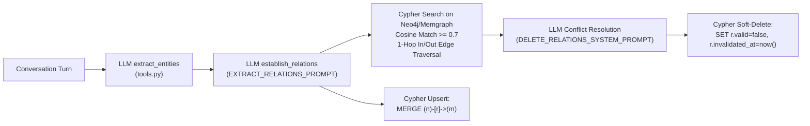
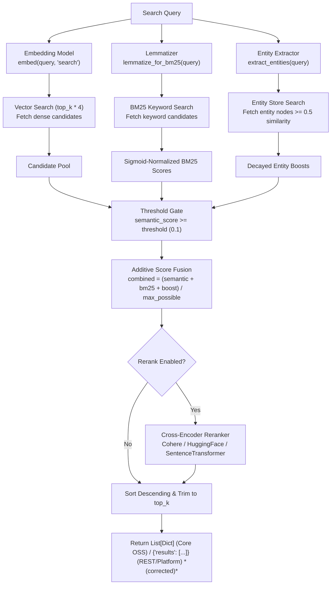
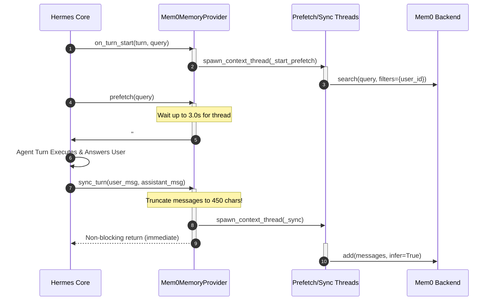

# Research Deep-Dive: Mem0 (mem0ai/mem0) Architecture, Pipelines, and Lessons for Engram

> **Verification status:** PASS-WITH-FIXES — corrected on 2026-10-24 per [V03 report](verification/V03-mem0.md). Corrections are marked with *(corrected)*.

**Target Project:** Engram (Long-Term Memory System for AI Agents, Rust + SurrealDB)  
**Reference Repo:** `mem0ai/mem0` (local clone at `mem0ai/mem0`)  
**Analyzed Releases:** v1.0.11 (pre-overhaul reference with Mem0g graph memory) and v2.2.1 (current October 2026 release with V3 additive extraction)  
**Authoritative Reference:** arXiv:2504.19413 (*Mem0: Building Production-Ready AI Agents with Scalable Long-Term Memory*)  
**Integration Reference:** `~/.hermes/hermes-agent/plugin-catalog/mem0.yaml` & `integrations/hermes-plugin-mem0/`  

---

## 1. Conceptual Model

### 1.1 Tenant Scoping: `user_id`, `agent_id`, `run_id`, `app_id`
Mem0 isolates memory using a multi-tier scoping hierarchy. In the core SDK ([`mem0/memory/main.py:135-141`](https://github.com/mem0ai/mem0/blob/2c81af3bbe27d9bccb09c772d583df9e9be72ee5/mem0/memory/main.py#L135-L141)), tenant scopes are governed by three primary entity parameters:
```python
ENTITY_PARAMS = frozenset({"user_id", "agent_id", "run_id"})
_IDENTITY_KEYS = ENTITY_PARAMS | {"actor_id"}
```
- **`user_id`**: Identifies human end-users across sessions. Queries scoped to `user_id` retrieve memories across all agents and runs under that user principal.
- **`agent_id`**: Identifies autonomous personas or sub-agents (e.g., `"hermes"`, `"coding-assistant"`).
- **`run_id`**: Represents a specific conversation thread, workflow execution, or session run.
- **`actor_id`**: Identifies specific speakers in multi-party or group chats ([`mem0/memory/main.py:899-902`](https://github.com/mem0ai/mem0/blob/2c81af3bbe27d9bccb09c772d583df9e9be72ee5/mem0/memory/main.py#L899-L902)).
- **`app_id`**: Supported in the hosted platform API and client ([`mem0/client/main.py:41`](https://github.com/mem0ai/mem0/blob/2c81af3bbe27d9bccb09c772d583df9e9be72ee5/mem0/client/main.py#L41) *(corrected)*) for multi-application workspace isolation.

To prevent privilege escalation or scope pollution, Mem0 enforces strict scoping boundaries via `_strip_identity_keys()` ([`mem0/memory/main.py:143-160`](https://github.com/mem0ai/mem0/blob/2c81af3bbe27d9bccb09c772d583df9e9be72ee5/mem0/memory/main.py#L143-L160)): caller-supplied `metadata` dictionaries cannot inject or override `user_id`, `agent_id`, `run_id`, or `actor_id`.

In `search()` and `get_all()`, Mem0 enforces that at least one of `user_id`, `agent_id`, or `run_id` must be provided in `filters`, rejecting them as top-level arguments ([`mem0/memory/main.py:800-804`, `1449-1475`](https://github.com/mem0ai/mem0/blob/2c81af3bbe27d9bccb09c772d583df9e9be72ee5/mem0/memory/main.py#L800-L804)).

### 1.2 Memory Types & Procedural Memory
The enum `MemoryType` ([`mem0/configs/enums.py:1-10`](https://github.com/mem0ai/mem0/blob/2c81af3bbe27d9bccb09c772d583df9e9be72ee5/mem0/configs/enums.py#L1-L10)) historically supported episodic/conversational facts and procedural memory:
```python
class MemoryType(Enum):
    SEMANTIC = "semantic"
    EPISODIC = "episodic"
    PROCEDURAL = "procedural_memory"
``` *(corrected)*
Procedural memory was introduced to record and preserve step-by-step action history for task-oriented agents (e.g., browser-use or code-execution agents). When `memory_type="procedural_memory"` and an `agent_id` are provided, `Memory.add()` routes messages to `_create_procedural_memory()` ([`mem0/memory/main.py:855-864`, `2007-2035`](https://github.com/mem0ai/mem0/blob/2c81af3bbe27d9bccb09c772d583df9e9be72ee5/mem0/memory/main.py#L855-L864)), which summarizes execution logs into numbered action-result pairs using `PROCEDURAL_MEMORY_SYSTEM_PROMPT` ([`mem0/configs/prompts.py:326-403`](https://github.com/mem0ai/mem0/blob/2c81af3bbe27d9bccb09c772d583df9e9be72ee5/mem0/configs/prompts.py#L326-L403)).

> [!WARNING]
> In Mem0 v2.2.1, procedural memory is deprecated and slated for deletion:
> ```python
> # mem0/memory/main.py:853-854
> # TODO: Remove procedural-memory support in a future breaking release.
> # Remove memory_type and its helpers from Memory and AsyncMemory together.
> ```
> Procedural summaries proved too heavy and poorly suited to vector similarity search, as action transcripts lack dense semantic query match.

### 1.3 `infer=True` vs `infer=False`
The `infer` boolean parameter in `add()` controls whether unstructured text is parsed by an LLM or stored verbatim:
- **`infer=True` (Default)**: Messages pass through the extraction pipeline where an LLM analyzes user and assistant turns, extracts structured factual propositions, grounds relative timestamps, and connects related existing memories ([`mem0/memory/main.py:918-1220`](https://github.com/mem0ai/mem0/blob/2c81af3bbe27d9bccb09c772d583df9e9be72ee5/mem0/memory/main.py#L918-L1220)).
- **`infer=False`**: Bypasses the LLM entirely ([`mem0/memory/main.py:882-916`](https://github.com/mem0ai/mem0/blob/2c81af3bbe27d9bccb09c772d583df9e9be72ee5/mem0/memory/main.py#L882-L916)). Each message's text is embedded and inserted as a raw memory item directly into the vector store. Used by agent tools (like `mem0_add`) when the agent has already formatted an explicit fact and wants to avoid extraction latency or hallucinations.

### 1.4 Metadata & Filter DSL
Mem0 supports rich metadata operators converted to backend-specific vector store queries ([`mem0/memory/main.py:1416-1431`, `1538-1636`](https://github.com/mem0ai/mem0/blob/2c81af3bbe27d9bccb09c772d583df9e9be72ee5/mem0/memory/main.py#L1416-L1431)):
- Exact match: `{"department": "engineering"}` or `{"department": {"eq": "engineering"}}`
- Inequality: `{"department": {"ne": "marketing"}}`
- Membership: `{"tag": {"in": ["active", "pinned"]}}`, `{"tag": {"nin": ["archived"]}}`
- Numeric comparison: `{"score": {"gt": 10}}`, `{"age": {"lte": 45}}`
- String matching: `{"summary": {"contains": "garmin"}}`, `{"title": {"icontains": "rust"}}`
- Wildcards: `{"project": "*"}`
- Boolean logic: `{"AND": [...]}`, `{"OR": [...]}`, `{"NOT": [...]}`

### 1.5 Memory Export Capabilities *(corrected)*
Mem0 implements structured asynchronous memory export capabilities in [`mem0/client/main.py:769-825`](https://github.com/mem0ai/mem0/blob/2c81af3bbe27d9bccb09c772d583df9e9be72ee5/mem0/client/main.py#L769-L825). Using `create_memory_export()` and polling via `get_memory_export()`, clients can trigger background jobs that dump scoped memory sets filtered by user, agent, or run into structured JSON schemas.

---

## 2. The `add()` Ingestion Pipeline

Mem0's extraction pipeline underwent a major architectural rewrite between v1.x and v2.x (PR #4805 in April 2026). Understanding both architectures reveals critical design lessons.

```mermaid
flowchart TD
    subgraph V1_Two_Step_Pipeline ["Mem0 v1.x Classic Pipeline (2 LLM Calls)"]
        V1_In["Conversation Turns"] --> V1_LLM1["LLM Call 1: FACT_RETRIEVAL_PROMPT\nExtracts list of atomic facts"]
        V1_LLM1 --> V1_Vec["Vector Search (top-k)\nFetch similar existing memories"]
        V1_Vec --> V1_Map["UUID-to-Integer ID Mapping\nOld: {0: 'uuid-1', 1: 'uuid-2'}"]
        V1_Map --> V1_LLM2["LLM Call 2: DEFAULT_UPDATE_MEMORY_PROMPT\nDecides ADD / UPDATE / DELETE / NONE"]
        V1_LLM2 --> V1_Exec["Vector Store Mutation + SQLite History Audit\n(Destructive overwrite / delete)"]
    end

    subgraph V2_Additive_Pipeline ["Mem0 v2.x V3 Phased Batch Pipeline (1 LLM Call)"]
        V2_In["Conversation Turns"] --> P0["Phase 0: Context Gathering\nLast 10 messages from SQLite + Scope"]
        P0 --> P1["Phase 1: Existing Memory Retrieval\nVector search top-10 with query embedding"]
        P1 --> P2["Phase 2: Single LLM Call\nADDITIVE_EXTRACTION_PROMPT\nExtracts context-rich facts & linked_memory_ids"]
        P2 --> P3["Phase 3: Batch Embeddings\nEmbed all extracted facts in one batch"]
        P3 --> P4["Phase 4 & 5: MD5 Hash Dedup & spaCy Lemmatization\nFilter duplicates against store & current batch"]
        P4 --> P6["Phase 6: Batch Vector Store Persist\nInsert vectors + payloads"]
        P6 --> P7["Phase 7: Batch Entity Linking\nspaCy NER -> Embed -> Search {col}_entities -> Link"]
        P7 --> P8["Phase 8: SQLite Message Window Commit\nRolling 10-message session buffer"]
    end
```



### 2.1 Classic v1 Pipeline: The Two-LLM-Call Loop

In v1.x ([`mem0/memory/main.py`](https://github.com/mem0ai/mem0/blob/2c81af3bbe27d9bccb09c772d583df9e9be72ee5/mem0/memory/main.py) pre-v2.0.0), each `add()` operation required two sequential LLM calls:

#### LLM Call 1: Fact Extraction
The incoming turn was processed using `FACT_RETRIEVAL_PROMPT` ([`mem0/configs/prompts.py:15-60`](https://github.com/mem0ai/mem0/blob/2c81af3bbe27d9bccb09c772d583df9e9be72ee5/mem0/configs/prompts.py#L15-L60)) or `USER_MEMORY_EXTRACTION_PROMPT` ([`mem0/configs/prompts.py:63-121`](https://github.com/mem0ai/mem0/blob/2c81af3bbe27d9bccb09c772d583df9e9be72ee5/mem0/configs/prompts.py#L63-L121)):
```text
You are a Personal Information Organizer, specialized in accurately storing facts,
user memories, and preferences. Your primary role is to extract relevant pieces of
information from conversations and organize them into distinct, manageable facts.

# [IMPORTANT]: GENERATE FACTS SOLELY BASED ON THE USER'S MESSAGES.
# [IMPORTANT]: YOU WILL BE PENALIZED IF YOU INCLUDE INFORMATION FROM ASSISTANT OR SYSTEM MESSAGES.

Return the facts and preferences in a JSON format:
{"facts": ["Looking for a restaurant in San Francisco", "Likes vegetarian food"]}
```

#### Intermediate Search & UUID Anti-Hallucination Mapping
For each extracted fact, Mem0 queried the vector store for the top $k$ (typically 5–10) nearest existing memories. To prevent the LLM from hallucinating or corrupting 36-character UUIDs in the decision step, Mem0 re-indexed existing memories with sequential integers:
```python
# mem0/memory/main.py:938-941
uuid_mapping = {}
existing_memories = []
for idx, mem in enumerate(existing_results):
    uuid_mapping[str(idx)] = mem.id
    existing_memories.append({"id": str(idx), "text": mem.payload.get("data", "")})
```

#### LLM Call 2: Reconciliation & Update Decision
The integer-mapped existing memories and newly extracted candidate facts were fed into `DEFAULT_UPDATE_MEMORY_PROMPT` ([`mem0/configs/prompts.py:176-324`](https://github.com/mem0ai/mem0/blob/2c81af3bbe27d9bccb09c772d583df9e9be72ee5/mem0/configs/prompts.py#L176-L324)):
```text
You are a smart memory manager which controls the memory of a system.
You can perform four operations: (1) add, (2) update, (3) delete, and (4) no change.

Compare newly retrieved facts with the existing memory:
- ADD: Add it to memory as a new element
- UPDATE: Update an existing memory element (keep the same ID, specify old_memory)
- DELETE: Delete an existing memory element if contradictory or instructed
- NONE: Make no change if already present or irrelevant

Output schema:
{
    "memory": [
        {
            "id": "0",
            "text": "User loves cheese and chicken pizza",
            "event": "UPDATE",
            "old_memory": "I really like cheese pizza"
        },
        {
            "id": "1",
            "text": "User is a software engineer",
            "event": "NONE"
        },
        {
            "id": "2",
            "text": "User relocated to Jakarta",
            "event": "ADD"
        }
    ]
}
```
Mem0 then resolved integer IDs back to real UUIDs via `uuid_mapping[item["id"]]` and executed hard vector-store mutations (`insert`, `update`, or `delete`).

### 2.2 Modern v2 / v3 Pipeline: Single-Pass Additive Extraction

In v2.0.0 (released April 14, 2026, PR #4805; see [`docs/changelog/sdk.mdx:373-421`](https://github.com/mem0ai/mem0/blob/2c81af3bbe27d9bccb09c772d583df9e9be72ee5/docs/changelog/sdk.mdx#L373-L421)), Mem0 eliminated the second LLM call and deprecated destructive in-place updates. The new architecture, termed the **V3 Phased Batch Pipeline** ([`mem0/memory/main.py:918-1220`](https://github.com/mem0ai/mem0/blob/2c81af3bbe27d9bccb09c772d583df9e9be72ee5/mem0/memory/main.py#L918-L1220)), executes in 8 phases:

- **Phase 0 (Context Gathering):** Retrieves the rolling 10-message conversational history from SQLite (`self.db.get_last_messages(session_scope, limit=10)`).
- **Phase 1 (Existing Memory Retrieval):** Generates a query embedding from the turn text and fetches the top 10 relevant existing memories from the vector store.
- **Phase 2 (Single-Pass LLM Extraction):** Calls the LLM once with `ADDITIVE_EXTRACTION_PROMPT` ([`mem0/configs/prompts.py:468-944`](https://github.com/mem0ai/mem0/blob/2c81af3bbe27d9bccb09c772d583df9e9be72ee5/mem0/configs/prompts.py#L468-L944)). The LLM performs **ADD** operations and is prompted to output `linked_memory_ids`. *(Note on dead code: In the OSS v2.x codebase, Phase 6 vector insertion in `main.py:1017-1041` completely ignores and discards `linked_memory_ids`, and `uuid_mapping` at `main.py:937-941` is leftover dead code never read back; cross-memory links exist only in the auxiliary `{collection}_entities` collection constructed by spaCy *(corrected)*.)*
- **Phase 3 (Batch Embedding):** Executes `self.embedding_model.embed_batch(mem_texts, "add")` in a single vector API call.
- **Phase 4 & 5 (CPU Lemmatization & MD5 Dedup):** Computes MD5 text hashes. Skips insertion if the hash already exists in the search pool or in the current batch. Runs spaCy lemmatization (`lemmatize_for_bm25`) for BM25 keyword indexing.
- **Phase 6 (Batch Persist):** Executes `self.vector_store.insert(vectors, ids, payloads)` in one call.
- **Phase 7 (Batch Entity Linking):** Runs spaCy entity extraction on the extracted memory texts, embeds entities in batch, queries the auxiliary `{collection}_entities` vector store, and updates entity records (`semantic_match >= 0.95`) or inserts new entity nodes.
- **Phase 8 (Audit & Context Store):** Persists added memories into the SQLite `history` table and writes the turn into the SQLite `messages` table.

#### Verbatim Key Instructions from `ADDITIVE_EXTRACTION_PROMPT`
> *"You are a Memory Extractor — a precise, evidence-bound processor responsible for extracting rich, contextual memories from conversations. Your sole operation is ADD: identify every piece of memorable information and produce self-contained, contextually rich factual statements."*
>
> *"Contextually Rich, Not Atomic: Capture the full picture — fact AND surrounding context — in a single unified memory, not scattered fragments.*  
> *Bad: 'User prefers oat milk lattes'*  
> *Good: 'User switched from almond milk to oat milk lattes after developing an almond sensitivity'"*
>
> *"Temporally Grounded: Resolve ALL relative references against Observation Date:*  
> *- 'yesterday' -> day before Observation Date*  
> *- 'last week' -> week preceding Observation Date*  
> *CRITICAL: 'User went to Paris last week' is useless 6 months later. 'User went to Paris the week of May 15, 2023' is meaningful forever."*

#### Output JSON Schema ([`mem0/configs/prompts.py:924-938`](https://github.com/mem0ai/mem0/blob/2c81af3bbe27d9bccb09c772d583df9e9be72ee5/mem0/configs/prompts.py#L924-L938))
```json
{
  "memory": [
    {
      "id": "0",
      "text": "User switched from almond milk to oat milk lattes after developing an almond sensitivity on 2026-03-12",
      "attributed_to": "user",
      "linked_memory_ids": ["a1b2c3d4-5678-9abc-def0-111111111111"]
    }
  ]
}
```

### 2.3 Async Pipeline (`AsyncMemory`)
`AsyncMemory` ([`mem0/memory/main.py:2455-2880`](https://github.com/mem0ai/mem0/blob/2c81af3bbe27d9bccb09c772d583df9e9be72ee5/mem0/memory/main.py#L2455-L2880)) mirrors the 8-phase pipeline asynchronously. CPU-intensive operations (`lemmatize_for_bm25`, MD5 hashing) and blocking SQLite writes run inside `asyncio.to_thread()`, while async LLM calls and vector queries use native coroutines.

---

## 3. History and Audit Logging

Mem0 maintains an out-of-band audit trail in a local SQLite database (`history_db_path`, default `~/.mem0/history.db`), managed by `SQLiteManager` ([`mem0/memory/storage.py:11-348`](https://github.com/mem0ai/mem0/blob/2c81af3bbe27d9bccb09c772d583df9e9be72ee5/mem0/memory/storage.py#L11-L348)).

### 3.1 SQLite Table Schemas

```sql
-- mem0/memory/storage.py:68-80, 108-121
CREATE TABLE IF NOT EXISTS history (
    id           TEXT PRIMARY KEY,
    memory_id    TEXT,
    old_memory   TEXT,
    new_memory   TEXT,
    event        TEXT,        -- 'ADD', 'UPDATE', 'DELETE', 'RESET'
    created_at   DATETIME,
    updated_at   DATETIME,
    is_deleted   INTEGER,     -- 0 or 1
    actor_id     TEXT,
    role         TEXT
);

-- mem0/memory/storage.py:134-142 (rolling context buffer)
CREATE TABLE IF NOT EXISTS messages (
    id            TEXT PRIMARY KEY,
    session_scope TEXT,
    role          TEXT,
    content       TEXT,
    name          TEXT,
    created_at    DATETIME
);
```

### 3.2 Rolling Context Eviction
`save_messages()` enforces a strict sliding window of 10 messages per `session_scope` using an embedded subquery to force SQLite evaluation ordering ([`mem0/memory/storage.py:279-291`](https://github.com/mem0ai/mem0/blob/2c81af3bbe27d9bccb09c772d583df9e9be72ee5/mem0/memory/storage.py#L279-L291)):
```sql
DELETE FROM messages WHERE session_scope = ? AND id NOT IN (
    SELECT id FROM (
        SELECT id FROM messages WHERE session_scope = ? ORDER BY created_at DESC LIMIT 10
    )
);
```

### 3.3 What-Changed Audit Queries
Calling `Memory.history(memory_id)` ([`mem0/memory/main.py:2280-2305`](https://github.com/mem0ai/mem0/blob/2c81af3bbe27d9bccb09c772d583df9e9be72ee5/mem0/memory/main.py#L2280-L2305)) executes:
```sql
-- mem0/memory/storage.py:229-238
SELECT id, memory_id, old_memory, new_memory, event,
       created_at, updated_at, is_deleted, actor_id, role
FROM history
WHERE memory_id = ?
ORDER BY created_at ASC, DATETIME(updated_at) ASC;
```
This enables retrieving the complete lifecycle diff of a single memory ID:
1. `event: "ADD"`, `old_memory: None`, `new_memory: "User works at Google"`
2. `event: "UPDATE"`, `old_memory: "User works at Google"`, `new_memory: "User works at Anthropic"`
3. `event: "DELETE"`, `is_deleted: 1`

### 3.4 Architecture Assessment for Engram
Mem0's history system suffers from severe structural flaws:
1. **No Distributed Consistency:** If Mem0 runs against a remote Qdrant or PGVector cluster across multiple worker nodes, each worker writes to its own local `history.db` file. Audit logs become fragmented and inconsistent.
2. **No ACID Guarantee:** Writes to the vector store and writes to SQLite happen sequentially without two-phase commit. If the vector store succeeds but SQLite fails, the memory is persisted without audit history.
3. **Audit Isolated from Retrieval:** The vector store only indexes the current text. Search queries cannot query historical states or filter by transaction time.

---

## 4. Graph Memory (Mem0g)

In academic literature (arXiv:2504.19413) and v1.x releases (`v1.0.11`), Mem0 offered a graph-augmented architecture called **Mem0g**, backed by external graph engines (Neo4j, Memgraph, Kùzu, Apache AGE, and Amazon Neptune).



### 4.1 Extraction Tools & Prompts
Mem0g utilized a two-step LLM extraction mechanism using OpenAI function calling:
1. **Entity Extraction** (`EXTRACT_ENTITIES_STRUCT_TOOL` in `v1.0.11:mem0/graphs/tools.py:281-308` *(corrected)*):
   The LLM identified entities and classifications (Person, City, Organization).
2. **Relation Extraction** (`RELATIONS_STRUCT_TOOL` in `v1.0.11:mem0/graphs/tools.py:238-278` *(corrected)* and `EXTRACT_RELATIONS_PROMPT` in [`mem0/graphs/utils.py:38-60`](https://github.com/mem0ai/mem0/blob/2c81af3bbe27d9bccb09c772d583df9e9be72ee5/mem0/graphs/utils.py#L38-L60)):
   ```text
   Extract only explicitly stated information from the text.
   Establish relationships among the entities provided.
   Use "USER_ID" as the source entity for self-references ("I", "me", "my").
   Relationships: Prefer timeless types (e.g., "professor" over "became_professor").
   Output: entities = [{"source": "...", "relationship": "...", "destination": "..."}]
   ```

### 4.2 Conflict Detection & Deletion Prompt
When new relational triplets arrived, Mem0g queried the graph for existing edges connected to those entities. If potential conflicts were found, it invoked `delete_graph_memory` guided by `DELETE_RELATIONS_SYSTEM_PROMPT` ([`mem0/graphs/utils.py:62-118`](https://github.com/mem0ai/mem0/blob/2c81af3bbe27d9bccb09c772d583df9e9be72ee5/mem0/graphs/utils.py#L62-L118)):
```text
You are a graph memory manager specializing in identifying, managing, and optimizing
relationships within graph-based memories. Your primary task is to analyze existing
relationships and determine which ones should be deleted based on new information.

Deletion Criteria:
1. Outdated or Inaccurate: The new information is more recent or accurate.
2. Contradictory: The new information conflicts with or negates existing information.
3. DO NOT DELETE if there is a possibility of same type of relationship with different
   destination nodes (e.g. Alice loves pizza AND Alice loves burgers).
```

### 4.3 Node Matching Thresholds & Soft Deletion
- **Node Matching:** Nodes stored dense vector embeddings of their names. In `_search_graph_db` ([`mem0/memory/graph_memory.py:301-304`](https://github.com/mem0ai/mem0/blob/2c81af3bbe27d9bccb09c772d583df9e9be72ee5/mem0/memory/graph_memory.py#L301-L304)), semantic matching was gated by a hard threshold (default `0.7`):
  ```cypher
  MATCH (n {user_id: $user_id})
  WHERE n.embedding IS NOT NULL
  WITH n, round(2 * vector.similarity.cosine(n.embedding, $n_embedding) - 1, 4) AS similarity
  WHERE similarity >= $threshold
  ```
- **Soft Deletion:** To avoid catastrophic graph corruption and allow temporal audit, Mem0g switched from hard `DETACH DELETE` to soft deletion ([`mem0/memory/graph_memory.py:417-430`](https://github.com/mem0ai/mem0/blob/2c81af3bbe27d9bccb09c772d583df9e9be72ee5/mem0/memory/graph_memory.py#L417-L430)):
  ```cypher
  MATCH (n {name: $source, user_id: $user_id})-[r]->(m {name: $dest, user_id: $user_id})
  WHERE r.valid IS NULL OR r.valid = true
  SET r.valid = false, r.invalidated_at = datetime()
  ```

### 4.4 How Graph Results Merged with Vectors in `search()`
In v1.x `Memory.search()` ([`v1.0.11:mem0/memory/main.py:941-956`](https://github.com/mem0ai/mem0/blob/2c81af3bbe27d9bccb09c772d583df9e9be72ee5/mem0/memory/main.py#L941-L956)), vector search and graph search ran concurrently in a thread pool. Graph search extracted entities from the query, matched nodes in the graph DB, fetched 1-hop edges, and ran BM25 (`BM25Okapi`) over candidate relationship triplets.
Crucially, **the results were never mathematically fused**; they were returned as separate top-level dictionary keys:
```python
if self.enable_graph:
    return {"results": original_memories, "relations": graph_entities}
return {"results": original_memories}
```

### 4.5 The v2.0.0 OSS Removal of External Graph Databases
In v2.0.0 (April 2026), Mem0 completely removed the external graph engine dependencies from the OSS SDK ([`docs/changelog/sdk.mdx:398`](https://github.com/mem0ai/mem0/blob/2c81af3bbe27d9bccb09c772d583df9e9be72ee5/docs/changelog/sdk.mdx#L398)):
> *"External Graph Store Removed (OSS): `mem0/memory/graph_memory.py`, `memgraph_memory.py`, `kuzu_memory.py`, `apache_age_memory.py`, and `mem0/graphs/` deleted, about 4,000 lines... Graph memory now runs natively as built-in entity linking."*

In the modern v2.x architecture:
- Entities are extracted via spaCy (`extract_entities_batch()`).
- Entities are stored in a dedicated auxiliary vector collection named `{collection}_entities`.
- At query time, entity matches provide an additive score boost (`ENTITY_BOOST_WEIGHT = 0.5`) to vector memories sharing those entities ([`mem0/utils/scoring.py:57-140`](https://github.com/mem0ai/mem0/blob/2c81af3bbe27d9bccb09c772d583df9e9be72ee5/mem0/utils/scoring.py#L57-L140)). Full graph traversal is reserved for the commercial Platform *(unverified)*.

---

## 5. `search()` and Retrieval Architecture

Mem0's search pipeline executes hybrid retrieval combining dense vectors, BM25 sparse keywords, entity linking, and optional cross-encoder reranking ([`mem0/memory/main.py:1393-1746`](https://github.com/mem0ai/mem0/blob/2c81af3bbe27d9bccb09c772d583df9e9be72ee5/mem0/memory/main.py#L1393-L1746)).



### 5.1 Hybrid Scoring Formula
Rather than Reciprocal Rank Fusion (RRF), Mem0 uses an **additive normalization model** ([`mem0/utils/scoring.py:60-140`](https://github.com/mem0ai/mem0/blob/2c81af3bbe27d9bccb09c772d583df9e9be72ee5/mem0/utils/scoring.py#L60-L140)):

$$\text{Final Score} = \min\left(1.0, \frac{\text{Semantic Score} + \text{BM25 Score} + \text{Entity Boost}}{\text{Max Possible Score}}\right)$$

Where:
- $\text{Threshold Gate}$: A candidate **must** meet `semantic_score >= threshold` (default `0.1`, formerly `0.0`). Candidates failing this are dropped even if BM25 or entity boost is high ([`mem0/utils/scoring.py:111-112`](https://github.com/mem0ai/mem0/blob/2c81af3bbe27d9bccb09c772d583df9e9be72ee5/mem0/utils/scoring.py#L111-L112)).
- $\text{Max Possible Score}$: Adapts dynamically to active search signals:
  - Dense only: $1.0$
  - Dense + BM25: $2.0$
  - Dense + Entity Boost: $1.5$
  - Dense + BM25 + Entity Boost: $2.5$

### 5.2 BM25 Sigmoid Normalization
Raw BM25 scores are normalized into $[0, 1]$ via a logistic sigmoid with parameters adapting to query length ([`mem0/utils/scoring.py:16-54`](https://github.com/mem0ai/mem0/blob/2c81af3bbe27d9bccb09c772d583df9e9be72ee5/mem0/utils/scoring.py#L16-L54)):

$$\text{BM25}_{\text{norm}} = \frac{1}{1 + e^{-s \cdot (\text{raw} - m)}}$$

| Query Terms | Midpoint ($m$) | Steepness ($s$) |
|---|---|---|
| $\le 3$ terms | 5.0 | 0.7 |
| $4 - 6$ terms | 7.0 | 0.6 |
| $7 - 9$ terms | 9.0 | 0.5 |
| $10 - 15$ terms | 10.0 | 0.5 |
| $> 15$ terms | 12.0 | 0.5 |

### 5.3 Entity Boost with Frequency Penalty
To prevent over-represented entities (e.g., the user's name) from dominating every query, Mem0 applies an entity-frequency damping factor ([`mem0/memory/main.py:1815-1823`](https://github.com/mem0ai/mem0/blob/2c81af3bbe27d9bccb09c772d583df9e9be72ee5/mem0/memory/main.py#L1815-L1823)):

$$\text{Entity Boost} = \text{Similarity} \times 0.5 \times \frac{1}{1.0 + 0.001 \times (N_{\text{linked}} - 1)^2}$$

### 5.4 Reranker Support
Mem0 supports 5 pluggable rerankers ([`mem0/reranker/`](https://github.com/mem0ai/mem0/tree/2c81af3bbe27d9bccb09c772d583df9e9be72ee5/mem0/reranker/)):
1. `cohere_reranker.py`: Cohere Rerank API (`rerank-v3.5`).
2. `huggingface_reranker.py`: TEI / Hugging Face cross-encoder endpoints.
3. `sentence_transformer_reranker.py`: Local `CrossEncoder` models (e.g., `cross-encoder/ms-marco-MiniLM-L-6-v2`).
4. `llm_reranker.py`: Uses an LLM to score relevance $[0, 10]$.
5. `zero_entropy_reranker.py`: Zero Entropy reranker API.

### 5.5 Result Shape
In the core OSS v2.x SDK ([`mem0/memory/main.py:1745`](https://github.com/mem0ai/mem0/blob/2c81af3bbe27d9bccb09c772d583df9e9be72ee5/mem0/memory/main.py#L1745)), `Memory.search()` directly returns a flat list (`List[Dict[str, Any]]`) rather than an envelope. The dictionary envelope `{"results": [...]}` was used in v1 (`v1.0.11:main.py:965`) and remains the response shape for the standalone FastAPI REST server and Platform client *(corrected)*:
```json
[
  {
    "id": "e4f8d2b0-9123-4567-89ab-cdef01234567",
      "memory": "User switched from almond milk to oat milk lattes after developing an almond sensitivity",
      "hash": "d41d8cd98f00b204e9800998ecf8427e",
      "created_at": "2026-03-12T10:15:30Z",
      "updated_at": "2026-03-12T10:15:30Z",
      "score": 0.884,
      "user_id": "alice",
      "agent_id": "hermes",
      "run_id": null,
      "actor_id": null,
      "role": "user",
      "attributed_to": "user",
      "expiration_date": null,
      "metadata": {
        "channel": "cli"
      },
      "score_details": {
        "semantic_score": 0.82,
        "bm25_score": 0.74,
        "entity_boost": 0.41,
        "raw_score": 1.97,
        "max_possible_score": 2.5,
        "final_score": 0.788,
        "threshold": 0.1
      }
  }
]
```

### 5.6 Ancillary Operations
- **`get_all(filters, top_k=20)`** ([`mem0/memory/main.py:1260-1375`](https://github.com/mem0ai/mem0/blob/2c81af3bbe27d9bccb09c772d583df9e9be72ee5/mem0/memory/main.py#L1260-L1375)): Lists memories matching identity filters, suppressing expired memories unless `show_expired=True`.
- **`delete(memory_id)`** ([`mem0/memory/main.py:1865-1900`](https://github.com/mem0ai/mem0/blob/2c81af3bbe27d9bccb09c772d583df9e9be72ee5/mem0/memory/main.py#L1865-L1900)): Deletes the vector record from the primary vector store, unlinks memory IDs in `{collection}_entities`, and appends an `event: "DELETE"`, `is_deleted: 1` entry to SQLite history.
- **`delete_all(filters)`** ([`mem0/memory/main.py:1905-1980`](https://github.com/mem0ai/mem0/blob/2c81af3bbe27d9bccb09c772d583df9e9be72ee5/mem0/memory/main.py#L1905-L1980)): Batches deletions in chunks of 1000 (`DELETE_ALL_BATCH_SIZE = 1000`).
- **`reset()`** ([`mem0/memory/main.py:2144-2172`](https://github.com/mem0ai/mem0/blob/2c81af3bbe27d9bccb09c772d583df9e9be72ee5/mem0/memory/main.py#L2144-L2172) and `AsyncMemory.reset()` at `lines 3865-3894` *(corrected)*): Drops and recreates the vector store collection, entity collection, and wipes SQLite history and messages tables.

---

## 6. Multi-Tenancy and Storage Abstraction

### 6.1 Vector Store Payload Schema
Mem0 flattens memory metadata and tenant identity into each vector point payload ([`mem0/memory/main.py:1030-1040`](https://github.com/mem0ai/mem0/blob/2c81af3bbe27d9bccb09c772d583df9e9be72ee5/mem0/memory/main.py#L1030-L1040)):
```json
{
  "data": "Memory text content",
  "text_lemmatized": "memory text content lemmatize",
  "hash": "md5-hex-string",
  "created_at": "ISO-8601 UTC timestamp",
  "updated_at": "ISO-8601 UTC timestamp",
  "user_id": "alice",
  "agent_id": "hermes",
  "run_id": "session-123",
  "actor_id": "user",
  "role": "user",
  "attributed_to": "user",
  "expiration_date": "YYYY-MM-DD",
  "custom_metadata_key": "custom_value"
}
```

### 6.2 The Minimal `VectorStoreBase` Contract
Every vector store implements `VectorStoreBase` ([`mem0/vector_stores/base.py:1-101`](https://github.com/mem0ai/mem0/blob/2c81af3bbe27d9bccb09c772d583df9e9be72ee5/mem0/vector_stores/base.py#L1-L101)):

```python
class VectorStoreBase(ABC):
    @abstractmethod
    def create_col(self, name, vector_size, distance): ...
    @abstractmethod
    def insert(self, vectors, payloads=None, ids=None): ...
    @abstractmethod
    def search(self, query, vectors, top_k=5, filters=None): ...
    @abstractmethod
    def delete(self, vector_id): ...
    @abstractmethod
    def update(self, vector_id, vector=None, payload=None): ...
    @abstractmethod
    def get(self, vector_id): ...
    @abstractmethod
    def list_cols(self): ...
    @abstractmethod
    def delete_col(self): ...
    @abstractmethod
    def col_info(self): ...
    @abstractmethod
    def list(self, filters=None, top_k=None): ...
    @abstractmethod
    def reset(self): ...

    # Optional extension methods:
    def keyword_search(self, query: str, top_k: int = 5, filters: dict = None):
        return None  # Default fallback when store lacks native BM25

    def search_batch(self, queries: list, vectors_list: list, top_k: int = 1, filters: dict = None):
        return [self.search(q, v, top_k=top_k, filters=filters) for q, v in zip(queries, vectors_list)]
```

Mem0 registers 26 vector backends (`VectorStoreFactory.provider_to_class` in `mem0/utils/factory.py:181-207` *(corrected)*; Qdrant, PGVector, Pinecone, Chroma, Weaviate, Milvus, Redis, Elasticsearch, Valkey, Turbopuffer, OpenSearch, etc.).

---

## 7. REST Server and OpenMemory MCP

### 7.1 FastAPI REST Server Endpoints
The standalone REST service in [`server/main.py:146-561`](https://github.com/mem0ai/mem0/blob/2c81af3bbe27d9bccb09c772d583df9e9be72ee5/server/main.py#L146-L561) wraps `Memory`:

| Method | Endpoint | Description | Auth Required |
|---|---|---|---|
| `POST` | `/memories` | Add memories from conversation turns | User / Admin |
| `GET` | `/memories` | Scoped list (or all memories if admin) | User / Admin |
| `GET` | `/memories/{id}` | Fetch a single memory by UUID | User / Admin |
| `PUT` | `/memories/{id}` | Update text, metadata, or expiration date | User / Admin |
| `DELETE` | `/memories/{id}` | Delete a single memory | User / Admin |
| `DELETE` | `/memories` | Bulk delete scoped by `user_id`/`agent_id`/`run_id` | Admin only |
| `POST` | `/search` | Hybrid search across memories | User / Admin |
| `GET` | `/memories/{id}/history` | Retrieve modification audit trail | User / Admin |
| `POST` | `/reset` | Wipe and recreate collections | Admin only |
| `GET` | `/configure` | Inspect current configuration (redacted) | User / Admin |
| `POST` | `/configure` | Update runtime configuration | Admin only |
| `POST` | `/generate-instructions`| Auto-generate custom instructions for use cases | User / Admin |

Authentication is handled via JWT Bearer tokens or `ADMIN_API_KEY`, toggleable for local development with `AUTH_DISABLED=true` ([`server/auth.py:20-65`](https://github.com/mem0ai/mem0/blob/2c81af3bbe27d9bccb09c772d583df9e9be72ee5/server/auth.py#L20-L65)).

### 7.2 Docker Deployment Footprint
The deployment is configured via [`server/docker-compose.yaml`](https://github.com/mem0ai/mem0/blob/2c81af3bbe27d9bccb09c772d583df9e9be72ee5/server/docker-compose.yaml):
- **`mem0`**: FastAPI server on port `8888:8000`, running Uvicorn + Alembic migrations.
- **`postgres`**: `pgvector/pgvector:pg17` on port `8432:5432` with shared memory size 128MB.
- **`mem0-dashboard`**: Next.js administrative web console on port `3000:3000`.

### 7.3 OpenMemory / MCP Tools
Mem0 provides two Model Context Protocol (MCP) implementations:

#### 1. Hosted Platform MCP (`mcp.mem0.ai`)
Documented in [`docs/platform/mem0-mcp.mdx:62-79`](https://github.com/mem0ai/mem0/blob/2c81af3bbe27d9bccb09c772d583df9e9be72ee5/docs/platform/mem0-mcp.mdx#L62-L79), exposed via HTTPS Streamable HTTP transport:
- `add_memory`: Store facts or raw turns.
- `search_memories`: Semantic and filtered retrieval.
- `get_memories`: List memories with pagination.
- `get_memory`: Fetch memory by ID.
- `update_memory`: In-place text/metadata update.
- `delete_memory`: Remove memory by ID.
- `delete_all_memories`: Wipe scoped memories.
- `delete_entities`: Delete user/agent/app entity records.
- `list_entities`: Enumerate users, agents, and apps.
- `list_events`: Audit log of memory operations.
- `get_event_status`: Check async job status.

#### 2. Local IDE / Agent MCP Stdio Plugin
Located in [`integrations/agent-plugin-core/python/mcp_server.py:22-68`](https://github.com/mem0ai/mem0/blob/2c81af3bbe27d9bccb09c772d583df9e9be72ee5/integrations/agent-plugin-core/python/mcp_server.py#L22-L68), running over JSON-RPC stdio. It exposes a focused `search_memories` tool allowing coding agents (Claude Code, Cursor, Codex) to recall repository-scoped memories:
- Parameters: `query`, `top_k`, `category`, `scope` (`"repo"`, `"dir"`, `"mine"`), `run_id`.

---

## 8. Hermes Agent Integration

The Hermes provider plugin is located at [`integrations/hermes-plugin-mem0/__init__.py`](https://github.com/mem0ai/mem0/blob/2c81af3bbe27d9bccb09c772d583df9e9be72ee5/integrations/hermes-plugin-mem0/__init__.py) and declared in [`~/.hermes/hermes-agent/plugin-catalog/mem0.yaml`](https://github.com/NousResearch/hermes-agent/blob/v0.22.4/plugin-catalog/mem0.yaml).

### 8.1 Modes of Operation
`Mem0MemoryProvider` supports three backends ([`integrations/hermes-plugin-mem0/__init__.py:174-188`](https://github.com/mem0ai/mem0/blob/2c81af3bbe27d9bccb09c772d583df9e9be72ee5/integrations/hermes-plugin-mem0/__init__.py#L174-L188)):
1. **`platform` (default)**: Calls hosted `api.mem0.ai` via `PlatformBackend` using `MEM0_API_KEY`.
2. **`self-hosted`**: Connects to the FastAPI REST server via `SelfHostedBackend` using `MEM0_HOST`.
3. **`oss`**: Directly instantiates Python `Memory` via `OSSBackend` configured in `~/.hermes/mem0.json`.

### 8.2 Lifecycle Hook Mapping



1. **`on_turn_start(turn_number, message)`** ([lines 263-265](https://github.com/mem0ai/mem0/blob/2c81af3bbe27d9bccb09c772d583df9e9be72ee5/integrations/hermes-plugin-mem0/__init__.py#L263-L265)): Initiates prefetch on a background thread (`spawn_context_thread(_run, name="mem0-prefetch")`).
2. **`prefetch(query)`** ([lines 294-304](https://github.com/mem0ai/mem0/blob/2c81af3bbe27d9bccb09c772d583df9e9be72ee5/integrations/hermes-plugin-mem0/__init__.py#L294-L304)): Checks the prefetch cache. If still running, joins the background thread for up to 3 seconds (`_PREFETCH_WAIT_SECS = 3`). Returns markdown:
   ```markdown
   ## Mem0 Memory
   - Alice prefers concise Rust code with no unwrap
   - Project billing-service uses Python 3.12
   ```
3. **`sync_turn(user_content, assistant_content)`** ([lines 305-327](https://github.com/mem0ai/mem0/blob/2c81af3bbe27d9bccb09c772d583df9e9be72ee5/integrations/hermes-plugin-mem0/__init__.py#L305-L327)): Non-blocking. Truncates user and assistant turns to `_SYNC_MSG_MAX_CHARS` (default 450 chars), enqueues extraction onto `spawn_context_thread(_sync, name="mem0-sync")`, and returns immediately.
4. **`system_prompt_block()`** ([lines 257-262](https://github.com/mem0ai/mem0/blob/2c81af3bbe27d9bccb09c772d583df9e9be72ee5/integrations/hermes-plugin-mem0/__init__.py#L257-L262)): Injects instructions directing the model to proactively invoke `mem0_search`.
5. **Tool Schemas Exposed** ([lines 109-118](https://github.com/mem0ai/mem0/blob/2c81af3bbe27d9bccb09c772d583df9e9be72ee5/integrations/hermes-plugin-mem0/__init__.py#L109-L118)):
   - `mem0_search(query, top_k, rerank)`
   - `mem0_add(content)` (executes with `infer=False` to store facts verbatim)
   - `mem0_update(memory_id, text)`
   - `mem0_delete(memory_id)`

### 8.3 Workarounds and Critical Vulnerabilities Observed in Hermes Plugin
- **Severe Message Truncation (450 Characters):**
  Lines 36-43 contain an illuminating comment:
  > *"sync_turn sends the whole turn to the backend for fact extraction. OSS embedding models often have small context windows (bge-small-zh-v1.5: 512 tokens ≈ 500 chars...)... Ollama answers HTTP 500... which _try only logs, silently dropping the turn's memory extraction. Cap each message up front... measured: 450 OK, 600 -> HTTP 500."*
  Because Mem0 embeds the full conversation text to find candidate memories, turns longer than 450 characters get chopped at sentence boundaries ([`_truncate_for_sync`](https://github.com/mem0ai/mem0/blob/2c81af3bbe27d9bccb09c772d583df9e9be72ee5/integrations/hermes-plugin-mem0/__init__.py#L53-L68)). This drops critical context from multi-turn agent deliberations.
- **Circuit Breaker:** Trips after 5 consecutive failures, muting all memory operations for 120 seconds ([`_BREAKER_THRESHOLD = 5`, `_BREAKER_COOLDOWN_SECS = 120`](https://github.com/mem0ai/mem0/blob/2c81af3bbe27d9bccb09c772d583df9e9be72ee5/integrations/hermes-plugin-mem0/__init__.py#L30)).
- **Blocking Hot-Path Wait:** `prefetch()` waits up to 3 seconds synchronously on the thread join ([line 302](https://github.com/mem0ai/mem0/blob/2c81af3bbe27d9bccb09c772d583df9e9be72ee5/integrations/hermes-plugin-mem0/__init__.py#L302)), violating Hermes's recommendation that `prefetch()` return cached data instantly.

---

## 9. Telemetry, Observability, and Provider Abstractions

### 9.1 Telemetry Implementation & Opt-Out
Mem0 embeds PostHog analytics across the entire codebase ([`mem0/memory/telemetry.py:1-242`](https://github.com/mem0ai/mem0/blob/2c81af3bbe27d9bccb09c772d583df9e9be72ee5/mem0/memory/telemetry.py#L1-L242)):
- **Default State:** **ENABLED BY DEFAULT**.
  ```python
  # mem0/memory/telemetry.py:14-16
  MEM0_TELEMETRY = os.environ.get("MEM0_TELEMETRY", "True")
  PROJECT_API_KEY = "phc_hgJkUVJFYtmaJqrvf6CYN67TIQ8yhXAkWzUn9AMU4yX"
  HOST = "https://us.i.posthog.com"
  ```
- **Opt-Out:** Requires setting `MEM0_TELEMETRY=false` (or `"0"`, `"no"`).
- **Fingerprinting:** Transmits client source, Python version, OS platform, OS kernel version, CPU architecture, machine ID, and an anonymous distinct user ID saved in `~/.mem0/user_id.txt`.
- **Sampling:** Hot-path operations (`mem0.add`, `mem0.search`, `mem0.get`) are sampled at 10% (`_DEFAULT_SAMPLE_RATE = 0.1`) via a PostHog `before_send` hook ([lines 58-74](https://github.com/mem0ai/mem0/blob/2c81af3bbe27d9bccb09c772d583df9e9be72ee5/mem0/memory/telemetry.py#L58-L74)). Lifecycle operations (`mem0.init`, `mem0.reset`, `mem0.notice_displayed`) always fire at 100%.

### 9.2 In-Terminal Upsell Nudges
Mem0 includes a dedicated module, `mem0/memory/notices.py`, that inspects query execution and prints promotional messages to `stdout`/terminal:
- **First Run Notice:** Prompts user to star GitHub or sign up for Platform.
- **Scale Threshold Notice:** Intercepts `add()` and `top_k > 20` to warn that OSS search will degrade and urges migration to Mem0 Platform.
- **Slow Query Notice:** Triggered whenever search takes longer than 2.0 seconds (`PERFORMANCE_SLOW_QUERY_THRESHOLD_SECONDS = 2.0`), advertising managed platform indexing.
- **Decay & Temporal Feature Notices:** Warns users that temporal reasoning and recency decay are platform-only features.

### 9.3 Provider Abstraction Architectures
Mem0 utilizes dynamic factory loaders ([`mem0/utils/factory.py:1-281`](https://github.com/mem0ai/mem0/blob/2c81af3bbe27d9bccb09c772d583df9e9be72ee5/mem0/utils/factory.py#L1-L281)):
- **`LlmFactory`**: Supports 18 providers (OpenAI, Anthropic, AWS Bedrock, Azure OpenAI, Gemini, Groq, Ollama, Together, DeepSeek, vLLM, LiteLLM, LM Studio, xAI, etc.).
- **`EmbedderFactory`**: Supports 14 providers (OpenAI, Azure, Gemini, Hugging Face, Ollama, FastEmbed, Together, Bedrock, Vertex AI, LM Studio, etc.).
- **`VectorStoreFactory`**: Dynamically imports and instantiates vector adapters from `mem0.vector_stores.<provider>`.

---

## 10. Published Benchmark Claims (LoCoMo) and Controversies

In arXiv:2504.19413 (*"Mem0: Building Production-Ready AI Agents with Scalable Long-Term Memory"*), the authors evaluate Mem0 and Mem0g against the **LOCOMO** dataset (10 conversations, 600 turns and 26,000 tokens on average, 200 questions per conversation; evaluating commercial proprietary systems including OpenAI Memory and Zep Platform *(unverified)*).

### 10.1 Key Published Claims

#### Accuracy (LLM-as-a-Judge Score 'J')
| Question Type | Mem0 | Mem0g (Graph) | Full-Context (GPT-4o-mini) | OpenAI Memory | Zep Platform | LangMem | A-Mem |
|---|---|---|---|---|---|---|---|
| **Single-Hop** | **67.13%** | 65.58% | 66.80% | 61.20% | 58.90% | 59.10% | 41.20% |
| **Multi-Hop** | **51.15%** | 48.72% | 49.30% | 44.10% | 46.80% | 43.20% | 25.40% |
| **Temporal** | 55.51% | **58.13%** | 52.40% | 14.80% | 54.20% | 49.10% | 38.60% |
| **Open-Domain**| 72.93% | 75.71% | 71.50% | 68.40% | **76.60%** | 69.80% | 51.20% |
| **Overall J** | 67.00% | **68.44%** | **73.20%** | 54.30% | 62.10% | 58.40% | 39.10% |

#### Latency & Token Efficiency Claims
- **Search Latency:** Mem0 achieved median p50 of **0.148s** and p95 of **0.200s** (vs Zep 0.380s, LangMem 17.99s, A-Mem 0.668s).
- **Total Turn Latency:** Mem0 achieved p95 of **1.44s** vs **17.12s** for full-context processing (a **91.6% reduction**).
- **Token Consumption:** Stored memory required ~**7k tokens** per conversation for Mem0, ~**14k tokens** for Mem0g, vs **26k tokens** for raw transcript, and **>600k tokens** for Zep (due to abstractive summaries duplicated across graph nodes).

### 10.2 Methodological Controversies

1. **Full-Context Won on Raw Accuracy:** Despite claims of superiority, Table 2 in the paper shows that the Full-Context model (passing the entire 26k-token conversation) scored higher overall ($J = 73.20\%$) than both Mem0 ($67.00\%$) and Mem0g ($68.44\%$). Mem0's true benefit is latency and token cost reduction, not higher recall quality.
2. **Exclusion of Adversarial Questions:** The LOCOMO dataset includes adversarial questions designed to test whether agents hallucinate answers to unanswerable queries. Mem0 authors explicitly excluded all adversarial questions (Section 3.1), artificially inflating accuracy and masking hallucination rates.
3. **OpenAI Baseline Manipulation:** The OpenAI memory baseline was tested by manually pasting the full conversation into ChatGPT and querying memories from the playground, giving OpenAI privileged context while generating memories that lacked timestamps.
4. **Graph Memory Failed on Multi-Hop Queries:** The benchmark revealed a critical finding: **Mem0g scored lower on multi-hop questions (48.72%) than base Mem0 (51.15%)**. The authors admitted that navigating multi-step relational graphs introduced structural noise and false hops compared to natural language text search. This empirical failure directly led to the abandonment of external graph databases in v2.0.0.
5. **The Zep Conflict:** The paper harshly criticized Zep for requiring "several hours" of background processing before memories became searchable. Zep's team countered that Mem0 achieves instant availability only by discarding bi-temporal intervals, generating non-ACID duplicate facts, and lacking formal contradiction resolution.

---

## 11. Weaknesses Observed in Mem0

1. **Destructive Overwrites & Data Loss (v1.x):** Letting the LLM assign `DELETE` operations based on cosine similarity caused catastrophic forgetting. Stating *"I dislike pizza today"* permanently wiped earlier memories of dietary history.
2. **Uncontrolled Accumulation Without Invalidation (v2.x):** Mem0's fix in v2 was moving to ADD-only extraction. However, without invalidation or temporal validity intervals, conflicting facts simply pile up with `linked_memory_ids`. The reader LLM must resolve whether *"User lives in London"* or *"User moved to Jakarta"* is the current reality.
3. **No Bi-Temporal Reality:** Mem0 only stores transaction timestamps (`created_at`, `updated_at`). It has no notion of valid time ($t_v$) versus system time ($t_s$). When a user says *"In 2024 I lived in Berlin"*, Mem0 timestamps it as 2026.
4. **Poly-Store Consistency Drift:** Vector store records, entity links (`{collection}_entities`), and SQLite history (`history.db`) are written across three disjoint stores with zero ACID transactional safety. A crash leaves orphaned entity nodes and broken history links.
5. **Brittle Chunk Truncation:** In agent integrations, turns are truncated to 450 characters to accommodate weak embedding models, severing rich agent transcripts.
6. **Double-LLM Latency Tax (v1):** Requiring two sequential LLM inferences on every turn introduced prohibitive latency and cost on interactive chat turns.
7. **Invasive Telemetry and Paywall Nudges:** Mandatory-by-default PostHog tracking, device fingerprinting, and CLI stdout advertisements undermine enterprise and private agent deployments.

---

## 12. Patterns for Engram: Architectural Comparison & Adaptation

| Pattern | How Mem0 Does It (Source Citation) | Verdict for Engram | Concrete Adaptation for Rust + SurrealDB |
|---|---|---|---|
| **Fact Extraction Prompt** | Contextual, unified factual statements with temporal grounding against Observation Date ([`mem0/configs/prompts.py:605-640`](https://github.com/mem0ai/mem0/blob/2c81af3bbe27d9bccb09c772d583df9e9be72ee5/mem0/configs/prompts.py#L605-L640)). | **ADOPT** | Port Mem0's rules for *transitions/changes* (*"User switched from X to Y"*), relative-to-absolute date resolution, and proper noun preservation into Engram's Rust extraction prompt templates. |
| **UUID Anti-Hallucination Mapping** | Maps candidate UUIDs to sequential integer strings (`"0"`, `"1"`) before prompting LLM (in OSS v2, `uuid_mapping` was leftover dead code and `linked_memory_ids` was discarded during vector persistence, `main.py:1017-1041` *(corrected)*). | **ADOPT** | When presenting existing candidates to an LLM in Rust, assign short index handles (`E1..En`) and maintain an internal mapping back to SurrealDB Record IDs (`entity:ulid` / `fact:ulid`) *(superseded by 00-decisions.md ADR-07 and §1 row 20)*. |
| **Single-Pass Additive Ingestion** | Single LLM call extracts facts and connects existing IDs via `linked_memory_ids` ([`mem0/configs/prompts.py:468-477`, `924-938`](https://github.com/mem0ai/mem0/blob/2c81af3bbe27d9bccb09c772d583df9e9be72ee5/mem0/configs/prompts.py#L468-L477)). | **ADAPT** | Keep single-pass extraction, but instead of loose UUID strings, extract structured subject-predicate-object triples + temporal validity. Persist as bi-temporal graph edges in SurrealDB *(superseded by 00-decisions.md ADR-07, ADR-08, ADR-09)*. |
| **Truth Maintenance & Contradiction** | v1: LLM decides hard `DELETE`/`UPDATE` ([`prompts.py:181-222`](https://github.com/mem0ai/mem0/blob/2c81af3bbe27d9bccb09c772d583df9e9be72ee5/mem0/configs/prompts.py#L181-L222)). v2: ADD-only accumulation with no deletion ([`prompts.py:468`](https://github.com/mem0ai/mem0/blob/2c81af3bbe27d9bccb09c772d583df9e9be72ee5/mem0/configs/prompts.py#L468)). | **REJECT BOTH / ADAPT ENGRAM MODEL** | Never hard-delete or silently overwrite. In SurrealDB, close outdated edges by setting `valid_to = time::now()`. For contested claims, link via `contradiction_of` edge and mark `contested = true`. Both remain retrievable with valid intervals. |
| **Graph Modeling** | v1: External Neo4j/Memgraph with Cypher queries ([`mem0/memory/graph_memory.py:1-460`](https://github.com/mem0ai/mem0/blob/2c81af3bbe27d9bccb09c772d583df9e9be72ee5/mem0/memory/graph_memory.py#L1-L460)). v2: Dropped external DBs for flat vector entity store `{col}_entities` ([`main.py:1100-1205`](https://github.com/mem0ai/mem0/blob/2c81af3bbe27d9bccb09c772d583df9e9be72ee5/mem0/memory/main.py#L1100-L1205)). | **REJECT MEM0's REMOVAL / ADAPT SINGLE-ENGINE GRAPH** | Do not deploy separate graph daemons (Neo4j) and do not abandon the graph for flat vectors. SurrealDB natively integrates graph relations (`RELATE entity:a->fact->entity:b`) with vectors and document fields in one storage engine *(superseded by 00-decisions.md §1 row 20)*. |
| **Score Fusion** | Additive weighted combination gated by hard semantic threshold ([`mem0/utils/scoring.py:60-140`](https://github.com/mem0ai/mem0/blob/2c81af3bbe27d9bccb09c772d583df9e9be72ee5/mem0/utils/scoring.py#L60-L140)). | **ADAPT (Use RRF)** | Mem0's additive divisor ($1.0 / 2.0 / 2.5$) requires delicate manual tuning. Engram should use **Reciprocal Rank Fusion (RRF)**: $RRF(d) = \sum_{m} \frac{1}{k + r_m(d)}$ across Dense Vector, BM25, Graph 1-hop, and Recency. Robust across score scales with zero parameter drift. |
| **Entity Boost Frequency Damping** | Quadratic penalty on high-degree entity nodes: $1 / (1 + 0.001 \cdot (N-1)^2)$ ([`mem0/memory/main.py:1816`](https://github.com/mem0ai/mem0/blob/2c81af3bbe27d9bccb09c772d583df9e9be72ee5/mem0/memory/main.py#L1816)). | **ADAPT** | Adopt graph-degree damping in SurrealQL traversal: when expanding 1-hop edges from an entity, damp edges connected to hub entities with in-degree $> 50$ (e.g., self-references or generic concepts) to prevent graph fan-out noise. |
| **Storage Architecture** | Poly-store: Vector Store (Qdrant/Pinecone) + SQLite file (`history.db`) + Entity Vector Collection ([`main.py:1048-1100`](https://github.com/mem0ai/mem0/blob/2c81af3bbe27d9bccb09c772d583df9e9be72ee5/mem0/memory/main.py#L1048-L1100)). | **REJECT** | Unified single-engine ACID transaction in SurrealDB: `BEGIN TRANSACTION; CREATE episode ...; UPSERT entity ...; RELATE ...->fact->...; COMMIT TRANSACTION;`. Zero drift, one process, single embedded or networked engine *(superseded by 00-decisions.md §1 row 20)*. |
| **Turn Message Truncation** | Forcibly truncates turns to 450 characters at sentence ends ([`hermes-plugin-mem0/__init__.py:43-68`](https://github.com/mem0ai/mem0/blob/2c81af3bbe27d9bccb09c772d583df9e9be72ee5/integrations/hermes-plugin-mem0/__init__.py#L43-L68)). | **REJECT** | Support modern high-context embedding models natively in Rust (e.g., `nomic-embed-text` with 8192 tokens or `qwen3-embedding` with 32k tokens). Chunk oversized turns intelligently without crude character chopping. |
| **Prefetch Hot-Path Concurrency** | Starts prefetch in `on_turn_start`, blocks `prefetch()` for up to 3 seconds waiting for thread join ([`hermes-plugin-mem0/__init__.py:287-304`](https://github.com/mem0ai/mem0/blob/2c81af3bbe27d9bccb09c772d583df9e9be72ee5/integrations/hermes-plugin-mem0/__init__.py#L287-L304)). | **ADAPT** | Follow live recall prefetch under a tight deadline (~1500 ms) falling back to `queue_prefetch()` cache *(superseded by 00-decisions.md ADR-13 and §1 row 17: cache-only prefetch replaced by live prefetch)*. |
| **Telemetry & Promotion** | Mandatory-by-default PostHog tracking, hardware fingerprinting, terminal upsell notices ([`mem0/memory/telemetry.py:14-118`](https://github.com/mem0ai/mem0/blob/2c81af3bbe27d9bccb09c772d583df9e9be72ee5/mem0/memory/telemetry.py#L14-L118), [`notices.py`](https://github.com/mem0ai/mem0/blob/2c81af3bbe27d9bccb09c772d583df9e9be72ee5/mem0/memory/notices.py)). | **REJECT** | Zero phone-home telemetry, zero advertisements, zero promotional nudges. Engram is clean, sovereign, production infrastructure. |

---

## Summary of Exact Repo Citations
- **Scoping & Filters:** [`mem0/memory/main.py:135-160`, `800-830`, `1416-1490`](https://github.com/mem0ai/mem0/blob/2c81af3bbe27d9bccb09c772d583df9e9be72ee5/mem0/memory/main.py#L135-L160)
- **v1 Fact Extraction Prompts:** [`mem0/configs/prompts.py:15-121`](https://github.com/mem0ai/mem0/blob/2c81af3bbe27d9bccb09c772d583df9e9be72ee5/mem0/configs/prompts.py#L15-L121)
- **v1 Decision Prompt & Schemas:** [`mem0/configs/prompts.py:176-324`, `406-460`](https://github.com/mem0ai/mem0/blob/2c81af3bbe27d9bccb09c772d583df9e9be72ee5/mem0/configs/prompts.py#L176-L324)
- **v2 Additive Extraction Prompt:** [`mem0/configs/prompts.py:468-944`, `1016-1062`](https://github.com/mem0ai/mem0/blob/2c81af3bbe27d9bccb09c772d583df9e9be72ee5/mem0/configs/prompts.py#L468-L944)
- **v2 8-Phase Batch Ingestion:** [`mem0/memory/main.py:918-1220`](https://github.com/mem0ai/mem0/blob/2c81af3bbe27d9bccb09c772d583df9e9be72ee5/mem0/memory/main.py#L918-L1220)
- **Procedural Memory Prompt & Logic:** [`mem0/configs/prompts.py:326-403`](https://github.com/mem0ai/mem0/blob/2c81af3bbe27d9bccb09c772d583df9e9be72ee5/mem0/configs/prompts.py#L326-L403), [`mem0/memory/main.py:2007-2035`](https://github.com/mem0ai/mem0/blob/2c81af3bbe27d9bccb09c772d583df9e9be72ee5/mem0/memory/main.py#L2007-L2035)
- **SQLite History & Messages Schemas:** [`mem0/memory/storage.py:68-142`, `227-295`](https://github.com/mem0ai/mem0/blob/2c81af3bbe27d9bccb09c772d583df9e9be72ee5/mem0/memory/storage.py#L68-L142)
- **Mem0g Graph Prompts & Cypher Queries:** [`v1.0.11:mem0/graphs/utils.py:1-125`](https://github.com/mem0ai/mem0/blob/2c81af3bbe27d9bccb09c772d583df9e9be72ee5/mem0/graphs/utils.py), [`v1.0.11:mem0/graphs/tools.py:1-267`](https://github.com/mem0ai/mem0/blob/2c81af3bbe27d9bccb09c772d583df9e9be72ee5/mem0/graphs/tools.py), [`v1.0.11:mem0/memory/graph_memory.py:1-460`](https://github.com/mem0ai/mem0/blob/2c81af3bbe27d9bccb09c772d583df9e9be72ee5/mem0/memory/graph_memory.py)
- **Search Scoring & Sigmoid BM25:** [`mem0/utils/scoring.py:1-140`](https://github.com/mem0ai/mem0/blob/2c81af3bbe27d9bccb09c772d583df9e9be72ee5/mem0/utils/scoring.py#L1-L140), [`mem0/memory/main.py:1642-1827`](https://github.com/mem0ai/mem0/blob/2c81af3bbe27d9bccb09c772d583df9e9be72ee5/mem0/memory/main.py#L1642-L1827)
- **VectorStoreBase Interface:** [`mem0/vector_stores/base.py:1-101`](https://github.com/mem0ai/mem0/blob/2c81af3bbe27d9bccb09c772d583df9e9be72ee5/mem0/vector_stores/base.py#L1-L101)
- **REST Server & Docker Compose:** [`server/main.py:1-561`](https://github.com/mem0ai/mem0/blob/2c81af3bbe27d9bccb09c772d583df9e9be72ee5/server/main.py#L1-L561), [`server/docker-compose.yaml:1-77`](https://github.com/mem0ai/mem0/blob/2c81af3bbe27d9bccb09c772d583df9e9be72ee5/server/docker-compose.yaml#L1-L77)
- **Hermes Provider Plugin:** [`integrations/hermes-plugin-mem0/__init__.py:1-505`](https://github.com/mem0ai/mem0/blob/2c81af3bbe27d9bccb09c772d583df9e9be72ee5/integrations/hermes-plugin-mem0/__init__.py#L1-L505), [`~/.hermes/hermes-agent/plugin-catalog/mem0.yaml`](https://github.com/NousResearch/hermes-agent/blob/v0.22.4/plugin-catalog/mem0.yaml)
- **Telemetry & Fingerprinting:** [`mem0/memory/telemetry.py:1-242`](https://github.com/mem0ai/mem0/blob/2c81af3bbe27d9bccb09c772d583df9e9be72ee5/mem0/memory/telemetry.py#L1-L242), [`mem0/memory/notices.py`](https://github.com/mem0ai/mem0/blob/2c81af3bbe27d9bccb09c772d583df9e9be72ee5/mem0/memory/notices.py)
