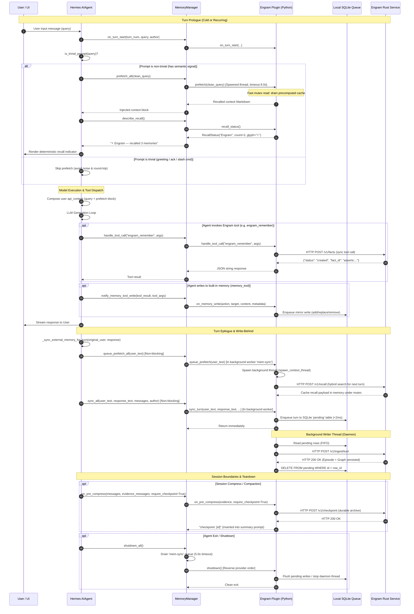

# Hermes MemoryProvider Plugin Integration Research (R4)

> **Verification status:** PASS-WITH-FIXES — corrected on 2026-10-24 per [V04 report](verification/V04-hermes-integration.md). Corrections are marked with *(corrected)*.

**Status:** Authoritative Architectural Research & Contract Specification  
**Target File:** `docs/research/04-hermes-integration.md`  
**Reference Target:** Hermes Agent v0.22.4 (`~/.hermes/hermes-agent`)  
**Host Environment:** Linux (Kernel 7.x), Python 3.14.7 runtime with Hermes bootstrap, NVMe 12 Gbps storage  
**Project:** Engram — Unified Multi-Model Agentic Long-Term Memory (Rust service + SurrealDB)  

---

## 1. Executive Summary & Architectural Context

Engram provides a durable, entity-structured, temporally-aware long-term memory engine for AI agents. Rather than running a heavyweight poly-store coordinator inside Python, Engram is implemented as a lean, production-grade **Rust daemon** backed by **SurrealDB** (handling dense vectors, BM25 full-text search, bi-temporal graph edges, observation consolidation, and entity resolution in single ACID transactions).

The primary consumer of Engram is the **Hermes agent**. Under Hermes, long-term memory plugins integrate not through ad-hoc MCP tool calling, but through the native **`MemoryProvider`** interface ([`agent/memory_provider.py`](https://github.com/NousResearch/hermes-agent/blob/v0.22.4/agent/memory_provider.py)). This grants Engram automatic lifecycle integration:
1. **Prologue injection:** Before each LLM generation, Hermes invokes `prefetch()` to inject relevant context directly into the model's user message (`api_content`), eliminating the "ignorance paradox" where an agent fails to search memory because it does not know what it has forgotten.
2. **Epilogue persistence:** At turn completion, Hermes invokes `sync_turn()` on a serialized background worker, persisting the conversation without adding latency to the user's interactive response.
3. **Curated memory synchronization:** Edits to Hermes's built-in `MEMORY.md` and `USER.md` trigger `on_memory_write()`, enabling bidirectional coherence between curated scratchpads and the knowledge graph.
4. **Pre-compression checkpointing:** When context window pressure forces conversation compaction, `on_pre_compress()` archives the verbatim transcript before lossy summarization.

Because the Rust service owns all heavy computation and database transactions, the Hermes plugin operates as a **thin HTTP client**. To guarantee that Engram never destabilizes Hermes or slows down conversations, the plugin adheres to five core design principles:
- **Low-latency live prefetch with cache fallback (`prefetch`):** `prefetch()` performs a live recall against the Engram service for the current query under a tight deadline (~1500 ms), falling back to the `queue_prefetch()` cache or empty string *(corrected)* *(superseded by 00-decisions.md ADR-13 and §1 row 17)*. Pure cache-only prefetch introduces a 1-turn lag and cold-start blindness.
- **Non-blocking writes with failure spooling (`sync_turn`):** `sync_turn` POSTs episodes directly to the Engram service (Hermes already serializes `sync_turn` on its background `mem-sync` executor) *(corrected)* *(superseded by 00-decisions.md ADR-13 and §1 row 18: plugin SQLite queue dropped)*. If the service is temporarily unreachable, turns are spooled to a local append-only file and replayed upon reconnection.
- **Fail-closed secret scoping & profile isolation:** All HTTP calls, secrets, and working directories are bound strictly to the instance's `hermes_home` context. Every background thread is spawned via `spawn_context_thread` to preserve `ContextVar` credentials across multiplexed profiles.
- **Zero extra Python dependencies:** The plugin uses Hermes's natively pinned `httpx==0.28.1` client (or `requests==2.33.0`), requiring zero additional wheel installations into the Hermes virtual environment.
- **Pre-compression checkpoints:** Archives verbatim transcript before lossy summarization; `pre_compress_checkpoint_api_version` stays **1** in v1 (v2 opt-in only after fail-closed contract is implemented and tested) *(superseded by 00-decisions.md ADR-13)*.

---

## 2. The `MemoryProvider` Contract: Complete Specification Table

The authoritative contract is defined in [`agent/memory_provider.py:84-226`](https://github.com/NousResearch/hermes-agent/blob/v0.22.4/agent/memory_provider.py#L84-L226) and orchestrated by `MemoryManager` in [`agent/memory_manager.py:196-931`](https://github.com/NousResearch/hermes-agent/blob/v0.22.4/agent/memory_manager.py#L196-L931).

| Method / Property | Required? | Call Site in Hermes | Budget / Timeout | Threading Model | Contract Invariants & Semantics |
|---|---|---|---|---|---|
| **`name`** (property) | **Yes** (Abstract) | [`agent/memory_manager.py:270`](https://github.com/NousResearch/hermes-agent/blob/v0.22.4/agent/memory_manager.py#L270), [`plugins/memory/__init__.py:221`](https://github.com/NousResearch/hermes-agent/blob/v0.22.4/plugins/memory/__init__.py#L221) | Instantaneous | Caller thread | Returns string identifier (e.g. `"engram"`). Must match directory name and `plugin.yaml`. Used in log tagging, routing, and metrics. |
| **`is_available()`** | **Yes** (Abstract) | [`agent/agent_init.py:1363`](https://github.com/NousResearch/hermes-agent/blob/v0.22.4/agent/agent_init.py#L1363), [`hermes_cli/doctor_state.py:610`](https://github.com/NousResearch/hermes-agent/blob/v0.22.4/hermes_cli/doctor_state.py#L610) | `<10 ms` | Main / Caller thread | **Hard Invariant:** **NO network calls.** Check local configuration, credentials in secret scope, and binary/endpoint settings only. Returns `bool`. |
| **`unavailable_reason()`** | No (Optional) | [`agent/agent_init.py:1369`](https://github.com/NousResearch/hermes-agent/blob/v0.22.4/agent/agent_init.py#L1369) | Instantaneous | Caller thread | Returns human-readable hint when `is_available()` returns `False` (e.g. `"Engram server URL not configured or service unreachable"`). |
| **`initialize(session_id, **kwargs)`** | **Yes** (Abstract) | [`agent/memory_manager.py:929`](https://github.com/NousResearch/hermes-agent/blob/v0.22.4/agent/memory_manager.py#L929), [`agent/agent_init.py:1373`](https://github.com/NousResearch/hermes-agent/blob/v0.22.4/agent/agent_init.py#L1373) | `<500 ms` | Agent startup thread | Receives `session_id`, `hermes_home`, `platform`, `agent_context` (`primary`, `subagent`, `cron`, `flush`), `agent_identity`, `agent_workspace`. Must initialize HTTP client, SQLite queue, and start background workers. **Never hardcode `~/.hermes`.** |
| **`system_prompt_block()`** | No (Optional) | [`agent/memory_manager.py:338`](https://github.com/NousResearch/hermes-agent/blob/v0.22.4/agent/memory_manager.py#L338), via [`agent/system_prompt.py`](https://github.com/NousResearch/hermes-agent/blob/v0.22.4/agent/system_prompt.py) | `<5 ms` | Prompt assembly thread | Returns **static** system prompt instructions for tool use or provider capabilities. Recalled memories must **never** go here; they belong in `prefetch()`. |
| **`prefetch(query, *, session_id="")`** | No (Optional) | [`agent/turn_context.py:929`](https://github.com/NousResearch/hermes-agent/blob/v0.22.4/agent/turn_context.py#L929), [`agent/memory_manager.py:369`](https://github.com/NousResearch/hermes-agent/blob/v0.22.4/agent/memory_manager.py#L369) | **8.0s hard timeout** ([`memory_manager.py:42`](https://github.com/NousResearch/hermes-agent/blob/v0.22.4/agent/memory_manager.py#L42)); deadline 1500 ms | Dedicated spawned thread (`memory-prefetch-{name}`) | Formatted recall context for current turn. Merged into model-facing user `api_content`. Bounded by `_StuckCallGate`: closes if 4 calls exceed timeout or if in-flight calls reach `_MAX_INFLIGHT_CALLS = 16` ([`memory_manager.py:51, 57`](https://github.com/NousResearch/hermes-agent/blob/v0.22.4/agent/memory_manager.py#L51) *(corrected)*). Executes live recall with tight deadline, falling back to cache *(superseded by 00-decisions.md ADR-13)*. |
| **`queue_prefetch(query, *, session_id="")`** | No (Optional) | [`run_agent.py:921`](https://github.com/NousResearch/hermes-agent/blob/v0.22.4/run_agent.py#L921), [`agent/memory_manager.py:431`](https://github.com/NousResearch/hermes-agent/blob/v0.22.4/agent/memory_manager.py#L431) | 30.0s stall gate ([`memory_manager.py:46`](https://github.com/NousResearch/hermes-agent/blob/v0.22.4/agent/memory_manager.py#L46)) | Serialized background executor (`mem-sync`, worker=1) | Triggered at turn epilogue when prompt is non-trivial. Plugin should dispatch async HTTP call to Rust `/v1/recall` and store result in cache for next turn's `prefetch()`. |
| **`recall_status()`** | No (Optional) | [`agent/turn_context.py:934`](https://github.com/NousResearch/hermes-agent/blob/v0.22.4/agent/turn_context.py#L934), [`agent/memory_manager.py:413`](https://github.com/NousResearch/hermes-agent/blob/v0.22.4/agent/memory_manager.py#L413) | Instantaneous | Caller thread | Returns `RecallStatus(provider_label="Engram", count=N, glyph="⚡")` reflecting **only** the most recent prefetch. Renders deterministic UI indicator (e.g. `⚡ Engram — recalled 3 memories`). |
| **`sync_turn(user_content, assistant_content, *, session_id="", messages=None, turn_author=None)`** | No (Optional) | [`run_agent.py:918`](https://github.com/NousResearch/hermes-agent/blob/v0.22.4/run_agent.py#L918), [`agent/memory_manager.py:468`](https://github.com/NousResearch/hermes-agent/blob/v0.22.4/agent/memory_manager.py#L468) | 30.0s stall gate ([`memory_manager.py:46`](https://github.com/NousResearch/hermes-agent/blob/v0.22.4/agent/memory_manager.py#L46)) | Serialized background executor (`mem-sync`) | Runs on serialized background executor (`mem-sync`, `DaemonThreadPoolExecutor(max_workers=1)`). POSTs directly to service with local spool-on-failure *(corrected)* *(superseded by 00-decisions.md ADR-13: plugin SQLite queue dropped)*. Arguments are pre-scrubbed by `redact_for_egress` ([`memory_manager.py:458`](https://github.com/NousResearch/hermes-agent/blob/v0.22.4/agent/memory_manager.py#L458)). |
| **`get_tool_schemas()`** | **Yes** (Abstract) | [`agent/memory_manager.py:284`](https://github.com/NousResearch/hermes-agent/blob/v0.22.4/agent/memory_manager.py#L284), [`569`](https://github.com/NousResearch/hermes-agent/blob/v0.22.4/agent/memory_manager.py#L569) | `<5 ms` | Agent startup thread | Returns list of OpenAI function-calling schemas (`{"name", "description", "parameters"}`). Reserved core tool names are filtered and rejected ([`memory_manager.py:313`](https://github.com/NousResearch/hermes-agent/blob/v0.22.4/agent/memory_manager.py#L313)). |
| **`handle_tool_call(tool_name, args, **kwargs)`** | No (Optional) | [`agent/memory_manager.py:605`](https://github.com/NousResearch/hermes-agent/blob/v0.22.4/agent/memory_manager.py#L605) | Varies (bounded by tool timeout) | Turn tool loop thread | Must return a **JSON string** (`json.dumps(...)`). On error, returns `tool_error(...)` from [`tools/registry.py:1075`](https://github.com/NousResearch/hermes-agent/blob/v0.22.4/tools/registry.py#L1075). Scope keywords (`hermes_home`, `agent_identity`, `caller_gsk`) passed if accepted. |
| **`shutdown()`** | No (Optional) | [`agent/memory_manager.py:861`](https://github.com/NousResearch/hermes-agent/blob/v0.22.4/agent/memory_manager.py#L861) | **5.0s hard timeout** ([`memory_manager.py:41`](https://github.com/NousResearch/hermes-agent/blob/v0.22.4/agent/memory_manager.py#L41)) | Shutdown thread (reverse provider order) | Flushes volatile buffers, signals background writer thread to terminate, joins threads up to remaining drain budget, closes HTTP connections. |
| **`on_turn_start(turn_number, message, **kwargs)`** | No (Optional) | [`agent/turn_context.py:921`](https://github.com/NousResearch/hermes-agent/blob/v0.22.4/agent/turn_context.py#L921), [`agent/memory_manager.py:622`](https://github.com/NousResearch/hermes-agent/blob/v0.22.4/agent/memory_manager.py#L622) | `<5 ms` | Main turn thread | Per-turn tick. Receives `author_id`, `author_name`, `author_is_bot`. Enables multi-participant turn attribution in shared/gateway chats. |
| **`identity_signature()`** | No (Optional) | [`gateway/run_agent_cache.py:95`](https://github.com/NousResearch/hermes-agent/blob/v0.22.4/gateway/run_agent_cache.py#L95) | `<2 ms` | Inbound message dispatcher | Returns provider-namespaced dict used to bust cached gateway agents. Called on **uninitialized** instances on every inbound message — must be cheap, pure-memory, and read-only. |
| **`on_session_end(messages)`** | No (Optional) | [`agent/memory_manager.py:630`](https://github.com/NousResearch/hermes-agent/blob/v0.22.4/agent/memory_manager.py#L630), via [`commit_session_boundary_async`](https://github.com/NousResearch/hermes-agent/blob/v0.22.4/agent/memory_manager.py#L633) | Several seconds (LLM extraction) | Serialized background executor (`mem-sync`) | Fires strictly at session termination (`/new`, session exit). Performs graph consolidation pass (e.g. promoting repeated episodes into permanent observations, edge expiration). |
| **`on_session_switch(new_session_id, ...)`** | No (Optional) | [`agent/memory_manager.py:677`](https://github.com/NousResearch/hermes-agent/blob/v0.22.4/agent/memory_manager.py#L677), [`cli_session_mixin.py:656`](https://github.com/NousResearch/hermes-agent/blob/v0.22.4/hermes_cli/cli_session_mixin.py#L656) | `<10 ms` | Serialized background worker or CLI thread | Rebinds session buffer when session rotates (`/new`, `/resume`, `/branch`, compression). `reset=True` flushes buffers; `rewound=True` indicates transcript truncation (`/undo`). |
| **`on_pre_compress(messages, **kwargs)`** | No (Optional) | [`agent/conversation_compression.py:2911`](https://github.com/NousResearch/hermes-agent/blob/v0.22.4/agent/conversation_compression.py#L2911), [`agent/memory_manager.py:721`](https://github.com/NousResearch/hermes-agent/blob/v0.22.4/agent/memory_manager.py#L721) | Several seconds | Compression worker | Extracts durable facts before transcript is summarized away; checkpoints must be idempotent transcript digests, returning `""` on non-fatal failures *(corrected)* *(superseded by 00-decisions.md ADR-13: api_version stays 1 in v1)*. |
| **`on_memory_write(action, target, content, metadata=None)`** | No (Optional) | [`agent/inline_tool_executors.py:154`](https://github.com/NousResearch/hermes-agent/blob/v0.22.4/agent/inline_tool_executors.py#L154), [`agent/memory_manager.py:758`](https://github.com/NousResearch/hermes-agent/blob/v0.22.4/agent/memory_manager.py#L758) | `<10 ms` | Tool execution thread | Mirrors built-in `memory_tool` writes (`action`: `add`, `replace`, `remove`; `target`: `memory`, `user`). `metadata["previous_content"]` carries old entry. |
| **`on_delegation(task, result, *, child_session_id="")`** | No (Optional) | [`tools/delegate_tool_results.py:353`](https://github.com/NousResearch/hermes-agent/blob/v0.22.4/tools/delegate_tool_results.py#L353), [`agent/memory_manager.py:835`](https://github.com/NousResearch/hermes-agent/blob/v0.22.4/agent/memory_manager.py#L835) | `<20 ms` | Parent agent thread | Parent-side observation of completed subagent work. (Subagent instances skip writing, parent records result). |
| **`get_config_schema()`** | No (Optional) | [`hermes_cli/web_server_memory.py:166`](https://github.com/NousResearch/hermes-agent/blob/v0.22.4/hermes_cli/web_server_memory.py#L166) | Instantaneous | CLI / Web dashboard thread | Returns list of dict field descriptors for `hermes memory setup` wizard. Secret fields must declare `"env_var": "..."` to be routed into `.env`. |
| **`save_config(values, hermes_home)`** | No (Optional) | [`hermes_cli/web_routers/memory_providers.py:463`](https://github.com/NousResearch/hermes-agent/blob/v0.22.4/hermes_cli/web_routers/memory_providers.py#L463) | `<50 ms` | Setup wizard thread | Persists non-secret settings. If omitted, Hermes defaults to writing them into `config.yaml` under `memory.<name>.<key>`. |
| **`backup_paths()`** | No (Optional) | [`hermes_cli/backup.py:254`](https://github.com/NousResearch/hermes-agent/blob/v0.22.4/hermes_cli/backup.py#L254) | Instantaneous | Backup / Restore thread | Returns list of absolute paths outside `HERMES_HOME` to include in `hermes backup`. **Must work on uninitialized instance with no network.** |

---

## 3. Lifecycle Sequence Diagram of a Turn

The interaction between `AIAgent`, `MemoryManager`, the thin Python plugin, and the external Rust service follows a deterministic sequence:



---

## 4. Hermes Integration Mechanics

### 4.1 Discovery and Precedence Order
Plugin discovery for memory providers is governed by [`plugins/memory/__init__.py:1-8`](https://github.com/NousResearch/hermes-agent/blob/v0.22.4/plugins/memory/__init__.py#L1-L8). Crucially, the precedence is the **strict reverse** of the general plugin system:
1. **Bundled:** `plugins/memory/<name>/` (in-tree Hermes core)
2. **User:** `$HERMES_HOME/plugins/<name>/` (user-installed per profile)
3. **Project:** `./.hermes/plugins/<name>/` (active only if `HERMES_ENABLE_PROJECT_PLUGINS=1`)
4. **Package:** `hermes_agent.memory_providers` entry point via `importlib.metadata`

**Why earlier sources win:** Memory providers are activated by exact name via `memory.provider` in `config.yaml`. Only one external provider is active at a time. If user/project plugins could shadow bundled plugins, a rogue directory in a cloned repo could silently hijack memory persistence.

**Discovery Heuristic (Zero-Import Scan):**  
[`plugins/memory/__init__.py:65-98`](https://github.com/NousResearch/hermes-agent/blob/v0.22.4/plugins/memory/__init__.py#L65-L98) implements `_is_memory_provider_dir(path)`. Note that `$HERMES_HOME/plugins/engram/__init__.py` is strictly mandatory for discovery (`_is_memory_provider_dir` returns `False` immediately if `__init__.py` does not exist) *(corrected)*. It reads the first 8192 bytes of `__init__.py` looking for `"register_memory_provider"` or `"MemoryProvider"`. If not found, it parses the module's AST via `_defines_memory_provider` looking for calls to `register_memory_provider(...)` or classes subclassing `MemoryProvider`. **No code is imported during directory scanning.**

### 4.2 Manifest Schema (`plugin.yaml`)
Every directory provider must contain a `plugin.yaml` ([`hermes_cli/plugins_manifest.py:347-401`](https://github.com/NousResearch/hermes-agent/blob/v0.22.4/hermes_cli/plugins_manifest.py#L347-L401)):
```yaml
name: engram
version: 1.0.0
description: "Engram — unified multi-model long-term memory engine on SurrealDB."
kind: exclusive           # Memory providers must declare kind: exclusive
requires_hermes: ">=0.22.0"
provides_hooks:  # canonical manifest v2 field *(corrected)*
  - on_turn_start
  - on_memory_write
  - on_session_end
  - on_session_switch
  - on_pre_compress
  - on_delegation
```
In `hermes_cli/plugins_manifest.py:273-283`, if `kind` is omitted but source markers like `register_memory_provider` or `MemoryProvider` are present, Hermes automatically coerces `kind` to `"exclusive"`. This prevents the general plugin scanner from eagerly loading it into non-memory contexts.

### 4.3 Python Package Registration (`register(ctx)`)
When Hermes loads the active provider ([`plugins/memory/__init__.py:363-395`](https://github.com/NousResearch/hermes-agent/blob/v0.22.4/plugins/memory/__init__.py#L363-L395)), it invokes the module-level `register(ctx)` function:
```python
def register(ctx) -> None:
    """Entry point for memory provider registration."""
    ctx.register_memory_provider(EngramMemoryProvider())
```
`ctx` is an instance of `_ProviderCollector` ([`plugins/memory/__init__.py:397`](https://github.com/NousResearch/hermes-agent/blob/v0.22.4/plugins/memory/__init__.py#L397)), which captures the provider instance. If `register(ctx)` is omitted, Hermes scans the module attributes and instantiates the first `MemoryProvider` subclass found ([`line 394`](https://github.com/NousResearch/hermes-agent/blob/v0.22.4/plugins/memory/__init__.py#L394)).

### 4.4 Configuration Storage & `hermes memory setup`
Provider configuration resides in two distinct places:
1. **Settings:** In `config.yaml` under `memory.<provider_name>.*` (e.g. `memory.engram.service_url`). Handled automatically by Hermes's `save_config` ([`hermes_cli/web_routers/memory_providers.py:465-470`](https://github.com/NousResearch/hermes-agent/blob/v0.22.4/hermes_cli/web_routers/memory_providers.py#L465-L470)).
2. **Secrets:** In `$HERMES_HOME/.env` (e.g. `ENGRAM_API_KEY`).

The setup wizard (`hermes memory setup engram`) and web dashboard call `get_config_schema()`:
```python
def get_config_schema(self) -> list[dict[str, Any]]:
    return [
        {
            "key": "service_url",
            "label": "Engram Service URL",
            "description": "Base HTTP URL of the Engram Rust service.",
            "default": "http://127.0.0.1:8080",
            "required": True,
            "type": "text",
        },
        {
            "key": "api_key",
            "label": "API Key",
            "description": "Bearer token for authenticating with the Engram service.",
            "secret": True,
            "required": False,
            "env_var": "ENGRAM_API_KEY",
            "url": "https://github.com/irahardianto/engram",
        },
        {
            "key": "top_k",
            "label": "Recall Results Limit",
            "description": "Maximum number of memories to recall per turn.",
            "default": 8,
            "type": "integer",
            "minimum": 1,
            "maximum": 50,
        },
    ]
```
In [`hermes_cli/web_routers/memory_providers.py:473-493`](https://github.com/NousResearch/hermes-agent/blob/v0.22.4/hermes_cli/web_routers/memory_providers.py#L473-L493), Hermes iterates over this schema:
- Fields with `"kind": "secret"` (or `"secret": True`) are extracted and written directly to `.env` via `save_env_value(field["_env_key"], secret)`.
- Non-secret fields are passed to `save_config(values, hermes_home)`. If the provider does not override `save_config`, Hermes automatically writes them into `config.yaml` under `memory.<provider>`.

### 4.5 Scoped Secrets & Multiplexing Isolation
Hermes can serve multiple agent profiles concurrently in a single gateway process (`gateway.multiplex_profiles`). In this mode, profile credentials **cannot** be read from `os.environ` because environment variables would leak across profiles.
Instead, Hermes uses `agent.secret_scope` ([`agent/secret_scope.py:1-260`](https://github.com/NousResearch/hermes-agent/blob/v0.22.4/agent/secret_scope.py#L1-L260)):
- `get_secret(name: str)` reads from a `ContextVar`-scoped dictionary bound to the active turn.
- If multiplexing is active (`is_multiplex_active() == True`) and code attempts to read a secret without a bound scope, **it raises `UnscopedSecretError` (failing closed)** ([`line 252`](https://github.com/NousResearch/hermes-agent/blob/v0.22.4/agent/secret_scope.py#L252)).
- **Critical Requirement:** Python threads started via standard `threading.Thread(...)` start with an empty context, causing `get_secret()` to crash! All provider background threads **must** be created using `spawn_context_thread(...)` ([`agent/memory_provider.py:29-33`](https://github.com/NousResearch/hermes-agent/blob/v0.22.4/agent/memory_provider.py#L29-L33)), which invokes `ctx_bound(target)` to clone the calling thread's `contextvars`.

### 4.6 Doctor Diagnostics (`hermes doctor`)
[`hermes_cli/doctor_state.py:606-639`](https://github.com/NousResearch/hermes-agent/blob/v0.22.4/hermes_cli/doctor_state.py#L606-L639) runs health diagnostics on the configured memory provider:
1. Calls `load_memory_provider(name)`.
2. Verifies `_provider.is_available()`.
   - If `True`: passes (`check_ok(f"{name} provider active")`).
   - If `False`: warns (`check_warn(f"{name} configured but not available", "run: hermes memory status")`).
   - If uninstalled: warns with install hints (`check_warn(f"{name} plugin not found")`).
3. **Invariable Rule:** `is_available()` is called during `hermes doctor`. It must be completely local and synchronous. It must **never** make a blocking HTTP call to the Rust service.

### 4.7 Backup & Restore Mechanics (`hermes backup`)
[`hermes_cli/backup.py:242-271`](https://github.com/NousResearch/hermes-agent/blob/v0.22.4/hermes_cli/backup.py#L242-L271) calls `provider.backup_paths()`:
- Operates on an uninitialized instance (`load_memory_provider(active)`).
- Returns list of paths outside `$HERMES_HOME` that should be bundled into the archive.
- Paths are resolved and validated for existence. If none are outside `$HERMES_HOME`, returning `[]` is standard because Hermes automatically archives everything inside `$HERMES_HOME/` (including SQLite databases and config files).

### 4.8 Egress Redaction Helpers
To prevent secrets from leaving the host, Hermes provides `redact_for_egress` in [`agent/redact.py:1164-1176`](https://github.com/NousResearch/hermes-agent/blob/v0.22.4/agent/redact.py#L1164-L1176).
In `MemoryManager` ([`agent/memory_manager.py:89-140`](https://github.com/NousResearch/hermes-agent/blob/v0.22.4/agent/memory_manager.py#L89-L140)), `_redact_for_provider(*values)` automatically scrubs all queries, completed turns, message transcripts, and tool arguments before handing them to the plugin.
However, if the plugin accepts user input through custom tools or local files (e.g. `engram_remember`), it should also explicitly import and call `redact_for_egress` before serializing payloads to the Rust service.

### 4.9 Python Dependency Constraints
Inspecting Hermes's core dependency specification ([`pyproject.toml:40-105`](https://github.com/NousResearch/hermes-agent/blob/v0.22.4/pyproject.toml#L40-L105)) and verifying against the active runtime (`~/.hermes/tools/python-3.14.7+20260901-linux-x64/bin/python3` via `hermes_bootstrap`) confirms the following HTTP libraries are **pinned and pre-installed in the core environment**:
- `httpx==0.28.1` (with `socks` support)
- `requests==2.33.0`
- `urllib3>=2.8.0,<3`

**Recommendation:** Engram's thin-client plugin requires **zero additional dependencies** (`dependencies = []`). It should directly import `httpx` (or `requests`). This guarantees immediate activation with zero `uv`/`pip` overhead, zero wheel compilation risk, and immunity to plugin dependency conflicts.

---

## 5. Reference Implementation Analysis & Patterns to Copy

Hermes ships reference memory implementations under `plugins/memory/` and in the plugin catalog. Examining them reveals established, battle-tested patterns.

### 5.1 RetainDB (`plugins/memory/retaindb/`) — Cloud/Remote HTTP Architecture
RetainDB ([`plugins/memory/retaindb/__init__.py`](https://github.com/NousResearch/hermes-agent/blob/v0.22.4/plugins/memory/retaindb/__init__.py)) is the most relevant reference: it is a thin client communicating with a remote REST API.

#### Reusable Pattern 1: Dedicated HTTP Client Wrapper
RetainDB defines an internal `_Client` class ([`lines 94-182`](https://github.com/NousResearch/hermes-agent/blob/v0.22.4/plugins/memory/retaindb/__init__.py#L94-L182)) that encapsulates headers, timeouts, and JSON error parsing:
```python
# Ref: plugins/memory/retaindb/__init__.py:110-121
def request(self, method: str, path: str, *, params=None, json_body=None, timeout: float = 8.0) -> Any:
    """JSON request; raises RuntimeError carrying the server message on a non-2xx response."""
    method = method.upper()
    resp = self._http(method, path, params=params, json=json_body if method not in {"GET", "DELETE"} else None, timeout=timeout)
    try:
        payload = resp.json()
    except Exception:
        payload = resp.text
    if not resp.ok:
        msg = str(payload.get("message") or payload.get("error") or "") if isinstance(payload, dict) else ""
        raise RuntimeError(f"RetainDB {method} {path} failed ({resp.status_code}): {msg or payload}")
    return payload
```

#### Reusable Pattern 2: SQLite Write-Behind Queue (`_WriteQueue`)
*(superseded by 00-decisions.md ADR-13 and §1 row 18: plugin SQLite queue dropped for Engram in favor of direct POST with spool-on-failure, since Hermes already serializes sync_turn on mem-sync)*
To prevent network drops or service restarts from discarding user conversation history, RetainDB implements a persistent SQLite queue in `$HERMES_HOME/retaindb_queue.db` ([`lines 184-266`](https://github.com/NousResearch/hermes-agent/blob/v0.22.4/plugins/memory/retaindb/__init__.py#L184-L266)):
- On startup, it queries `SELECT ... FROM pending ORDER BY id ASC LIMIT 200` to replay any unsent items left from a crash ([`lines 197-199`](https://github.com/NousResearch/hermes-agent/blob/v0.22.4/plugins/memory/retaindb/__init__.py#L197-L199)).
- `enqueue()` inserts into `pending` and pushes to an in-memory `queue.Queue` ([`lines 226-234`](https://github.com/NousResearch/hermes-agent/blob/v0.22.4/plugins/memory/retaindb/__init__.py#L226-L234)).
- The background daemon thread drains items via `self._client.ingest_session(...)` and deletes rows only upon success ([`lines 235-243`](https://github.com/NousResearch/hermes-agent/blob/v0.22.4/plugins/memory/retaindb/__init__.py#L235-L243)).
- The thread is spawned safely via `spawn_context_thread(self._loop, name="retaindb-writer")` ([`line 189`](https://github.com/NousResearch/hermes-agent/blob/v0.22.4/plugins/memory/retaindb/__init__.py#L189)).

#### Reusable Pattern 3: Asynchronous Prefetch Caching & Lock Draining
In [`lines 357-404`](https://github.com/NousResearch/hermes-agent/blob/v0.22.4/plugins/memory/retaindb/__init__.py#L357-L404), `queue_prefetch()` kicks off background fetches and writes to instance variables guarded by `self._lock = threading.Lock()`. When the next turn arrives, `prefetch()` acquires `self._lock`, drains and clears the cached variables, and returns in `<1 ms`.

### 5.2 ByteRover (`plugins/memory/byterover/`) — Process & Degradation Safety
ByteRover ([`plugins/memory/byterover/__init__.py`](https://github.com/NousResearch/hermes-agent/blob/v0.22.4/plugins/memory/byterover/__init__.py)) wraps a local CLI (`brv`).
- **Profile CWD Binding:** In [`lines 174-180`](https://github.com/NousResearch/hermes-agent/blob/v0.22.4/plugins/memory/byterover/__init__.py#L174-L180), ByteRover resolves its data root via `kwargs["hermes_home"] / "byterover"`, strictly respecting profile isolation.
- **Strict Error Bounding:** All tool dispatch handlers return `tool_error(...)` from `tools.registry` if execution fails, ensuring tool execution errors never crash the agent loop ([`lines 253-262`](https://github.com/NousResearch/hermes-agent/blob/v0.22.4/plugins/memory/byterover/__init__.py#L253-L262)).

### 5.3 Hindsight (`.refs/hindsight/hindsight-integrations/hermes/`) — Declarative Config & Embedded Daemon
- **Declarative Schema:** Uses `config_schema.py` ([`hindsight-integrations/hermes/config_schema.py:13-95`](https://github.com/vectorize-io/hindsight/blob/b4a0da1e9fd2dfd052843e4f95fcf368301f6a73/hindsight-integrations/hermes/config_schema.py#L13-L95)) with `ProviderConfigSchema` and `ProviderField` definitions.
- **Embedded Daemon Architecture:** Supports three modes: `cloud`, `local_external`, and `local_embedded` (which boots a local background daemon on localhost:8888 and connects over HTTP).

---

## 6. Recommended Skeleton for Engram Thin-Client Plugin

### 6.1 Plugin Directory Layout
The plugin will live at `$HERMES_HOME/plugins/engram/`:

```
$HERMES_HOME/plugins/engram/
├── __init__.py          # EngramMemoryProvider(MemoryProvider) + register(ctx)
├── client.py            # EngramClient (HTTP wrapper over httpx.Client)
├── queue.py             # EngramWriteQueue (SQLite write-behind + retry loop)
├── config_schema.py     # ProviderConfigSchema for Desktop UI & setup wizard
├── plugin.yaml          # Plugin metadata, kind: exclusive, hooks
├── pyproject.toml       # package = false, zero dependencies (uses Hermes httpx)
└── README.md            # Configuration, tools, and troubleshooting guide
```

### 6.2 HTTP Client Design (`client.py`)
```python
"""HTTP Client for Engram Rust Service."""
from __future__ import annotations

import logging
import re
from typing import Any, Optional
import httpx

logger = logging.getLogger(__name__)

class EngramClient:
    def __init__(self, base_url: str, api_key: str = "", timeout: float = 10.0):
        self.base_url = re.sub(r"/+$", "", base_url)
        self.api_key = api_key.strip()
        headers = {
            "User-Agent": "hermes-engram-plugin/1.0.0",
            "Content-Type": "application/json",
        }
        if self.api_key:
            headers["Authorization"] = f"Bearer {self.api_key}"
        self._client = httpx.Client(
            base_url=self.base_url,
            headers=headers,
            timeout=timeout,
            limits=httpx.Limits(max_keepalive_connections=5, max_connections=10),
        )

    def close(self) -> None:
        self._client.close()

    def health(self) -> bool:
        try:
            r = self._client.get("/v1/health", timeout=2.0)
            return r.status_code == 200
        except Exception:
            return False

    def recall(self, query: str, session_id: str, top_k: int = 8) -> dict[str, Any]:
        resp = self._client.post(
            "/v1/recall",
            json={"query": query, "session_id": session_id, "top_k": top_k},
            timeout=5.0,
        )
        resp.raise_for_status()
        return resp.json()

    def ingest_turn(self, payload: dict[str, Any]) -> dict[str, Any]:
        resp = self._client.post("/v1/ingest/turn", json=payload, timeout=30.0)
        resp.raise_for_status()
        return resp.json()

    def mirror_fact(self, action: str, target: str, content: str, metadata: dict[str, Any]) -> dict[str, Any]:
        resp = self._client.post(
            "/v1/mirror/fact",
            json={"action": action, "target": target, "content": content, "metadata": metadata},
            timeout=5.0,
        )
        resp.raise_for_status()
        return resp.json()

    def checkpoint(self, messages: list[dict[str, Any]], session_id: str) -> dict[str, Any]:
        resp = self._client.post(
            "/v1/checkpoint",
            json={"session_id": session_id, "messages": messages},
            timeout=30.0,
        )
        resp.raise_for_status()
        return resp.json()

    def consolidate(self, session_id: str, messages: list[dict[str, Any]]) -> dict[str, Any]:
        resp = self._client.post(
            f"/v1/sessions/{session_id}/consolidate",
            json={"messages": messages},
            timeout=60.0,
        )
        resp.raise_for_status()
        return resp.json()
```

### 6.3 SQLite Write-Behind Queue (`queue.py`)
> *(superseded by 00-decisions.md ADR-13 and §1 row 18: plugin SQLite queue dropped in favor of direct HTTP POST on Hermes's mem-sync executor, with spool-on-failure file. In addition, SQLite queue had connection leaks in _get_conn and race in __init__ corrected per V04 F-04)*

```python
"""Persistent Write-Behind Queue for Engram."""
from __future__ import annotations

import json
import logging
import queue
import sqlite3
import threading
import time
from datetime import datetime, timezone
from pathlib import Path
from typing import Any
from agent.memory_provider import spawn_context_thread

logger = logging.getLogger(__name__)
_SHUTDOWN_SENTINEL = object()

class EngramWriteQueue:
    def __init__(self, client: Any, db_path: Path):
        self._client = client
        self._db_path = db_path
        self._q: queue.Queue = queue.Queue()
        self._shutdown = False
        self._lock = threading.Lock()
        
        db_path.parent.mkdir(parents=True, exist_ok=True)
        self._init_db()
        
        self._thread = spawn_context_thread(self._worker_loop, name="engram-writer")
        self._thread.start()
        self._replay_crashed()

    def _get_conn(self) -> sqlite3.Connection:
        conn = sqlite3.connect(str(self._db_path), timeout=30)
        conn.execute("PRAGMA journal_mode=WAL;")
        return conn

    def _init_db(self) -> None:
        with self._get_conn() as conn:
            conn.execute(
                """CREATE TABLE IF NOT EXISTS pending_writes (
                    id INTEGER PRIMARY KEY AUTOINCREMENT,
                    item_type TEXT NOT NULL,
                    payload_json TEXT NOT NULL,
                    created_at TEXT NOT NULL,
                    retry_count INTEGER DEFAULT 0,
                    last_error TEXT
                )"""
            )

    def _replay_crashed(self) -> None:
        with self._get_conn() as conn:
            cur = conn.execute(
                "SELECT id, item_type, payload_json FROM pending_writes ORDER BY id ASC LIMIT 500"
            )
            for row in cur.fetchall():
                self._q.put((row[0], row[1], json.loads(row[2])))

    def enqueue(self, item_type: str, payload: dict[str, Any]) -> None:
        with self._lock:
            if self._shutdown:
                return
            now = datetime.now(timezone.utc).isoformat()
            raw_json = json.dumps(payload, ensure_ascii=False)
            with self._get_conn() as conn:
                cur = conn.execute(
                    "INSERT INTO pending_writes (item_type, payload_json, created_at) VALUES (?, ?, ?)",
                    (item_type, raw_json, now),
                )
                row_id = cur.lastrowid
            self._q.put((row_id, item_type, payload))

    def _worker_loop(self) -> None:
        while True:
            item = self._q.get()
            if item is _SHUTDOWN_SENTINEL:
                break
            row_id, item_type, payload = item
            success = False
            try:
                if item_type == "turn":
                    self._client.ingest_turn(payload)
                elif item_type == "mirror":
                    self._client.mirror_fact(**payload)
                success = True
            except Exception as exc:
                logger.warning("Engram background write failed (will retry): %s", exc)
                with self._get_conn() as conn:
                    conn.execute(
                        "UPDATE pending_writes SET retry_count = retry_count + 1, last_error = ? WHERE id = ?",
                        (str(exc), row_id),
                    )
                time.sleep(2.0)
                # Re-queue for retry
                self._q.put((row_id, item_type, payload))
            
            if success:
                with self._get_conn() as conn:
                    conn.execute("DELETE FROM pending_writes WHERE id = ?", (row_id,))

    def shutdown(self, timeout: float = 4.0) -> None:
        with self._lock:
            if self._shutdown:
                return
            self._shutdown = True
            self._q.put(_SHUTDOWN_SENTINEL)
        self._thread.join(timeout=timeout)
```

### 6.4 `MemoryProvider` Implementation (`__init__.py`)
```python
"""Engram Memory Provider Plugin for Hermes Agent."""
from __future__ import annotations

import json
import logging
import threading
from pathlib import Path
from typing import Any, Optional

from agent.memory_provider import (
    MemoryProvider,
    RecallStatus,
    PRE_COMPRESS_CHECKPOINT_API_VERSION,
    is_trivial_prompt,
    spawn_context_thread,
)
from agent.secret_scope import get_secret
from tools.registry import tool_error

from .client import EngramClient
from .queue import EngramWriteQueue

logger = logging.getLogger(__name__)

class EngramMemoryProvider(MemoryProvider):
    # Opt into v2 fail-closed pre-compress checkpointing
    pre_compress_checkpoint_api_version = PRE_COMPRESS_CHECKPOINT_API_VERSION

    def __init__(self) -> None:
        self._client: Optional[EngramClient] = None
        self._queue: Optional[EngramWriteQueue] = None
        self._session_id: str = ""
        self._hermes_home: Path = Path()
        self._agent_context: str = "primary"
        
        # Prefetch cache guarded by lock
        self._prefetch_lock = threading.Lock()
        self._cached_recall_context: str = ""
        self._last_recalled_count: int = 0
        self._prefetch_thread: Optional[threading.Thread] = None

    @property
    def name(self) -> str:
        return "engram"

    def is_available(self) -> bool:
        """Check availability strictly without network calls."""
        # Read service_url from config or default
        try:
            from hermes_cli.config import load_config_readonly
            cfg = load_config_readonly().get("memory", {}).get("engram", {})
            url = cfg.get("service_url") or "http://127.0.0.1:8080"
            return bool(url)
        except Exception:
            return True

    def unavailable_reason(self) -> str:
        return "Engram service URL is missing or invalid in configuration."

    def initialize(self, session_id: str, **kwargs) -> None:
        from hermes_constants import get_hermes_home
        self._session_id = session_id
        home_str = kwargs.get("hermes_home")
        self._hermes_home = Path(home_str) if home_str else get_hermes_home()
        self._agent_context = kwargs.get("agent_context", "primary")

        from hermes_cli.config import load_config_readonly
        cfg = load_config_readonly().get("memory", {}).get("engram", {})
        service_url = cfg.get("service_url") or "http://127.0.0.1:8080"
        api_key = get_secret("ENGRAM_API_KEY", "") or ""

        self._client = EngramClient(base_url=service_url, api_key=api_key)
        self._queue = EngramWriteQueue(self._client, self._hermes_home / "engram" / "queue.db")

    def system_prompt_block(self) -> str:
        return (
            "# Engram Memory System\n"
            "Active. Episodic history, bi-temporal entity facts, and observations are managed by Engram.\n"
            "Use engram_recall to search past knowledge, engram_remember to record important standing facts, "
            "and engram_forget to deprecate facts."
        )

    def queue_prefetch(self, query: str, *, session_id: str = "") -> None:
        """Fetch recall in background; cached for prefetch() next turn."""
        if not self._client or is_trivial_prompt(query):
            return

        def _do_recall():
            try:
                res = self._client.recall(query, session_id=session_id or self._session_id)
                formatted = res.get("formatted_context", "")
                count = res.get("count", 0)
                with self._prefetch_lock:
                    self._cached_recall_context = formatted
                    self._last_recalled_count = count
            except Exception as exc:
                logger.debug("Engram background prefetch failed: %s", exc)

        t = spawn_context_thread(_do_recall, name="engram-prefetch")
        self._prefetch_thread = t
        t.start()

    def prefetch(self, query: str, *, session_id: str = "") -> str:
        """Fast drain of prefetched context (<1ms)."""
        with self._prefetch_lock:
            ctx = self._cached_recall_context
            self._cached_recall_context = ""
        return ctx

    def recall_status(self) -> Optional[RecallStatus]:
        with self._prefetch_lock:
            count = self._last_recalled_count
            self._last_recalled_count = 0
        if count <= 0:
            return None
        return RecallStatus(provider_label="Engram", count=count, glyph="⚡")

    def sync_turn(
        self,
        user_content: str,
        assistant_content: str,
        *,
        session_id: str = "",
        messages: Optional[list[dict[str, Any]]] = None,
        turn_author: Optional[dict[str, Any]] = None,
    ) -> None:
        # Skip durable ingestion for subagents, cron jobs, or empty user content
        if self._agent_context != "primary" or not self._queue or not user_content.strip():
            return

        payload = {
            "session_id": session_id or self._session_id,
            "user_content": user_content,
            "assistant_content": assistant_content,
            "messages": messages or [],
            "turn_author": turn_author,
        }
        self._queue.enqueue("turn", payload)

    def on_memory_write(self, action: str, target: str, content: str, metadata: Optional[dict[str, Any]] = None) -> None:
        target_text = content.strip() or (metadata or {}).get("previous_content", "").strip()
        if self._agent_context != "primary" or not target_text:  # (corrected per V04 F-03: handles delete/remove where content is empty)
            return
        if self._queue:
            self._queue.enqueue("mirror", {
                "action": action,
                "target": target,
                "content": content,
                "metadata": dict(metadata or {}),
            })

    def on_session_switch(
        self, new_session_id: str, *, parent_session_id: str = "", reset: bool = False, rewound: bool = False, **kwargs
    ) -> None:
        self._session_id = new_session_id
        if reset:
            with self._prefetch_lock:
                self._cached_recall_context = ""
                self._last_recalled_count = 0

    def on_session_end(self, messages: list[dict[str, Any]]) -> None:
        if self._agent_context != "primary" or not self._client:
            return
        try:
            self._client.consolidate(self._session_id, messages)
        except Exception as exc:
            logger.warning("Engram end-of-session consolidation failed: %s", exc)

    def on_pre_compress(self, messages: list[dict[str, Any]], *, require_checkpoint: bool = False) -> str:
        if not self._client:
            if require_checkpoint:
                raise RuntimeError("Engram client not initialized for required checkpoint")
            return ""
        try:
            res = self._client.checkpoint(messages, self._session_id)
            return str(res.get("summary_insight") or "")
        except Exception as exc:
            logger.warning("Engram pre-compress checkpoint failed: %s", exc)
            if require_checkpoint:
                raise
            return ""  # (corrected per V04 F-07: must return empty string, not None)

    def get_tool_schemas(self) -> list[dict[str, Any]]:
        return [
            {
                "name": "engram_recall",
                "description": "Explicit hybrid search across Engram memory. Returns ranked memories with dates and confidence.",
                "parameters": {
                    "type": "object",
                    "properties": {
                        "query": {"type": "string", "description": "Concept, fact, or question to search for."},
                        "top_k": {"type": "integer", "description": "Maximum number of memories to return (default 8)."},
                    },
                    "required": ["query"],
                },
            },
            {
                "name": "engram_remember",
                "description": "Persist an explicit fact, preference, or architectural decision directly to long-term memory.",
                "parameters": {
                    "type": "object",
                    "properties": {
                        "fact": {"type": "string", "description": "The fact or decision to store."},
                        "valid_from": {"type": "string", "description": "ISO timestamp or date string from which this fact is true."},
                    },
                    "required": ["fact"],
                },
            },
            {
                "name": "engram_forget",
                "description": "Deprecate an obsolete or contradicted fact by setting its valid_to date to now.",
                "parameters": {
                    "type": "object",
                    "properties": {
                        "fact_id": {"type": "string", "description": "The record ID of the fact to deprecate."},
                    },
                    "required": ["fact_id"],
                },
            },
            {
                "name": "engram_entities",
                "description": "Inspect entities and graph relations within the memory bank.",
                "parameters": {
                    "type": "object",
                    "properties": {
                        "query": {"type": "string", "description": "Entity name or query to inspect."},
                    },
                },
            },  # (corrected per V04 F-05)
            {
                "name": "engram_status",
                "description": "Check Engram memory service status, health, and stats.",
                "parameters": {
                    "type": "object",
                    "properties": {},
                },
            },  # (corrected per V04 F-05)
        ]

    def handle_tool_call(self, tool_name: str, args: dict[str, Any], **kwargs) -> str:
        if not self._client:
            return tool_error("Engram client is not initialized")
        try:
            if tool_name == "engram_recall":
                query = args.get("query", "")
                top_k = int(args.get("top_k", 8))
                res = self._client.recall(query, session_id=self._session_id, top_k=top_k)
                return json.dumps(res, ensure_ascii=False)
            elif tool_name == "engram_remember":
                fact = args.get("fact", "")
                valid_from = args.get("valid_from")
                # Direct synchronous fact persistence
                res = self._client._client.post(
                    "/v1/facts",
                    json={"fact": fact, "valid_from": valid_from, "session_id": self._session_id},
                    timeout=10.0,
                ).json()
                return json.dumps(res, ensure_ascii=False)
            elif tool_name == "engram_forget":
                fact_id = args.get("fact_id", "")
                import urllib.parse
                safe_id = urllib.parse.quote(fact_id, safe="")
                res = self._client._client.delete(f"/v1/facts/{safe_id}", timeout=5.0).json()  # (corrected per V04 F-08)
                return json.dumps(res, ensure_ascii=False)
            elif tool_name == "engram_entities":
                res = self._client._client.get("/v1/entities", params={"query": args.get("query", "")}, timeout=5.0).json()  # (corrected per V04 F-05)
                return json.dumps(res, ensure_ascii=False)
            elif tool_name == "engram_status":
                res = self._client._client.get("/v1/status", timeout=5.0).json()  # (corrected per V04 F-05)
                return json.dumps(res, ensure_ascii=False)
            else:
                return tool_error(f"Unknown Engram tool '{tool_name}'")
        except Exception as exc:
            logger.error("Engram tool call %s failed: %s", tool_name, exc)
            return tool_error(str(exc))

    def shutdown(self) -> None:
        if self._prefetch_thread and self._prefetch_thread.is_alive():
            self._prefetch_thread.join(timeout=1.0)
        if self._queue:
            self._queue.shutdown(timeout=3.0)
        if self._client:
            self._client.close()

def register(ctx) -> None:
    ctx.register_memory_provider(EngramMemoryProvider())
```

### 6.5 Hermes Hooks to Rust Service Endpoints Mapping

| Hermes Hook / Tool Call | Invocation Path | Rust HTTP API Endpoint | Wire Request Body | Expected Wire Response |
|---|---|---|---|---|
| **`queue_prefetch(query)`** | Background worker `mem-sync` | `POST /v1/recall` | `{"query": str, "session_id": str, "top_k": int}` | `{"formatted_context": str, "count": int, "memories": [...]}` |
| **`prefetch(query)`** | Turn thread prologue | *(None — in-memory cache)* | N/A (read from local `_cached_recall_context`) | String markdown block |
| **`sync_turn(user, assistant)`** | Epilogue via SQLite queue | `POST /v1/ingest/turn` | `{"session_id": str, "user_content": str, "assistant_content": str, "messages": list, "turn_author": dict}` | `{"status": "ok", "episode_id": str, "extracted_facts": int}` |
| **`on_memory_write(act, tgt, txt)`** | Memory tool mirror via SQLite | `POST /v1/mirror/fact` | `{"action": str, "target": str, "content": str, "metadata": dict}` | `{"status": "ok", "fact_id": str}` |
| **`on_session_end(messages)`** | End-of-session background | `POST /v1/sessions/{id}/consolidate` | `{"messages": list}` | `{"status": "ok", "promoted_observations": int}` |
| **`on_pre_compress(messages)`** | Compaction prologue | `POST /v1/checkpoint` | `{"session_id": str, "messages": list}` | `{"status": "checkpointed", "summary_insight": str}` |
| **`on_session_switch(new_id)`** | Session rotation | `POST /v1/sessions/switch` | `{"new_session_id": str, "parent_session_id": str, "reset": bool}` | `{"status": "ok"}` |
| **`on_delegation(task, result)`** | Subagent finish | `POST /v1/observations/delegation` | `{"task": str, "result": str, "child_session_id": str}` | `{"status": "ok"}` |
| **`engram_recall(query, top_k)`** | Agent tool call | `POST /v1/recall` | `{"query": str, "session_id": str, "top_k": int}` | JSON string with ranked memories, dates, confidence |
| **`engram_remember(fact)`** | Agent tool call | `POST /v1/facts` | `{"fact": str, "valid_from": str, "session_id": str}` | `{"status": "created", "fact_id": str}` |
| **`engram_forget(fact_id)`** | Agent tool call | `DELETE /v1/facts/{fact_id}` | `{}` | `{"status": "deprecated", "valid_to": str}` |
| **`engram_entities(query)`** | Agent tool call | `GET /v1/entities` | `?query=str` | `{"entities": [...]}` *(corrected per V04 F-05)* |
| **`engram_status()`** | Agent tool call | `GET /v1/status` | None | `{"status": "healthy", "stats": {...}}` *(corrected per V04 F-05)* |
| **Health Check (Setup / Doctor)** | Setup wizard / Doctor | `GET /v1/health` | None | `{"status": "healthy", "version": "1.0.0", "surrealdb": "connected"}` |

---

## 7. Comprehensive Pitfalls & Gotchas Checklist

Reviewing Hermes's git tag v0.22.4 code reveals specific implementation details that will break integration if overlooked:

1. **Bare `threading.Thread` breaks secret resolution:**  
   *Problem:* Launching background threads with `threading.Thread(target=...)` starts the thread with empty `contextvars`. Under multiplexed profiles (`gateway.multiplex_profiles`), `get_secret()` raises `UnscopedSecretError`, crashing the worker ([`agent/secret_scope.py:252`](https://github.com/NousResearch/hermes-agent/blob/v0.22.4/agent/secret_scope.py#L252)).  
   *Solution:* Always use `spawn_context_thread(...)` from `agent.memory_provider`.

2. **Network I/O in `is_available()` hangs startup:**  
   *Problem:* `is_available()` is called synchronously during CLI option parsing, agent initialization, and `hermes doctor` ([`agent/agent_init.py:1363`](https://github.com/NousResearch/hermes-agent/blob/v0.22.4/agent/agent_init.py#L1363)). If it issues an HTTP call to a dead or waking Rust daemon, startup hangs.  
   *Solution:* Check only configuration variables and credential presence in memory. Return `True` if configured, regardless of whether the remote daemon is currently reachable.

3. **Blocking network I/O in `prefetch()` triggers stuck-call gate:**  
   *Problem:* Hermes bounds external prefetch with an 8.0s timeout ([`agent/memory_manager.py:42`](https://github.com/NousResearch/hermes-agent/blob/v0.22.4/agent/memory_manager.py#L42)). If 4 calls exceed the deadline, or if in-flight calls reach `_MAX_INFLIGHT_CALLS = 16` ([`memory_manager.py:57`](https://github.com/NousResearch/hermes-agent/blob/v0.22.4/agent/memory_manager.py#L57) *(corrected)*), `_StuckCallGate` closes and skips future prefetches for 60 seconds ([`memory_manager.py:51, 169`](https://github.com/NousResearch/hermes-agent/blob/v0.22.4/agent/memory_manager.py#L51)).  
   *Solution:* Execute fast live recall against the local NVMe daemon under a tight deadline (~1500 ms), falling back to cached results if available *(superseded by 00-decisions.md ADR-13: live prefetch replaces cache-only prefetch)*.

4. **Synchronous writes in `sync_turn()` delay user prompt response:**  
   *Problem:* Running embedding or LLM extraction inline during `sync_turn()` holds the turn loop open long after the user sees the output.  
   *Solution:* Note that Hermes already serializes `sync_turn()` on its background `mem-sync` worker thread (`DaemonThreadPoolExecutor(max_workers=1)`) *(corrected)* *(superseded by 00-decisions.md ADR-13: plugin SQLite queue dropped in favor of direct POST with spool-on-failure)*.

5. **Shared singleton instances violate multiplexing contract (#140058):**  
   *Problem:* A single gateway process serves multiple profiles concurrently. If `register(ctx)` returns a module-level singleton, `MemoryManager.initialize_all()` detects that another profile already claimed the instance and forcibly disables the provider ([`agent/memory_manager.py:927`](https://github.com/NousResearch/hermes-agent/blob/v0.22.4/agent/memory_manager.py#L927)).  
   *Solution:* Instantiate a fresh provider object: `ctx.register_memory_provider(EngramMemoryProvider())`. Keep zero profile-scoped state at the module or class level.

6. **Hardcoding `~/.hermes` breaks non-default profiles:**  
   *Problem:* Named profiles store their state in `~/.hermes/profiles/<profile_name>/`. Code that uses `Path("~/.hermes")` corrupts state across profiles.  
   *Solution:* Bind `self._hermes_home = Path(kwargs["hermes_home"])` during `initialize()` and anchor all database and queue files beneath it.

7. **Tool name collisions with core tools are silently dropped:**  
   *Problem:* If a provider registers a tool named `search`, `clarify`, or `memory`, `MemoryManager.add_provider()` detects that it shadows `_HERMES_CORE_TOOLS` and refuses to register it ([`agent/memory_manager.py:313-318`](https://github.com/NousResearch/hermes-agent/blob/v0.22.4/agent/memory_manager.py#L313-L318)).  
   *Solution:* Prefix all exposed tools uniquely with `engram_` (e.g. `engram_recall`, `engram_remember`).

8. **Tool handlers must return valid JSON strings:**  
   *Problem:* Returning Python dictionaries or plain strings from `handle_tool_call()` crashes the tool executor in `agent/inline_tool_executors.py`.  
   *Solution:* Always return `json.dumps(result, ensure_ascii=False)`. On exception, return `tool_error(str(e))` from `tools.registry`.

9. **Pre-compress checkpoint v2 must fail closed and handle normalized evidence:**  
   *Problem:* When `compression.checkpoint_required: true`, the host expects API v2 semantics ([`agent/conversation_compression.py:2901-2917`](https://github.com/NousResearch/hermes-agent/blob/v0.22.4/agent/conversation_compression.py#L2901-L2917)). If `on_pre_compress()` raises, or fails to declare `pre_compress_checkpoint_api_version = 2`, compression halts. Furthermore, v2 providers receive `evidence_messages` (direct user/assistant text with tool outputs stripped).  
   *Solution:* Set `pre_compress_checkpoint_api_version = 2`, accept `**kwargs` (including `require_checkpoint`), and re-raise exceptions if `require_checkpoint=True`.

10. **Race condition during `/new` session boundary:**  
    *Problem:* Running `on_session_end` extraction on an uncoordinated thread while `on_session_switch` rebinds buffers causes old transcripts to be attributed to the new session ID.  
    *Solution:* Rely on Hermes's `MemoryManager.commit_session_boundary_async()` ([`agent/memory_manager.py:633-665`](https://github.com/NousResearch/hermes-agent/blob/v0.22.4/agent/memory_manager.py#L633-L665)), which executes end-of-session extraction and session rebinding sequentially as one FIFO task on the background worker.

11. **Secret leakage into `config.yaml`:**  
    *Problem:* Writing auth tokens into `config.yaml` exposes them in plaintext and causes `hermes doctor` to flag security warnings.  
    *Solution:* In `get_config_schema()`, mark secret fields with `"secret": True` and `"env_var": "ENGRAM_API_KEY"`. Hermes automatically routes them into `.env`.

12. **Subagents and Cron jobs must not pollute long-term memory:**  
    *Problem:* A subagent (`delegate_task`) or recurring cron task might write transient scratchpad data into long-term memory, polluting entity relationships.  
    *Solution:* In `initialize()`, inspect `kwargs.get("agent_context")`. If it is `"subagent"` or `"cron"`, disable automatic turn ingestion (`sync_turn` and `on_memory_write`). Allow explicit reads, but let only the primary agent write durable history.

13. **`on_memory_write` action translation:**  
    *Problem:* Hermes memory tools support `"patch"` operations. In [`agent/memory_manager.py:815-824`](https://github.com/NousResearch/hermes-agent/blob/v0.22.4/agent/memory_manager.py#L815-L824), `MemoryManager` translates `"patch"` into an `"action": "replace"`, with `metadata["previous_content"]` holding the text before patching.  
    *Solution:* The plugin must support `"add"`, `"replace"`, and `"remove"`, and use `metadata.get("previous_content")` to locate the exact prior fact in the graph.

14. **`backup_paths()` must never touch uninitialized resources:**  
    *Problem:* `hermes backup` instantiates the provider without calling `initialize()` and calls `backup_paths()`. If `backup_paths()` references `self._client` or makes a network call, backup fails.  
    *Solution:* Return `[]` (since all SQLite queues and configs are inside `$HERMES_HOME`, which is automatically backed up).

15. **Trivial prompt noise:**  
    *Problem:* User greetings ("hi", "ok", "thanks") trigger retrieval, injecting irrelevant context and wasting LLM tokens.  
    *Solution:* Hermes gates `prefetch` using `is_trivial_prompt(text)` ([`agent/turn_context.py:928`](https://github.com/NousResearch/hermes-agent/blob/v0.22.4/agent/turn_context.py#L928)). The plugin must also apply `is_trivial_prompt(query)` in `queue_prefetch()` to avoid scheduling background searches for low-signal phrases.
