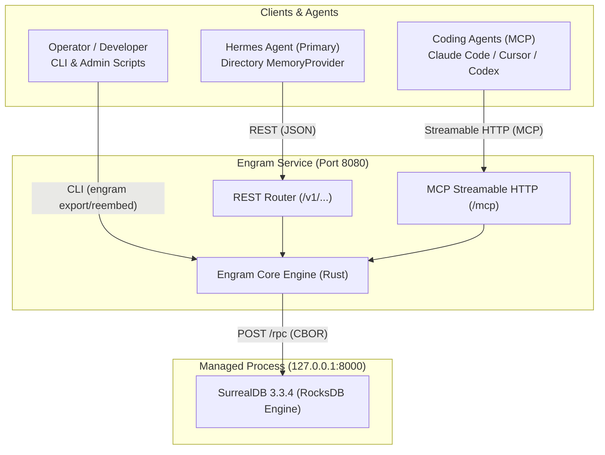
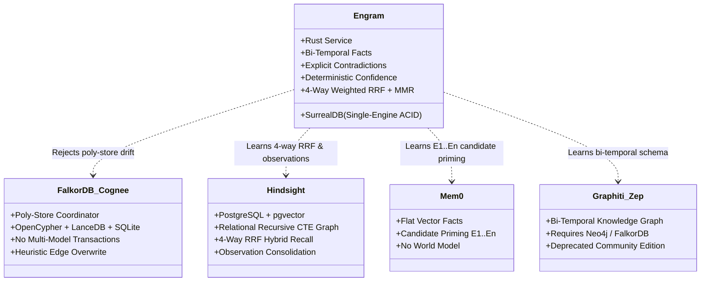
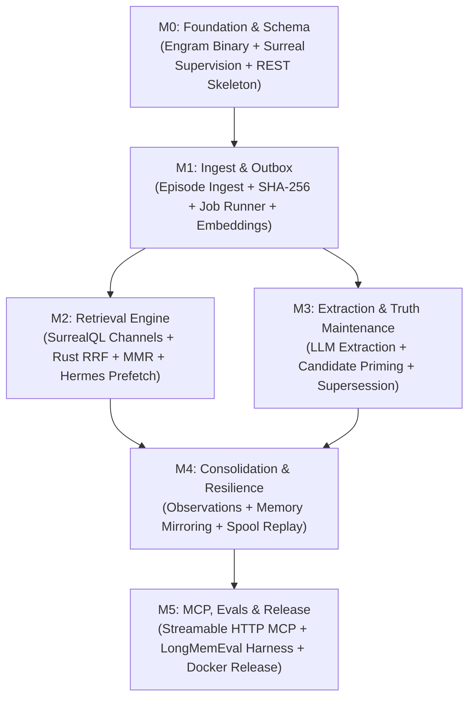

# Engram v1 — Product Requirements Document (PRD)

**Status:** Draft / Specification Phase · **Date:** 2026-10-24 · **Version:** 1.0.0-draft  
**Target Repository:** `irahardianto/engram`  
**Binding Architecture:** [`00-decisions.md`](00-decisions.md) (ADR & Canonical Registry)  
**Author:** Engram Core Architecture & Engineering Team  

---

## 1. Summary & Elevator Pitch

Autonomous AI agents require persistent, long-term memory to operate coherently across weeks, months, and diverse problem domains. Today's agent memory landscape is fundamentally compromised in one of two ways:
1. **Flat vector RAG**, which matches semantic similarity but is blind to structural relationships, temporal ordering, and factual contradictions; or
2. **Poly-store coordinator architectures**, which duct-tape a graph database (Neo4j, FalkorDB) to a vector index (Qdrant, pgvector) and a relational database (PostgreSQL, SQLite), relying on brittle Python glue code to keep separate storage engines synchronized.

**Engram** is a unified, single-engine long-term memory service built natively on SurrealDB and authored in Rust. Documents, knowledge-graph edges, dense vector embeddings, full-text BM25 indexes, and temporal provenance live inside identical records under a single ACID transaction boundary. Engram provides autonomous agents with structured, human-like episodic recall: it discovers and connects entities, tracks how real-world facts evolve over time, and **explicitly flags contradictions instead of silently overwriting them**.

Engram packages this engine into an all-in-one Docker image running a lean Rust binary (`engram`) that supervises a local SurrealDB instance. Engram exposes a high-performance REST API (`/v1/...`) alongside Model Context Protocol (MCP) Streamable HTTP (`/mcp`) on a single port (`8080`). It integrates into the **Hermes Agent** as a native, dependency-free `MemoryProvider` plugin and into coding agents (Claude Code, OpenAI Codex, Cursor, Gemini CLI) via standard MCP tools.

> **Primary Slogan:** *"The physical memory trace for autonomous agents."*  
> **README Slogan:** *"One engine. Zero drift. Absolute recall."*

---

## 2. Problem Statement & Context

### 2.1 Failure Mode A — The Native Memory Ceiling
Hermes Agent provides built-in memory via two curated markdown files: `MEMORY.md` (~2.2 kB) and `USER.md` (~1.4 kB). These files are injected verbatim into the system prompt on every turn. While this pattern is ideal for permanent personal guidelines and core user identity, it imposes a hard ceiling:
- **No Episodic Long Tail:** The agent cannot retain arbitrary decisions, debugging outcomes, or tool outputs spanning dozens of projects over months (e.g., *"which compiler flag fixed the link error in July"*, *"who approved the Tokopedia vendor evaluation"*).
- **Unstructured Transcript Dumps:** Historical conversations exist only as raw session logs retrievable by flat grep, lacking typed entity graphs or temporal markers.
- **Ignorance of Current Truth:** The native store cannot express whether a past statement has been superseded by a newer decision, leading to context pollution and hallucinations.

### 2.2 Failure Mode B — The Poly-Store Memory Stack
Alternative agent memory frameworks (such as Cognee, Mem0, Zep/Graphiti) address episodic and relational memory by acting as distributed coordinators. In practice, this introduces critical failure modes:
- **Index and Graph Drift:** Graph nodes, vector embeddings, and session state reside in separate daemons. A mid-pipeline failure leaves orphaned graph pointers, unsynced embeddings, and missing relational metadata.
- **Silent Overwrites & Temporal Amnesia:** Poly-stores either overwrite old facts upon encountering a new assertion or permit conflicting edges to coexist without temporal demarcation. The consuming agent cannot distinguish what is *currently true* from what *was true in March*.
- **Operational Sprawl:** Running a graph daemon, a vector database, a relational metadata store, and an embedding service creates excessive memory, CPU, and maintenance overhead for a single-user agent workstation.

### 2.3 Why Build on SurrealDB Now?
SurrealDB 3.3.4 consolidates document storage, relational graph traversal (`RELATE ...->fact->...`), HNSW vector indexing (`HNSW DIMENSION 1024 COSINE`), and BM25 full-text search (`FULLTEXT ANALYZER ... BM25`) under a single storage engine (RocksDB). With SurrealDB executing multi-statement ACID transactions over HTTP RPC (`POST /rpc`), a dedicated Rust service can eliminate poly-store coordination drift entirely while maintaining strict sub-150 ms retrieval deadlines on local NVMe storage.

---

## 3. Product Goals & Explicit Non-Goals

### 3.1 In-Scope Goals for v1
- **G-01 (Single Engine ACID):** Execute all entity, fact, episode, and embedding mutations within unified SurrealDB ACID transactions.
- **G-02 (Bi-Temporal Fact Graph):** Record both world validity time (`valid_from`, `valid_to`) and system transaction time (`recorded_at`, `expired_at`) for every knowledge graph assertion.
- **G-03 (Contradiction Visibility):** Maintain contradictory assertions simultaneously with explicit `contested = true` flags and `conflicts_with` references. Never perform silent overwrites.
- **G-04 (Hybrid Retrieval Pipeline):** Implement 4-channel hybrid recall (Dense Vector, BM25 Full-Text, Graph Traversal, Recency) fused via Reciprocal Rank Fusion (RRF) and deduplicated via Maximal Marginal Relevance (MMR) in Rust.
- **G-05 (Deterministic Confidence):** Calculate fact confidence strictly from provenance trust levels and repeated episode support counts, avoiding uncalibrated LLM floating-point guesses.
- **G-06 (Candidate-Entity Priming):** Prime extraction prompts with deterministic candidate entity handles (`E1..En`) to eliminate LLM entity hallucinations.
- **G-07 (Dual Protocol Interface):** Expose identical memory capabilities over REST (`/v1/...`) and MCP Streamable HTTP (`/mcp`) on port `8080`.
- **G-08 (Hermes Native Integration):** Provide a zero-dependency Python `MemoryProvider` plugin at `$HERMES_HOME/plugins/engram/` supporting live prefetch deadlines, asynchronous background write-behind, and offline spool replay.
- **G-09 (All-in-One Packaging):** Ship a single Docker container packaging `engram` and `surreal` with automatic child process supervision and zero-configuration bootstrapping.

### 3.2 Explicit Non-Goals for v1
- **NG-01 (No Replacement of Curated Memory):** Hermes's native `MEMORY.md` and `USER.md` remain active. Engram mirrors their writes via `on_memory_write` but does not replace their prompt injection.
- **NG-02 (No Web UI / Visualization):** Engram v1 provides no built-in graphical dashboard. Administrative inspection is conducted via REST endpoints, MCP tools, the `engram` CLI, or Surrealist connected to SurrealDB.
- **NG-03 (No Multi-User / Cloud SaaS Features):** Engram v1 is built for single-node, single-operator deployments. Cross-tenant authentication, billing, or organization-level IAM are excluded.
- **NG-04 (No In-Process Model Execution):** Engram v1 will not embed ONNX runtimes or LLM weights directly in the Rust binary. Embedding and extraction are delegated to external local endpoints (Ollama) or OpenAI-compatible APIs.
- **NG-05 (No Multimodal Memory):** Audio, video, and image ingestion are excluded from v1.
- **NG-06 (No Cross-Bank Memory Bleed):** Memory banks are completely isolated at the SurrealDB database boundary. No cross-bank queries or federated reasoning are supported in v1.
- **NG-07 (No stdio MCP Transport in Initial Image):** v1 provides MCP exclusively over Streamable HTTP (`/mcp`). A local `stdio` bridge process is scheduled for v1.1.

---

## 4. Personas & Consumers

### 4.1 Persona 1: Hermes Autonomous Agent (Primary Consumer)
- **Profile:** An agent running continuous multi-turn sessions across coding, automation, and personal organization tasks.
- **Access Pattern:** Interacts via the `$HERMES_HOME/plugins/engram/` provider plugin. Uses lifecycle hooks (`prefetch`, `queue_prefetch`, `sync_turn`, `on_pre_compress`, `on_memory_write`, `on_session_end`) and invokes explicit tools when performing deliberate memory operations.
- **Key Need:** Zero cold-start latency lag, sub-250 ms prefetch execution, robust offline queuing when the backend is restarting, and complete absence of silent overwrites.

### 4.2 Persona 2: MCP-Capable Coding Agents (Secondary Consumer)
- **Profile:** External developer agents (Claude Code, OpenAI Codex, Cursor, Gemini CLI) operating within local software repositories.
- **Access Pattern:** Connects via MCP Streamable HTTP to `http://127.0.0.1:8080/mcp` using header `X-Engram-Bank: <repo-or-project>` or query parameter `?bank=<name>`.
- **Key Need:** Standardized tool definitions (`engram_recall`, `engram_remember`, `engram_forget`, `engram_entities`, `engram_status`), structured entity browsing, and project-isolated memory banks.

### 4.3 Persona 3: Operator / Self-Hoster (System Administrator)
- **Profile:** Technical operator managing the host machine, Docker infrastructure, and model backends.
- **Access Pattern:** Manages service lifecycle via Docker (`docker run`, `docker compose`), monitors operational health via `/healthz`, `/readyz`, and `/metrics`, and performs disaster recovery via `engram export` and `engram import`.
- **Key Need:** Low resource footprint (≤ 650 MB uncompressed / ≤ 160 MB compressed pull container, <25 MB stripped binary), reliable single-command deployment, clear JSON logging, zero cloud telemetry, and deterministic upgrade paths.

---

## 5. User Stories & Acceptance Criteria

### US-01: Recall of Old Decisions
- **As a** Hermes user asking about past infrastructure decisions,  
- **I want** the agent to recall architectural details discussed four months ago,  
- **So that** I do not have to re-explain technical context or past trade-offs.  
- **Acceptance Criteria (Given / When / Then):**
  - **Given** an episode from 120 days ago stating *"We use mimalloc on service-mesh because glibc exhibited fragmentation"*,
  - **When** the user asks *"Why did we switch allocators on service-mesh?"*,
  - **Then** `prefetch()` returns a formatted markdown block citing the `mimalloc` fact, its `valid_from` timestamp, and a confidence score ≥ 0.70 within 250 ms.

### US-02: Temporal Fact Queries ("What Was True in March")
- **As an** operator inspecting historical team configurations,  
- **I want** to query the memory system for facts valid at a specific point in time,  
- **So that** I can accurately reconstruct past organizational states.  
- **Acceptance Criteria:**
  - **Given** fact A (*"Alice works_at Billing"*, valid 2026-01-01 to 2026-04-01) and fact B (*"Alice works_at Platform"*, valid 2026-04-01 onwards),
  - **When** an agent calls `engram_recall` with query *"Where did Alice work in March 2026?"*,
  - **Then** the retrieval engine applies temporal parsing, recognizes the target window `[2026-03-01, 2026-03-31]`, and returns fact A as active-in-window while excluding or demoting fact B.

### US-03: Contradiction Visibility Without Silent Overwriting
- **As a** developer updating project documentation,  
- **I want** contradicting technical claims to be preserved and explicitly highlighted,  
- **So that** the agent does not fabricate false consensus or discard conflicting historical claims.  
- **Acceptance Criteria:**
  - **Case A (Authoritative Strict-Later Supersession):** Given an existing fact (*"Auth-Service written_in Go"*, trust `user_stated`, `valid_from: 2026-02-01`), when an incoming statement has equal/higher trust and strictly later `valid_from` (e.g. 2026-10-24 stating *"Auth-Service written_in Rust"*), then Engram supersedes the Go fact (`valid_to = 2026-10-24`, `expired_at = now()`, `status = superseded`, `superseded_by = <rust-fact-id>`), inserts the Rust fact (`valid_from = 2026-10-24`, `status = active`, `supersedes = <go-fact-id>`), leaving `contested = false`. Recall returns only Rust.
  - **Case B (Contradictory / Same-Timestamp Claim):** When conflicting assertions have identical timestamps or lower trust, Engram inserts the incoming assertion as `status = active`, marks both records as `contested = true`, links them bidirectionally via `conflicts_with`, and formats recall output displaying both claims and the `[CONTESTED]` indicator.

### US-04: Explicit Remember and Forget
- **As an** AI agent executing an important workflow,  
- **I want** to explicitly store a critical requirement and retract an invalid belief via tool calls,  
- **So that** I have immediate control over memory state without waiting for batch extraction.  
- **Acceptance Criteria:**
  - **Given** an active memory bank,
  - **When** the agent invokes `engram_remember(statement="Customer X insists on Mutual TLS")`,
  - **Then** a priority episode is created with trust `user_stated` and extracted immediately;
  - **When** the agent subsequently invokes `engram_forget(target_id="fact:123", reason="Revoked by user")`,
  - **Then** Engram sets `status = retracted` and `expired_at = now()` without physically deleting the underlying audit row (`valid_to` is left untouched, and `retracted_at` is populated only on `episode` records when an episode is retracted).

### US-05: Entity Inspection and Graph Browsing
- **As a** user troubleshooting agent reasoning,  
- **I want** to inspect all known relations and aliases for a named entity,  
- **So that** I can verify graph connectivity and detect duplicate nodes.  
- **Acceptance Criteria:**
  - **Given** entity `entity:tokopedia` with aliases `["Tokopedia", "PT Tokopedia", "Tokped"]`,
  - **When** a client sends `GET /v1/banks/default/entities/tokopedia` or invokes `engram_entities(ref="Tokped")`,
  - **Then** Engram resolves the alias to `entity:tokopedia` and returns its canonical summary, entity kind `organization`, and all inbound and outbound live facts.

### US-06: Curated-Memory Mirroring
- **As a** Hermes user modifying `MEMORY.md` via the built-in memory tool,  
- **I want** additions and removals to automatically synchronize with Engram,  
- **So that** the curated file and the long-term knowledge graph remain strictly aligned.  
- **Acceptance Criteria:**
  - **Given** Hermes triggers `on_memory_write(action="remove", target="MEMORY.md", content="", metadata={"previous_content": "User prefers dark mode"})`,
  - **When** the provider processes the hook,
  - **Then** it extracts `previous_content`, identifies the corresponding fact in SurrealDB, and soft-retracts the fact by setting `status = retracted` and `expired_at = now()` (`valid_to` untouched; `superseded` is reserved strictly for facts replaced by an explicit successor per ADR-08 Rule 3).

### US-07: Pre-Compress Transcript Fact Preservation
- **As a** long-running Hermes session approaching context window exhaustion,  
- **I want** Engram to extract and commit all durable facts before transcript truncation occurs,  
- **So that** critical context is never lost during LLM-driven summarization.  
- **Acceptance Criteria:**
  - **Given** an active session with 3 unextracted turns buffered in Engram,
  - **When** Hermes triggers `on_pre_compress(messages)`,
  - **Then** the provider calls `POST /v1/banks/{bank}/sessions/{session_id}/flush`, waits up to 5000 ms for outbox completion, and returns a non-empty summary digest of captured facts before Hermes summarizes the prompt.

### US-08: Multi-Bank Isolation
- **As a** developer running distinct coding projects,  
- **I want** memories from repository A to be completely isolated from repository B,  
- **So that** internal credentials, names, and technical stacks never cross-contaminate.  
- **Acceptance Criteria:**
  - **Given** banks `project-alpha` and `project-beta` residing in SurrealDB namespace `engram`,
  - **When** a client queries `/v1/banks/project-alpha/recall` for an entity existing only in `project-beta`,
  - **Then** the response returns 0 hits, and SurrealDB logs verify that the query was scoped strictly to database `project-alpha`.

### US-09: Outage Behaviour & Spool Replay
- **As an** operator restarting the Engram Docker container while Hermes is running,  
- **I want** Hermes to remain fully responsive and automatically spool write operations to disk,  
- **So that** conversations are not interrupted and no memories are dropped.  
- **Acceptance Criteria:**
  - **Given** the Engram service is unreachable (`ECONNREFUSED`),
  - **When** Hermes invokes `prefetch()`, it logs a debug warning, trips its circuit breaker after 3 failures, and returns `""` within 5 ms;
  - **When** Hermes executes `sync_turn()`, the plugin appends the episode JSON to `$HERMES_HOME/engram/spool.jsonl`;
  - **When** Engram comes back online, the next successful `sync_turn()` flushes and retransmits the spooled turns in FIFO order.

### US-10: Logical Backup & Version Migration
- **As a** system administrator preparing for an operating system migration,  
- **I want** to take a complete logical snapshot of all banks and restore it on a fresh machine,  
- **So that** memory state is fully portable across major SurrealDB releases.  
- **Acceptance Criteria:**
  - **Given** an Engram service holding 5,000 facts across 2 banks,
  - **When** running `engram export --bank default --output /data/backups/default.surql`,
  - **Then** a self-contained SurrealQL dump is generated;
  - **When** restoring via `engram import --bank default --input /data/backups/default.surql` on an empty instance,
  - **Then** all entities, episodes, facts, and indexes match the original record count and checksums.

### US-11: First-Run Docker Experience
- **As a** new user deploying Engram,  
- **I want** to launch the entire stack using a single `docker run` invocation,  
- **So that** I do not need to configure multiple containers, bridge networks, or database credentials.  
- **Acceptance Criteria:**
  - **Given** a host machine with Docker installed and Ollama running locally,
  - **When** executing `docker run -d -p 127.0.0.1:8080:8080 -v engram_data:/data ghcr.io/irahardianto/engram:latest`,
  - **Then** the container initializes `/data`, spawns `surreal start`, generates credentials at `/data/secrets/`, runs embedded schema migrations, and passes `GET /readyz` within 5 seconds.

---

## 6. Functional Requirements

> [!NOTE]
> Functional requirements are numbered in modular groups per subsection (e.g. §6.1 Ingestion = FR-001..FR-008, §6.2 Extraction = FR-010..FR-018), with unallocated IDs intentionally reserved for future minor-version extensions.

### 6.1 Ingestion Pipeline
- **FR-001 (Episode Ingestion):** The system MUST expose `POST /v1/banks/{bank}/episodes` accepting batch payloads of 1 to 100 episodes. [ADR-01, ADR-05]
- **FR-002 (Supported Episode Kinds):** The ingestion API MUST support episode kinds: `turn`, `note`, `curated`, `delegation`, and `document`. [ADR-05, Canonical Registry §3.3]
- **FR-003 (Immediate Ingestion Durability):** On receiving an episode, the service MUST compute a SHA-256 `content_hash`, enforce `idempotency_key`, and persist the episode record to SurrealDB before returning HTTP `202 Accepted`. [ADR-07, ADR-11]
- **FR-004 (Two-Stage Availability):** Ingested episodes MUST be immediately searchable via BM25 full-text queries; vector embedding and fact extraction MUST execute asynchronously via the job outbox. [ADR-07, ADR-17]
- **FR-005 (Turn Redaction):** The service MUST execute regex-based secret redaction on all ingested text prior to database persistence and prior to sending text to embedding or LLM providers. [ADR-14]
- **FR-006 (Context Gating):** The Hermes plugin MUST skip durable episode writes if `agent_context != "primary"`, unless explicitly enabled via `write_contexts`. [ADR-13]
- **FR-007 (Clock-Skew Clamping):** The service MUST validate client timestamps on episode ingestion; if $|occurred\_at - server\_time| > 300\text{ s}$, the service MUST clamp `occurred_at = server_time` and record the adjustment in `audit` to prevent temporal ordering corruption from client clock drift. [ADR-08, VS5 m-07]
- **FR-008 (Payload Size and Rate Limits):** The ingestion endpoint MUST enforce a maximum request body limit of 10 MB (accommodating up to 100 episodes × 64 KB) and concurrent request throttling via Axum middleware, rejecting oversized payloads with HTTP 413. [ADR-01, ADR-16, VS5 m-04]

### 6.2 Extraction Engine
- **FR-010 (Single Structured Extraction Call):** Fact and entity extraction MUST execute via a single structured LLM call per extraction batch using JSON Schema mode. [ADR-07]
- **FR-011 (Batch Accumulation Gating):** Episodes MUST be accumulated for extraction up to `extraction.batch_max_turns` (default: 4 turns) or until `extraction.batch_idle_ms` (default: 20,000 ms) elapses, or upon explicit flush. [ADR-07]
- **FR-012 (Candidate-Entity Priming):** Before calling the extraction LLM, the system MUST retrieve top candidate entities matching the batch text via exact alias, BM25, and vector cosine similarity, formatting them as integer handles (`E1..En`) in the prompt. [ADR-07, ADR-10]
- **FR-013 (Entity Handle Mapping):** The extraction processor MUST map integer handles back to existing entity record IDs in code and reject unprimed handles. [ADR-07]
- **FR-014 (Closed Predicate Vocabulary):** The extractor MUST enforce the 15 closed predicates defined in ADR-09. Relations outside the vocabulary MUST be recorded under `related_to` with a descriptive `label`, or dropped if `strict_vocabulary = true`. [ADR-09]
- **FR-015 (Temporal Anchor Extraction):** The extractor MUST resolve relative conversational time references (*"yesterday"*, *"next Tuesday"*) to absolute ISO 8601 timestamps using the episode's `occurred_at` anchor. [ADR-07, ADR-08]
- **FR-016 (Prompt Versioning):** Every extraction prompt MUST be versioned (`prompts/extract.v1.md`), and the active version MUST be recorded in `fact.extractor_version`. [ADR-07]
- **FR-017 (Durable Extraction Timers):** Extraction batching timers MUST NOT rely on volatile in-process memory timers. Each session MUST maintain a deterministic outbox job `job:['extract', session_id]` in SurrealDB: the first pending turn sets `run_after = now + batch_idle_ms`, subsequent turns update `run_after = now + batch_idle_ms`, and reaching `batch_max_turns`, `remember`, curated writes, or flush resets `run_after = now`, guaranteeing no timer loss across service restarts. [ADR-17]
- **FR-018 (Flush Concurrency Contract):** `POST /v1/banks/{bank}/sessions/{session_id}/flush` MUST NOT execute extraction inline in the HTTP handler (preserving the single writer worker). It MUST update the session extraction job `run_after = now`, signal the bank worker, and await an in-process watch notification up to `wait_ms` (max 10,000 ms), returning `{"status": "completed" | "pending", "facts_written": n, "digest": [...]}`. [ADR-17, VS5 M-05]

### 6.3 Truth Maintenance & Entity Resolution
- **FR-020 (Deterministic Resolution Cascade):** Entity resolution MUST follow the deterministic 4-stage cascade: (1) Primed handle match; (2) Exact normalized key match; (3) Same kind and Jaro-Winkler distance ≥ `resolution.jaro_winkler` (0.92); (4) Same kind and embedding cosine ≥ `resolution.embed_merge` (0.90). [ADR-10]
- **FR-021 (Review Flagging):** Name-embedding cosine scores falling in `[0.80, 0.90)` MUST create a new entity and insert a review entry into the bank's `audit` log without halting ingestion. [ADR-10]
- **FR-022 (Functional Supersession):** For functional predicates (`works_at`, `has_role`, `reports_to`, `located_in`, `written_in`), a new fact asserting a distinct object with `valid_from > existing.valid_from (strict inequality)` and `trust ≥ existing.trust` MUST supersede the existing fact (setting `existing.status = superseded`, `existing.valid_to = new.valid_from`, `existing.expired_at = now()`) in a single ACID transaction. When `valid_from == existing.valid_from` with different values, ADR-08 Rule 7 applies and the facts MUST contest each other. [ADR-08, ADR-09]
- **FR-023 (Contradiction Marking):** If a new conflicting functional assertion has equal `valid_from` timestamps, unknown temporal precision on either side, or lower trust with a later timestamp, it MUST NOT supersede; both facts MUST be retained with `contested = true` and linked via `conflicts_with`. If the new assertion has an earlier `valid_from` date ($n.valid\_from < e.valid\_from$), it MUST be processed as a historical backfill under Rule 6: inserted with `status = 'active'`, `valid_to = min(n.valid_to, e.valid_from)`, and `contested = false` (no contest). [ADR-08]
- **FR-024 (Negative Polarity Resolution):** An extraction with negative polarity MUST close the matching active positive fact by setting `valid_to = statement_time` without inserting a new positive edge. [ADR-08]
- **FR-025 (Deterministic Confidence):** Confidence MUST be computed deterministically using the formula:  
  $$\text{confidence} = \text{clamp}_{[0, 1]}(\text{trust\_base}[\text{trust}] \times (1 + 0.1 \times \min(\text{support} - 1, 5)))$$  
  rounded to 2 decimal places. LLM floating-point confidence estimates are prohibited. [ADR-08]
- **FR-026 (Observation Consolidation):** When an entity accumulates ≥ 5 new facts since its last consolidation or upon session termination, the system MUST trigger background consolidation to update synthesized observation records. [ADR-12]
- **FR-027 (Authority Guard):** For functional predicates, if an existing fact has trust `user_stated` and an incoming assertion has lower trust (`rank(n) ≤ 3`, including `assistant_stated`, `tool_output`, `inferred`) with a differing object or negative polarity, the incoming assertion MUST be rejected without altering the existing fact, and a `reconcile.rejected_low_trust` audit entry MUST be recorded. User-stated facts are never contested or closed by assistant/tool/inferred claims. [ADR-08]
- **FR-028 (Current-Truth Semantics):** The system MUST evaluate current truth as `status = 'active' AND (valid_to IS NONE OR valid_to > now)`. Believed historical facts retain `status = 'active'` with past `valid_to`. Negative polarity closures update `valid_to = n.valid_from` while preserving `status = 'active'`, avoiding semantic confusion with retracted facts (which are reserved for `forget`). [ADR-08]

### 6.4 Retrieval Engine
- **FR-030 (Multi-Channel Query Execution):** Recall MUST execute dense vector search, BM25 full-text search, and recent episode retrieval in a single multi-statement SurrealQL round trip over `/rpc`. [ADR-02, ADR-11]
- **FR-031 (Graph Traversal Hop):** Top candidate entities from vector and BM25 hits MUST be expanded by 1 graph hop (`retrieval.graph_hops`, default: 1) traversing live `fact` relations with hub-damping penalty ($1/\sqrt{\text{degree}}$). [ADR-10, ADR-11]
- **FR-032 (Temporal Keyword Parsing):** The retrieval engine MUST parse English and Indonesian temporal expressions to derive query time windows used to filter validity intervals and activate historical facts. [ADR-11]
- **FR-033 (Weighted RRF Fusion):** The service MUST combine channel ranked lists in Rust using Weighted Reciprocal Rank Fusion ($k = 60$) with weights: Vector 1.0, BM25 1.0, Graph 0.8, Recency 0.5. [ADR-11]
- **FR-034 (Maximal Marginal Relevance):** The fused candidate list MUST be diversified using MMR ($\lambda = 0.7$) against candidate statement embeddings. [ADR-11]
- **FR-035 (Token Budget Packing):** Final recalled items MUST be packed within the configured token budget (default: 1,200 tokens, estimated at $\lceil \text{chars} / 3.5 \rceil$), formatting output as structured markdown and JSON. [ADR-11]
- **FR-036 (Zero LLM on Read Path):** The recall retrieval pipeline MUST NOT execute any LLM inference calls during the retrieval request. [ADR-11]

### 6.5 REST API Surface
- **FR-040 (System Endpoints):** Expose `GET /healthz`, `GET /readyz`, `GET /metrics`, and `GET /v1/status`. [ADR-01, ADR-15]
- **FR-041 (Bank Management):** Expose `GET /v1/banks`, `PUT /v1/banks/{bank}`, and `GET /v1/banks/{bank}`. Unregistered banks MUST auto-create with default configuration on first write. [ADR-05]
- **FR-042 (Memory Operations):** Expose `POST /v1/banks/{bank}/recall`, `POST /v1/banks/{bank}/remember`, and `POST /v1/banks/{bank}/forget`. [Canonical Registry §3.2]
- **FR-043 (Graph & Entity Inspection):** Expose `GET /v1/banks/{bank}/entities`, `GET /v1/banks/{bank}/entities/{ref}`, `POST /v1/banks/{bank}/entities/merge`, `GET /v1/banks/{bank}/facts`, and `GET /v1/banks/{bank}/facts/{id}`. [Canonical Registry §3.2]
- **FR-044 (Session Lifecycle Control):** Expose `POST /v1/banks/{bank}/sessions/{session_id}/flush` and `POST /v1/banks/{bank}/sessions/{session_id}/end`. [ADR-07, ADR-12]
- **FR-045 (Job & Administrative Ops):** Expose `GET /v1/banks/{bank}/jobs`, `POST /v1/banks/{bank}/jobs/{id}/retry`, `POST /v1/banks/{bank}/export`, and `POST /v1/banks/{bank}/import`. [ADR-04, ADR-17]
- **FR-046 (Physical Purge Endpoint):** The service MUST expose an administrative endpoint `POST /v1/banks/{bank}/purge` requiring payload `{"ids": [...], "confirm": "PURGE"}` to physically delete specified episodes, facts, and observations, plus records whose only evidence is a purged record, scrubbing textual content from `audit` while retaining an action record for auditability (for leaked secrets, PII, and right-to-be-forgotten compliance). [ADR-14]

### 6.6 Model Context Protocol (MCP) Interface
- **FR-050 (Streamable HTTP Transport):** Engram MUST expose an MCP Streamable HTTP endpoint at `/mcp` supporting MCP specifications `2025-06-18` through `2026-07-28`. [ADR-01, ADR-18]
- **FR-051 (Exposed MCP Tools):** The MCP server MUST register exactly five tools matching the canonical names: `engram_recall`, `engram_remember`, `engram_forget`, `engram_entities`, and `engram_status`. [ADR-18, Canonical Registry §3.4]
- **FR-052 (Bank Header Routing):** The MCP handler MUST determine target bank scoping via the `X-Engram-Bank` HTTP header or `?bank=` query parameter, defaulting to `default`. [ADR-05, ADR-18]

### 6.7 Hermes Plugin Integration
- **FR-060 (Plugin Packaging):** The Hermes provider MUST install under `$HERMES_HOME/plugins/engram/` as a directory provider with zero external Python dependencies beyond Hermes's pinned `httpx`. [ADR-13]
- **FR-061 (Non-Blocking Prefetch):** `prefetch()` MUST execute a live recall against `/v1/banks/{bank}/recall` bounded by a strict 1,500 ms deadline, falling back to cached results from `queue_prefetch()` or `""` upon timeout. [ADR-13]
- **FR-062 (Asynchronous Sync Turn):** `sync_turn()` MUST post episodes directly to the service without blocking turn execution, relying on Hermes's internal `mem-sync` worker. [ADR-13]
- **FR-063 (Local Spool on Failure):** If Engram is unreachable during `sync_turn()`, the plugin MUST append the turn payload to `$HERMES_HOME/engram/spool.jsonl` (capped at 10,000 entries / 20 MB) and replay spooled lines upon the next successful connection. [ADR-13]
- **FR-064 (Memory Mirroring):** The plugin MUST intercept `on_memory_write` events to mirror `MEMORY.md` and `USER.md` additions, modifications, and removals into Engram. [ADR-13]
- **FR-065 (Pre-Compress Hook):** On `on_pre_compress()`, the plugin MUST trigger session flush (`/sessions/{session_id}/flush`) with a 5,000 ms wait timeout, maintaining `pre_compress_checkpoint_api_version = 1`. [ADR-13]

### 6.8 Operations, Supervision & Storage
- **FR-070 (SurrealDB Supervision):** In managed mode, the `engram` process MUST supervise a child `surreal start` process bound to `127.0.0.1:8000`, generating secure root credentials stored at `/data/secrets/surreal_root` (mode 0600). [ADR-03]
- **FR-071 (Storage Engine):** The default managed storage engine MUST be RocksDB at `rocksdb:///data/surreal`. [ADR-04]
- **FR-072 (Ordered Shutdown):** On receiving `SIGTERM` or `SIGINT`, Engram MUST execute an ordered 5-stage shutdown within a 40-second grace period: (1) stop accepting incoming requests; (2) finish in-flight HTTP requests (≤10 s); (3) permit active outbox workers to checkpoint or release leases (≤15 s); (4) terminate child SurrealDB process via `SIGTERM` (≤10 s, followed by `SIGKILL`); (5) exit cleanly. [ADR-03]
- **FR-073 (Schema Migrations):** Database migrations MUST be embedded within the Rust binary and applied forward-only per bank database at startup or bank creation, tracked in `schema_migration`. [ADR-05]
- **FR-074 (Outbox Job Worker):** Asynchronous tasks (`embed`, `extract`, `consolidate`, `reembed`) MUST be committed as `job` records in SurrealDB within the triggering transaction and processed with exponential lease backoff. [ADR-17]
- **FR-075 (CLI Utilities):** The `engram` binary MUST provide subcommands: `serve`, `migrate`, `export`, `import`, `reembed`, `key show`, `doctor`, and `healthcheck`. [Canonical Registry §3.1]
- **FR-076 (Backup Verification):** The `engram export` and `engram import` backup utilities MUST verify snapshot integrity via record counts and table checksums, ensuring round-trip export/import produces identical state across instances and provides a reliable upgrade path across SurrealDB versions. [ADR-04]

---

## 7. Non-Functional Requirements

### 7.1 Performance & Latency Targets
- **NFR-001 (Ingestion Accept Latency):** Ingestion endpoint `POST /v1/banks/{bank}/episodes` MUST return HTTP `202` with $p95 \le 20\text{ ms}$ on local NVMe storage. [ADR-11]
- **NFR-002 (Recall Service Latency):** Recall endpoint `POST /v1/banks/{bank}/recall` MUST execute with $p95 \le 150\text{ ms}$ for banks containing $\le 100,000$ facts using local Ollama embeddings. [ADR-11]
- **NFR-003 (Hermes Prefetch End-to-End Latency):** Total end-to-end latency for Hermes `prefetch()` (including HTTP round-trip, JSON deserialization, and string rendering) MUST achieve $p95 \le 250\text{ ms}$. [ADR-11]
- **NFR-004 (Concurrency Scaling):** Outbox workers MUST process up to 4 concurrent memory banks (`jobs.max_concurrent_banks = 4`) while restricting each bank to a single serialized writer to eliminate HNSW write contention. [ADR-17]

### 7.2 Durability, Consistency & Isolation
- **NFR-005 (Transactional ACID Boundary):** Every write affecting an episode, derived facts, entity nodes, and outbox job entries MUST commit atomically within a single SurrealDB transaction. [ADR-02, ADR-17]
- **NFR-006 (Zero Cross-Bank Bleed):** Tenant memory banks MUST map to distinct SurrealDB databases within the `engram` namespace, guaranteeing total cryptographic and logical isolation of indexes, graphs, and vectors. [ADR-05]
- **NFR-007 (Spool Durability):** The Hermes plugin write spool (`spool.jsonl`) MUST persist uncommitted turns across gateway crashes and restarts. [ADR-13]

### 7.3 Security & Redaction
- **NFR-008 (Authentication):** All REST and MCP endpoints (excluding public probes `/healthz`, `/readyz`, and `/metrics`) MUST require a static Bearer API key validated via constant-time comparison. If unset at first launch, a 32-byte cryptographic key MUST be generated and stored at `/data/secrets/api_key` with file mode `0600`. [ADR-01, ADR-14]
- **NFR-009 (Disabled Auth Restriction):** `ENGRAM_AUTH=disabled` MUST be rejected with a fatal error if the service is bound to any network interface other than `127.0.0.1`. [ADR-14]
- **NFR-010 (Pre-Egress Secret Redaction):** High-entropy tokens, private keys, API keys, and URL credentials MUST be redacted before being persisted or sent to external LLM/embedding providers. [ADR-14]

### 7.4 Rust Footprint & Dependency Budget
- **NFR-011 (Crate Count Ceiling):** The normal production build MUST NOT exceed 300 unique crates (`cargo tree -e normal --prefix none | sort -u | wc -l`), or 340 crates with the optional `otlp` feature enabled. [ADR-16]
- **NFR-012 (Binary Size):** The stripped release binary size MUST NOT exceed 25 MB on `x86_64-unknown-linux-gnu`. [ADR-16]
- **NFR-013 (Docker Image Size):** The complete production Docker image containing `engram`, `surreal`, and `tini` on `debian:bookworm-slim` MUST NOT exceed 650 MB uncompressed / 160 MB compressed pull (measured 584 MB / 140.76 MB; official `surreal` binary alone is 352 MB uncompressed / 105 MB gzipped; Engram's contribution ≤ 40 MB uncompressed). [ADR-16]
- **NFR-014 (Rust Edition & MSRV):** The codebase MUST compile using Rust Edition 2024 with a Minimum Supported Rust Version (MSRV) of 1.88. [ADR-16]

### 7.5 Observability & Auditability
- **NFR-015 (Structured Logging):** Logs MUST be emitted as structured JSON to `stdout` via `tracing-subscriber`, conforming to span names declared in Canonical Registry §3.7. [ADR-15]
- **NFR-016 (Distributed Tracing):** Inbound W3C `traceparent` headers MUST be extracted, propagated across internal spans, and echoed in HTTP responses. [ADR-15]
- **NFR-017 (Prometheus Metrics):** Expose Prometheus metrics at `/metrics` conforming to naming rules in Canonical Registry §3.7. [ADR-15]
- **NFR-018 (Audit Trail):** Every fact reconciliation, extraction decision, and entity merge MUST record its structured rationale in the bank's `audit` table, retained for 30 days. [ADR-15]

### 7.6 Licensing & Privacy
- **NFR-019 (Permissive Service License):** The Engram codebase MUST be licensed under Apache-2.0 or MIT. Direct linking to BSL-licensed crates (including the `surrealdb` Rust SDK) is strictly prohibited. [ADR-02, ADR-16]
- **NFR-020 (Zero Telemetry):** Engram MUST NEVER transmit telemetry, analytics, heartbeats, or diagnostic pings to any external host. [ADR-14]

---

## 8. Success Metrics

| Metric | Target | Measurement Method & Tooling |
|---|---|---|
| **LongMemEval_S Strict Accuracy** | **≥ 70.0% goal (frontier)** **Record baseline (local 8B)** | 100-question subset across 5 core abilities (Extraction, Multi-Session, Temporal, Updates, Abstention), evaluated via strict LLM judge against gold labels. Goals: (a) local-only stack (default Ollama models `qwen3:8b`/`qwen3-embedding:0.6b`): record baseline at M5 with ≤ 3-point regression gate on subsequent releases; (b) frontier answer/judge model (e.g. GPT-4o / Claude 3.5 Sonnet) with the same memory: goal ≥ 70.0% strict (context: Zep reported 71.2% on LongMemEval with GPT-4o). Never drop abstention questions. [ADR-19] |
| **Contradiction Detection Rate** | **100.0%** | Zero silent overwrites on contradictory knowledge updates in CI test suite; conflicting functional assertions must result in `contested = true` or superseded links. |
| **Ingestion Accept Latency (p95)** | **≤ 20 ms** | Benchmark measuring `POST /v1/banks/{bank}/episodes` under 50 req/sec load on local NVMe. |
| **Recall Service Latency (p95)** | **≤ 150 ms** | Service-side execution of 4-channel hybrid recall + RRF + MMR on bank with 100k facts. |
| **Hermes Prefetch Latency (p95)** | **≤ 250 ms** | End-to-end timing recorded inside Hermes `memory-prefetch` worker thread. |
| **Extraction Token Cost** | **≤ 3,000 tokens / batch** | Measured tokens per 4-turn extraction batch (~1,800 tokens input, ≤600 tokens output). Under an estimated $0.05 per 100 turns on remote APIs [estimated], $0.00 on local Ollama. |
| **Plugin Gateway Reliability** | **0 crashes** | Zero gateway-level process crashes induced by memory plugin failures during 72-hour burn-in. |
| **Crate Budget Compliance** | **≤ 300 normal crates** | Verified in CI via `cargo deny` and `cargo tree`. |

---

## 9. Alternatives Considered & Prior Art Learnings

### 9.1 FalkorDB + Cognee
- **Evaluated:** Running `falkordb/falkordb` paired with Hermes's existing `cognee` catalog plugin.
- **Why It Is Compelling:** FalkorDB provides industrial-grade GraphBLAS sparse-matrix traversals and sub-millisecond OpenCypher queries. Setup takes under 10 minutes.
- **Why Rejected for Engram:** Cognee is fundamentally a *poly-store coordinator*. Its pipeline spans FalkorDB (graph), LanceDB/pgvector (vectors), and SQLite/Postgres (relational metadata). A crash during extraction leaves orphaned graph pointers and unsynchronized vector indices. Furthermore, Cognee resolves contradictory facts through heuristic overwrites. Engram knowingly invests engineering effort to obtain **single-engine ACID transactions**, native contradiction modeling, and zero-drift persistence on SurrealDB.

### 9.2 Hindsight (vectorize-io)
- **Evaluated:** Hindsight memory service backed by PostgreSQL.
- **What Engram Learns:** 4-channel hybrid retrieval (vector, BM25, graph, temporal) fused via Reciprocal Rank Fusion (RRF); Maximal Marginal Relevance (MMR) for candidate diversification; deterministic observation consolidation; and replacing noisy LLM floating-point confidence with deterministic scoring.
- **Why Runtime Rejected:** Hindsight models graphs relationally using tables and recursive CTEs rather than native graph edges. SurrealDB provides native pointer traversals (`->fact->entity`) within unified multi-model queries.

### 9.3 Mem0
- **Evaluated:** Mem0 vector memory layer.
- **What Engram Learns:** The candidate-entity priming trick: retrieving existing candidate entities prior to extraction and injecting them as integer handles (`E1..En`) into the prompt, preventing LLM name drift.
- **Why Runtime Rejected:** Mem0 is vector-first and stores atomic text chunks. It lacks a structured relational world model and cannot perform temporal graph reasoning.

### 9.4 Zep / Graphiti
- **Evaluated:** Graphiti bi-temporal knowledge graph framework.
- **What Engram Learns:** The bi-temporal model separating valid time (`valid_from`, `valid_to`) from transaction time (`recorded_at`, `expired_at`); anchoring future plans to statement time; and forbidding recency-alone fact invalidation.
- **Why Runtime Rejected:** Graphiti requires external graph databases (Neo4j, FalkorDB) and its standalone engine is tied to Zep's deprecated community edition.

---

## 10. Milestones & Acceptance Criteria

### M0 — Service Foundation & Schema Bootstrap
- **Scope:** Build the Rust service binary (`engram`), SurrealDB process supervisor, configuration parser, embedded migrations engine, and REST routing skeleton. Build Hermes plugin skeleton.
- **Acceptance Criteria:**
  1. `engram serve` launches `surreal start` on `127.0.0.1:8000`, generates root secrets, and applies migrations idempotently.
  2. `GET /healthz` and `GET /readyz` return HTTP 200 within 5 seconds of container boot.
  3. `hermes config set memory.provider engram` loads the plugin; `is_available()` returns `True` without performing network I/O; `prefetch()` returns `""` on an empty store.
  4. Consecutive boots leave identical database schemas without data loss.

### M1 — Ingestion Pipeline & Outbox Engine
- **Scope:** Implement `POST /v1/banks/{bank}/episodes`, transactional SHA-256 content hashing, regex redaction, outbox `job` scheduler, and asynchronous Ollama/OpenAI embedding workers.
- **Acceptance Criteria:**
  1. Ingestion endpoint accepts 20 turns, stores them in `episode`, and enqueues `embed` jobs with $p95 \le 20\text{ ms}$.
  2. Ingested episodes are immediately searchable via BM25 full-text queries within 50 ms of receipt.
  3. Embedding outbox worker processes jobs, writes 1024-dim vectors to `episode.embedding`, and updates `job.status = completed`.
  4. Redaction engine strips simulated AWS access keys and Bearer tokens before database insertion.

### M2 — Hybrid Retrieval & Hermes Read Path
- **Scope:** Implement 4-channel SurrealQL retrieval, graph 1-hop traversal, English/Indonesian temporal keyword parsing, Rust-side Weighted RRF, MMR candidate diversification, token packing, and Hermes live `prefetch()`.
- **Acceptance Criteria:**
  1. Multi-channel recall returns ranked results combining vector, BM25, graph, and recency hits within 150 ms service-side.
  2. Hermes `prefetch()` executes within 250 ms end-to-end, respecting the 1,200 token budget.
  3. Querying for an Indonesian temporal expression (*"kemarin"*, *"minggu lalu"*) accurately filters candidate validity windows.
  4. The trivial prompt gate skips recall for greetings (*"hello"*, *"thanks"*) without invoking the network.

### M3 — Structured Extraction & Truth Maintenance
- **Scope:** Implement batch extraction LLM worker with integer candidate priming (`E1..En`), closed predicate mapping, entity resolution cascade (Jaro-Winkler + cosine), bi-temporal fact supersession, and contradiction marking. Expose `engram_remember` and `engram_forget`.
- **Acceptance Criteria:**
  1. A 20-turn conversation extracts ≥5 entities and ≥5 facts into the `fact` relation table.
  2. Sequential assertions *"Service X uses Go"* followed by *"Service X uses Rust"* result in the Go fact being marked `status = superseded` (`valid_to = statement_time`) and the Rust fact marked `status = active`. Zero silent overwrites.
  3. Conflicting claims from lower-trust sources result in `contested = true` and appear in recall with `[CONTESTED]` flags.
  4. `engram_forget` soft-retires target facts (`expired_at = now()`, `status = retracted`, `valid_to` untouched per ADR-08/Registry §3.3, and predecessor fact reopened).

### M4 — Consolidation, Curated Mirroring & Resilience
- **Scope:** Implement `observation` consolidation worker, `on_memory_write` mirroring for `MEMORY.md`/`USER.md`, `on_pre_compress` session flush, offline spooling (`spool.jsonl`), and logical backup (`engram export`/`import`).
- **Acceptance Criteria:**
  1. Updating `MEMORY.md` via Hermes mirrors changes into Engram facts immediately; deletions properly retire facts using `metadata["previous_content"]`.
  2. Killing the Engram service causes `sync_turn` to buffer turns into `spool.jsonl`; restarting Engram automatically replays spooled turns in FIFO order.
  3. `on_pre_compress()` flushes pending turns to the outbox and returns a summary digest within 5,000 ms.
  4. `engram export` and `engram import` successfully round-trip a 10,000-record database with identical checksums.

### M5 — MCP Interface, Evaluation Harness & Release Hardening
- **Scope:** Implement MCP Streamable HTTP endpoint (`/mcp`) with 5 tools, LongMemEval_S automated evaluation harness, all-in-one Docker build, and release documentation.
- **Acceptance Criteria:**
  1. Claude Code and Cursor connect to `http://127.0.0.1:8080/mcp`, listing and executing all 5 tools successfully across isolated banks.
  2. LongMemEval_S evaluation harness runs against the 100-question subset: records local 8B baseline (with ≤ 3-point regression gate for subsequent releases) and evaluates frontier model against the ≥ 70.0% strict goal. [ADR-19]
  3. Docker image builds under 650 MB uncompressed / 160 MB compressed pull (measured 584 MB / 140.76 MB; official `surreal` binary alone is 352 MB uncompressed / 105 MB gzipped; Engram stripped binary ≤ 25 MB, measured 7.41 MB default / 7.41 MB with OTLP on the VS4 vertical slice); `cargo deny` passes license and advisory audits. [ADR-16]
  4. 72-hour continuous soak test executes under simulated agent workload with zero process crashes, zero memory leaks, and stable RSS.

---

## 11. Risks & Mitigations

| Risk | Impact | Prob. | Mitigation Strategy | Verification Source |
|---|---|---|---|---|
| **SurrealDB HNSW Maturity & Crashes** | High | Med | Isolate SurrealDB in a supervised child process with automatic crash recovery; pin strictly to verified `v3.3.4` binary; serialize writes per bank via outbox workers to eliminate index race conditions. | `V05-surrealdb.md` (FIND-01, FIND-02) |
| **Local LLM Extraction Quality & Hallucination** | High | Med | Constrain extractions with strict JSON Schema; prime prompts with integer handles (`E1..En`) for candidate entities; restrict relations to 15 closed predicates; map unknown relations to `related_to`. | `00-decisions.md` (ADR-07, ADR-09) |
| **BSL Licensing of SurrealDB Server** | High | Low | Engram communicates with SurrealDB strictly over HTTP RPC (`POST /rpc`) via `reqwest`, linking zero BSL code; SurrealDB server runs under BSL-1.1 Additional Use Grant since Engram is not a managed Database Service. | `V05-surrealdb.md` (FIND-02), `V06-rust-stack-deployment.md` (F-03) |
| **Embedding Dimension Lock-in** | Med | Med | Store vector dimension explicitly in per-bank `meta` record; provide `engram reembed --bank <name>` CLI tool to perform in-place embedding regeneration with BM25 fallback during maintenance. | `00-decisions.md` (ADR-17), `03-data-model.md` §12.3 |
| **Extraction Token Cost & API Latency Runaway** | Med | Med | Batch turns up to 4 turns or 20s idle; process extraction entirely asynchronously via background outbox jobs; skip extraction on trivial conversational prompts (`is_trivial_prompt`). | `00-decisions.md` (ADR-07), `DISCOVERY_HANDOFF.md` §6.3 |
| **Hermes Plugin API Drift** | Med | Low | Implement thin Python client with zero extra dependencies; link only to stable Hermes `MemoryProvider` ABC methods; adhere strictly to `provides_hooks:` manifest v2 standard. | `V04-hermes-integration.md` (F-11) |

---

## 12. Resolved Open Questions

This section formally resolves the ten open questions raised in `DISCOVERY_HANDOFF.md` §11, consistent with `00-decisions.md` §4:

1. **Embedding Model & Dimension:** Default is `qwen3-embedding:0.6b` (1024 dimensions) hosted via Ollama or OpenAI-compatible endpoint. Dimensions are locked per bank in `meta:bank`. Switching models or dimensions is executed via the `engram reembed` migration utility.
2. **Extraction Cost Ceiling:** Extracted via a single structured LLM call per batch of up to 4 turns or 20,000 ms idle. Average batch consumption is ~1,800 tokens input and ≤600 tokens output, keeping operating costs under an estimated $0.05 per 100 turns on remote APIs [estimated] and $0.00 on local Ollama.
3. **Automatic vs. Approved Writes:** Episodes and extracted facts are committed automatically to maintain conversational speed and full reversibility (historical facts are never deleted). Optional `reconcile.require_approval = true` allows staging non-user supersessions as `status = pending`.
4. **Entity-Resolution Thresholds:** Deterministic cascade: exact normalized key match → Jaro-Winkler distance ≥ 0.92 → embedding cosine similarity ≥ 0.90 (auto-merge). Scores in `[0.80, 0.90)` trigger a review flag in `audit`.
5. **Scope of the Knowledge Graph:** Closed vocabulary of 15 predicates (`is_a`, `works_at`, `has_role`, `reports_to`, `located_in`, `member_of`, `part_of`, `owns`, `uses`, `written_in`, `depends_on`, `prefers`, `scheduled_for`, `credentials_for`, `related_to`). Out-of-vocabulary relations map to `related_to` with free-text labels.
6. **Consolidation Policy:** Triggered upon session end or when an entity accumulates ≥ 5 new facts. Source episodes are never deleted; observation records reference supporting fact and episode IDs in `evidence`.
7. **Subagent and Cron Writes:** Subagent and cron contexts have read-only recall access by default (`write_contexts = ["primary"]`). Writing permissions for auxiliary contexts must be explicitly configured.
8. **Backup and Portability:** Backups are executed via logical exports (`engram export`), wrapping SurrealDB's logical dump format. Raw RocksDB data directories are not treated as portable backups.
9. **Migration Strategy:** Forward-only SQL migrations embedded into the Rust binary, recorded in `schema_migration`. Migrations execute idempotently per bank on service startup or bank initialization.
10. **Failure Mode UX:** Hermes starts without network checks (`is_available()` returns True if configured). Ingest calls spool locally to `$HERMES_HOME/engram/spool.jsonl` if Engram is offline, and prefetch degrades gracefully to cache or empty strings without blocking the agent.

---

## 13. Glossary

- **Memory Bank:** A logically isolated memory store mapping to a single SurrealDB database (`engram:<bank>`), containing dedicated entities, facts, episodes, and indexes.
- **Episode:** An immutable record of an event, conversational turn, note, or document, forming the raw audit trace of agent experience.
- **Fact:** A typed, bi-temporal relation edge (`entity->fact->entity`) representing an assertion about the world, subject to truth maintenance and reconciliation.
- **Observation:** A consolidated, high-level belief synthesized from multiple episodes and facts, providing an entity-level summary facet.
- **Entity:** A canonical node in the knowledge graph representing a person, organization, project, software, tool, account, place, concept, or event.
- **Valid Time:** The real-world temporal interval (`valid_from` to `valid_to`) during which a fact was true in physical or logical reality.
- **Transaction Time:** The system timestamp interval (`recorded_at` to `expired_at`) during which a fact was considered active within the database.
- **Supersede:** The deterministic transition of an existing functional fact to `status = superseded` caused by a newer, authoritative assertion.
- **Contested:** A boolean state indicating that two or more mutually incompatible facts coexist without an authoritative resolution.
- **Trust:** A categorical ranking of provenance authority (`user_stated` > `user_implied` > `assistant_stated` > `tool_output` > `inferred`).
- **Support:** The integer count of independent episodes corroborating a given fact or observation.

---

## 14. Resolved Design Issues (history)

### 14.1 Status & Verification Alignment
Historical design adjustments and audit resolutions cross-referenced against [`00-decisions.md`](00-decisions.md):

All verification audit findings from `VS1-consistency.md` and `VS5-coverage-quality.md` affecting the PRD have been resolved:
1. **Docker Image & Binary Size Budget (F-11, M-07):** Updated §4.3, NFR-013, and M5 to reflect the verified SurrealDB 3.3.4 binary size (352 MB uncompressed / 105 MB gzipped) and established image limits of $\le 650\text{ MB}$ uncompressed / $\le 160\text{ MB}$ compressed pull (measured 584 MB / 140.76 MB), with Engram stripped release binary at $\le 25\text{ MB}$ (measured 7.41 MB default / 7.41 MB with OTLP on the VS4 vertical slice) [ADR-16].
2. **Evaluation Targets (F-12, M-03):** Calibrated LongMemEval_S targets in §8 and M5 per ADR-19: local 8B stack baseline recorded at M5 with $\le 3$-point regression gate for subsequent releases; frontier answer/judge model goal set to $\ge 70.0\%$ strict (avoiding unrealistic $\ge 75\%$ claims for local 8B models).
3. **Explicit Functional Requirements:** Codified all previously implicit requirements:
   - FR-007: Ingestion clock-skew validation and clamping ($\le 300\text{ s}$).
   - FR-008: 10 MB payload body limit and concurrency throttling.
   - FR-017: Durable outbox extraction timers (`job:['extract', session_id]`).
   - FR-018: Flush concurrency contract preventing inline extraction races.
   - FR-027: Deterministic authority guard protecting user-stated facts from lower-trust overwrites.
   - FR-028: Two-axis current-truth semantics (`status = 'active'` with validity intervals).
   - FR-046: Physical purge endpoint (`POST /v1/banks/{bank}/purge`) for GDPR/secret scrubbing [ADR-14].
   - FR-076: Backup snapshot verification via record counts and table checksums.
4. **Wire Format & Single-Writer Model:** Confirmed CBOR wire format requirement [ADR-02] and single writer worker per bank [ADR-17].
