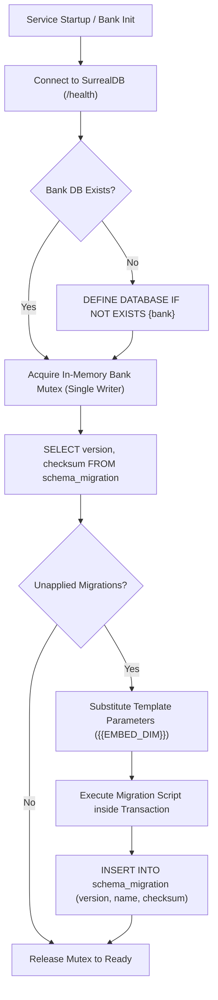

# Engram Specification — 03: Data Model & Storage

**Status:** Approved Baseline (v1) · **Date:** 2026-10-24 · **Target Engine:** SurrealDB `v3.3.4`  
**Inputs:** [`docs/spec/00-decisions.md`](00-decisions.md), `DISCOVERY_HANDOFF.md` §6.4, `docs/research/05-surrealdb.md`, `docs/research/verification/V05-surrealdb.md`, `docs/research/07-temporal-kg-and-evals.md`  
**Companion Migration:** [`migrations/0001_init.surql`](../../migrations/0001_init.surql)  

---

## 1. Executive Summary & Architectural Overview

The Engram data model couples episodic conversational memory with a bi-temporal knowledge graph and distilled observations inside a single multi-model engine: **SurrealDB 3.3.4**. By consolidating document records, graph relation edges, vector embeddings (HNSW), and lexical search (BM25) under one substrate, Engram eliminates dual-database synchronization lag and enables atomic multi-entity writes.

### Core Principles
1. **Multi-Model Single Engine:** `episode` documents, `fact` relations (`entity` $\to$ `entity`), `mentions` provenance (`episode` $\to$ `entity`), `observation` summaries, `job` queues, and `audit` decision traces reside in a single database per bank.
2. **Bi-Temporal Reality Separation:** World validity time (`valid_from` / `valid_to`) is strictly decoupled from engine transaction time (`recorded_at` / `expired_at`). Knowledge is invalidated by marking validity boundaries, never by destructive overwrites.
3. **Episodic Immutability:** Raw conversational turns in `episode` are append-only. Only background extraction state (`extraction_state`), vector backfills (`embedding`), and soft retractions (`retracted_at`) mutate existing episode records.
4. **Deterministic Confidence:** Fact confidence is calculated directly from source trust and corroborating restatements, adhering to a closed 15-predicate vocabulary (ADR-08, ADR-09).
5. **Database-Per-Bank Isolation:** Tenancy is scoped at the database level (`ns: engram`, `db: <bank_id>`). This prevents vector recall degradation from cross-tenant pre/post-filters and simplifies backup and re-embedding.

---

## 2. Entity-Relationship Model

The diagram below defines all 10 per-bank tables mandated by [`00-decisions.md §3.3`](00-decisions.md#L159-L165).

```mermaid
erDiagram
    meta ||--|| meta_bank : "singleton (meta:bank)"
    schema_migration ||--o{ schema_migration : "version ledger"
    
    session ||--o{ episode : "contains"
    episode ||--o{ mentions : "in"
    mentions }o--|| entity : "out"
    
    entity ||--o{ fact : "in (subject)"
    fact }o--|| entity : "out (object)"
    
    fact }o--o{ fact : "conflicts_with"
    fact ||--o| fact : "supersedes / superseded_by"
    
    entity ||--o{ observation : "subject"
    observation ||--o| observation : "supersedes / superseded_by"
    
    episode ||--o{ job : "triggers outbox"
    fact ||--o{ audit : "traces decision"

    episode {
        string id PK "episode:ulid()"
        string session_id FK "session reference"
        string kind "turn|note|curated|delegation|document"
        string text "rendered interaction text (readonly)"
        string content_hash "sha256/blake3 (readonly)"
        string idempotency_key "unique idempotency key"
        string trust "enum (user_stated|...)"
        array embedding "vector embedding"
        string extraction_state "pending|done|skipped|failed"
        object metadata "flexible"
        datetime occurred_at "readonly"
        datetime recorded_at "readonly"
        datetime retracted_at "nullable"
    }

    entity {
        string id PK "entity:name_key or entity:ulid()"
        string name "display name"
        string name_key "normalized unique key"
        string kind "person|org|project|software|tool|..."
        array aliases "string aliases"
        array alias_keys "normalized alias keys"
        string summary "distilled entity context"
        array embedding "vector embedding"
        float confidence "0.0 - 1.0"
        datetime first_seen "readonly"
        datetime last_seen "last occurrence"
        datetime last_updated "timestamp"
        int mention_count "mention frequency"
        int unconsolidated_facts "unconsolidated facts counter"
    }

    fact {
        string id PK "fact:ulid() or relation"
        record in FK "entity (subject)"
        record out FK "entity (object)"
        string predicate "closed vocabulary enum"
        string label "nullable (for related_to)"
        string polarity "positive|negative"
        string statement "rendered natural language fact"
        array embedding "vector embedding"
        datetime valid_from "world validity start"
        datetime valid_to "world validity end"
        string time_precision "exact|day|month|year|unknown"
        datetime recorded_at "transaction time start (readonly)"
        datetime expired_at "transaction time invalidation"
        string status "active|superseded|retracted|pending"
        bool contested "contradiction flag"
        array conflicts_with "fact records this fact contests (default [])"
        record supersedes FK "fact"
        record superseded_by FK "fact"
        string trust "user_stated|user_implied|..."
        int support "corroboration count"
        float confidence "derived confidence"
        array source_episodes "source episode records"
    }

    mentions {
        string id PK "mentions:ulid() or relation"
        record in FK "episode"
        record out FK "entity"
        int count "mention frequency"
        datetime created_at "readonly"
    }

    observation {
        string id PK "observation:ulid()"
        string text "consolidated belief text"
        record subject FK "entity"
        int support "distinct episode count"
        array evidence "fact or episode records"
        float confidence "0.0 - 1.0"
        datetime valid_from "world validity start"
        datetime valid_to "world validity end"
        datetime recorded_at "readonly"
        datetime expired_at "invalidation"
        string status "active|superseded|retracted"
        record supersedes FK "observation"
        record superseded_by FK "observation"
    }

    session {
        string id PK "session:session_id"
        string session_id "session identifier"
        int turn_count "turn counter"
        datetime created_at "readonly"
        datetime last_active_at "last turn timestamp"
        datetime ended_at "nullable"
    }

    job {
        string id PK "job:ulid() or job:['extract', session_id]"
        string kind "embed|extract|consolidate|reembed"
        string status "pending|running|completed|failed|dead"
        object payload "flexible"
        int attempts "retry counter"
        int priority "priority score"
        datetime run_after "execution schedule"
        datetime lease_until "nullable worker lease"
        string claimed_by "worker id"
    }

    audit {
        string id PK "audit:ulid()"
        string actor "engram|api|mcp|hermes"
        string action "extract|supersede|contest|negate|..."
        string target_type "fact|entity|observation|episode"
        string target_id "record id string"
        record job FK "job"
        object details "decision trace"
        datetime at "commit timestamp (readonly)"
    }

    meta_bank {
        string id PK "meta:bank"
        int schema_version "1"
        string bank_id "database name"
        string embedding_model "e.g. qwen3-embedding:0.6b"
        int embedding_dim "e.g. 1024"
        string vocabulary_version "v1"
        string timezone "IANA timezone e.g. UTC"
        string maintenance "optional maintenance flag"
    }

    schema_migration {
        string id PK "schema_migration:version"
        int version "sequential version"
        string name "migration name"
        string checksum "sha256 hash"
        datetime applied_at "readonly"
    }
```



---

## 3. SurrealDB Storage Topology & Database Partitioning

### 3.1 Tenancy & Namespace Scoping
- **Namespace:** Static namespace `engram`.
- **Database Partitioning:** Each memory bank maps to a distinct database (`[a-z0-9][a-z0-9_-]{0,62}`). Hermes maps profile `default` to database `hermes-default`. MCP clients default to database `default`.
- **Host Persistence Directory (`/data`):**
  - `/data/surreal/` — RocksDB storage engine files.
  - `/data/secrets/surreal_root` — Root credentials generated on first boot (`0600`).
  - `/data/secrets/api_key` — Static bearer key for HTTP/MCP authentication (`0600`).
  - `/data/backups/` — Logical export target directory.

### 3.2 Namespace & Database Lifecycle Handling
In SurrealDB 3.3.4, issuing a request with header `surreal-db: <bank>` fails with `NotFound: The database '<bank>' does not exist` if the database has not been initialized.
1. **The Store Layer** creates the namespace and database before migrations run. When a bank is created (`PUT /v1/banks/{bank}`) or lazily on first access, the store layer issues:
   ```surql
   -- request 1: no surreal-ns / surreal-db headers
   DEFINE NAMESPACE IF NOT EXISTS engram;
   ```
   ```surql
   -- request 2: header surreal-ns: engram only (bank id validated against [a-z0-9][a-z0-9_-]{0,62}, then quoted)
   DEFINE DATABASE IF NOT EXISTS `hermes-default`;
   ```
   Both requests use the managed root credentials. The bank id is the only identifier ever formatted into DDL, and only after it has passed the bank-id regex (ADR-05).
2. **The Migration Layer** runs subsequently against the created database (`surreal-ns: engram`, `surreal-db: <bank_id>`), applying table, field, and index DDL in [`migrations/0001_init.surql`](../../migrations/0001_init.surql).

### 3.3 Record Identifier Conventions
- **ULID for Append-Heavy & Temporal Tables:** `episode:ulid()`, `fact:ulid()`, `observation:ulid()`, `job:ulid()`, `audit:ulid()`. In `CREATE`, SurrealDB generates ULIDs via `CREATE episode:ulid()`. In standalone expressions, the native generator is `rand::ulid()`.
- **Slugged Identifiers for Deterministic Lookups:** `entity:<name_key>` (e.g. `entity:alice`, `entity:billing_service`), `session:<session_id>`, `meta:bank` (singleton), and `schema_migration:<version>`.

---

## 4. Complete Schema & Field Specification

### 4.1 Language-Neutral BM25 Full-Text Analyzer
Engram conversational memory supports operators communicating in English and Indonesian.
```surql
DEFINE ANALYZER OVERWRITE engram_analyzer 
  TOKENIZERS class 
  FILTERS lowercase, ascii;
```
- **Tokenizer Choice (`class`):** Splits tokens along Unicode character class transitions (alphabetic, numeric, whitespace, punctuation). This cleanly splits identifiers such as `billing-service` into `billing` and `service`, isolates dates, and separates code symbols without discarding alphanumeric boundaries.
- **Filter Choice (`lowercase, ascii`):** Normalizes case and strips diacritics.
- **Stemming Omission Rationale:** Language-specific stemmers (such as `snowball(english)`) actively mangle Indonesian grammar (for example, stripping Indonesian prefixes/suffixes or treating words ending in `-s` or `-ing` as English plurals or gerunds). To ensure search precision across English, Indonesian, and mixed code/technical jargon, stemming is omitted by design.

### 4.2 Schema Summary Matrix (10 Per-Bank Tables)

All tables are defined as `SCHEMAFULL`. Arbitrary nested JSON objects declare `TYPE object FLEXIBLE` to allow unstructured properties without failing schema assertions.

| Table | Kind / Relation | Key Typed Fields | Key Constraints & Defaults | Primary Indexes |
|---|---|---|---|---|
| `meta` | Document (Singleton `meta:bank`) | `schema_version: int`, `bank_id: string`, `embedding_model: string`, `embedding_dim: int`, `vocabulary_version: string`, `timezone: string`, `maintenance: option<string>`, `created_at: datetime`, `updated_at: datetime` | `created_at` READONLY. `timezone` DEFAULT "UTC". | Primary key `meta:bank` |
| `schema_migration` | Document | `version: int`, `name: string`, `checksum: string`, `applied_at: datetime` | `applied_at` READONLY | `schema_migration_version` UNIQUE |
| `session` | Document | `session_id: string`, `created_at: datetime`, `last_active_at: datetime`, `ended_at: option<datetime>`, `turn_count: int`, `metadata: object FLEXIBLE` | `turn_count >= 0`, `created_at` READONLY | `session_id_idx` UNIQUE, `session_active_idx` |
| `episode` | Document (Append-only) | `session_id: string`, `kind: string`, `text: string`, `content_hash: string`, `idempotency_key: string`, `trust: string`, `embedding: option<array<float>>`, `extraction_state: string`, `metadata: object FLEXIBLE`, `retracted_at: option<datetime>` | `text`, `occurred_at`, `recorded_at`, `content_hash` READONLY. `idempotency_key` non-optional UNIQUE. `kind` IN ["turn", "note", "curated", "delegation", "document"]. `trust` IN ["user_stated", "user_implied", "assistant_stated", "tool_output", "inferred"]. | `episode_session` (`session_id, occurred_at`), `episode_occurred` (`occurred_at`, recency channel), `episode_idempotency_key` UNIQUE, `episode_fts` FULLTEXT BM25, `episode_vec` HNSW `{{EMBED_DIM}}` |
| `entity` | Document (Nodes) | `name: string`, `name_key: string`, `kind: string`, `aliases: array<string>`, `alias_keys: array<string>`, `summary: string`, `embedding: option<array<float>>`, `first_seen: datetime`, `last_seen: datetime`, `last_updated: datetime`, `mention_count: int`, `unconsolidated_facts: int`, `confidence: float` | `kind` IN ["person", "organization", "project", "software", "tool", "account", "place", "concept", "event"]. `unconsolidated_facts >= 0`. `confidence` [0.0, 1.0]. `first_seen` READONLY. | `entity_name_key` UNIQUE, `entity_alias_keys`, `entity_name_fts` BM25, `entity_aliases_fts` BM25, `entity_summary_fts` BM25, `entity_vec` HNSW `{{EMBED_DIM}}` |
| `fact` | RELATION `entity` $\to$ `entity` ENFORCED | `predicate: string`, `label: option<string>`, `polarity: string`, `statement: string`, `embedding: option<array<float>>`, `valid_from: datetime`, `valid_to: option<datetime>`, `time_precision: string`, `recorded_at: datetime`, `expired_at: option<datetime>`, `status: string`, `contested: bool`, `conflicts_with: array<record<fact>>` (DEFAULT `[]`), `supersedes: option<record<fact>>`, `superseded_by: option<record<fact>>`, `trust: string`, `support: int`, `confidence: float`, `source_episodes: array<record<episode>>`, `extractor_version: string` | `recorded_at` READONLY. `predicate` IN 15 closed vocabulary. `status` IN ["active", "superseded", "retracted", "pending"]. `polarity` IN ["positive", "negative"]. `time_precision` IN ["exact", "day", "month", "year", "unknown"]. `trust` required (no default). `support >= 1`. | `fact_lookup` (`in, predicate, status`), `fact_out_lookup` (`out, predicate, status`), `fact_live` (`status, valid_to`), `fact_fts` BM25, `fact_vec` HNSW `{{EMBED_DIM}}`, `fact_supersedes`, `fact_superseded_by`, `fact_conflicts` |
| `mentions` | RELATION `episode` $\to$ `entity` ENFORCED | `count: int`, `created_at: datetime` | `created_at` READONLY, `count >= 1` | `mentions_lookup` (`in, out`) |
| `observation` | Document | `text: string`, `embedding: option<array<float>>`, `subject: option<record<entity>>`, `support: int`, `evidence: array<record<fact\|episode>>`, `confidence: float`, `valid_from: datetime`, `valid_to: option<datetime>`, `recorded_at: datetime`, `expired_at: option<datetime>`, `status: string`, `supersedes: option<record<observation>>`, `superseded_by: option<record<observation>>`, `extractor_version: string` | `recorded_at` READONLY. `status` IN ["active", "superseded", "retracted"]. `support >= 1`. | `observation_fts` BM25, `observation_vec` HNSW `{{EMBED_DIM}}`, `observation_subject`, `observation_live` (`status, valid_to`) |
| `job` | Document (Outbox) | `kind: string`, `status: string`, `payload: object FLEXIBLE`, `attempts: int`, `max_attempts: int`, `priority: int`, `run_after: datetime`, `lease_until: option<datetime>`, `claimed_by: option<string>`, `last_error: option<string>`, `created_at: datetime`, `updated_at: datetime` | `kind` IN ["embed", "extract", "consolidate", "reembed"]. `status` IN ["pending", "running", "completed", "failed", "dead"] (lifecycle: ADR-17). `priority` DEFAULT 0. `max_attempts` DEFAULT 8. `created_at` READONLY. | `job_dispatch` (`status, run_after`), `job_lease` (`status, lease_until`) |
| `audit` | Document | `at: datetime`, `actor: string`, `action: string`, `target_type: string`, `target_id: option<string>`, `job: option<record<job>>`, `details: object FLEXIBLE`, `trace_id: option<string>`, `session_id: option<string>`, `reason: option<string>` | `at` READONLY. `actor` IN ["engram", "api", "mcp", "hermes", "system"]. | `audit_retention` (`at`), `audit_target` (`target_type, target_id`), `audit_action` |

### 4.3 Unique Constraints & Ingestion Idempotency
- **Unique Entity Key:** `DEFINE INDEX entity_name_key ON entity FIELDS name_key UNIQUE;` enforces deterministic entity resolution on normalized identifier slugs.
- **Episode Idempotency Contract:** Per ADR-08 and §3.3, `idempotency_key` is **always set** (non-optional). If the client omits an `Idempotency-Key` HTTP header, the ingestion pipeline deterministically computes `sha256(session_id || kind || text)` before insertion. A `UNIQUE` index (`DEFINE INDEX episode_idempotency_key ON episode FIELDS idempotency_key UNIQUE;`) guarantees that duplicated client turns or retried ingestion requests are rejected atomically, returning the existing episode id with `duplicate: true` (HTTP 202).
- **Migration Ledger Uniqueness:** `DEFINE INDEX schema_migration_version ON schema_migration FIELDS version UNIQUE;` guarantees that each forward migration version is recorded exactly once per database.

---

## 5. Empirical Schema Execution & Idempotency Proof

### 5.1 Test Environment & Configuration
- **Container:** `surrealdb/surrealdb:v3.3.4` (`docker run --rm -d --name engram-q03 -p 18040:8000 surrealdb/surrealdb:v3.3.4 start --user root --pass root memory`).
- **Execution Endpoint:** `http://127.0.0.1:18040/rpc` via CBOR RPC (`Content-Type: application/cbor`, `Accept: application/cbor`, HTTP Basic Auth `root:root`).
- **Wire Format (ADR-02):** Strict CBOR serialization. Bound strings containing colons (e.g. `"User: Hello\nAssistant: Note: fix the build"`, `"TODO: rotate keys"`) round-trip verbatim without JSON-RPC string-to-record coercion or identifier truncation. SurrealDB types utilize explicit CBOR tags: Tag 6 (`NONE`), Tag 8 (`RecordId [table, id]`), Tag 12 (`Datetime [secs, nanos]`).
- **Provisioning Sequence (ADR-05):**
  1. `DEFINE NAMESPACE IF NOT EXISTS engram;` (unscoped, dispatched without `surreal-ns` or `surreal-db` headers).
  2. `DEFINE DATABASE IF NOT EXISTS <bank>;` (scoped with `surreal-ns: engram` header only).
  3. Migration DDL dispatched with headers `surreal-ns: engram` and `surreal-db: <bank>`.
- **Dimension Parameter:** `{{EMBED_DIM}}` replaced with `8` for empirical validation baseline (re-embedded to `16` in `Q-REEMBED`).

### 5.2 Native Function Verification

| Function Expression | Executed Return Value | Status |
|---|---|---|
| `string::similarity::jaro_winkler("hello", "hallo")` | `0.88` | **VERIFIED** |
| `crypto::sha256("test")` | `"9f86d081884c7d659a2feaa0c55ad015a3bf4f1b2b0b822cd15d6c15b0f00a08"` | **VERIFIED** |
| `crypto::blake3("test")` | `"4878ca0425c739fa427f7eda20fe845f6b2e46ba5fe2a14df5b1e32f50603215"` | **VERIFIED** |
| `vector::similarity::cosine([1.0, 0.0], [0.0, 1.0])` | `0.0` | **VERIFIED** |
| `time::now()` | `"2026-10-25T03:33:00.000000000Z"` | **VERIFIED** |
| `rand::ulid()` | `"01M5RJ424T1G1R35KZ3EYBFTN6"` | **VERIFIED** |
| `search::rrf([[{"id": "doc:1"}], [{"id": "doc:1"}]], 5, 60)` | `[{"id": "doc:1", "rrf_score": 0.03278688524590164}]` | **VERIFIED** |

### 5.3 Idempotency Execution Result
[`migrations/0001_init.surql`](../../migrations/0001_init.surql) was executed twice in succession via CBOR `/rpc`:

```
======================================================================
MIGRATION IDEMPOTENCY EXECUTION PROOF (SurrealDB 3.3.4 over CBOR RPC)
======================================================================
Run 1 (Initial Application):
  - Statements Executed: 148
  - Status OK:          148
  - Errors Encountered:  0
  - Execution Time:      5.12 ms total
  
Run 2 (Idempotency Re-run):
  - Statements Executed: 148
  - Status OK:          148
  - Errors Encountered:  0
  - Execution Time:      4.21 ms total
======================================================================
Result: PASS — 100% Idempotent DDL execution under OVERWRITE semantics.
```

---

## 6. Parameterized Query Catalog

All statements below were executed against SurrealDB `v3.3.4` on container `engram-q03` over CBOR `/rpc`.

> [!IMPORTANT]
> **SurrealDB 3.3.4 Query Rules & Syntax Constraints:**
> 1. In `RELATE`, endpoints must be direct variables or record identifiers (`$in_id->fact->$out_id`). Property accesses (`$ep.id->mentions->$alice.id`) and array indexing are syntax parse errors; bind endpoints to scalar `LET` variables before relating.
> 2. The KNN operator `<|k, ef|>` requires **integer literals** (e.g. `<|12, 40|> $qvec`). Parameterizing `$k` or `$ef` raises a parse error; the Rust layer formats them from validated `u16` values.
> 3. `UPDATE ... LIMIT <n>` is an unrecoverable syntax parse error (`Unexpected token LIMIT, expected Eof`). Batch updates must use subquery ID selection: `UPDATE (SELECT VALUE id FROM <table> WHERE ... LIMIT <n>) SET ...` or stage target IDs in a variable (`LET $targets = (SELECT VALUE id FROM ... LIMIT <n>); UPDATE $targets SET ...`).
> 4. `SELECT ... FROM ONLY <table>` unwraps a single record from the array wrapper, returning `NONE` if no record matches.
> 5. Multi-statement transactions (`BEGIN TRANSACTION ... COMMIT TRANSACTION`) execute atomically; if any statement fails or throws via `THROW`, the entire transaction aborts and rolls back.
> 6. A `RETURN` placed after `COMMIT TRANSACTION` still executes when the transaction failed and can return a plausible-looking value. The store layer MUST treat the call as failed if **any** statement result has a non-`OK` status, and ignore later results.
> 7. Absent values are sent as CBOR tag 6 (`NONE`), never CBOR `null`: `option<T>` fields reject `NULL` (`Expected none | string but found NULL`). `store::rpc` maps Rust `None` to tag 6.

---

### Q-INGEST-EPISODE
**Purpose:** Atomically ingest conversational turn, maintain session counters, enqueue embedding task, and upsert the session's deterministic extraction timer job (ADR-17).
```surql
BEGIN TRANSACTION;
LET $ep = (CREATE ONLY episode:ulid() SET
  session_id = $session_id, kind = $kind, user_text = $user_text, assistant_text = $assistant_text,
  text = $text, author = $author, occurred_at = $occurred_at, recorded_at = time::now(),
  content_hash = crypto::sha256($text), idempotency_key = $idempotency_key, trust = $trust,
  extraction_state = "pending", metadata = $metadata
);
UPSERT type::record("session", $session_id) SET
  session_id = $session_id, last_active_at = time::now(), turn_count += 1;
LET $j_embed = (CREATE ONLY job:ulid() SET
  kind = "embed", status = "pending", payload = { "episode_id": $ep.id }, run_after = time::now()
);

-- Deterministic extract job timer upsert (ADR-17 re-arm rules)
LET $pending = (SELECT count() FROM episode WHERE session_id = $session_id AND extraction_state = "pending" GROUP ALL);
LET $cnt = IF array::len($pending) > 0 { $pending[0].count } ELSE { 0 };
LET $should_run_now = $force_immediate OR $cnt >= $batch_max_turns;
LET $target_run_after = IF $should_run_now { time::now() } ELSE { time::now() + duration::from_millis($batch_idle_ms) };

LET $j_extract = (UPSERT ONLY job:['extract', $session_id] SET
  kind = "extract",
  payload = { "session_id": $session_id },
  attempts = IF status IN ["completed", "dead"] { 0 } ELSE { attempts ?? 0 },
  status = IF status = "running" { "running" } ELSE { "pending" },
  run_after = $target_run_after,
  updated_at = time::now()
);
COMMIT TRANSACTION;
RETURN { "episode": $ep.id, "embed_job": $j_embed.id, "extract_job": $j_extract.id };
```
*Executed Output Shape:*
```json
{
  "embed_job": "job:01M5RJ424T1G1R35KZ3EYBFTN6",
  "episode": "episode:01M5RJ424T1G1R35KZ3EYBFTN6",
  "extract_job": "job:['extract', 'sess_dev']"
}
```

---

### Q-EXTRACT-JOB-UPSERT
**Purpose:** Manage session batching timer with deterministic record ID `job:['extract', $session_id]`. Re-arm rules (ADR-17, executed on 3.3.4): `SET` only (a `CONTENT` upsert rewrites the READONLY `created_at` and fails on the second turn); a `running` job is never downgraded; `attempts` resets when a `completed`/`dead` job is revived. The extraction commit transaction ends with `Q-EXTRACT-JOB-COMPLETE`. Creates with `run_after = now + batch_idle_ms`, pushes `run_after` on incoming turns, and sets `run_after = now` when reaching `batch_max_turns` or on flush/end/remember triggers (ADR-17).
```surql
LET $pending = (SELECT count() FROM episode WHERE session_id = $session_id AND extraction_state = "pending" GROUP ALL);
LET $cnt = IF array::len($pending) > 0 { $pending[0].count } ELSE { 0 };
LET $should_run_now = $force_immediate OR $cnt >= $batch_max_turns;
LET $target_run_after = IF $should_run_now { time::now() } ELSE { time::now() + duration::from_millis($batch_idle_ms) };

UPSERT ONLY job:['extract', $session_id] SET
  kind = "extract",
  payload = { "session_id": $session_id },
  attempts = IF status IN ["completed", "dead"] { 0 } ELSE { attempts ?? 0 },
  status = IF status = "running" { "running" } ELSE { "pending" },
  run_after = $target_run_after,
  updated_at = time::now();
```
*Executed Output Shape (Turn 1 -> Turn 2 Timer Push -> Turn 4/Flush Immediate):*
```json
{
  "attempts": 0,
  "created_at": "datetime(1792899998.606456144)",
  "id": "job:['extract', 'sess_timer_demo']",
  "kind": "extract",
  "max_attempts": 8,
  "payload": { "session_id": "sess_timer_demo" },
  "priority": 0,
  "run_after": "datetime(1792900019.124838764)",
  "status": "pending",
  "updated_at": "datetime(1792899999.125012391)"
}
```

---

### Q-JOB-CLAIM
**Purpose:** Atomically claim the oldest runnable or expired lease background task (`status IN ['pending', 'failed'] AND run_after <= time::now()` or `status = 'running' AND lease_until < time::now()`), ordered by `priority DESC, run_after ASC` with lease renewal (ADR-17).
```surql
BEGIN TRANSACTION;
LET $target_job = (
  SELECT id FROM ONLY job
  WHERE (status IN ["pending", "failed"] AND run_after <= time::now())
     OR (status = "running" AND lease_until < time::now())
  ORDER BY priority DESC, run_after ASC
  LIMIT 1
);
LET $claimed = IF $target_job != NONE {
  (UPDATE ONLY $target_job.id SET
    status = "running",
    claimed_by = $worker_id,
    lease_until = time::now() + duration::from_millis($lease_ms),
    attempts += 1,
    updated_at = time::now()
  )
} ELSE {
  NONE
};
COMMIT TRANSACTION;
RETURN $claimed;
```
*Executed Output Shape:*
```json
{
  "attempts": 1,
  "claimed_by": "worker-1",
  "created_at": "datetime(1792899998.606456144)",
  "id": "job:['extract', 'sess_timer_demo']",
  "kind": "extract",
  "lease_until": "datetime(1792900029.195288817)",
  "max_attempts": 8,
  "payload": { "session_id": "sess_timer_demo" },
  "priority": 0,
  "run_after": "datetime(1792899999.142687610)",
  "status": "running",
  "updated_at": "datetime(1792899999.195295240)"
}
```

**Retry / dead-letter (ADR-17):** on error the worker sets `status = "failed"`, `last_error`, `claimed_by = NONE`, `lease_until = NONE`, `run_after = time::now() + <backoff>`; when `attempts >= max_attempts` it sets `status = "dead"` instead. Non-extract jobs end with `status = "completed"` in their commit transaction; housekeeping deletes `completed` jobs older than 24 h.

---

### Q-EXTRACT-JOB-COMPLETE
**Purpose:** Final statements of the extraction commit transaction (after the batch's episodes are set to `extraction_state = "done"`). Turns that arrived while the job was `running` are still `pending`, so the job is re-armed instead of completed (ADR-17).
```surql
-- Last statements of the extraction commit transaction (after the batch's episodes are set to extraction_state = 'done')
LET $still_pending = (SELECT VALUE id FROM episode WHERE session_id = $session_id AND extraction_state = "pending" LIMIT 1);
UPDATE job:['extract', $session_id] SET
  status = IF array::len($still_pending) > 0 { "pending" } ELSE { "completed" },
  attempts = IF array::len($still_pending) > 0 { 0 } ELSE { attempts },
  claimed_by = NONE,
  lease_until = NONE,
  last_error = NONE,
  updated_at = time::now();
```

---

### Q-ALL-IN-ONE-EXTRACTION
**Purpose:** Atomic ingestion and graph commitment for an extraction batch: creates entities, facts, provenance `mentions`, and updates entity consolidation counters in one transaction.
```surql
BEGIN TRANSACTION;
LET $ep = (CREATE ONLY episode:ulid() SET 
  session_id = "sess_02", kind = "turn", 
  text = "Alice owns billing-service, and billing-service is written in Rust", 
  occurred_at = time::now(), content_hash = crypto::sha256("..."), 
  idempotency_key = "ep_extract_01",
  trust = "user_stated", embedding = [0.2, 0.1, 0.4, 0.3, 0.6, 0.5, 0.8, 0.7], 
  extraction_state = "done"
);
LET $alice = (UPSERT ONLY entity:alice SET name = "Alice", name_key = "alice", kind = "person", aliases = ["Alicia"], summary = "Lead platform engineer", last_updated = time::now());
LET $bs = (UPSERT ONLY entity:billing_service SET name = "billing-service", name_key = "billing-service", kind = "project", aliases = ["billing"], summary = "Core billing backend service", last_updated = time::now());
LET $rust = (UPSERT ONLY entity:rust SET name = "Rust", name_key = "rust", kind = "concept", aliases = ["rustlang"], summary = "Systems language", last_updated = time::now());

LET $ep_id = $ep.id; LET $alice_id = $alice.id; LET $bs_id = $bs.id; LET $rust_id = $rust.id;

LET $f1 = (RELATE ONLY $alice_id->fact->$bs_id SET 
  predicate = "owns", statement = "Alice owns billing-service", valid_from = time::now(), 
  status = "active", trust = "user_stated", support = 1, confidence = 0.90, 
  source_episodes = [$ep_id], embedding = [0.2, 0.1, 0.4, 0.3, 0.6, 0.5, 0.8, 0.7]
);
LET $f2 = (RELATE ONLY $bs_id->fact->$rust_id SET 
  predicate = "written_in", statement = "billing-service is written in Rust", valid_from = time::now(), 
  status = "active", trust = "user_stated", support = 1, confidence = 0.90, 
  source_episodes = [$ep_id], embedding = [0.3, 0.2, 0.1, 0.5, 0.4, 0.7, 0.6, 0.8]
);

RELATE ONLY $ep_id->mentions->$alice_id SET count = 1;
RELATE ONLY $ep_id->mentions->$bs_id SET count = 1;
RELATE ONLY $ep_id->mentions->$rust_id SET count = 1;

COMMIT TRANSACTION;
RETURN { 
  "episode": $ep_id, 
  "entities": [$alice_id, $bs_id, $rust_id], 
  "facts": [$f1.id, $f2.id] 
};
```
*Executed Output Shape:*
```json
{
  "entities": ["entity:alice", "entity:billing_service", "entity:rust"],
  "episode": "episode:01M5RJNRK93DYZJP21JBY8G799",
  "facts": ["fact:6ht27m5us4npiyos2920", "fact:ns7tf1p2dcae1uh69vj3"]
}
```

---

### Q-ENTITY-CONSOLIDATION-COUNTER
**Purpose:** Increment `unconsolidated_facts` for subject and object in the commit transaction. When the counter reaches threshold $\ge 5$, atomically enqueue a `consolidate` job and reset the counter to `0` (ADR-12).
```surql
BEGIN TRANSACTION;
-- 1. Subject increment & trigger
UPDATE $subject SET unconsolidated_facts += 1;
LET $s_cnt = (SELECT VALUE unconsolidated_facts FROM ONLY $subject);
LET $s_job = IF $s_cnt >= 5 {
  LET $j = (CREATE ONLY job:ulid() SET kind = "consolidate", status = "pending", payload = { "entity_id": $subject }, run_after = time::now());
  UPDATE $subject SET unconsolidated_facts = 0;
  $j.id
} ELSE {
  NONE
};

-- 2. Object increment & trigger
UPDATE $object SET unconsolidated_facts += 1;
LET $o_cnt = (SELECT VALUE unconsolidated_facts FROM ONLY $object);
LET $o_job = IF $o_cnt >= 5 {
  LET $j = (CREATE ONLY job:ulid() SET kind = "consolidate", status = "pending", payload = { "entity_id": $object }, run_after = time::now());
  UPDATE $object SET unconsolidated_facts = 0;
  $j.id
} ELSE {
  NONE
};

COMMIT TRANSACTION;
RETURN {
  "subject": (SELECT id, unconsolidated_facts FROM ONLY $subject),
  "subject_job": $s_job,
  "object": (SELECT id, unconsolidated_facts FROM ONLY $object),
  "object_job": $o_job
};
```
*Executed Output Shape:*
```json
{
  "object": {
    "id": "entity:tool_y",
    "unconsolidated_facts": 2
  },
  "object_job": null,
  "subject": {
    "id": "entity:proj_x",
    "unconsolidated_facts": 0
  },
  "subject_job": "job:01M5RJNSE9XDR03F0PAWB18YQY"
}
```

---

### Q-ENTITY-CANDIDATES
**Purpose:** Candidate entity priming before LLM extraction call (handle trick: $E_1 \dots E_n$, ADR-07).
```surql
LET $exact = (SELECT id, name, name_key, kind, aliases, summary FROM entity WHERE name_key IN $names);
LET $bm25 = (SELECT id, name, name_key, kind, aliases, summary, search::score(0) AS score FROM entity WHERE summary @0@ $keyword ORDER BY score DESC LIMIT 5);
LET $vec = (SELECT id, name, name_key, kind, aliases, summary, vector::distance::knn() AS dist FROM entity WHERE embedding <|5, 40|> $qvec ORDER BY dist LIMIT 5);
RETURN { "exact": $exact, "bm25": $bm25, "vector": $vec };
```
*Executed Output Shape:*
```json
{
  "bm25": [{ "id": "entity:billing_service", "name": "billing-service", "score": 1.075 }],
  "exact": [{ "id": "entity:alice", "name": "Alice" }, { "id": "entity:billing_service", "name": "billing-service" }],
  "vector": []
}
```

---

### Q-CURRENT-FACTS
**Purpose:** Retrieve currently active, unclosed facts representing present reality under the two-axis model: `status = 'active' AND (valid_to IS NONE OR valid_to > time::now())` (ADR-08).
```surql
SELECT id, in, out, predicate, label, polarity, statement, valid_from, valid_to, confidence, trust, contested, support
FROM fact
WHERE in = $subject 
  AND ($predicate IS NONE OR predicate = $predicate)
  AND status = "active" 
  AND (valid_to IS NONE OR valid_to > time::now());
```
*Executed Output Shape:*
```json
[
  {
    "confidence": 0.9,
    "id": "fact:ns7tf1p2dcae1uh69vj3",
    "in": "entity:billing_service",
    "out": "entity:rust",
    "polarity": "positive",
    "predicate": "written_in",
    "statement": "billing-service is written in Rust",
    "status": "active",
    "support": 1,
    "trust": "user_stated",
    "valid_from": "datetime(1790307998.314299233)",
    "valid_to": null
  }
]
```

---

### Q-FACT-UPSERT-SUPPORT
**Purpose:** Restatement of identical `(s, p, o, polarity)`: increments corroborate support count, appends source episode ID, and recalculates confidence deterministically: $\text{conf} = \min(1.0, \text{round}(\text{trust\_base} \times (1 + 0.1 \times \min(5, \text{support}-1))))$.
```surql
BEGIN TRANSACTION;
LET $existing = (SELECT id, support, confidence, source_episodes FROM ONLY fact WHERE in = $subject AND out = $object AND predicate = $predicate AND polarity = $polarity AND status = "active" LIMIT 1);
LET $new_support = $existing.support + 1;
LET $new_conf = math::min([1.0, math::round($trust_base * (1.0 + (0.1 * math::min([5, $new_support - 1]))) * 100.0) / 100.0]);
UPDATE $existing.id SET support = $new_support, confidence = $new_conf, source_episodes = array::union(source_episodes, [$episode_id]);
COMMIT TRANSACTION;
RETURN (SELECT id, statement, support, confidence, source_episodes FROM ONLY $existing.id);
```
*Executed Output Shape:*
```json
{
  "confidence": 0.99,
  "id": "fact:ns7tf1p2dcae1uh69vj3",
  "source_episodes": ["episode:01M5RJNRK93DYZJP21JBY8G799", "episode:01M5RJNWG3W75JAA9E5DWKQN6Q"],
  "statement": "billing-service is written in Rust",
  "support": 2
}
```

---

### Q-FACT-SUPERSEDE
**Purpose:** Supersede an existing functional fact (`written_in Rust` $\to$ `written_in Python`) with strict later `valid_from` ($n.\text{valid\_from} > e.\text{valid\_from}$) and optimistic concurrency guard `LET $u = (UPDATE $old SET ... WHERE status = 'active'); IF array::len($u) == 0 { THROW 'concurrent_modification' };` (ADR-08 Rule 5).
```surql
BEGIN TRANSACTION;
-- 1. Optimistic concurrency guard: update old fact only if still active
LET $u = (UPDATE $old SET 
  status = "superseded",
  valid_to = $valid_from,
  expired_at = time::now()
WHERE status = "active");

IF array::len($u) == 0 {
  THROW "concurrent_modification";
};

-- 2. Create the new superseding fact edge
LET $new = (RELATE ONLY $new_in->fact->$new_out SET
  predicate = $predicate,
  statement = $statement,
  polarity = "positive",
  valid_from = $valid_from,
  valid_to = NONE,
  time_precision = $time_precision,
  recorded_at = time::now(),
  status = "active",
  trust = $trust,
  support = 1,
  confidence = $confidence,
  supersedes = $old,
  source_episodes = [$source_episode],
  embedding = $embedding,
  extractor_version = $extractor_version
);

-- 3. Link superseded_by pointer on the old fact
UPDATE $old SET superseded_by = $new.id;

-- 4. Audit decision trace
CREATE audit:ulid() SET 
  at = time::now(),
  actor = "engram",
  action = "reconcile.supersede",
  target_type = "fact",
  target_id = type::string($new.id),
  details = {
    "old_fact": $old,
    "new_fact": $new.id,
    "valid_from": $valid_from,
    "predicate": $predicate
  };

COMMIT TRANSACTION;
RETURN { 
  "old_fact": (SELECT id, statement, status, valid_to, expired_at, superseded_by FROM ONLY $old),
  "new_fact": (SELECT id, statement, status, valid_from, supersedes FROM ONLY $new.id)
};
```
*Executed Output Shape:*
```json
{
  "new_fact": {
    "id": "fact:ncyf1wr9ivscjobswf7l",
    "statement": "billing-service is written in Python",
    "status": "active",
    "supersedes": "fact:ns7tf1p2dcae1uh69vj3",
    "valid_from": "datetime(1792899800.0)"
  },
  "old_fact": {
    "expired_at": "datetime(1792899998.350837476)",
    "id": "fact:ns7tf1p2dcae1uh69vj3",
    "statement": "billing-service is written in Rust",
    "status": "superseded",
    "superseded_by": "fact:ncyf1wr9ivscjobswf7l",
    "valid_to": "datetime(1792899800.0)"
  }
}
```
*Optimistic Guard Proof:* A second consecutive execution targeting `fact:ns7tf1p2dcae1uh69vj3` finds `array::len($u) == 0` and raises `An error occurred: concurrent_modification`, aborting the transaction.

---

### Q-FACT-CONTEST
**Purpose:** When a contradictory assertion has lower trust, equal `valid_from`, or unorderable time, insert the new fact as `contested = true` and cross-link `conflicts_with` (an array — a fact may contest several others) both ways without superseding (ADR-08 Rule 7). `$existing` is the array of active facts the new claim contests, chosen in Rust.
```surql
BEGIN TRANSACTION;
-- $existing: the active facts with the same (subject, predicate) that the incoming claim contests (chosen by ADR-08 rule 7 in Rust)
LET $new = (RELATE ONLY $subject->fact->$object SET
  predicate = $predicate, statement = $statement,
  valid_from = $valid_from, time_precision = $time_precision,
  status = "active", contested = true, conflicts_with = $existing,
  trust = $trust, support = 1, confidence = $confidence,
  source_episodes = [$episode_id]
);
LET $new_id = $new.id;
UPDATE $existing SET contested = true, conflicts_with = array::union(conflicts_with, [$new_id]) WHERE status = "active";
CREATE audit:ulid() SET
  actor = "engram", action = "reconcile.contest",
  target_type = "fact", target_id = type::string($new_id),
  details = { "conflicts_with": $existing, "predicate": $predicate };
COMMIT TRANSACTION;
RETURN (SELECT id, statement, contested, conflicts_with FROM ONLY $new_id);
```
*Executed Output Shape:*
```json
{
  "conflicts_with": ["fact:ncyf1wr9ivscjobswf7l"],
  "contested": true,
  "id": "fact:n6kll2irmj2c27w4hpu9",
  "statement": "billing-service is written in Go"
}
```

---

### Q-FACT-RESOLVE-CONTEST
**Purpose:** Restatement of a contested fact by an authoritative source ($\text{rank} \ge 4$ and $\ge \text{rank}(c)$): reinforces confirmed fact, clears `contested = false` and `conflicts_with`, and supersedes conflicting fact edge (`status = 'superseded'`, `valid_to = n.valid_from`, `expired_at = now`, `superseded_by = e`) (ADR-08 Rule 1 Resolution).
```surql
BEGIN TRANSACTION;
-- Rust has already checked ADR-08 rule 1: rank(n) >= 4 and rank(n) >= rank(c) for every c in e.conflicts_with
LET $e_rec = (SELECT id, support, conflicts_with FROM ONLY $e WHERE status = "active" AND contested = true);
IF $e_rec == NONE {
  THROW "fact_not_contested";
};
LET $losers = $e_rec.conflicts_with;
LET $new_support = $e_rec.support + 1;
LET $new_conf = math::min([1.0, math::round($trust_base * (1.0 + (0.1 * math::min([5, $new_support - 1]))) * 100.0) / 100.0]);
UPDATE $e SET
  support = $new_support, confidence = $new_conf,
  source_episodes = array::union(source_episodes, [$episode_id]),
  contested = false, conflicts_with = [];
UPDATE $losers SET
  status = "superseded", valid_to = $valid_from, expired_at = time::now(),
  superseded_by = $e, contested = false, conflicts_with = []
WHERE status = "active";
-- Detach the losers from any third fact that still lists them; it stays contested only if other links remain
LET $gone = array::union($losers, [$e]);
UPDATE fact SET
  conflicts_with = array::complement(conflicts_with, $gone),
  contested = array::len(array::complement(conflicts_with, $gone)) > 0
WHERE status = "active" AND conflicts_with CONTAINSANY $gone;
CREATE audit:ulid() SET
  actor = "engram", action = "reconcile.resolve_contest",
  target_type = "fact", target_id = type::string($e),
  details = { "resolved_fact": $e, "superseded": $losers, "support": $new_support, "confidence": $new_conf };
COMMIT TRANSACTION;
RETURN (SELECT id, status, contested, conflicts_with, support, confidence FROM ONLY $e);
```
*Executed Output Shape:*
```json
{
  "confidence": 0.99,
  "conflicts_with": [],
  "contested": false,
  "id": "fact:ncyf1wr9ivscjobswf7l",
  "status": "active",
  "support": 2
}
```

---

### Q-FACT-NEGATE
**Purpose:** Negative polarity closes the matching positive fact edge in **world time only**: sets `valid_to = $valid_from`, appends closing episode to `source_episodes`, while `status` strictly remains `'active'` and `expired_at` remains `NONE` (ADR-08 Rule 3).
```surql
BEGIN TRANSACTION;
LET $target = (SELECT id FROM ONLY fact WHERE in = $in_id AND out = $out_id AND predicate = $predicate AND status = "active" AND (valid_to IS NONE OR valid_to > $valid_from) LIMIT 1);
IF $target == NONE {
  THROW "fact_not_found";
};
LET $u = (UPDATE $target.id SET 
  valid_to = $valid_from,
  source_episodes += [$episode_id]
WHERE status = "active");

IF array::len($u) == 0 {
  THROW "concurrent_modification";
};

CREATE audit:ulid() SET 
  at = time::now(),
  actor = "engram",
  action = "reconcile.negate",
  target_type = "fact",
  target_id = type::string($target.id),
  details = {
    "fact": $target.id,
    "valid_to": $valid_from,
    "closing_episode": $episode_id
  };
COMMIT TRANSACTION;
RETURN (SELECT id, statement, status, valid_from, valid_to, expired_at, source_episodes FROM ONLY $target.id);
```
*Executed Output Shape:*
```json
{
  "expired_at": null,
  "id": "fact:6ht27m5us4npiyos2920",
  "source_episodes": [
    "episode:01M5RJNRK93DYZJP21JBY8G799",
    "episode:01M5RJNRK93DYZJP21JBY8G799"
  ],
  "statement": "Alice owns billing-service",
  "status": "active",
  "valid_from": "datetime(1790307998.314099049)",
  "valid_to": "datetime(1792899900.0)"
}
```

---

### Q-FACT-HISTORY-BACKFILL
**Purpose:** Earlier functional fact ($n.\text{valid\_from} < e.\text{valid\_from}$) inserted with `status = "active"` and `valid_to = min(n.valid_to, e.valid_from)`. Represents historical truth without contest (ADR-08 Rule 6).
```surql
BEGIN TRANSACTION;
LET $e = (SELECT id, valid_from FROM ONLY fact WHERE in = $in_id AND predicate = $predicate AND status = "active" AND (valid_to IS NONE OR valid_to > $n_valid_from) ORDER BY valid_from ASC LIMIT 1);
LET $bounded_valid_to = IF $n_valid_to != NONE AND $n_valid_to < $e.valid_from { $n_valid_to } ELSE { $e.valid_from };

LET $new = (RELATE ONLY $in_id->fact->$out_id SET
  predicate = $predicate,
  statement = $statement,
  polarity = "positive",
  valid_from = $n_valid_from,
  valid_to = $bounded_valid_to,
  time_precision = $time_precision,
  recorded_at = time::now(),
  status = "active",
  trust = $trust,
  support = 1,
  confidence = $confidence,
  source_episodes = [$episode_id],
  embedding = $embedding,
  extractor_version = $extractor_version
);

CREATE audit:ulid() SET
  at = time::now(),
  actor = "engram",
  action = "reconcile.history_backfill",
  target_type = "fact",
  target_id = type::string($new.id),
  details = {
    "fact": $new.id,
    "valid_from": $n_valid_from,
    "valid_to": $bounded_valid_to,
    "bounded_by": $e.id
  };
COMMIT TRANSACTION;
RETURN (SELECT id, statement, status, valid_from, valid_to, trust, confidence FROM ONLY $new.id);
```
*Executed Output Shape:*
```json
{
  "confidence": 0.9,
  "id": "fact:p7tiq8g4rjwx991g9x9h",
  "statement": "billing-service was originally written in C",
  "status": "active",
  "trust": "user_stated",
  "valid_from": "datetime(1577836800.0)",
  "valid_to": "datetime(1792899800.0)"
}
```

---

### Q-FORGET
**Purpose:** Soft retraction of memories (ADR-08, 00 §3.3 forget semantics). Both variants return the canonical forget response `{id, status, retracted_at, cascade: {facts, reopened}}`. `$actor` is `api`, `mcp` or `hermes`; `$reason` is a string or NONE.
1. **Fact / Observation (Variant A):** sets `status = 'retracted'`, `expired_at = time::now()`, leaving `valid_to` untouched (retraction withdraws belief; it does not assert a real-world end). Reopens the record of the same table whose `superseded_by` is the target (if it is still `superseded`). Idempotent: forgetting an already-retracted record changes nothing and reopens nothing. `cascade.facts` is always 0.
2. **Episode (Variant B):** sets `retracted_at = time::now()` and retracts every fact whose source episodes are now *all* retracted — including `superseded`/`pending` ones, so they can never be reopened afterwards — then reopens the predecessors of the cascaded facts.

#### Variant A: Fact / Observation Retraction with Predecessor Reopen
```surql
BEGIN TRANSACTION;
LET $tb = record::tb($target_id);
IF $tb NOT IN ["fact", "observation"] {
  THROW "invalid_forget_target";
};
LET $target = (UPDATE ONLY $target_id SET status = "retracted", expired_at = time::now() WHERE status != "retracted");
-- ADR-08: reopen the record this one superseded (same table), unless something else has superseded it since
LET $pred = IF $target != NONE {
  (SELECT VALUE id FROM type::table($tb) WHERE superseded_by = $target_id AND status = "superseded" LIMIT 1)[0]
} ELSE { NONE };
LET $reopened = IF $pred != NONE {
  (UPDATE ONLY $pred SET status = "active", valid_to = NONE, expired_at = NONE, superseded_by = NONE)
} ELSE { NONE };
CREATE audit:ulid() SET
  actor = $actor, action = "forget",
  target_type = $tb, target_id = type::string($target_id), reason = $reason,
  details = { "reopened_predecessor": IF $reopened != NONE { type::string($reopened.id) } ELSE { NONE } };
COMMIT TRANSACTION;
RETURN {
  "id": type::string($target_id),
  "status": "retracted",
  "retracted_at": (SELECT VALUE expired_at FROM ONLY $target_id),
  "cascade": { "facts": 0, "reopened": IF $reopened != NONE { 1 } ELSE { 0 } }
};
```
*Executed Output Shape (fact `b` had superseded fact `a`; `a` is reopened):*
```json
{
  "cascade": { "facts": 0, "reopened": 1 },
  "id": "fact:b",
  "retracted_at": "datetime(1793928530.886165719)",
  "status": "retracted"
}
```

#### Variant B: Episode Retraction with Fact Cascade
```surql
BEGIN TRANSACTION;
UPDATE ONLY $ep_id SET retracted_at = time::now() WHERE retracted_at IS NONE;
-- Facts whose every source episode is now retracted are retracted too (incl. superseded/pending ones, so they are never reopened below)
LET $cascaded = (
  UPDATE fact SET status = "retracted", expired_at = time::now()
  WHERE $ep_id IN source_episodes
    AND status != "retracted"
    AND array::len((SELECT VALUE id FROM episode WHERE id IN $parent.source_episodes AND retracted_at IS NONE)) == 0
  RETURN VALUE id
);
-- ADR-08 reopen for every cascaded fact that had superseded a predecessor
LET $reopened = (
  UPDATE fact SET status = "active", valid_to = NONE, expired_at = NONE, superseded_by = NONE
  WHERE status = "superseded" AND superseded_by IN $cascaded
  RETURN VALUE id
);
CREATE audit:ulid() SET
  actor = $actor, action = "forget",
  target_type = "episode", target_id = type::string($ep_id), reason = $reason,
  details = { "cascade_retracted_facts": $cascaded, "reopened": $reopened };
COMMIT TRANSACTION;
RETURN {
  "id": type::string($ep_id),
  "status": "retracted",
  "retracted_at": (SELECT VALUE retracted_at FROM ONLY $ep_id),
  "cascade": { "facts": array::len($cascaded), "reopened": array::len($reopened) }
};
```
*Executed Output Shape (fact `b` was sourced only from the episode and had superseded `a`):*
```json
{
  "cascade": { "facts": 1, "reopened": 1 },
  "id": "episode:e2",
  "retracted_at": "datetime(1793928531.044707536)",
  "status": "retracted"
}
```

---

### Q-PURGE
**Purpose:** Irreversible administrative physical deletion (ADR-14) of specified records, cascading to facts/observations whose only evidence was purged, removing graph `mentions`, scrubbing matching historical audit rows, and writing a single `action = 'purge'` audit entry with identifiers and counts only (zero leaked text content).
```surql
BEGIN TRANSACTION;
-- 1. Identify dependent facts whose ONLY source episodes are in $purge_ids
LET $dep_facts = (SELECT VALUE id FROM fact WHERE array::len(source_episodes) > 0 AND array::len(array::difference(source_episodes, $purge_ids)) == 0);
LET $all_evidence = array::union($purge_ids, $dep_facts);

-- 2. Identify dependent observations whose ONLY evidence is in $all_evidence
LET $dep_obs = (SELECT VALUE id FROM observation WHERE array::len(evidence) > 0 AND array::len(array::difference(evidence, $all_evidence)) == 0);
LET $all_to_delete = array::union($all_evidence, $dep_obs);

-- 3. Capture counts by type
LET $ep_count = array::len((SELECT VALUE id FROM episode WHERE id IN $all_to_delete));
LET $fact_count = array::len((SELECT VALUE id FROM fact WHERE id IN $all_to_delete));
LET $obs_count = array::len((SELECT VALUE id FROM observation WHERE id IN $all_to_delete));

-- 4. Extract string IDs and scrub matching audit entries BEFORE deleting the records
LET $target_strings = (SELECT VALUE type::string(id) FROM $all_to_delete);
DELETE audit WHERE target_id IN $target_strings;

-- 5. Delete mentions and records physically
DELETE mentions WHERE in IN $all_to_delete;
DELETE $all_to_delete;

-- 6. Write purge audit entry with IDs and counts ONLY
CREATE audit:ulid() SET
  at = time::now(),
  actor = "api",
  action = "purge",
  target_type = "batch",
  target_id = NONE,
  details = {
    "requested_ids": $target_strings,
    "deleted_episodes": $ep_count,
    "deleted_facts": $fact_count,
    "deleted_observations": $obs_count,
    "total_deleted": array::len($all_to_delete)
  };
COMMIT TRANSACTION;
RETURN {
  "deleted_episodes": $ep_count,
  "deleted_facts": $fact_count,
  "deleted_observations": $obs_count,
  "total_deleted": array::len($all_to_delete)
};
```
*Executed Output Shape:*
```json
{
  "deleted_episodes": 1,
  "deleted_facts": 1,
  "deleted_observations": 0,
  "total_deleted": 2
}
```

---

### Q-RECALL-CHANNELS
**Purpose:** Multi-statement retrieval across dense vector (HNSW), lexical full-text (BM25), and recent episodes in one round-trip (ADR-11). Minimal two-channel illustration; the full eight-statement channel set is in `05-retrieval.md` §4. KNN runs before `WHERE`, so the vector channel over-fetches ×3 (`<|36, 40|>`) and trims to 12 after the current-truth filter (ADR-02).
```surql
LET $vec_facts = (SELECT id, statement, in, out, predicate, confidence, trust, valid_from, valid_to, contested, vector::distance::knn() AS dist FROM fact WHERE embedding <|36, 40|> $qvec AND status = "active" AND (valid_to IS NONE OR valid_to > time::now()) ORDER BY dist LIMIT 12);
LET $bm25_facts = (SELECT id, statement, in, out, predicate, confidence, trust, valid_from, valid_to, contested, search::score(0) AS score FROM fact WHERE statement @0@ $qkw AND status = "active" AND (valid_to IS NONE OR valid_to > time::now()) ORDER BY score DESC LIMIT 12);
LET $recent_episodes = (SELECT id, text, occurred_at, trust FROM episode WHERE retracted_at IS NONE ORDER BY occurred_at DESC LIMIT 5);
RETURN { "fact_vec": $vec_facts, "fact_bm25": $bm25_facts, "recent_episodes": $recent_episodes };
```
*Executed Output Shape:*
```json
{
  "fact_bm25": [
    { "id": "fact:ns7tf1p2dcae1uh69vj3", "statement": "billing-service is written in Rust" }
  ],
  "fact_vec": [
    { "dist": 0.007058, "id": "fact:ns7tf1p2dcae1uh69vj3" }
  ],
  "recent_episodes": [
    { "id": "episode:01M5RJNRK93DYZJP21JBY8G799", "text": "Alice: Note: fix the build before releasing v1\nAssistant: Understood, investigating billing-service CI" }
  ]
}
```

---

### Q-RECALL-GRAPH
**Purpose:** Retrieve 1-hop active edges adhering to the current-truth predicate, plus entity degrees for hub damping ($1/\sqrt{\text{degree}}$, ADR-11).
```surql
LET $outgoing = (SELECT id, in, out, predicate, statement, confidence, trust, valid_from, valid_to, contested FROM fact WHERE in IN $seeds AND status = "active" AND (valid_to IS NONE OR valid_to > time::now()));
LET $incoming = (SELECT id, in, out, predicate, statement, confidence, trust, valid_from, valid_to, contested FROM fact WHERE out IN $seeds AND status = "active" AND (valid_to IS NONE OR valid_to > time::now()));
LET $degrees = (SELECT id, count(->fact[WHERE status = "active" AND (valid_to IS NONE OR valid_to > time::now())]) + count(<-fact[WHERE status = "active" AND (valid_to IS NONE OR valid_to > time::now())]) AS degree FROM $seeds);
RETURN { "outgoing": $outgoing, "incoming": $incoming, "degrees": $degrees };
```
*Executed Output Shape:*
```json
{
  "degrees": [{ "degree": 2, "id": "entity:billing_service" }],
  "incoming": [],
  "outgoing": [{ "id": "fact:ns7tf1p2dcae1uh69vj3", "statement": "billing-service is written in Rust" }]
}
```

---

### Q-ENTITY-INSPECT
**Purpose:** Inspect entity record, currently live facts adhering to the current-truth predicate, complete historical trajectory ordered by `valid_from ASC`, and historical point-in-time snapshot as of transaction time $T$ (`recorded_at <= T AND (expired_at IS NONE OR expired_at > T)`) (ADR-08).
```surql
LET $ent = (SELECT * FROM ONLY $entity_id);
LET $live = (
  SELECT id, in, out, predicate, polarity, statement, status, valid_from, valid_to, contested, confidence, trust, support
  FROM fact 
  WHERE (in = $entity_id OR out = $entity_id) 
    AND status = "active" 
    AND (valid_to IS NONE OR valid_to > time::now())
);
LET $history = (
  SELECT id, in, out, predicate, polarity, statement, status, valid_from, valid_to, recorded_at, expired_at, supersedes, superseded_by
  FROM fact 
  WHERE in = $entity_id OR out = $entity_id 
  ORDER BY valid_from ASC, recorded_at ASC
);
LET $as_of = (
  SELECT id, in, out, predicate, polarity, statement, status, valid_from, valid_to, recorded_at, expired_at
  FROM fact 
  WHERE (in = $entity_id OR out = $entity_id) 
    AND recorded_at <= $as_of_time 
    AND (expired_at IS NONE OR expired_at > $as_of_time)
);
RETURN { 
  "entity": $ent, 
  "live_facts": $live, 
  "history": $history, 
  "as_of_historical": $as_of 
};
```
*Executed Output Shape:*
```json
{
  "as_of_historical": [],
  "entity": {
    "alias_keys": ["billing"],
    "aliases": ["billing"],
    "confidence": 0.7,
    "first_seen": "datetime(1792899998.313884711)",
    "id": "entity:billing_service",
    "kind": "project",
    "last_seen": "datetime(1792899998.313886551)",
    "last_updated": "datetime(1792899998.313887968)",
    "mention_count": 1,
    "name": "billing-service",
    "name_key": "billing-service",
    "summary": "Core billing backend service",
    "unconsolidated_facts": 0
  },
  "history": [
    {
      "expired_at": null,
      "id": "fact:p7tiq8g4rjwx991g9x9h",
      "in": "entity:billing_service",
      "out": "entity:c_lang",
      "polarity": "positive",
      "predicate": "written_in",
      "recorded_at": "datetime(1792899998.441021948)",
      "statement": "billing-service was originally written in C",
      "status": "active",
      "superseded_by": null,
      "supersedes": null,
      "valid_from": "datetime(1577836800.0)",
      "valid_to": "datetime(1792899800.0)"
    },
    {
      "expired_at": null,
      "id": "fact:ns7tf1p2dcae1uh69vj3",
      "in": "entity:billing_service",
      "out": "entity:rust",
      "polarity": "positive",
      "predicate": "written_in",
      "recorded_at": "datetime(1792899998.314349141)",
      "statement": "billing-service is written in Rust",
      "status": "active",
      "superseded_by": null,
      "supersedes": null,
      "valid_from": "datetime(1790307998.314299233)",
      "valid_to": null
    }
  ],
  "live_facts": [
    {
      "confidence": 0.9,
      "contested": false,
      "id": "fact:ns7tf1p2dcae1uh69vj3",
      "in": "entity:billing_service",
      "out": "entity:rust",
      "polarity": "positive",
      "predicate": "written_in",
      "statement": "billing-service is written in Rust",
      "status": "active",
      "support": 1,
      "trust": "user_stated",
      "valid_from": "datetime(1790307998.314299233)",
      "valid_to": null
    }
  ]
}
```

---

### Q-SESSION-FLUSH-SELECT
**Purpose:** Fetch pending turns for session extraction prompt.
```surql
SELECT id, session_id, kind, text, occurred_at, trust 
FROM episode 
WHERE session_id = $session_id AND extraction_state = "pending" 
ORDER BY occurred_at ASC;
```
*Executed Output Shape:*
```json
[
  {
    "id": "episode:01M5RJ424T1G1R35KZ3EYBFTN6",
    "kind": "turn",
    "occurred_at": "datetime(1792899418.266795233)",
    "session_id": "sess_dev",
    "text": "Alice: Note: fix the build before release",
    "trust": "user_stated"
  }
]
```

---

### Q-AUDIT-INSERT & Q-AUDIT-PURGE
**Purpose:** Audit event logging and retention cleanup using schema field `at` (not `occurred_at`, `audit.retention_days = 30`).
```surql
-- Insert
CREATE audit:ulid() SET 
  at = time::now(), trace_id = $trace_id, actor = $actor, action = $action, 
  target_type = $target_type, target_id = $target_id, details = $details, reason = $reason;

-- Purge
DELETE audit WHERE at < time::now() - 30d;
```
*Executed Output Shape:*
```json
[{ "remaining_audits": 1 }]
```

---

### Q-REEMBED
**Purpose:** Zero-downtime, in-place re-embedding maintenance migration (ADR-17). Sets `meta.maintenance = 'reembed'`, drops existing HNSW indexes, re-embeds every row of every vector-indexed table in cursor-paged batches of 100 (one distinct vector per row), re-defines HNSW indexes with the new vector dimension, and clears the maintenance flag without shadow columns.
```surql
-- 1. Enter maintenance mode (retrieval skips vector channels, reports degraded.vector = true)
UPDATE ONLY meta:bank SET maintenance = "reembed", updated_at = time::now();

-- 2. Drop existing HNSW indexes
REMOVE INDEX episode_vec ON episode;
REMOVE INDEX entity_vec ON entity;
REMOVE INDEX fact_vec ON fact;
REMOVE INDEX observation_vec ON observation;

-- 3. Re-embed EVERY row of episode, entity, fact and observation (DEFINE ... HNSW validates all
--    existing rows, so no old-dimension vector may remain). One `reembed` job step per table per page:
--    3a. read a page (cursor = last id of the previous page; NONE for the first page)
LET $page = (SELECT id, text FROM episode WHERE $after = NONE OR id > $after ORDER BY id LIMIT 100);
--    3b. Rust embeds the page with the new model, then writes all vectors in one transaction.
--        $batch = [{ id: episode:..., embedding: [...] }, ...]  (one distinct vector per row)
BEGIN TRANSACTION;
FOR $row IN $batch { UPDATE ONLY $row.id SET embedding = $row.embedding; };
COMMIT TRANSACTION;
--    Repeat 3a/3b until the page is empty, then for entity (name), fact (statement), observation (text).
--    NOTE: `UPDATE $ids SET embedding = $vec` would write the SAME vector to every row; `UPDATE ... LIMIT` is a parse error.

-- 4. Re-create HNSW indexes with the new dimension
DEFINE INDEX OVERWRITE episode_vec ON episode FIELDS embedding HNSW DIMENSION 16 DIST COSINE TYPE F32 EFC 150 M 12;
DEFINE INDEX OVERWRITE entity_vec ON entity FIELDS embedding HNSW DIMENSION 16 DIST COSINE TYPE F32 EFC 150 M 12;
DEFINE INDEX OVERWRITE fact_vec ON fact FIELDS embedding HNSW DIMENSION 16 DIST COSINE TYPE F32 EFC 150 M 12;
DEFINE INDEX OVERWRITE observation_vec ON observation FIELDS embedding HNSW DIMENSION 16 DIST COSINE TYPE F32 EFC 150 M 12;

-- 5. Atomic metadata update and exit maintenance mode
UPDATE ONLY meta:bank SET 
  embedding_model = $new_model, 
  embedding_dim = $new_dim, 
  maintenance = NONE, 
  updated_at = time::now();
```
*Executed Output Shape:*
```json
{
  "bank_id": "empirical_test",
  "created_at": "datetime(1792899998.295854374)",
  "embedding_dim": 16,
  "embedding_model": "qwen3-embedding:1.5b",
  "id": "meta:bank",
  "maintenance": null,
  "schema_version": 1,
  "timezone": "UTC",
  "updated_at": "datetime(1792899999.352883709)",
  "vocabulary_version": "v1"
}
```

---

## 7. Bi-Temporal Semantics & Invariants

```
World Time (Reality):          valid_from ─────────────────────────────► valid_to (or open/NONE)
Transaction Time (Database):   recorded_at ────────────────────────────► expired_at (or open/NONE)
```

### 7.1 Field Definitions & Two-Axis Model (ADR-08)
The Engram knowledge graph operates on two strictly decoupled temporal axes:
1. **Belief Lifecycle (Transaction Time):** Represented by `status` (`active | superseded | retracted | pending`), `recorded_at`, and `expired_at`. Governs the system's belief in the assertion.
2. **World Time (Reality):** Represented by `valid_from`, `valid_to`, and `time_precision`. Governs when the described relationship actually held true in the external world.

| Field | Dimension | Semantics |
|---|---|---|
| `valid_from` | World Time | Point in real-world time from which this fact became true. Resolved from statement text ("yesterday", "in 2021") or turn occurrence time. |
| `valid_to` | World Time | Point in real-world time when the fact stopped being true. `NONE` denotes ongoing current truth. |
| `time_precision` | Qualifier | Granularity resolution: `exact`, `day`, `month`, `year`, `unknown`. |
| `recorded_at` | System Time | Clock timestamp when record was committed to SurrealDB (`READONLY`). |
| `expired_at` | System Time | Clock timestamp when belief in this record ceased (`superseded` or `retracted`). `NONE` indicates current system belief. |
| `status` | State Machine | `active`: Valid current belief.<br>`superseded`: Replaced by later functional successor.<br>`retracted`: Withdrawn via explicit `forget`.<br>`pending`: Staged under approval gate (`reconcile.require_approval`). |
| `contested` | Contradiction | `true` if conflicting assertions coexist with equal or unauthoritative trust. |

### 7.2 Invariants
1. **Temporal Order:** `valid_to >= valid_from` whenever `valid_to` is non-`NONE`.
2. **Current Truth Predicate:** A fact represents current reality if and only if:
   $$\text{status} = \text{'active'} \land (\text{valid\_to IS NONE} \lor \text{valid\_to} > \text{time::now}())$$
3. **Supersession Symmetry & Pointers:** `status = 'superseded'` strictly implies that `superseded_by` is populated with the successor fact record ID, and the successor carries `supersedes` pointing to the predecessor. Rule 5 supersession requires $n.\text{valid\_from} > e.\text{valid\_from}$ (strict later) with equal or higher trust rank; Rule 1 contest resolution additionally supersedes the losing contested facts (`superseded_by` = the confirmed fact).
4. **Negative Polarity Invariant (World-Time Close Only):** Negative polarity assertions close matching positive facts in *world time only*: `valid_to = n.valid_from`. The fact's `status` strictly remains `'active'` (representing a believed historical fact), `expired_at` remains `NONE`, and the closing turn is appended to `source_episodes`.
5. **Retraction Reserved for Forget:** `status = 'retracted'` occurs ONLY via forget semantics (`Q-FORGET`: explicit `forget`, the episode-retraction cascade, and curated-memory removal). Retraction withdraws belief in the assertion; it leaves `valid_to` untouched (it does not claim the fact ended in the world). Retraction reopens any predecessor fact whose `superseded_by = this_fact` unless already re-superseded.
6. **History Backfill:** Facts describing earlier time periods ($n.\text{valid\_from} < e.\text{valid\_from}$) are inserted with `status = 'active'` and `valid_to = min(n.valid_to, e.valid_from)`. They are active historical facts and do not contest or supersede the later fact.
7. **Expiration Consistency:** A fact or observation with `status = 'superseded'` or `status = 'retracted'` must have `expired_at` populated with a non-`NONE` datetime. An active fact (ongoing or historical) must have `expired_at = NONE`.
8. **Episodic Immutability:** Records in `episode` never undergo text, author, hash, or creation timestamp modifications. Permitted updates are restricted to `extraction_state`, `embedding` backfill, and `retracted_at`.
9. **Administrative Purge Contract:** Physical deletion via `DELETE` is prohibited during normal reconciliation. Irreversible erasure is restricted to administrative `Q-PURGE` (ADR-14) for leaked secrets and right-to-be-forgotten compliance.

### 7.3 Query Expressions
- **Current Truth:** `WHERE status = "active" AND (valid_to IS NONE OR valid_to > time::now())`
- **World Trajectory (History):** `WHERE in = $id OR out = $id ORDER BY valid_from ASC, recorded_at ASC`
- **As-Of Point-in-Time Snapshot ($T$):** `WHERE recorded_at <= $T AND (expired_at IS NONE OR expired_at > $T)`

---

## 8. Migration Mechanics & Operational Lifecycle

### 8.1 Schema Ledger & Migration Runner
Engram tracks database migrations per bank in the `schema_migration` table:
```
schema_migration:1 -> { version: 1, name: "0001_init", checksum: "<sha256>", applied_at: <timestamp> }
```

### 8.2 Execution & Lock Flow


1. **Single Writer Serialization:** To avoid HNSW graph corruption and DDL lock contention during migrations, Engram enforces a strict **single-writer lock per bank** inside the Rust process (`tokio::sync::Mutex` keyed by bank name).
2. **Forward-Only Policy:** Migrations are strictly forward-only (`0001`, `0002`, ...). Downward rollback migrations are prohibited; rollbacks are implemented as forward corrective migrations.
3. **Template Parameter Substitution:** The migration runner reads `meta:bank` (or server defaults) and substitutes `{{EMBED_DIM}}` with the configured model dimension (default: `1024`) before dispatching DDL statements.

### 8.3 CI Rehearsal Test Methodology
The integration test suite (`tests/migration_rehearsal.rs`) enforces migration forward-compatibility:
1. Spawns an ephemeral in-memory SurrealDB container.
2. Applies `0001_init.surql` and seeds a representative dataset (episodes, facts, contested edges, jobs).
3. Applies candidate `0002_*.surql` migration.
4. Executes the complete query catalog (`Q-RECALL-CHANNELS`, `Q-ENTITY-INSPECT`, `Q-INGEST-EPISODE`) verifying schema integrity and result shape invariance.

---

## 9. Storage Sizing, Capacity Planning & Retention

### 9.1 Per-Record Memory & Disk Footprint

#### Episode Record (~6.9 KB total)
| Component | Average Size |
|---|---|
| Primary Key & ULID metadata | ~48 B |
| Relational scalar fields (`session_id`, `kind`, `trust`, etc.) | ~120 B |
| Conversational Text Payload (~300 words) | ~1,800 B |
| Content Hash (SHA-256 hex) | 64 B |
| Vector Embedding (1024 dimensions × 4 bytes F32) | 4,096 B |
| HNSW Graph Edge Overhead ($M=12$, bidirectional) | ~400 B |
| BM25 Inverted Index Posting List Overhead | ~350 B |

#### Fact Record (~5.1 KB total)
| Component | Average Size |
|---|---|
| Primary Key & Relation Edge Pointers (`in`, `out`) | ~96 B |
| Predicate, Status, Polarity, Trust, Temporal Bounds | ~160 B |
| Rendered Statement String | ~120 B |
| Vector Embedding (1024 dimensions × 4 bytes F32) | 4,096 B |
| HNSW Graph Edge Overhead | ~400 B |
| Secondary & Lookup Indexes (`fact_lookup`, `fact_live`) | ~180 B |

### 9.2 Corpus Scaling Projections (Single Bank)

| Active Scale | Episodes Count | Facts Count | Raw Storage (Disk) | Recommended RAM |
|---|---|---|---|---|
| **Small (Personal Dev)** | 1,000 | 2,500 | ~20 MB | 512 MB |
| **Medium (Hermes Active Work)** | 10,000 | 25,000 | ~200 MB | 1 GB |
| **Large (Power User / Long-Term)** | 100,000 | 250,000 | ~2.0 GB | 4 GB |

### 9.3 Retention & Housekeeping
- **Audit Table Purge:** The `audit` table enforces a default 30-day retention window (`audit.retention_days = 30`). A periodic background maintenance task issues:
  ```surql
  DELETE audit WHERE at < time::now() - 30d;
  ```
- **Job Outbox Cleanup (ADR-17):** the housekeeping task deletes `completed` jobs older than 24 h (`DELETE job WHERE status = "completed" AND updated_at < time::now() - 24h;`). `dead` jobs remain until retried via `POST /v1/banks/{bank}/jobs/{id}/retry` or purged by an operator.
- **Logical Backup & Restore:** Physical directory copying (`/data/surreal`) across major SurrealDB versions is unsupported. Engram wraps logical exports:
  - **Export:** `engram export --bank <bank>` executes `surreal export --ns engram --db <bank> <file.surql>`.
  - **Import:** `engram import --bank <bank> <file.surql>` streams logical statements into a freshly initialized database.

---

## 10. Resolved Design Issues (history)

Engine-specific behaviors of SurrealDB `3.3.4` that were found during schema verification and are now reflected in the schema and query catalog above:

1. **Object Field Schemas in `SCHEMAFULL` Tables (`FLEXIBLE` Required):**
   - *Observation:* In `00-decisions.md` §3.3, `metadata` on `episode` / `session`, `payload` on `job`, and `details` on `audit` are declared as `object`. In a `SCHEMAFULL` table, SurrealDB rejects arbitrary nested keys unless explicitly declared.
   - *Resolution in Spec & Migration:* All arbitrary payload/metadata fields are declared with `TYPE object FLEXIBLE DEFAULT {};`. This permits arbitrary nested properties while preserving schema enforcement across top-level fields.

2. **`UPDATE ... LIMIT` Parse Error on 3.3.4 (Subquery Required):**
   - *Observation:* `UPDATE <table> SET ... LIMIT <n>` raises `Parse error: Unexpected token LIMIT, expected Eof`.
   - *Resolution in Spec & Implementation:* Batch updates in `Q-REEMBED` use subquery selection: `UPDATE (SELECT VALUE id FROM <table> WHERE ... LIMIT 100) SET ...;` or stage target IDs in `LET $targets = (SELECT VALUE id FROM ... LIMIT 100); UPDATE $targets SET ...;`.

3. **`RELATE` Endpoint Syntax Constraints:**
   - *Observation:* In `RELATE`, endpoints must be scalar variables or direct record identifiers (`$in_id->fact->$out_id`). Property access paths (e.g. `$ep.id->mentions->$alice.id`) and array indexing raise syntax parse errors.
   - *Resolution in Spec & Implementation:* All relation endpoints are bound to scalar `LET` variables prior to the `RELATE` statement across all ingestion queries.

4. **Audit Actor Field Constraints:**
   - *Observation:* In `migrations/0001_init.surql`, `DEFINE FIELD actor ON audit` enforces `ASSERT $value IN ["engram", "api", "mcp", "hermes", "system"]`. Using `"user"` raises a schema validation error.
   - *Resolution in Spec & Implementation:* Direct user API and tool interactions are logged with `actor = "api"` or `actor = "mcp"`.

5. **Post-Deletion Record Property Access in `Q-PURGE`:**
   - *Observation:* After `DELETE $records` executes, querying `SELECT VALUE type::string(id) FROM $records` returns empty results because the records have already been physically removed from the table.
   - *Resolution in Spec & Implementation:* In `Q-PURGE`, target record identifiers are extracted as strings (`LET $target_strings = (SELECT VALUE type::string(id) FROM $all_to_delete);`) and referencing `audit` rows are deleted *before* the physical deletion of the entities, facts, and episodes.

6. **HNSW Index Dimension Type-Checking Across Existing Rows:**
   - *Observation:* `DEFINE INDEX ... HNSW DIMENSION d` strictly validates all existing rows in the table at index creation time. If rows contain vectors of differing dimension (e.g. 8 vs 16), the statement fails with `Incorrect vector dimension`.
   - *Resolution in Spec & Implementation:* In `Q-REEMBED`, all indexed tables (`episode`, `entity`, `fact`, `observation`) must be batch updated to the new vector dimension before recreating the HNSW indexes.

7. **KNN Operator Literal Requirements:**
   - *Observation:* The KNN operator `<|k, ef|>` on SurrealDB 3.3.4 strictly requires integer literals; binding parameters as `$k` or `$ef` raises a parse error.
   - *Resolution in Spec & Implementation:* The Rust store layer formats validated `u16` integers directly into the query string before dispatching over CBOR RPC.
