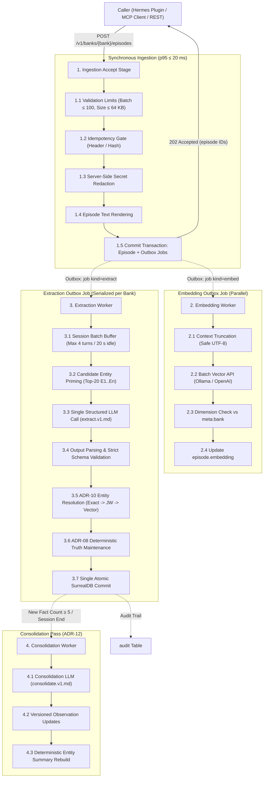
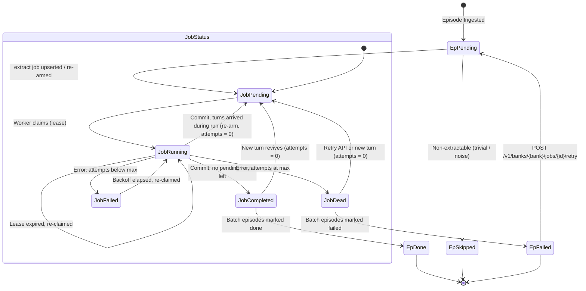
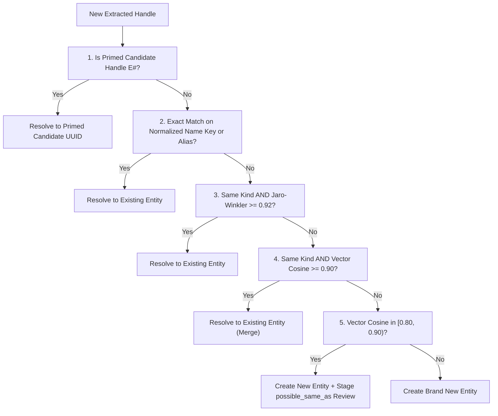

# Engram Specification: Ingestion Pipeline (Write Path)

**Document:** `docs/spec/04-ingestion-pipeline.md`  
**Status:** Accepted (v1 baseline) · **Date:** 2026-10-24 · **Owner:** irahardianto  
**Mandatory Inputs:** `00-decisions.md` (ADR-01 through ADR-19), `DISCOVERY_HANDOFF.md` §6.6, `01-hindsight.md`, `02-cognee.md`, `03-mem0.md`, `07-temporal-kg-and-evals.md`, `V01`–`V07`  

---

## 1. Pipeline Overview

The Engram ingestion pipeline translates raw conversation turns, developer notes, curated memory mirrors, and agent delegations into a validated, bi-temporal knowledge graph in SurrealDB. It guarantees immediate durability for episodic search while decoupling high-latency cognitive processing (vector embeddings, LLM fact extraction, entity resolution, and truth maintenance) into transactional outbox worker jobs.



### Two-Stage Availability Guarantee

In accordance with ADR-07:
1. **Stage 1 (Immediate Durability & BM25 Searchability):** Upon completion of the synchronous `POST /v1/banks/{bank}/episodes` request (p95 $\le 20$ ms), the episode is written to SurrealDB, indexed via native BM25 full-text search (`FULLTEXT ANALYZER ... BM25`), and assigned an outbox job. The episode is immediately retrievable via keyword search.
2. **Stage 2 (Semantic & Graph Convergence):** Within seconds, the asynchronous embedding worker generates and indexes dense vector representations (`HNSW`), while the bank-level extraction worker resolves entities, evaluates truth maintenance, and links bi-temporal fact edges.

---

## 2. Ingestion Accept Stage

The accept stage handles incoming episode payloads over `POST /v1/banks/{bank}/episodes`, validates bounds, enforces idempotency, strips secrets, renders search text, and inserts records alongside outbox jobs in a single SurrealDB transaction.

### 2.1 Validation Limits

Every request is checked against strict boundary constraints before database interaction:

| Constraint | Limit | Violation Handling | Rationale |
|---|---|---|---|
| **Batch Size** | Maximum 100 episodes per request | HTTP `400 Bad Request` (`BATCH_LIMIT_EXCEEDED`) | Bounds memory allocation and transaction lock times |
| **Episode Text Size** | Maximum 65,536 characters (64 KB) per episode | HTTP `400 Bad Request` (`PAYLOAD_TOO_LARGE`) | Prevents resource exhaustion and runaway LLM extraction costs |
| **Session ID Format** | Regex `^[a-zA-Z0-9_-]{1,128}$` | HTTP `400 Bad Request` (`INVALID_SESSION_ID`) | Prevents path injection and malformed index entries |
| **Bank Identifier** | Regex `^[a-z0-9][a-z0-9_-]{0,62}$` (ADR-05) | HTTP `400 Bad Request` (`INVALID_BANK_ID`) | Complies with SurrealDB database naming rules |
| **Allowed Episode Kinds** | `turn`, `note`, `curated`, `delegation`, `document` | HTTP `400 Bad Request` (`INVALID_EPISODE_KIND`) | Closed taxonomy per §3.3 of `00-decisions.md` |
| **Client Clock Skew** | `occurred_at` $\le \text{server\_time} + 300\text{ s}$ (5 min) | Clamped: `occurred_at = server_time`, flagged in metadata | Prevents future-skewed client clocks from corrupting temporal ordering |

**Clock Skew Clamping Rule:** If an incoming episode's `occurred_at` timestamp is more than 300 seconds (5 minutes) in the future relative to the server time (`time::now()`), Engram clamps `occurred_at` to `recorded_at` (`time::now()`) and flags `metadata["clock_skew_clamped"] = true` alongside an audit warning. Historical timestamps in the past are accepted without clamping to support backfilling.

### 2.2 Idempotency Mechanics

Duplicate episodes resulting from network retries or plugin replays are filtered through an idempotency gate:

1. **Always-Set Idempotency Key:** Callers may supply an `Idempotency-Key` HTTP header or an `idempotency_key` payload field. If omitted by the caller, Engram deterministically computes:
   $$\text{idempotency\_key} = \text{SHA-256}(\text{session\_id} \mathbin{\Vert} \text{kind} \mathbin{\Vert} \text{text})$$
   where `text` is the rendered episode text. Per §3.3 of `00-decisions.md`, `idempotency_key` is **always set** on every persisted episode.
2. **Deterministic Content Hashing:** In addition, Engram computes a canonical content hash across raw payload fields:
   $$\text{content\_hash} = \text{SHA-256}(\text{session\_id} \mathbin{\Vert} \text{kind} \mathbin{\Vert} \text{author} \mathbin{\Vert} \text{occurred\_at} \mathbin{\Vert} \text{user\_text} \mathbin{\Vert} \text{assistant\_text})$$
   where timestamps are normalized to RFC 3339 UTC strings (`YYYY-MM-DDTHH:MM:SS.sssZ`) and string fields are trimmed.

**SurrealDB Storage & Deduplication:**  
The `episode` table enforces the unique index defined in `migrations/0001_init.surql`:
```surql
DEFINE INDEX OVERWRITE episode_session         ON episode FIELDS session_id, occurred_at;
DEFINE INDEX OVERWRITE episode_idempotency_key ON episode FIELDS idempotency_key UNIQUE;
DEFINE INDEX OVERWRITE episode_content_hash    ON episode FIELDS content_hash;
```
If an insertion encounters a unique constraint violation on `episode_idempotency_key`:
- The transaction returns the existing `episode.id` with `duplicate: true` (HTTP 202 Accepted).
- No duplicate outbox jobs are spawned.

### 2.3 Server-Side Redaction Rules

In compliance with ADR-14, Engram executes server-side secret scrubbing *before* data is persisted to disk and *before* it is transmitted to any external embedding or LLM API. This complements Hermes's client-side `redact_for_egress` rules.

The redactor runs a sequence of regular expressions and high-entropy heuristic checks. Matched secret spans are replaced with deterministic placeholder markers:

```
[REDACTED_API_KEY]
[REDACTED_JWT]
[REDACTED_PRIVATE_KEY]
[REDACTED_URL_PASSWORD]
[REDACTED_HIGH_ENTROPY_SECRET]
```

#### Concrete Redaction Rules & Patterns

```rust
// Regex specifications implemented in src/ingest/redact.rs

// 1. Known Vendor API Keys (prefix + continuous token charset)
pub const OPENAI_PATTERN: &str = r"sk-[A-Za-z0-9_-](?:\.?[A-Za-z0-9_-]){20,}";
pub const ANTHROPIC_PATTERN: &str = r"sk-ant-[A-Za-z0-9_-]{20,}";
pub const OPENROUTER_PATTERN: &str = r"sk-or-v1-[a-f0-9]{64}";
pub const GITHUB_PAT_CLASSIC: &str = r"ghp_[A-Za-z0-9]{36,}";
pub const GITHUB_PAT_FINE_GRAINED: &str = r"github_pat_[A-Za-z0-9_]{22,}";
pub const GITHUB_OAUTH: &str = r"gho_[A-Za-z0-9]{36,}";
pub const AWS_ACCESS_KEY: &str = r"(?<![A-Z0-9])AKIA[A-Z0-9]{16}(?![A-Z0-9])";
pub const GOOGLE_API_KEY: &str = r"AIza[A-Za-z0-9_-]{35}";

// 2. JWT / Bearer Tokens (Base64 URL parts starting with eyJ)
pub const JWT_PATTERN: &str = r"eyJ[A-Za-z0-9_-]{10,}\.[A-Za-z0-9_-]{10,}(?:\.[A-Za-z0-9_=-]{10,})?";

// 3. PEM Private Keys (Block structure across multiple lines)
pub const PEM_PRIVATE_KEY_PATTERN: &str = 
    r"(?s)-----BEGIN[A-Z ]*PRIVATE KEY-----.*?-----END[A-Z ]*PRIVATE KEY-----";

// 4. Database Connection Strings with Passwords
pub const DB_CONNSTRING_PATTERN: &str = 
    r"(?i)((?:postgres(?:ql)?|mysql|mongodb(?:\+srv)?|redis|amqp)://[^:\s]+:)([^@\s]+)(@)";

// 5. Bare URL Tokens and Sensitive Query Parameters
pub const URL_USERINFO_PASSWORD: &str = r"(?i)(https?|wss?|ftp)://([^/\s:@]+):([^/\s@]+)@";
pub const URL_QUERY_PARAM_SECRETS: &str = 
    r"(?i)(?<=[?&;](?:access_token|refresh_token|id_token|api_key|apikey|client_secret|password|auth|jwt|secret|signature|x-amz-signature)=)[^&#\s]+";
```

#### Generic High-Entropy Secret Heuristic

To capture unstructured or custom credentials (e.g. AWS Secret Access Keys, Stripe restricted keys, arbitrary hex tokens) that do not match vendor prefixes:
1. Candidate tokens are extracted when adjacent to assignment markers:
   `(?i)(?:api_?key|token|secret|password|passwd|credential|auth)\s*[=:]\s*(['"]?)([^\s'"&]+)\1`
2. If candidate token length $\ge 16$ characters, compute Shannon entropy:
   $$H(X) = -\sum_{i=1}^{n} P(x_i) \log_2 P(x_i)$$
3. If $H(X) \ge 3.2$ bits per character and character set contains characters from at least 3 distinct classes (lowercase, uppercase, digits, symbols), mask the candidate value with `[REDACTED_HIGH_ENTROPY_SECRET]`.

### 2.4 Episode Text Rendering

For full-text indexing, vector embedding, and LLM context construction, Engram deterministically renders the searchable `text` field from the structured turn components:

```rust
pub fn render_episode_text(kind: &EpisodeKind, user_text: Option<&str>, assistant_text: Option<&str>, metadata: &serde_json::Value) -> String {
    match kind {
        EpisodeKind::Turn => {
            let u = user_text.unwrap_or("").trim();
            let a = assistant_text.unwrap_or("").trim();
            format!("User: {}\nAssistant: {}", u, a)
        }
        EpisodeKind::Note => {
            user_text.unwrap_or("").trim().to_string()
        }
        EpisodeKind::Curated => {
            // Curated mirror from MEMORY.md or USER.md
            user_text.unwrap_or("").trim().to_string()
        }
        EpisodeKind::Delegation => {
            let caller = metadata.get("caller").and_then(|v| v.as_str()).unwrap_or("subagent");
            let output = assistant_text.unwrap_or("").trim();
            format!("Delegation [{}]: {}", caller, output)
        }
        EpisodeKind::Document => {
            user_text.unwrap_or("").trim().to_string()
        }
    }
}
```

> [!NOTE]
> Because Engram communicates with SurrealDB over HTTP RPC using CBOR encoding (`store::rpc` per ADR-02), rendering strings containing colons (such as `"User: ...\nAssistant: ..."` and `"Note: ..."`) round-trips safely without triggering SurrealDB's JSON string-to-record coercion and truncation bug.

### 2.5 Atomic Transaction & Outbox Creation

The accept stage executes in a single SurrealDB transaction:
1. Inserts the `episode` record with `extraction_state = 'pending'`.
2. Inserts an embedding outbox record into `job` (`kind = 'embed'`).
3. Evaluates session batch buffering (Section 4) and upserts the extraction outbox record with deterministic ID `job:['extract', $session_id]` (`kind = 'extract'`) following the ADR-17 re-arm rules (`SET` only — never `CONTENT`, which rewrites the READONLY `created_at` and fails on the second turn; a `running` job is never downgraded; `attempts` resets when a `completed`/`dead` job is revived).

The statement below is identical to `03-data-model.md` `Q-INGEST-EPISODE` (the canonical copy). The redacted texts are bound as `$user_text` / `$assistant_text`, the rendered transcript as `$text`; `$idempotency_key` is the client key or the server-computed fallback (00 §3.3).

```surql
BEGIN TRANSACTION;
LET $ep = (CREATE ONLY episode:ulid() SET
  session_id = $session_id, kind = $kind, user_text = $user_text, assistant_text = $assistant_text,
  text = $text, author = $author, occurred_at = $occurred_at, recorded_at = time::now(),
  content_hash = crypto::sha256($text), idempotency_key = $idempotency_key, trust = $trust,
  extraction_state = "pending", metadata = $metadata
);
UPSERT type::record("session", $session_id) SET
  session_id = $session_id, last_active_at = time::now(), turn_count += 1;
LET $j_embed = (CREATE ONLY job:ulid() SET
  kind = "embed", status = "pending", payload = { "episode_id": $ep.id }, run_after = time::now()
);

-- Deterministic extract job timer upsert (ADR-17 re-arm rules)
LET $pending = (SELECT count() FROM episode WHERE session_id = $session_id AND extraction_state = "pending" GROUP ALL);
LET $cnt = IF array::len($pending) > 0 { $pending[0].count } ELSE { 0 };
LET $should_run_now = $force_immediate OR $cnt >= $batch_max_turns;
LET $target_run_after = IF $should_run_now { time::now() } ELSE { time::now() + duration::from_millis($batch_idle_ms) };

LET $j_extract = (UPSERT ONLY job:['extract', $session_id] SET
  kind = "extract",
  payload = { "session_id": $session_id },
  attempts = IF status IN ["completed", "dead"] { 0 } ELSE { attempts ?? 0 },
  status = IF status = "running" { "running" } ELSE { "pending" },
  run_after = $target_run_after,
  updated_at = time::now()
);
COMMIT TRANSACTION;
RETURN { "episode": $ep.id, "embed_job": $j_embed.id, "extract_job": $j_extract.id };
```

---

## 3. Embedding Job

The embedding worker (`jobs/embed.rs`) operates asynchronously across banks to compute dense semantic vector representations for newly inserted episodes.

### 3.1 Batching & Pipeline Concurrency

- **Batch Size:** Workers dequeue up to 32 pending `embed` jobs per provider call.
- **Provider Dispatch:** Dispatches to Ollama native `/api/embed` or OpenAI-compatible `/v1/embeddings` based on `embedding.provider` configuration.
- **Concurrency:** Embedding generation jobs run concurrently across multiple HTTP workers, but commits are serialized per bank through the bank writer.

### 3.2 Truncation Policy

Embedding models have finite context windows (e.g. 8,192 tokens for modern embeddings; 32,768 tokens for Qwen3-embedding).
1. When input text exceeds 28,000 characters (approx. 7,000 tokens), the worker truncates the text safely along UTF-8 character boundaries.
2. Truncation strategy: **Head-and-tail preservation**. The worker retains the first 20,000 characters and the final 8,000 characters, interpolating a marker: `"\n\n[... content truncated for embedding ...]\n\n"`. This ensures both initial user premises and final assistant conclusions are preserved in vector representations.

### 3.3 Dimension Check Against `meta:bank`

Per ADR-06, each bank fixes its embedding model and vector dimension at creation time inside `meta:bank`.
Before executing an update to `episode.embedding`:
```rust
if vector.len() != meta.embedding_dim {
    tracing::error!(
        expected = meta.embedding_dim,
        actual = vector.len(),
        "Embedding dimension mismatch detected. Aborting write to prevent index corruption."
    );
    return Err(JobError::DimensionMismatch {
        expected: meta.embedding_dim,
        actual: vector.len(),
    });
}
```
If a dimension mismatch is detected, the worker:
- Fails the job immediately without retry (`status = 'dead'`).
- Sets `last_error = "DimensionMismatch: expected 1024, got 1536"`.
- Never attempts to write an incompatible vector to the HNSW index.

---

## 4. Extraction Batching & State Machine

Per ADR-07, fact extraction is performed over multi-turn batches per session rather than per turn. This drastically reduces LLM invocations and provides sufficient conversational context for coreference resolution.

### 4.1 Batch Trigger Conditions & Durable Outbox Timers (ADR-17, B-05)

An extraction job is managed per session through a **durable outbox timer** in SurrealDB rather than ephemeral in-memory timers. This guarantees that daemon restarts never lose pending extraction batches.

#### Durable Batching Mechanics (`job:['extract', session_id]`)
Each session's extraction batching is represented by a single `extract` job with the deterministic record ID `job:['extract', session_id]`:
1. **First Pending Turn:** On the first unextracted turn of a session batch, the ingest transaction upserts `job:['extract', session_id]` with `kind = 'extract'`, `status = 'pending'`, and `run_after = time::now() + 20s` (`extraction.batch_idle_ms = 20000`).
2. **Subsequent Turns (Turns 2–3):** Each additional turn appended to the pending batch updates the existing job, pushing its timer out: `SET run_after = time::now() + 20s, updated_at = time::now()`.
3. **Turn Count Ceiling (Turn 4):** Upon appending the `extraction.batch_max_turns = 4` turn, the ingest transaction forces immediate execution: `SET run_after = time::now()`.
4. **Immediate Flush Triggers:**
   - **Session Flush:** `POST /v1/banks/{bank}/sessions/{session_id}/flush` (e.g. from Hermes `on_pre_compress`).
   - **Session End:** `POST /v1/banks/{bank}/sessions/{session_id}/end`.
   - **Explicit Memory:** `POST /v1/banks/{bank}/remember` or MCP `engram_remember`.
   - **Curated Mirror Write:** Invocation of `on_memory_write` mirroring `MEMORY.md`/`USER.md`.
   All immediate triggers execute `UPDATE job:['extract', $session_id] SET run_after = time::now() WHERE status = 'pending'`.

#### Worker Dispatch & Crash Recovery
The bank extraction worker claims jobs where `status = 'pending' AND run_after <= time::now()`. If the daemon crashes or restarts at any point, pending session extraction timers survive in SurrealDB without data loss.

#### Flush Contract & Concurrency Guard (ADR-17, M-05)
When a caller invokes `POST /v1/banks/{bank}/sessions/{session_id}/flush`:
- The HTTP handler **NEVER executes extraction inline**. Performing extraction inside the HTTP handler would cause race conditions against the bank writer worker.
- The handler sets `job:['extract', session_id].run_after = time::now()`, notifies the bank writer worker via channel signal, and awaits completion via a `tokio::sync::watch` channel up to `wait_ms` (maximum 10,000 ms).
- If extraction completes within the timeout, the endpoint returns `{"status": "completed", "facts_written": n, "digest": [...]}`. If `wait_ms` elapses before completion, it returns `{"status": "pending", "facts_written": 0, "digest": []}` with HTTP 202, leaving the worker to finish asynchronously.

### 4.2 State Machine: Episode & Job Lifecycle

The interaction between `episode.extraction_state` and `job.status` is governed by the state machine below:



### State Definitions

- `episode.extraction_state`:
  - `pending`: Episode accepted, awaiting batch extraction.
  - `done`: Extracted into entities and facts, committed to graph.
  - `skipped`: Classified as trivial filler or administrative noise; extraction bypassed.
  - `failed`: LLM extraction or schema validation exhausted maximum retries.
- `job.status` (the only values allowed by the migration; lifecycle in ADR-17):
  - `pending`: Ready for a worker once `run_after <= now`.
  - `running`: Claimed by a worker (`claimed_by`, `lease_until`, `attempts += 1`); re-claimable after the lease expires.
  - `completed`: Result committed atomically; deleted by housekeeping after 24 h.
  - `failed`: Transient error; `last_error` set and `run_after = now + backoff`; claimable again.
  - `dead`: `attempts >= max_attempts` (8); visible in `engram_status`, retryable via API.

---

## 5. Candidate-Entity Priming & Extraction Prompt

To prevent entity multiplication and hallucinated UUIDs, Engram adapts the Mem0 integer-handle trick (ADR-07, `03-mem0.md`). Before invoking the LLM, Engram primes the prompt with up to 20 candidate entities relevant to the batch text.

### 5.1 Candidate Entity Retrieval (Max 20)

Before compiling the extraction prompt, Engram queries SurrealDB for candidate entities:
1. **Lexical / Alias Search:** Exact match on normalized keywords and aliases in the batch text against `entity.name_key` and `entity.aliases`.
2. **Full-Text BM25 Search:** Disjunctive BM25 query over `entity.name` and `entity.summary`.
3. **Vector Similarity:** ANN search over `entity.name_embedding` using a merged embedding of the batch text.
4. **Ranking & Budget:** Results are deduplicated and ranked by composite score. Top 20 candidates are formatted as handles `E1..E20`:

```text
[E1] "Alice Chen" (kind: person, aliases: ["Alice", "architect"])
[E2] "Project Horizon" (kind: project, aliases: ["horizon-api"])
[E3] "Rust" (kind: concept, aliases: ["rust-lang"])
```

### 5.2 Extraction Prompt Specification (`prompts/extract.v1.md`)

The extraction engine reads `prompts/extract.v1.md` at startup and records `extractor_version = "v1"` on all derived facts.

#### Verbatim JSON Schema

```json
{
  "$schema": "http://json-schema.org/draft-07/schema#",
  "title": "EngramExtractionResult",
  "type": "object",
  "required": ["entities", "facts"],
  "additionalProperties": false,
  "properties": {
    "entities": {
      "type": "array",
      "description": "Newly discovered entities not in candidate priming",
      "items": {
        "type": "object",
        "required": ["handle", "name", "kind", "aliases"],
        "additionalProperties": false,
        "properties": {
          "handle": {
            "type": "string",
            "pattern": "^NEW_[0-9]+$"
          },
          "name": {
            "type": "string",
            "minLength": 1,
            "maxLength": 256
          },
          "kind": {
            "type": "string",
            "enum": [
              "person",
              "organization",
              "project",
              "software",
              "tool",
              "account",
              "place",
              "concept",
              "event"
            ]
          },
          "aliases": {
            "type": "array",
            "items": { "type": "string" }
          }
        }
      }
    },
    "facts": {
      "type": "array",
      "description": "Extracted factual propositions",
      "items": {
        "type": "object",
        "required": [
          "subject_handle",
          "predicate",
          "object_handle",
          "polarity",
          "statement",
          "valid_from",
          "valid_to",
          "time_precision",
          "attribution"
        ],
        "additionalProperties": false,
        "properties": {
          "subject_handle": {
            "type": "string",
            "pattern": "^(E[0-9]+|NEW_[0-9]+)$"
          },
          "predicate": {
            "type": "string",
            "enum": [
              "is_a",
              "works_at",
              "has_role",
              "reports_to",
              "located_in",
              "member_of",
              "part_of",
              "owns",
              "uses",
              "written_in",
              "depends_on",
              "prefers",
              "scheduled_for",
              "credentials_for",
              "related_to"
            ]
          },
          "object_handle": {
            "type": "string",
            "pattern": "^(E[0-9]+|NEW_[0-9]+)$"
          },
          "label": {
            "type": ["string", "null"]
          },
          "polarity": {
            "type": "string",
            "enum": ["positive", "negative"]
          },
          "statement": {
            "type": "string",
            "minLength": 5,
            "maxLength": 512
          },
          "valid_from": {
            "type": "string"
          },
          "valid_to": {
            "type": ["string", "null"]
          },
          "time_precision": {
            "type": "string",
            "enum": ["exact", "day", "month", "year", "unknown"]
          },
          "attribution": {
            "type": "string",
            "enum": ["user_stated", "user_implied", "assistant_stated", "tool_output"]
          }
        }
      }
    }
  }
}
```

---

## 6. Parsing & Validation of LLM Output

Raw LLM responses are parsed and validated strictly through the following steps before reaching resolution logic:

1. **Schema Validation:** The output is deserialized into typed Rust structs (`EngramExtractionResult`). Any missing required field, unexpected property, or invalid enum value triggers validation failure.
2. **Handle Integrity Guard:**
   - Every `subject_handle` and `object_handle` referenced in `facts` must either:
     - Match an existing candidate handle $E_i$ provided in priming ($1 \le i \le N$).
     - Match a new entity declared in the `entities` block as `NEW_j`.
   - Any unknown or dangling handle results in the rejection of that specific fact, recorded in the audit log.
3. **Out-of-Vocabulary Predicate Mapping:**
   - If `predicate` matches one of the 14 closed predicates or `related_to`, it is accepted.
   - If an unlisted predicate is returned:
     - If `extraction.strict_vocabulary = false` (default): Remap `predicate = "related_to"` and store the unlisted predicate name inside `label`.
     - If `extraction.strict_vocabulary = true`: Drop the fact and increment `engram_facts_total{event="dropped_unknown_predicate"}`.
4. **Date Parsing & Temporal Bounds:**
   - `valid_from` is parsed into UTC timestamps using RFC 3339 / ISO 8601 parsers. If parsing fails, fall back to `reference_time` with `time_precision = "unknown"`.
   - `valid_to`: If present, parsed into UTC. If a deadline regex is matched in the statement (e.g. `\bdue by\b|\bdeadline\b`), `valid_to` is forced to `null` per Graphiti rules.
5. **Self-Correction & JSON Repair Strategy:**
   - If the LLM generates syntactically malformed JSON or schema-invalid payloads, Engram executes **exactly one repair retry**:
     - The repair prompt sends the malformed output, the parser error message, and the schema back to the LLM: `"Your previous response had JSON/schema error: {err}. Return corrected JSON only."`
   - If the repair call fails, the extraction job transitions to `status = 'failed'`, increments retry attempts, and preserves the raw response in the job payload for debugging.
6. **Hard Safety Caps:**
   - Maximum facts per batch: 50.
   - Maximum new entities per batch: 30.
   - Statement character length: 512 characters maximum. Excess characters are cleanly truncated.
7. **Assistant Speculation & Prompt-Injection Guards:**
   - **Assistant Hallucination Filter:** Any extracted fact with `attribution: "assistant_stated"` is dropped during parsing unless it represents an action, configuration, or decision the assistant itself directly took. Claims where the assistant merely echoed, speculated about, or conjectured user traits are rejected.
   - **Prompt Injection Defense:** Episode turns fed to the extraction prompt are stripped of control sequences (`<|im_start|>`, `<|im_end|>`, `[INST]`, `\0`) and enclosed within `<untrusted_episodes>` tags in `prompts/extract.v1.md`.

---

## 7. Entity Resolution Algorithm (ADR-10)

Entity resolution maps extracted handles (`NEW_#` or `E#`) to canonical database records (`entity` table). In accordance with ADR-10, evaluation follows a strict waterfall: **first match wins**.



### 7.1 Resolution Steps & Thresholds

1. **Step 1 — Primed Handle Resolution:** If the LLM referenced an existing handle $E_k$, resolve directly to the primed candidate entity's database ID.
2. **Step 2 — Exact Normalized Match:**  
   Compute normalized key:
   $$\text{name\_key} = \text{strip\_punctuation}(\text{collapse\_whitespace}(\text{lowercase}(\text{name})))$$
   Query existing entities where `name_key == $new_key` OR `aliases CONTAINS $new_key`. If matched, link to this entity.
3. **Step 3 — Jaro-Winkler String Similarity ($\ge 0.92$):**  
   Filter candidates where `candidate.kind == new.kind`. Compute `string::similarity::jaro_winkler(cand.name, new.name)`. If $\ge 0.92$, merge into candidate entity.
4. **Step 4 — Dense Name Embedding Cosine ($\ge 0.90$):**  
   Generate embedding for new entity name. Query candidate entities of the same kind. If cosine similarity $\ge 0.90$ (`resolution.embed_merge`), merge into candidate entity.
5. **Step 5 — Ambiguity Review Band ($[0.80, 0.90)$):**  
   If cosine similarity is between $0.80$ (`resolution.embed_review`) and $0.90$, create a new entity record, but record a `possible_same_as` relation in `meta:bank` review list. These are surfaced by `engram_entities` and evaluated during consolidation.
6. **Step 6 — Create New Entity:** Otherwise, generate a new UUID and insert a new `entity` record.

### 7.2 The Kind-Guard Constraint

The resolution algorithm strictly enforces kind equality for fuzzy and vector matching:
$$\text{Resolve}(E_1, E_2) \implies \text{Kind}(E_1) == \text{Kind}(E_2)$$

#### Worked Example: "Java" Disambiguation
- $E_1$: `"Java"`, kind: `software` (Programming language).
- $E_2$: `"Java"`, kind: `place` (Geographical island in Indonesia).
- **Execution:** Even though Jaro-Winkler similarity is $1.0$ and string name matches, the kind guard (`software` $\ne$ `place`) immediately prevents Step 3 and Step 4 from resolving them together. Two distinct entities are preserved.

#### Worked Example: Multilingual Alias Resolution (Indonesian / English)
- Existing Entity: `Jakarta Provincial Government` (kind: `organization`, aliases: `["Pemprov DKI", "Pemerintah DKI Jakarta"]`).
- Ingested Turn: "User met with representatives from Pemprov DKI."
- LLM extracts: `name: "Pemprov DKI"`, kind: `organization`.
- **Execution:** Step 2 normalizes `"pemprov dki"` and matches the alias key. The handle resolves to `Jakarta Provincial Government` without requiring vector similarity.

---

## 8. Deterministic Truth Maintenance (ADR-08)

Engram's truth maintenance is executed exclusively by deterministic Rust code, never by an LLM judgment. This ensures predictable, mathematically sound, audit-traceable state transitions across factual contradictions.

### 8.1 Truth Maintenance Rules & Logic (ADR-08)

#### Two Independent Axes
Per ADR-08, Engram decouples belief lifecycle from world validity:
1. **Belief Lifecycle (`status`):** `active | superseded | retracted | pending` (transaction-time belief state).
2. **World Time (`valid_from` / `valid_to`):** Real-world interval during which the proposition was or is true.

A fact can be `status = 'active'` with a past `valid_to` (a believed historical fact, e.g. "lived in London 2021–2023").
- **Current Truth:** Evaluated as `status = 'active' AND (valid_to IS NONE OR valid_to > time::now())`.
- **Historical / As-of-T Truth:** Evaluated using the real-world validity interval (`valid_from` to `valid_to`) alongside transaction recorded bounds (`recorded_at` to `expired_at`).

#### Source Trust Hierarchy & Confidence
Incoming assertions are categorized into five strict trust ranks (high to low):

| Trust Rank | Rank Value | Description & Sources | Base Trust ($trust\_base$) |
|---|---|---|---|
| `user_stated` | **5** | Explicit user statement in chat, `POST /remember`, MCP `engram_remember`, mirrored `MEMORY.md`/`USER.md` | 0.90 |
| `user_implied` | **4** | Implicit preference or constraint directly inferred from user action or query | 0.75 |
| `assistant_stated` | **3** | Concrete actions, commitments, or configurations established by the assistant | 0.60 |
| `tool_output` | **3** | Direct execution results from tools, shell scripts, or external APIs | 0.60 |
| `inferred` | **2** | Higher-order deductions synthesized during consolidation passes | 0.50 |

Confidence is computed deterministically from trust rank and corroborating support count:
$$confidence = trust\_base[trust] \times \left(1 + 0.1 \times \min(support - 1, 5)\right)$$
clamped to $[0.0, 1.0]$ and rounded to 2 decimal places.

#### Ordered Rules 1–7
For an incoming extracted fact $n = (s, p, o_n, \text{polarity})$, Engram queries the set of existing `active` facts $E$ sharing the identical subject and predicate $(s, p)$. Rules are evaluated in strict order; **the first matching rule wins** and records an audit trace:

1. **Rule 1 — Restatement (with Contest Resolution):**  
   If $o_n == e.out$ and $n.\text{polarity} == e.\text{polarity}$ for some $e \in E$:
   - Increment support: $e.support \gets e.support + 1$.
   - Append provenance: $e.source\_episodes \gets e.source\_episodes \cup \{episode_{id}\}$.
   - Recalculate deterministic confidence. No new fact edge is created.
   - **Contest Resolution (B-03):** If $e.contested == true$, $rank(n) \ge 4$ (user-derived source), and $rank(n) \ge rank(c)$ for every opposing fact $c \in e.conflicts\_with$:
     - **Resolve contest:** Each opposing claim $c$ transitions to `status = 'superseded'` ($c.valid\_to \gets n.valid\_from$, $c.expired\_at \gets time::now()$, $c.superseded\_by \gets e.id$).
     - Clear contest flags: $e.contested \gets false$, $c.contested \gets false$, $e.conflicts\_with \gets NONE$, $c.conflicts\_with \gets NONE$.
     - Audit recorded as `action = 'reconcile.resolve_contest'`.
2. **Rule 2 — Authority Guard (Reject Low-Trust Contradictions; B-02):**  
   If predicate $p$ is `functional` (or $n$ has negative polarity targeting a `user_stated` fact), $e$ has $trust = \text{'user_stated'}$ ($rank = 5$), $rank(n) \le 3$ (`assistant_stated`, `tool_output`, `inferred`), and objects differ ($o_n \ne e.out$):
   - **REJECT $n$ completely.** No fact is inserted into the database.
   - Assistant, tool, or inferred claims CANNOT contest, supersede, or close what the user explicitly stated.
   - Record decision in `audit` with `action = 'reconcile.rejected_low_trust'`, preserving the user's active belief uncontested.
3. **Rule 3 — Negative Polarity (World-Time Close Only; F-13):**  
   If $n.\text{polarity} == \text{'negative'}$ targeting a matching positive fact $e \in E$:
   - Closes $e$ in **world time only**: $e.valid\_to \gets n.valid\_from$; $e.expired\_at$ stays NONE.
   - **$e.status$ STAYS `'active'`** (it becomes a believed historical fact; `superseded` requires a `superseded_by` successor, while `retracted` is strictly reserved for `forget`).
   - Append the closing episode to $e.source\_episodes$. No new edge is inserted.
   - Audit recorded as `action = 'reconcile.close_negative'`.
4. **Rule 4 — `related_to` and Multi-Cardinality Predicates:**  
   If $p == \text{'related_to'}$ or $p$ is declared `multi` (e.g. `uses`, `depends_on`, `member_of`) and $o_n \ne e.out$:
   - Insert $n$ as a new independent active fact (`status = 'active'`). Multi-cardinality relations coexist simultaneously without conflict.
5. **Rule 5 — Functional, Orderable, Strict-Later Supersession (B-01):**  
   If $p$ is `functional`, both $time\_precision \ne \text{'unknown'}$, $n.valid\_from > e.valid\_from$ (**strict inequality**), and $rank(n) \ge rank(e)$:
   - **Approval Staging Check:** If `reconcile.require_approval = true` and $n.trust \ne \text{'user_stated'}$:
     - Insert $n$ with `status = 'pending'`, awaiting user approval. Old fact $e$ remains untouched.
   - **Authoritative Supersession:**
     - Close prior fact: $e.valid\_to \gets n.valid\_from$, $e.expired\_at \gets time::now()$, $e.status \gets \text{'superseded'}$, $e.superseded\_by \gets n.id$.
     - Insert new fact: $n.supersedes \gets e.id$, $n.status \gets \text{'active'}$.
     - Audit recorded as `action = 'reconcile.supersede'`.
6. **Rule 6 — Functional, Orderable, Earlier History Backfill:**  
   If $p$ is `functional`, both $time\_precision \ne \text{'unknown'}$, and $n.valid\_from < e.valid\_from$:
   - The incoming fact describes historical reality predating the current belief.
   - Insert $n$ as a historical fact with $valid\_to \gets \min(n.valid\_to, e.valid\_from)$ and $status \gets \text{'active'}$.
   - Old fact $e$ remains active and uncontested (no conflict).
   - Audit recorded as `action = 'reconcile.history_backfill'`.
7. **Rule 7 — Otherwise Contest (B-01):**  
   If none of the above conditions apply (e.g. equal timestamps $n.valid\_from == e.valid\_from$, coarse/unknown time precision on either side, or $rank(n) < rank(e)$ with $n.valid\_from > e.valid\_from$):
   - Insert $n$ with `status = 'active'`, `contested = true`.
   - Update existing fact: $e.contested \gets true$.
   - Link edges bidirectionally: $n.conflicts\_with \gets e.id$, $e.conflicts\_with \gets n.id$.
   - Audit recorded as `action = 'reconcile.contest'`.

#### Concurrency Guard & Optimistic Locking (FIND-07)
To prevent race conditions during parallel bank updates:
- Every supersede and world-time close executes:
  `UPDATE fact SET ... WHERE id = $old_id AND status = 'active'`
- The commit transaction verifies that exactly 1 row was modified. If 0 rows are affected (indicating a concurrent modification or race), the transaction executes `THROW "ConcurrentModification: fact superseded or closed concurrently"`, causing an immediate rollback. The outbox worker catches the failure and retries with backoff, re-evaluating reconciliation rules against the fresh database state.

#### Retraction Reopen Semantics (ADR-08, ADR-14)
When a user or agent invokes `POST /v1/banks/{bank}/forget` on a fact $n$ that previously superseded an older fact $e$:
- $n$ is soft-retracted: $n.status \gets \text{'retracted'}$, $n.expired\_at \gets time::now()$.
- Engram inspects $n.supersedes$. If the prior fact $e$ exists, $e$ is **reopened** ($e.status \gets \text{'active'}$, $e.valid\_to \gets NONE$, $e.expired\_at \gets NONE$, $e.superseded\_by \gets NONE$), **unless** another active fact has since superseded $e$.
- Retraction withdraws belief in transaction time; it never alters historical world validity.

### 8.2 Deterministic Confidence Formula

Confidence is calculated deterministically from source trust and corroborating support count:

$$confidence = trust\_base[trust] \times \left(1 + 0.1 \times \min(support - 1, 5)\right)$$

Clamped to $[0.0, 1.0]$ and rounded to 2 decimal places.

| Source Trust Level | $trust\_base$ | Confidence ($support=1$) | Confidence ($support=2$) | Max Confidence ($support \ge 6$) |
|---|---|---|---|---|
| `user_stated` (Rank 5) | 0.90 | **0.90** | **0.99** | **1.00** |
| `user_implied` (Rank 4) | 0.75 | **0.75** | **0.83** | **1.00** |
| `assistant_stated` (Rank 3) | 0.60 | **0.60** | **0.66** | **0.90** |
| `tool_output` (Rank 3) | 0.60 | **0.60** | **0.66** | **0.90** |
| `inferred` (Rank 2, Consolidation) | 0.50 | **0.50** | **0.55** | **0.75** |

### 8.3 Reconciliation Decision Table

The decision table below maps incoming fact attributes against existing active facts $(s, p, e.out)$:

| Rule # | Predicate Cardinality | Polarity | Existing Fact Trust | Incoming Fact Trust | Temporal Ordering | Action Taken | Resulting DB State |
|---|---|---|---|---|---|---|---|
| **1a** | Any | Positive | Any | Any | Any | **Restatement** (same object & polarity) | $e.support += 1$, recompute confidence; no new edge. |
| **1b** | Any | Positive | $e.contested$ | $rank(n) \ge 4 \land \ge rank(c)$ | Any | **Resolve Contest** (restating contested fact) | $e.contested = false$, $c.status = \text{'superseded'}$, links cleared. |
| **2** | Functional / Negative | Any | $user\_stated$ (Rank 5) | $rank(n) \le 3$ (Assistant/Tool/Inferred) | Any | **Authority Guard** (Reject Low Trust) | $n$ rejected (no write); audit `reconcile.rejected_low_trust`. |
| **3** | Any | Negative | Any | $rank(n) \ge rank(e)$ | Any | **Negative Close** (Cessation) | $e.valid\_to = n.valid\_from$, **$e.status = \text{'active'}$**; no new edge. |
| **4** | Multi / `related_to` | Positive | Any | Any | Any | **Multi-edge Insert** | $n$ inserted with `status = 'active'`; no conflict. |
| **5a** | Functional | Positive | Any | $rank(n) \ge rank(e)$ | $n.valid\_from > e.valid\_from$ (strict) | **Supersede** (`require_approval = false`) | $e$ closed (`superseded`, $valid\_to = n.valid\_from$); $n$ active. |
| **5b** | Functional | Positive | Any | $n.trust \ne user\_stated$ | $n.valid\_from > e.valid\_from$ (strict) | **Stage Approval** (`require_approval = true`) | $e$ untouched; $n$ inserted as `status = 'pending'`. |
| **6** | Functional | Positive | Any | Any | $n.valid\_from < e.valid\_from$ | **History Backfill** | $n$ inserted as active ($valid\_to = e.valid\_from$); $e$ stays active. |
| **7** | Functional | Positive | Any | Any | $n.valid\_from == e.valid\_from$ or unknown precision or lower rank | **Contest** | Both active; both $contested = true$; $conflicts\_with$ linked. |

### 8.4 Truth Maintenance Algorithm (Pseudocode)

```rust
pub fn reconcile_fact(
    store: &mut StoreTransaction,
    new_fact: &ExtractedFact,
    resolved_subject: &EntityId,
    resolved_object: &EntityId,
    episode_id: &EpisodeId,
    config: &ReconcileConfig,
) -> Result<ReconciliationOutcome, StoreError> {
    let n_rank = trust_rank(new_fact.attribution);
    let existing_active = store.find_active_facts_for_predicate(resolved_subject, &new_fact.predicate)?;

    // --------------------------------------------------------------------------
    // RULE 1: Restatement (Identical Object & Polarity)
    // --------------------------------------------------------------------------
    if let Some(e) = existing_active.iter().find(|e| e.out == *resolved_object && e.polarity == new_fact.polarity) {
        let mut updated_e = e.clone();
        updated_e.support += 1;
        updated_e.source_episodes.push(episode_id.clone());
        updated_e.confidence = compute_confidence(updated_e.trust, updated_e.support);

        // Contest Resolution: User-derived restatement clears active conflict
        if updated_e.contested && n_rank >= 4 {
            let conflicts = store.get_facts(&updated_e.conflicts_with)?;
            if conflicts.iter().all(|c| n_rank >= trust_rank(c.trust)) {
                for mut c in conflicts {
                    c.status = FactStatus::Superseded;
                    c.valid_to = Some(new_fact.valid_from);
                    c.expired_at = Some(jiff::Timestamp::now());
                    c.superseded_by = Some(updated_e.id.clone());
                    c.contested = false;
                    c.conflicts_with.clear();
                    store.update_fact_guard_active(&c)?; // WHERE status = 'active'
                }
                updated_e.contested = false;
                updated_e.conflicts_with.clear();
                // Also remove the losers from any third fact that still lists them (03 Q-FACT-RESOLVE-CONTEST)
            }
        }

        store.update_fact_guard_active(&updated_e)?;
        return Ok(ReconciliationOutcome::Restatement { fact_id: updated_e.id });
    }

    // --------------------------------------------------------------------------
    // RULE 2: Authority Guard (Reject Low-Trust Contradictions of user_stated)
    // --------------------------------------------------------------------------
    for e in &existing_active {
        let is_functional = PREDICATE_REGISTRY.get(&new_fact.predicate).cardinality == Cardinality::Functional;
        let is_neg_target = new_fact.polarity == Polarity::Negative && e.polarity == Polarity::Positive;
        
        if (is_functional || is_neg_target) && e.trust == TrustLevel::UserStated && n_rank <= 3 {
            // Reject incoming contradiction without modifying database
            store.record_audit(AuditEntry {
                action: "reconcile.rejected_low_trust",
                target_type: "fact",
                target_id: None,
                details: json!({
                    "predicate": new_fact.predicate,
                    "existing_fact": e.id,
                    "rejected_statement": new_fact.statement,
                    "reason": "Lower-trust source cannot contradict user_stated fact"
                }),
            })?;
            return Ok(ReconciliationOutcome::RejectedLowTrust);
        }
    }

    // --------------------------------------------------------------------------
    // RULE 3: Negative Polarity (World-Time Close Only, Status Remains Active)
    // --------------------------------------------------------------------------
    if new_fact.polarity == Polarity::Negative {
        if let Some(e) = existing_active.iter().find(|e| e.out == *resolved_object && e.polarity == Polarity::Positive) {
            let mut updated_e = e.clone();
            updated_e.valid_to = Some(new_fact.valid_from);
            // expired_at stays None: world-time close only (ADR-08 rule 3)
            // status STAYS Active (believed historical fact)
            updated_e.source_episodes.push(episode_id.clone());
            store.update_fact_guard_active(&updated_e)?; // WHERE status = 'active'
            return Ok(ReconciliationOutcome::ClosedNegative { fact_id: updated_e.id });
        }
        return Ok(ReconciliationOutcome::NoOpNegative);
    }

    // --------------------------------------------------------------------------
    // RULE 4: Multi-Cardinality & related_to (Coexist Independently)
    // --------------------------------------------------------------------------
    let predicate_def = PREDICATE_REGISTRY.get(&new_fact.predicate);
    if predicate_def.cardinality == Cardinality::Multi || new_fact.predicate == "related_to" {
        let created = store.insert_fact(new_fact, resolved_subject, resolved_object, episode_id)?;
        return Ok(ReconciliationOutcome::InsertedMulti { fact_id: created.id });
    }

    // --------------------------------------------------------------------------
    // FUNCTIONAL RULES (5, 6, 7) against existing active functional fact
    // --------------------------------------------------------------------------
    if let Some(e) = existing_active.into_iter().next() {
        let e_rank = trust_rank(e.trust);
        let time_known = new_fact.time_precision != TimePrecision::Unknown && e.time_precision != TimePrecision::Unknown;

        // RULE 5: Functional, Orderable, Strict-Later Supersession
        if time_known && new_fact.valid_from > e.valid_from && n_rank >= e_rank {
            if config.require_approval && new_fact.attribution != TrustLevel::UserStated {
                let mut staged = store.insert_fact(new_fact, resolved_subject, resolved_object, episode_id)?;
                staged.status = FactStatus::Pending;
                store.update_fact(&staged)?;
                return Ok(ReconciliationOutcome::StagedPendingApproval { fact_id: staged.id });
            }

            let mut updated_e = e.clone();
            updated_e.valid_to = Some(new_fact.valid_from);
            updated_e.expired_at = Some(jiff::Timestamp::now()); // Rule 5: belief ends in transaction time
            updated_e.status = FactStatus::Superseded;

            let mut created = store.insert_fact(new_fact, resolved_subject, resolved_object, episode_id)?;
            created.supersedes = Some(updated_e.id.clone());
            updated_e.superseded_by = Some(created.id.clone());

            store.update_fact_guard_active(&updated_e)?; // WHERE status = 'active' + THROW on 0 rows
            store.update_fact(&created)?;
            return Ok(ReconciliationOutcome::Superseded { old_id: updated_e.id, new_id: created.id });
        }

        // RULE 6: Functional, Orderable, Earlier History Backfill
        if time_known && new_fact.valid_from < e.valid_from {
            let mut historical_fact = new_fact.clone();
            let effective_valid_to = match new_fact.valid_to {
                Some(v_to) => std::cmp::min(v_to, e.valid_from),
                None => e.valid_from,
            };
            historical_fact.valid_to = Some(effective_valid_to);
            let created = store.insert_fact(&historical_fact, resolved_subject, resolved_object, episode_id)?;
            return Ok(ReconciliationOutcome::HistoryBackfill { fact_id: created.id });
        }

        // RULE 7: Otherwise Contest (Equal Timestamps, Unknown Precision, or Lower Trust)
        let mut updated_e = e.clone();
        updated_e.contested = true;

        let mut created = store.insert_fact(new_fact, resolved_subject, resolved_object, episode_id)?;
        created.contested = true;
        created.conflicts_with.push(updated_e.id.clone());
        updated_e.conflicts_with.push(created.id.clone());

        store.update_fact_guard_active(&updated_e)?;
        store.update_fact(&created)?;
        return Ok(ReconciliationOutcome::Contested { active: updated_e.id, challenger: created.id });
    }

    // No existing active fact: Clean insert
    let created = store.insert_fact(new_fact, resolved_subject, resolved_object, episode_id)?;
    Ok(ReconciliationOutcome::Inserted { fact_id: created.id })
}
```

### 8.5 Worked Reconciliation Examples

#### Example 1: Language Migration (Rust -> Python) — Strict-Later Supersession (Rule 5)
- **Initial State:** User asserts: "Billing-service is written in Rust" on 2025-11-01 (`valid_from: 2025-11-01`, `trust: user_stated`, `status: active`).
- **New Assertion:** User asserts: "We rewrote billing-service in Python 3.12" on 2026-02-15 (`valid_from: 2026-02-15`, `trust: user_stated`).
- **Execution:**
  1. Predicate `written_in` is functional.
  2. $trust_{new} \text{ (user\_stated)} == trust_{old} \text{ (user\_stated)}$ (rank 5 == 5).
  3. $valid\_from_{new} \text{ (2026-02-15)} > valid\_from_{old} \text{ (2025-11-01)}$ (**strict inequality holds**).
  4. Rule 5 triggers: Old fact gets `valid_to = 2026-02-15`, `expired_at = now()`, `status = 'superseded'`, `superseded_by = fact:python`.
  5. New fact gets `supersedes = fact:rust`, `status = 'active'`. Audit recorded as `reconcile.supersede`.

#### Example 2: Same-Batch Contradictory Claims — Contest on Equal Timestamps (Rule 7, B-01)
- **Scenario:** In a single conversation turn on 2026-06-01, the user states: "Alice works at Acme Corp, but wait, Alice works at Beta Inc." The LLM extracts both claims with `valid_from = 2026-06-01` and `trust = user_stated`.
- **Execution:**
  1. The first fact `fact:acme` is inserted with `status = 'active'`.
  2. The second fact `fact:beta` arrives with identical `valid_from = 2026-06-01` and identical trust rank (5).
  3. Rule 5 does NOT trigger because $valid\_from_{new} > valid\_from_{old}$ is strict ($2026-06-01 > 2026-06-01$ is false).
  4. Rule 6 does NOT trigger ($2026-06-01 < 2026-06-01$ is false).
  5. Rule 7 triggers: Contest on equal timestamps. Both facts are marked `contested = true` and linked bidirectionally via `conflicts_with`. Neither arbitrarily supersedes the other based on JSON emission order.

#### Example 3: Assistant-Stated Claim Contradicting User Fact — Rejected by Authority Guard (Rule 2, B-02)
- **Initial State:** `(User, works_at, Vercel)`, `trust: user_stated` (rank 5), `status: active`.
- **New Assertion:** Assistant asserts: "Since you work at Netlify, here is how you configure edge functions." Extracted with `attribution: assistant_stated` (rank 3).
- **Execution:**
  1. Predicate `works_at` is functional.
  2. Existing fact is `user_stated` ($rank = 5$), while incoming claim is `assistant_stated` ($rank = 3 \le 3$).
  3. Rule 2 (Authority Guard) triggers: **The assistant claim is REJECTED.** No fact edge is inserted into SurrealDB.
  4. Decision is logged to `audit` with `action = 'reconcile.rejected_low_trust'`. The user's active belief remains completely uncontested.

#### Example 4: "I no longer use X" (Negative Polarity) — World-Time Close Only (Rule 3, F-13)
- **Initial State:** `(User, uses, Docker)`, `valid_from: 2024-03-01`, `valid_to: null`, `status: active`, `support: 3`.
- **New Assertion:** User states: "I no longer use Docker on my machine." Extracted as `predicate: uses`, `object: Docker`, `polarity: negative`, `valid_from: 2026-07-15`.
- **Execution:**
  1. Rule 3 triggers: Closes existing matching positive fact in world time only.
  2. `(User, uses, Docker)` is updated with `valid_to = 2026-07-15` (`expired_at` stays NONE), closing episode appended to `source_episodes`.
  3. **Crucially, `status` STAYS `'active'`** (it is now a believed historical fact). No new edge is inserted. Audit recorded as `reconcile.close_negative`.

#### Example 5: History Backfill for Earlier `valid_from` (Rule 6)
- **Initial State:** `(User, works_at, Beta Inc)`, `valid_from: 2025-01-01`, `valid_to: null`, `status: active`.
- **New Assertion:** On 2026-10-01, user mentions: "Back in 2023 I worked at Acme Corp." Extracted with `predicate: works_at`, `object: Acme Corp`, `valid_from: 2023-01-01`, `time_precision: year`, `trust: user_stated`.
- **Execution:**
  1. Predicate `works_at` is functional.
  2. Both timestamps have known precision, and $valid\_from_{new} \text{ (2023-01-01)} < valid\_from_{old} \text{ (2025-01-01)}$.
  3. Rule 6 triggers: Incoming assertion is a historical fact predating the current employer.
  4. New fact `(User, works_at, Acme Corp)` is inserted with `valid_from = 2023-01-01`, `valid_to = 2025-01-01`, `status = 'active'`, `contested = false`.
  5. Existing fact `(User, works_at, Beta Inc)` remains current and active without contest. Audit recorded as `reconcile.history_backfill`.

#### Example 6: User Restates Contested Fact — Contest Resolved (Rule 1, B-03)
- **Initial State:** Two facts are in conflict: `fact:alpha` `(User, has_role, Lead Architect)` and `fact:beta` `(User, has_role, Engineering Manager)`, both with `contested: true`, linked via `conflicts_with`.
- **New Assertion:** User explicitly states in chat: "I am the Lead Architect here." Extracted with `predicate: has_role`, `object: Lead Architect`, `trust: user_stated` (rank 5).
- **Execution:**
  1. Matches `fact:alpha` on $(s, p, o, \text{polarity})$.
  2. Rule 1 triggers: Restatement with contest resolution.
  3. `fact:alpha.contested == true`, $rank(n) = 5 \ge 4$, and $rank(n) \ge rank(fact:beta)$.
  4. Contest is resolved:
     - `fact:alpha`: `support += 1`, `contested = false`, `conflicts_with = []`, confidence recomputed to 0.99.
     - `fact:beta`: `status = 'superseded'`, `valid_to = n.valid_from`, `expired_at = now()`, `superseded_by = fact:alpha`, `contested = false`, `conflicts_with = []`.
  5. Audit recorded as `reconcile.resolve_contest`.

---

## 9. Single Commit Transaction & Audit Trail

All writes resulting from an extraction batch are executed within a **single atomic SurrealDB transaction**. This eliminates the poly-store orphaned edge failure modes documented in Cognee (`02-cognee.md`).

### 9.1 Transaction Contents & Sequence

```surql
BEGIN TRANSACTION;

-- 1. Upsert Resolved Entities (SET, never CONTENT: CONTENT would rewrite READONLY first_seen)
UPSERT entity:alice_chen SET name = "Alice Chen", name_key = "alice chen", kind = "person", last_seen = time::now();
UPSERT entity:project_horizon SET name = "Project Horizon", name_key = "project horizon", kind = "project", last_seen = time::now();

-- 2. Concurrency Guard: Verify Active Fact Before Superseding (ADR-08, FIND-07)
LET $old = SELECT VALUE id FROM fact:old_fact_123 WHERE status = 'active';
IF count($old) == 0 {
    THROW "ConcurrentModification: fact superseded or closed concurrently";
};

-- 3. Update Existing Fact (valid_to as bound param or d"..." datetime literal; FIND-07)
UPDATE fact:old_fact_123 SET 
    valid_to = d"2026-10-24T12:00:00Z", 
    expired_at = time::now(), 
    status = 'superseded', 
    superseded_by = fact:new_fact_456
WHERE status = 'active';

-- 4. Insert New Fact Edge (fact is TYPE RELATION: must use RELATE, never CREATE)
LET $new = (RELATE ONLY entity:alice_chen->fact:new_fact_456->entity:project_horizon SET
    predicate = "works_at", statement = "Alice Chen works at Project Horizon",
    status = "active", valid_from = d"2026-10-24T12:00:00Z", time_precision = "day",
    trust = "user_stated", confidence = 0.90, support = 1,
    source_episodes = [episode:ep_001], supersedes = fact:old_fact_123);

-- 5. Increment Entity unconsolidated_facts Counter (ADR-12, B-04)
UPDATE entity:alice_chen, entity:project_horizon SET 
    unconsolidated_facts += 1, 
    last_updated = time::now();

-- 6. Conditionally Trigger Consolidation Job If Threshold Reached (>= 5)
-- Evaluated in transaction:
-- IF (SELECT VALUE unconsolidated_facts FROM entity:alice_chen)[0] >= 5 {
--     CREATE job CONTENT { kind: 'consolidate', payload: { entity_id: 'entity:alice_chen' }, status: 'pending', run_after: time::now() };
--     UPDATE entity:alice_chen SET unconsolidated_facts = 0;
-- };

-- 7. Link Episode Mentions
RELATE episode:ep_001->mentions->entity:alice_chen;
RELATE episode:ep_001->mentions->entity:project_horizon;

-- 8. Transition Episode Extraction State
UPDATE episode:ep_001, episode:ep_002 SET extraction_state = 'done';

-- 9. Record Decision Trace in Audit Table (Conforming to SCHEMAFULL schema; FIND-02, F-04)
CREATE audit CONTENT {
    actor: 'engram',
    action: 'reconcile.supersede',
    target_type: 'fact',
    target_id: 'fact:new_fact_456',
    session_id: $session_id,
    details: {
        extractor_version: 'v1',
        episodes: [$ep_1, $ep_2],
        entities_resolved: [
            { handle: "E1", id: "entity:alice_chen", strategy: "primed" },
            { handle: "NEW_1", id: "entity:project_horizon", strategy: "exact_alias" }
        ],
        reconciliation_decisions: [
            {
                predicate: "works_at",
                outcome: "superseded",
                old_fact: "fact:old_fact_123",
                new_fact: "fact:new_fact_456",
                reason: "User stated newer employer with strict-later timestamp"
            }
        ]
    }
};

-- 10. Complete or re-arm the extract job (ADR-17; canonical: 03 Q-EXTRACT-JOB-COMPLETE)
LET $still_pending = (SELECT VALUE id FROM episode WHERE session_id = $session_id AND extraction_state = "pending" LIMIT 1);
UPDATE job:['extract', $session_id] SET
  status = IF array::len($still_pending) > 0 { "pending" } ELSE { "completed" },
  attempts = IF array::len($still_pending) > 0 { 0 } ELSE { attempts },
  claimed_by = NONE, lease_until = NONE, last_error = NONE, updated_at = time::now();

COMMIT TRANSACTION;
```

---

## 10. Consolidation Job (Observations)

Consolidation synthesizes raw atomic facts into cohesive higher-order beliefs called **Observations** (`observation` table) per ADR-12 and Hindsight research (`01-hindsight.md §5.1`).

### 10.1 Triggers & Candidate Selection

A consolidation job (`kind = 'consolidate'`) is enqueued when:
1. **Session Termination:** A session ends via `POST /v1/banks/{bank}/sessions/{session_id}/end`.
2. **Fact Accumulation Threshold (ADR-12, B-04):** An entity accumulates $\ge 5$ new facts since its previous consolidation pass (`consolidation.min_new_facts = 5`).
   - Tracked deterministically via the `entity.unconsolidated_facts` integer counter field.
   - Incremented during each extraction commit transaction for both subject and object entities.
   - When `unconsolidated_facts >= 5`, the commit transaction enqueues a `consolidate` job for the entity (`payload: { entity_id: $entity_id }`) and resets `unconsolidated_facts = 0`.

**Candidate Selection for LLM Pass:**
- Gathers unconsolidated active facts for the entity (maximum 20 facts).
- Gathers existing live observations linked to the entity (maximum 10 observations).

### 10.2 Consolidation Rules (`prompts/consolidate.v1.md`)

Consolidation executes using the versioned prompt `prompts/consolidate.v1.md`. Key principles adapted from Hindsight:
- **Prefer Update Over Create:** Update existing observations rather than spawning duplicates.
- **One Facet Per Observation:** Isolate counts, primary tools, and roles into distinct observations.
- **Preserve Trajectory:** Explicitly record previous states when state changes occur.
- **No Induction / Arithmetic:** Never perform arithmetic deductions (e.g. summing pets or project counts).
- **Versioned Invalidation per ADR-12 (No Deletions):** Observations are NEVER deleted. Updates create a new observation record (`status = 'active'`, `valid_from = now()`, `supersedes = old_observation.id`) and deterministically close the prior version (`status = 'superseded'`, `valid_to = now()`, `expired_at = now()`, `superseded_by = new_observation.id`).

### 10.3 Deterministic Entity Summary Rebuild

Unlike platforms that make an expensive LLM call to summarize entities, Engram rebuilds `entity.summary` **deterministically** from top active facts:

```rust
pub fn build_deterministic_summary(facts: &[FactRecord]) -> String {
    // Filter active, non-contested facts, sorted by confidence DESC, valid_from DESC
    let mut live_facts: Vec<&FactRecord> = facts.iter()
        .filter(|f| f.status == FactStatus::Active && !f.contested)
        .collect();
    live_facts.sort_by(|a, b| b.confidence.partial_cmp(&a.confidence).unwrap()
        .then_with(|| b.valid_from.cmp(&a.valid_from)));

    live_facts.iter()
        .take(8)
        .map(|f| format!("- {}", f.statement))
        .collect::<Vec<_>>()
        .join("\n")
}
```

---

## 11. Curated Mirror Semantics (`kind = curated`)

Engram mirrors Hermes's built-in `MEMORY.md` and `USER.md` files via `on_memory_write` lifecycle events.

### 11.1 Ingestion Semantics

1. When an entry is added or replaced in `MEMORY.md` / `USER.md`, Hermes invokes `on_memory_write(action="add" | "replace", target="memory" | "user", content=..., metadata=...)` (Hermes v0.22.4 signature `on_memory_write(self, action, target, content, metadata=None)`).
2. Engram creates an episode with `kind = 'curated'` and `trust = 'user_stated'`.
3. The extraction worker processes the episode with highest trust precedence (`user_stated`), ensuring curated human edits supersede lower-trust conversational assertions.

### 11.2 Retraction on Removal

When an entry is deleted from `MEMORY.md`:
1. Hermes passes `metadata["previous_content"]`.
2. Engram locates the live curated episode that carried that text (same `target`, matching content hash of the trimmed `previous_content`).
3. That episode is retracted with forget semantics (`03-data-model.md` `Q-FORGET` Variant B): facts whose source episodes are now all retracted become `status = 'retracted'`, `expired_at = now` (`valid_to` untouched), and any predecessor they had superseded is reopened.
4. Facts corroborated by other live episodes remain active (they still have a non-retracted source).

---

## 12. Token & Cost Model

Engram's ingestion architecture optimizes operational cost by batching turns and strictly gating LLM calls.

### 12.1 Token Estimates per Ingestion Batch

Assumptions: Batch of 4 conversation turns (average 150 tokens per turn = 600 tokens raw text); 20 primed entity candidates (~400 tokens); system prompt and schemas (~800 tokens).

| Ingestion Phase | Input Tokens | Output Tokens | LLM Calls |
|---|---|---|---|
| **Fact Extraction Batch (4 turns)** | 1,800 tokens | 400 tokens | 1 call |
| **Consolidation Pass (Per Trigger)** | 1,500 tokens | 350 tokens | 1 call |
| **Embedding (32-turn batch)** | 4,800 tokens | 0 (vector) | 0 LLM (1 Embed API) |

### 12.2 Ingestion Overhead per 100 Turns

Across a typical 100-turn interactive workload:
- **Extraction Batches:** $\lceil 100 / 4 \rceil = 25$ extraction LLM calls.
- **Consolidation Passes:** Triggered on session end or every $\ge 5$ new facts $\approx 3$ consolidation LLM calls.
- **Total LLM Calls:** **28 LLM calls per 100 turns**.

*Comparison with Industry Baselines:*
- Graphiti / Zep: 400 to 1,200 LLM calls per 100 turns (4–12 calls per turn).
- Mem0 v1: 200 LLM calls per 100 turns (2 calls per turn).
- Cognee: 200 LLM calls + 400 embedding calls per 100 turns.
- **Engram achieves a 7× to 40× reduction in LLM calls.**

### 12.3 Cost Matrix (per 1,000 Turns)

| Provider / Model | Extraction Cost (250 batches) | Consolidation Cost (30 passes) | Total Cost / 1k Turns | Latency Impact |
|---|---|---|---|---|
| **Local Ollama (Qwen 2.5 7B / 14B)** | **$0.00** | **$0.00** | **$0.00** | Background outbox (0 user impact) |
| **DeepSeek V3 (API)** | $0.14 | $0.02 | **$0.16** | Background outbox |
| **OpenAI GPT-4o-mini** | $0.11 | $0.01 | **$0.12** | Background outbox |
| **Anthropic Claude 3.5 Sonnet** | $1.65 | $0.21 | **$1.86** | Background outbox |

---

## 13. Failure Handling & Retries (ADR-17)

All asynchronous operations are governed by the transactional outbox worker (`jobs/worker.rs`).

### 13.1 Lease Mechanics & Concurrency

- Workers claim pending jobs in one transaction (`UPDATE … LIMIT` is a parse error on 3.3.4, so the id is selected first; see 03 `Q-JOB-CLAIM`):
  ```surql
  BEGIN TRANSACTION;
  LET $target = (SELECT VALUE id FROM job
      WHERE (status IN ['pending', 'failed'] AND run_after <= time::now())
         OR (status = 'running' AND lease_until < time::now())
      ORDER BY priority DESC, run_after ASC LIMIT 1)[0];
  LET $claimed = IF $target != NONE {
      (UPDATE ONLY $target SET status = 'running', claimed_by = $worker_uuid,
          lease_until = time::now() + 60s, attempts += 1, updated_at = time::now())
  } ELSE { NONE };
  COMMIT TRANSACTION;
  RETURN $claimed;
  ```
- **Serialization:** To prevent write races on HNSW vector indices and graph relationships, **exactly one writer worker operates per bank at any time**. Banks are processed concurrently up to `jobs.max_concurrent_banks = 4`.

### 13.2 Retry Schedule & Exponential Backoff

Per ADR-17, jobs retry with randomized exponential backoff up to 8 attempts:
$$t_{\text{backoff}} = \min\left(300, 1.0 \times 2^{\text{attempt}}\right) \times (0.8 + 0.4 \times \text{rand}())$$

| Attempt | Base Delay | Jittered Interval Range | Outcome on Failure |
|---|---|---|---|
| 1 | 1 s | 0.8 s – 1.2 s | Re-enqueued |
| 2 | 2 s | 1.6 s – 2.4 s | Re-enqueued |
| 3 | 4 s | 3.2 s – 4.8 s | Re-enqueued |
| 4 | 8 s | 6.4 s – 9.6 s | Re-enqueued |
| 5 | 16 s | 12.8 s – 19.2 s | Re-enqueued |
| 6 | 32 s | 25.6 s – 38.4 s | Re-enqueued |
| 7 | 64 s | 51.2 s – 76.8 s | Re-enqueued |
| 8 | 128 s | 102.4 s – 153.6 s | **Transitions to `status = 'dead'`** |

When a job transitions to `dead`:
- The gauge `engram_jobs_pending{kind="dead"}` increases (alert rule in `09-observability.md` §7) and a `WARN` log is emitted.
- The failure is exposed in `GET /v1/status` and `engram_status`.
- Operators or callers may retry dead jobs via `POST /v1/banks/{bank}/jobs/{id}/retry`.

---

## 14. Resolved Design Issues (history)

Two points clarified during authoring, now reflected in `00-decisions.md`:

1. **`credentials_for` Predicate Storage Representation (ADR-09, ADR-14):**  
   - *Status:* **RESOLVED in `00-decisions.md` (ADR-09 & ADR-14).**
   - *Resolution:* ADR-09 explicitly codifies the signature `account/secret-name -> software/service (never the secret value)`. Server-side regex and high-entropy secret scrubbing executes *before* persistence and before any external embedding/LLM egress (ADR-14), guaranteeing secret values are masked with placeholders (e.g. `[REDACTED_API_KEY]`) and never stored in graph edges.
2. **Observation Invalidation vs. Fact Supersession Terminology (ADR-12, §3.3):**  
   - *Status:* **RESOLVED in `00-decisions.md` (§3.3 & ADR-12).**
   - *Resolution:* The `observation` table schema in `migrations/0001_init.surql` and §3.3 adopts the canonical status lifecycle enum (`status: active | superseded | retracted`). Observations are never hard deleted; updates create a new version (`status = 'active'`, `valid_from = now()`, `supersedes = old_observation.id`) and deterministically close the prior version (`status = 'superseded'`, `valid_to = now()`, `expired_at = now()`, `superseded_by = new_observation.id`). This unifies retrieval queries across both `fact` and `observation` tables.
