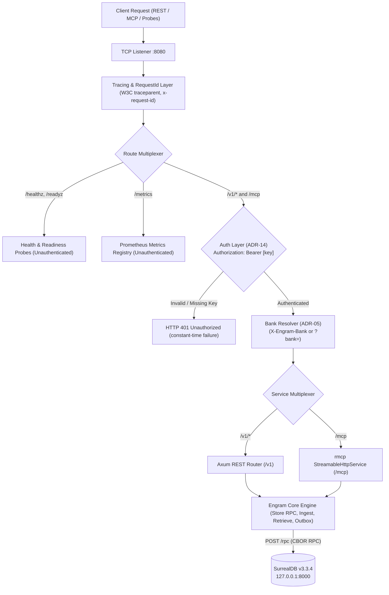
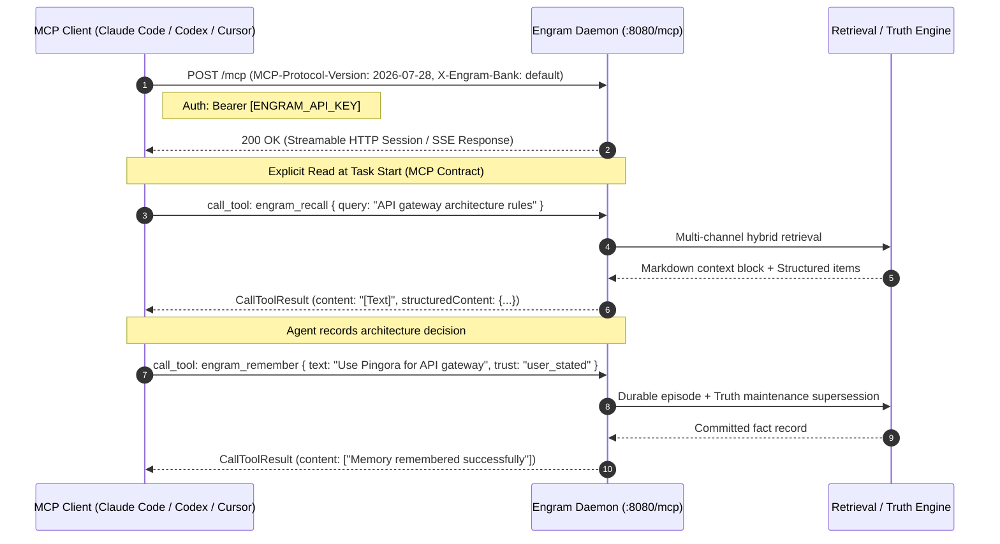

# Engram Specification: External Interfaces (REST API & Model Context Protocol)

**Document:** `docs/spec/06-api-and-mcp.md`  
**Status:** Accepted (v1 baseline) · **Date:** 2026-10-24 · **Owner:** irahardianto  
**Binding Inputs:** [`00-decisions.md`](00-decisions.md) (ADR-01, ADR-02, ADR-05, ADR-11, ADR-14, ADR-15, ADR-16, ADR-18, §3.2 REST API, §3.4 Tools), [`DISCOVERY_HANDOFF.md`](../../DISCOVERY_HANDOFF.md) §6.7  
**Research & Verifications:** `docs/research/06-rust-stack-deployment.md` §3, `docs/research/verification/V06-rust-stack-deployment.md`, `docs/research/01-hindsight.md` §6, `docs/research/03-mem0.md` §7  
**Runtime Environment:** Linux (x86_64), Cargo 1.98.0, Rustc 1.98.0, rmcp 3.7.0, Axum 0.8.9, SurrealDB v3.3.4  

---

## 1. Conventions & Standards

Engram exposes all external functionality over a single HTTP port (default `8080`, configurable via `server.bind` or `ENGRAM_BIND`). The service multiplexes standard REST endpoints (`/v1/...`), the Model Context Protocol Streamable HTTP transport (`/mcp`), health probes (`/healthz`, `/readyz`), and Prometheus metrics (`/metrics`).



### 1.1 Base URL & Path Structure

| Channel | Base Path | Port | Target Consumers |
|---|---|---|---|
| REST API | `http://<host>:8080/v1` | `8080` | Hermes Agent plugin (`MemoryProvider`), automated pipelines, administrative scripts |
| MCP Transport | `http://<host>:8080/mcp` | `8080` | Claude Code, Cursor, Codex, Gemini CLI, external AI agents |
| Liveness Probe | `http://<host>:8080/healthz` | `8080` | Docker daemon, Kubernetes kubelet, host systemd |
| Readiness Probe| `http://<host>:8080/readyz` | `8080` | Container readiness, deployment gates, test harness |
| Metrics Exposition| `http://<host>:8080/metrics` | `8080` | Prometheus scraper, OpenTelemetry collectors |

Default bind: `0.0.0.0:8080` in container image (published as `-p 127.0.0.1:8080:8080`), `127.0.0.1:8080` bare binary.

### 1.2 Versioning Policy

- All REST resources reside under `/v1`. Changes within `/v1` are strictly non-breaking and additive (new optional parameters, new response fields).
- Any breaking change (field removal, data type mutation, status code alterations) requires a new major root (`/v2`).
- Deprecated endpoints emit RFC 8594 `Sunset` and `Deprecation` HTTP headers with a minimum 6-month lifecycle before removal.

### 1.3 Casing & Data Formatting

- **JSON Casing:** All JSON keys across REST requests, responses, errors, and query parameters MUST use `snake_case`. (Note: MCP wire protocol uses JSON-RPC 2.0 with camelCase for protocol fields, but tool arguments and structured result dictionaries preserve domain `snake_case`).
- **Encoding:** Strict UTF-8. Non-UTF-8 byte sequences are rejected with `400 validation_error`.
- **Timestamps:** ISO 8601 / RFC 3339 UTC with explicit offset (`2026-10-24T13:41:49Z`). Datetimes are evaluated using Rust's `jiff` crate against the bank's timezone (`meta:bank.timezone`, default `UTC`). Output datetimes format in UTC ending with `Z`.
- **Identifiers:** Primary keys are stringified SurrealDB record pointers (`"episode:019a12b4..."`, `"fact:019a12b4..."`, `"entity:019a12b4..."`) backed by monotonic UUIDv7 or ULID values.
- **Internal SurrealDB Wire Format (ADR-02):** While Engram's REST and MCP interfaces strictly speak JSON, internal communication between Engram (`store::rpc`) and SurrealDB over `POST /rpc` uses **CBOR** (`Content-Type: application/cbor`, `Accept: application/cbor`). This prevents string truncation bugs on colons (such as `"Note:fix the build"` coerced to record id) and round-trips explicit SurrealDB types (tag 6 NONE, tag 8 RecordId, tag 12 Datetime).

### 1.4 Bank Identification & Tenancy Regex

Per ADR-05, banks map to separate SurrealDB databases in namespace `engram`.
- **Regex:** `^[a-z0-9][a-z0-9_-]{0,62}$` (1 to 63 chars, lowercase alphanumeric start, letters, digits, hyphen, underscore).
- **Resolution:** REST path `/v1/banks/{bank}` > MCP header `X-Engram-Bank: <bank>` > MCP query `?bank=<bank>` > default `default`.
- **Provisioning:** Auto-created on first write with server defaults, or configured explicitly via `PUT /v1/banks/{bank}`.
- **Access Policy (ADR-14):** In v1, `ENGRAM_API_KEY` is a single-operator credential granting access to all banks across REST and MCP. There is deliberately no MCP-only bank allowlist: it would not be a security boundary while the same key opens every bank over REST. Per-bank scoped keys are planned for v1.1. MCP clients select a bank with `X-Engram-Bank` / `?bank=` (default `default`); an invalid bank id returns MCP error `-32602` (invalid params).

### 1.5 Pagination Contract

Collection endpoints (`/entities`, `/facts`, `/jobs`) use cursor pagination:
- `limit`: Integer, default `20`, maximum `200`.
- `cursor`: Opaque base64 string referencing the last record of the previous page.
- Response envelope: `items: [...]`, `has_more: bool`, `next_cursor: Option<String>`.

### 1.6 Error Envelope & Code Registry

All errors return `Content-Type: application/json`:
```json
{
  "error": {
    "code": "validation_error",
    "message": "Field 'user_text' or 'assistant_text' required for episode kind 'turn'.",
    "details": { "field": "episodes[0].user_text" }
  }
}
```

| Error Code | HTTP Status | Meaning | Retryable | Client Action |
|---|---|---|---|---|
| `validation_error` | `400 Bad Request` | Malformed JSON, schema violation, out-of-range parameter | No | Fix payload syntax before resending. |
| `unauthorized` | `401 Unauthorized` | Missing, malformed, or invalid `Authorization: Bearer [key]` | No | Check `ENGRAM_API_KEY`. |
| `forbidden` | `403 Forbidden` | Disallowed operation (e.g. auth disabled on non-loopback) | No | Check configuration & permissions. |
| `bank_not_found` | `404 Not Found` | Requested memory bank does not exist | No | Verify bank ID or call `PUT /v1/banks/{bank}`. |
| `record_not_found` | `404 Not Found` | Record pointer (`fact`, `episode`, `entity`, `job`) not found | No | Verify record ID provenance. |
| `conflict` | `409 Conflict` | Idempotency key reused with differing body; entity merge cycle (cause in `details.reason`) | No | Use new key or resolve merge loop. |
| `payload_too_large` | `413 Payload Too Large` | Episode text > 64 KB, batch > 100, or HTTP body > 10 MB | No | Chunk text or reduce batch size. |
| `unprocessable_entity`| `422 Unprocessable` | Strict vocabulary violation; temporal `valid_to < valid_from` (cause in `details`) | No | Correct semantic values. |
| `rate_limited` | `429 Too Many Requests` | Outbox queue backpressure. Returns `Retry-After: <seconds>` | Yes | Back off and retry after delay. |
| `store_unavailable` | `503 Service Unavailable`| SurrealDB child restarting/offline. Returns `Retry-After: 2` | Yes | Poll after delay. (Hermes spools locally). |
| `upstream_timeout` | `504 Gateway Timeout` | Outbound AI model inference deadline exceeded | Yes | Retry with exponential backoff. |

**Maintenance & Degradation (ADR-17):** During an active re-embedding migration (`meta:bank.maintenance = 'reembed'`), recall endpoints do NOT return HTTP errors; they return HTTP 200 with `degraded.vector = true` and fulfill queries across BM25 and graph channels.

### 1.7 Authentication & Security

- **Static Bearer Token:** Header `Authorization: Bearer <ENGRAM_API_KEY>`.
- **Auth Scoping (ADR-01):** Bearer auth applies strictly to `/v1/*` and `/mcp`. Public probes (`/healthz`, `/readyz`) and Prometheus metrics (`/metrics`) are unauthenticated to allow container runtimes and scrapers to poll without credentials.
- **Constant-Time Check:** Comparison uses `subtle::ConstantTimeEq` to prevent side-channel timing leaks (ADR-14).
- **Auto-Generation:** If unset at boot, Engram creates a 32-byte secret at `/data/secrets/api_key` (`0600`) and logs it once.
- **Bypass Restriction:** `ENGRAM_AUTH=disabled` is allowed **strictly on loopback bind** (`127.0.0.1` or `::1`). Refuses startup on external bind.
- **Secret Redaction:** Inbound text is regex-filtered for tokens, passwords, private keys, and auth headers before persistence or AI model egress.

### 1.8 Idempotency-Key Semantics

- **Header & Payload:** `Idempotency-Key: <opaque-string>` (up to 128 chars) or per-episode `idempotency_key` field.
- **Scope:** Supported on `POST /v1/banks/{bank}/episodes` and `POST /v1/banks/{bank}/remember`. Window: 24 hours.
- **Episode Idempotency (ADR-11, 00-decisions §3.3):** `idempotency_key` is **always set** on every episode — either explicitly from client `Idempotency-Key` / body field, or computed automatically in the ingest query as `sha256(session_id ‖ kind ‖ text)`. SurrealDB enforces uniqueness via unique index `episode_idempotency_key`. A duplicate returns the existing episode id with `duplicate: true` (HTTP `202 Accepted`).
- **Conflict Behavior:** Same key with identical body returns cached response with `Idempotent-Replayed: true`. Same key with differing body returns `409 Conflict` with code `"conflict"` and `details.reason = "idempotency_conflict"` (D10).

### 1.9 Request Size Limits & Tracing Headers

- **Limits:** Ingest batch ≤ 100 episodes; episode text ≤ 64 KB; HTTP request body limit is 10 MB (`DefaultBodyLimit::max(10 * 1024 * 1024)` in Axum) to safely accommodate 100 episodes × 64 KB plus JSON framing; recall token budget ≤ 8192; top_k ≤ 50. Concurrency is bounded to 128 in-flight requests via `tower::limit::ConcurrencyLimitLayer`.
- **Tracing:** W3C `traceparent` (and `tracestate`) accepted, propagated to internal spans, and echoed in responses. Header `x-request-id` accepted or generated (UUIDv7) and echoed.

---

## 2. REST API Endpoints Specification

Complete specification of every endpoint declared in `00-decisions.md` §3.2.

### 2.1 System Health & Diagnostics

#### `GET /healthz` · Liveness Probe
- **Purpose:** Verifies HTTP listener responsiveness. FR: `FR-040`.
- **Response (`200 OK`):** `{"status": "ok"}`. Idempotent: Yes. Side effects: None. Security: Unauthenticated.

#### `GET /readyz` · Readiness Probe
- **Purpose:** Verifies SurrealDB RPC connectivity and completed migrations. FR: `FR-040`.
- **Response:** `200 OK` `{"status": "ready", "surreal_version": "v3.3.4", "migrations_current": true}`. If SurrealDB is recovering, returns `503 Service Unavailable` with `Retry-After: 2`. Idempotent: Yes. Side effects: Runs loopback SurrealDB query `RETURN 1`. Security: Unauthenticated.

#### `GET /metrics` · Prometheus Metrics
- **Purpose:** Prometheus exposition in text 0.0.4 format. FR: `FR-040`.
- **Response (`200 OK`, `text/plain`):** Counter, gauge, and histogram metric lines (`engram_http_requests_total`, `engram_surreal_up`, `engram_jobs_pending`, `engram_recall_duration_seconds`). Security: Unauthenticated.

#### `GET /v1/status` · Service Runtime Status
- **Purpose:** Returns service version, uptime, SurrealDB child PID, active bank count, and outbox job backlog. FR: `FR-040`.
- **Example Request & Response:**
```bash
curl -s -H "Authorization: Bearer $ENGRAM_API_KEY" http://127.0.0.1:8080/v1/status
```
```json
{
  "version": "0.1.0",
  "uptime_seconds": 18452,
  "surreal_mode": "managed",
  "surreal_up": true,
  "surreal_pid": 4129,
  "banks_count": 2,
  "jobs_backlog": { "pending": 4, "running": 1, "dead": 0 }
}
```

---

### 2.2 Bank Tenancy & Management

#### `GET /v1/banks` · List Memory Banks
- **Purpose:** Enumerate all banks with record statistics. FR: `FR-041`.
- **Response (`200 OK`):**
```json
{
  "banks": [
    { "id": "hermes-default", "facts_count": 842, "episodes_count": 128, "entities_count": 94, "created_at": "2026-10-24T08:15:30Z" }
  ]
}
```

#### `PUT /v1/banks/{bank}` · Create or Configure Bank
- **Purpose:** Explicitly provision or configure a memory bank (timezone, embedding model, strict vocabulary). FR: `FR-041`.
- **Request Body (`application/json`):**
```json
{ "timezone": "Asia/Jakarta", "strict_vocabulary": false }
```
- **Response (`201 Created` or `200 OK`):** Bank configuration & stats. Side effects: Idempotently applies `migrations/0001_init.surql` and initializes `meta:bank` record.

#### `GET /v1/banks/{bank}` · Inspect Bank
- **Purpose:** Inspect configuration, metadata, and index counts for a single bank. FR: `FR-041`.
- **Response (`200 OK`):** Bank configuration and aggregate counts. Error: `404 bank_not_found`.

---

### 2.3 Episodic Ingestion (Write Path)

#### `POST /v1/banks/{bank}/episodes` · Ingest Episodes
- **Purpose:** Durably ingest 1..100 conversation turns, developer notes, curated memory mirrors, delegations, or documents. FR: `FR-001`.
- **Target Latency:** Synchronous accept p95 ≤ 20 ms. Offloads vector embedding and LLM fact extraction to outbox jobs.
- **Request Schema:**
  - `episodes`: Array of 1..100 items. Each item carries `kind` (`"turn"`, `"note"`, `"curated"`, `"delegation"`, `"document"`).
  - Fields: `session_id` (string), `user_text` (string), `assistant_text` (string), `text` (string), `author` (string, e.g. `"user"`, `"assistant"`, `"hermes"`), `occurred_at` (ISO 8601), `trust` (enum), `idempotency_key` (string, optional), `metadata` (object).
  - Curated mirrors (`kind == "curated"`) carry `metadata.action` (`"add"`, `"replace"`, `"remove"`), `metadata.target_file` (`"MEMORY.md"`, `"USER.md"`), and `metadata.previous_content` (required for replace/remove).
- **Example Request:**
```bash
curl -s -X POST -H "Authorization: Bearer $ENGRAM_API_KEY" \
  -H "Content-Type: application/json" -H "Idempotency-Key: turn-ack-09412" \
  http://127.0.0.1:8080/v1/banks/hermes-default/episodes \
  -d '{
    "episodes": [
      {
        "kind": "turn",
        "session_id": "sess_8912",
        "user_text": "We are switching our API gateway from Envoy to Pingora.",
        "assistant_text": "Noted. I will update all gateway deployment scripts to Pingora.",
        "author": "user"
      },
      {
        "kind": "curated",
        "text": "Preferred language: Rust",
        "metadata": { "action": "replace", "target_file": "USER.md", "previous_content": "Preferred language: Python" }
      }
    ]
  }'
```
- **Response (`202 Accepted`):**
```json
{
  "accepted_ids": ["episode:019a12b4-82a1-7c90-b19d-b633092b71fa", "episode:019a12b4-82a1-7c90-b19d-b633092b71fb"],
  "enqueued_jobs": { "embed": 2, "extract": 1 }
}
```
- **Duplicate Handling:** If an episode's computed or provided `idempotency_key` exists, returns `202 Accepted` with the existing ID and `duplicate: true`.
- **Side Effects (Transactional Outbox):** Inserts `episode` records; enqueues `embed` job; appends to extraction session buffer or enqueues `extract` job; executes supersession for curated replacements.

---

### 2.4 Retrieval & Recall (Read Path)

#### `POST /v1/banks/{bank}/recall` · Hybrid Retrieval
- **Purpose:** Multi-channel hybrid search (dense vector + BM25 fulltext + graph expansion + temporal recency) with weighted RRF in Rust. Synthesizes a markdown context block for prompt injection. FR: `FR-042`.
- **Target Latency:** Service-side p95 ≤ 150 ms; Hermes prefetch end-to-end ≤ 250 ms. Matches `05-retrieval.md`.
- **Request Parameters:** `query` (required), `top_k` (default 12, max 50), `token_budget` (default 1200, max 8192), `session_id`, `as_of` (point-in-time timestamp), `history` (boolean), `tags`, `timezone`.
- **Example Request:**
```bash
curl -s -X POST -H "Authorization: Bearer $ENGRAM_API_KEY" \
  -H "Content-Type: application/json" \
  http://127.0.0.1:8080/v1/banks/hermes-default/recall \
  -d '{"query": "Which API gateway are we deploying for production?", "top_k": 8, "token_budget": 800}'
```
- **Response (`200 OK`):** (Canonical model per `00-decisions.md` §3.3)
```json
{
  "context_markdown": "### Architectural Facts & Preferences\n- Project uses Pingora for API gateway (valid from 2026-10-24, trust: user_stated, confidence: 0.90)\n- [Superseded 2026-10-24] Project uses Envoy for API gateway\n\n### Supporting Context\n- Turn 8912 (2026-10-24): \"We are switching our API gateway from Envoy to Pingora.\"",
  "estimated_tokens": 114,
  "items": [
    {
      "type": "fact",
      "id": "fact:019a12c0-1122-7f89-9a01-445566778899",
      "text": "Project uses Pingora as API gateway",
      "score": 0.892,
      "channels": { "vector": 1, "bm25": 3, "graph": null, "recency": null },
      "valid_from": "2026-10-24T08:20:00Z",
      "valid_to": null,
      "occurred_at": null,
      "status": "active",
      "contested": false,
      "conflicts_with": [],
      "confidence": 0.90,
      "support": 2
    }
  ],
  "counts": { "facts": 1, "observations": 0, "episodes": 0, "entities": 0 },
  "timings_ms": { "embed": 12.1, "channels": 14.3, "graph": 4.2, "fuse": 2.1, "pack": 1.5, "total": 34.2 },
  "degraded": { "vector": false, "graph": false, "rerank": false },
  "temporal_window": null
}
```
- **Degraded Execution:** If the bank is in maintenance mode (`meta:bank.maintenance = 'reembed'`), `degraded.vector` evaluates to `true`; vector retrieval is bypassed and queries are satisfied using BM25, graph, and recency channels without failing requests.
- **Side Effects:** None. Read-only. Idempotent: Yes.

---

### 2.5 Explicit Memory & Truth Maintenance

#### `POST /v1/banks/{bank}/remember` · Explicit Memory Injection
- **Purpose:** Persist an explicit directive or technical decision. Highest trust (`user_stated`), priority processing. FR: `FR-042`.
- **Request Body:** Free-form `text` OR structured `triple: { subject, predicate, object }`, optional `trust` (default `"user_stated"`), optional `priority` (default `true`).
- **Structured Triple Bypass Contract (ADR-08, ADR-10):**
  When a structured `triple` is provided:
  1. **Bypass LLM:** Skips the LLM extraction queue and worker entirely.
  2. **Entity Resolution:** Resolves subject and object strings via ADR-10 cascade (exact `name_key` match $\to$ Jaro-Winkler $\ge 0.92 \to$ create entity).
  3. **Statement Synthesis:** Constructs canonical statement: `"{subject.name} {predicate} {object.name}"`.
  4. **Embedding:** Generates statement vector embedding synchronously (or via high-priority outbox embed job).
  5. **Durable Episode:** Inserts a corresponding `episode` record (`kind = 'note'`, `text = statement`, `trust = 'user_stated'`).
  6. **Reconcile:** Commits the `fact` edge with `trust = 'user_stated'`, executing deterministic functional supersession (closing conflicting predecessor facts).
- **Response (`200 OK`):** `{"episode_id": "episode:019a...", "fact_ids": ["fact:019a..."], "status": "committed"}`. Side effects: Directly persists fact and episode; triggers deterministic reconciliation.

#### `POST /v1/banks/{bank}/forget` · Soft Retirement
- **Purpose:** Soft-retire a memory record by ID (`fact`, `observation`, `episode`). Zero data loss: never hard deletes. FR: `FR-042`.
- **Semantics by Record Type (00-decisions §3.3):**
  - **Fact & Observation:** Sets `status = "retracted"`, `expired_at = now` (`valid_to` untouched: retraction withdraws belief, it does not assert an end in the real world). Automatically reopens superseded predecessor facts (ADR-08).
  - **Episode:** Sets `retracted_at = now`. Facts whose *only* source episodes are all retracted are retracted too.
- **Request Body:** `{"id": "fact:019a1010...", "reason": "Architecture superseded"}`.
- **Response (`200 OK`):**
```json
{
  "id": "fact:019a1010-0011-7a89-8800-112233445566",
  "status": "retracted",
  "retracted_at": "2026-10-24T08:45:00Z",
  "cascade": { "facts": 0, "reopened": 1 }
}
```
- **Error:** `404 record_not_found`.

---

### 2.6 Entity Graph & Facts Inspection

#### `GET /v1/banks/{bank}/entities` · Search/List Entities
- **Purpose:** Search and paginate canonical knowledge graph entities. FR: `FR-043`.
- **Query Params:** `query`, `kind`, `cursor`, `limit`.
- **Response (`200 OK`):** `{ "items": [ { "id": "entity:019a...", "name": "Engram", "kind": "software", "aliases": ["engram-service"], "summary": "..." } ], "has_more": false, "next_cursor": null }`.

#### `GET /v1/banks/{bank}/entities/{ref}` · Inspect Entity
- **Purpose:** Inspect entity details by ID or `name_key`, including active facts, summary, and historical facts (`?history=true`, `?as_of=`). FR: `FR-043`.
- **Response (`200 OK`):** Entity object with `live_facts` array and optional `historical_facts` array. Error: `404 record_not_found`.

#### `POST /v1/banks/{bank}/entities/merge` · Merge Duplicate Entities
- **Purpose:** Consolidate two entity records into one canonical identity in a single transaction. FR: `FR-043`.
- **Execution:** Rewires facts and mentions from `merged_id` to `canonical_id`; unions aliases; physically deletes `merged_id` (`DELETE $merged_id`) after edge/alias rewiring (the `entity` table has no `status` field).
- **Request Body:** `{"canonical_id": "entity:019a...", "merged_id": "entity:019b...", "reason": "Alias deduplication"}`.
- **Response (`200 OK`):** `{"canonical_id": "entity:019a...", "merged_id": "entity:019b...", "rewired_facts_count": 6}`. Error: `409 conflict` (self-merge or circular loop).

#### `GET /v1/banks/{bank}/facts` · Filter Facts
- **Purpose:** Enumerate facts by `subject`, `predicate`, `object`, `status` (`active`, `superseded`, `retracted`, `pending`), `as_of`, `cursor`, `limit`. FR: `FR-043`.
- **Response (`200 OK`):** Paginated fact records with confidence and temporal bounds.

#### `GET /v1/banks/{bank}/facts/{id}` · Get Fact Detail
- **Purpose:** Retrieve fact with deep provenance (`source_episodes`, `extractor_version`, `conflicts_with`, `supersedes`, `superseded_by`). FR: `FR-043`.
- **Response (`200 OK`):** Full fact entity. Error: `404 record_not_found`.

---

### 2.7 Session Lifecycle & Outbox Jobs

#### `POST /v1/banks/{bank}/sessions/{session_id}/flush` · Pre-Compress Flush
- **Purpose:** Synchronously drain pending turns for a session (`wait_ms` ≤ 10000). Called by Hermes on `on_pre_compress`. FR: `FR-044`.
- **Execution Contract (ADR-17):** The HTTP handler never runs extraction itself (preserving the single bank-writer concurrency model). It sets the pending session job `run_after = now`, wakes the bank writer, and awaits a `tokio::sync::watch` completion receiver up to `wait_ms`.
- **Request Body (`application/json`, optional):** `{"wait_ms": 5000}`.
- **Response (`200 OK`):**
```json
{
  "status": "completed",
  "facts_written": 2,
  "digest": ["Project uses Pingora as API gateway"]
}
```
If the timeout elapses before background extraction completes, returns `200 OK` with `{"status": "pending", "facts_written": 0, "digest": []}`.

#### `POST /v1/banks/{bank}/sessions/{session_id}/end` · End Session
- **Purpose:** Mark session closed, flush buffer, and enqueue asynchronous consolidation job (`kind = "consolidate"`). FR: `FR-044`.
- **Response (`200 OK`):** `{"session_id": "sess_8912", "status": "closed", "consolidation_job_id": "job:019a..."}`.

#### `GET /v1/banks/{bank}/jobs` · List Outbox Jobs
- **Purpose:** Inspect pending, running, completed, failed, or dead outbox jobs. FR: `FR-045`.
- **Query Params:** `status`, `kind`, `cursor`, `limit`. Response: Paginated `job` records.

#### `POST /v1/banks/{bank}/jobs/{id}/retry` · Retry Job
- **Purpose:** Re-enqueue a failed or dead outbox job (resets `attempts = 0`, `status = "pending"`). FR: `FR-045`.
- **Response (`200 OK`):** Updated job record. Error: `404 record_not_found`.

#### `POST /v1/banks/{bank}/export` · Logical Export
- **Purpose:** Logical backup dump of all bank records in portable SurrealQL format. FR: `FR-045`.
- **Streaming Execution:** Invokes `/usr/local/bin/surreal export --conn http://127.0.0.1:8000 --user root --pass <secret> --ns engram --db <bank> -` and streams stdout directly via HTTP chunked transfer encoding (`axum::body::Body::from_stream`).
- **Response (`200 OK`, `application/sql`):** Plaintext SurrealQL statements.

#### `POST /v1/banks/{bank}/import` · Logical Import
- **Purpose:** Restore bank data from SurrealQL dump statements. FR: `FR-045`.
- **Streaming Execution:** Pipes incoming HTTP request body stream directly into stdin of `/usr/local/bin/surreal import --conn http://127.0.0.1:8000 --user root --pass <secret> --ns engram --db <bank> -`.
- **Request Body (`application/sql`):** SurrealQL dump. Response (`200 OK`): `{"records_imported": 2480, "status": "completed"}`.

---

### 2.8 Administrative Physical Purge

#### `POST /v1/banks/{bank}/purge` · Irreversible Physical Purge (Admin)
- **Purpose:** Irreversible physical deletion of listed episodes, facts, or observations for GDPR right-to-be-forgotten or leaked credentials (ADR-14). FR: `FR-046`. Not exposed as an MCP or Hermes agent tool.
- **Request Body (`application/json`):**
```json
{
  "ids": ["episode:019a12b4-82a1-7c90-b19d-b633092b71fa", "fact:019a12c0-1122-7f89-9a01-445566778899"],
  "confirm": "PURGE"
}
```
`confirm` MUST be the exact uppercase string `"PURGE"`. Missing or incorrect value returns `400 validation_error`.
- **Response (`200 OK`):**
```json
{
  "status": "purged",
  "purged": { "episodes": 1, "facts": 1, "observations": 0 }
}
```
- **Cascade & Audit Scrub:**
  1. Executes physical `DELETE` in SurrealDB for listed records.
  2. Cascades to physically delete facts and observations whose *only* evidence is a purged record.
  3. Scrubs record content from the `audit` log, leaving an audit row with `action = "purge"`, recording target record IDs and counts without retaining any deleted text.

---

## 3. Model Context Protocol (MCP) Specification

Engram implements the official Model Context Protocol (MCP) specification via the **Streamable HTTP** transport mounted at `/mcp`.



### 3.1 Transport & Wire Framing

- **Mount Point:** `/mcp` nested into Axum via `StreamableHttpService`. Mounted on an authenticated sub-router via `.fallback_service(mcp_service)` (ADR-01).
- **Authentication:** Same Bearer token header `Authorization: Bearer <ENGRAM_API_KEY>`.
- **Bank Scoping:** Resolved from `X-Engram-Bank: {bank_id}` header or `?bank={bank_id}` query parameter (default `"default"`). v1 has no MCP bank allowlist (ADR-14: one key = all banks); an invalid bank id returns `-32602`.
- **Mandatory Headers (FIND-10):**
  - `Accept: application/json, text/event-stream` MUST be passed by clients on all POST requests (including session handshakes and notifications). Requests lacking this header are rejected by `rmcp 3.7.0` with `406 Not Acceptable`.
- **Stateless 2026-07-28 Conventions (FIND-08):**
  - For protocol version `2026-07-28` (`V_2026_07_28`), requests operate statelessly without `initialize` sessions.
  - Every stateless request MUST provide `Mcp-Method: <method>` HTTP header (e.g. `Mcp-Method: tools/call`).
  - Requests carrying params MUST supply `params._meta` containing `io.modelcontextprotocol/protocolVersion` and `io.modelcontextprotocol/clientCapabilities` per SEP-2243 and SEP-2567. Missing headers or meta return `HTTP 400` with codes `-32020` or `-32602`.
- **Supported Protocol Versions:** Verified from `rmcp::model::ProtocolVersion` (`rmcp-3.7.0/src/model.rs:166-209`):
  - `2024-11-05` (`V_2024_11_05`)
  - `2025-03-26` (`V_2025_03_26`)
  - `2025-06-18` (`V_2025_06_18`)
  - `2025-11-25` (`V_2025_11_25` — `LATEST_WITH_INITIALIZE`)
  - `2026-07-28` (`V_2026_07_28` — `LATEST`, `STANDARD_HEADERS`, `NO_INITIALIZE`)
- **Capabilities & Resources:** `tools` enabled; optional resource `engram://guide`.

---

### 3.2 The Five Unified Tools

> [!IMPORTANT]
> **Prompt Injection Contract: Hermes vs. MCP Clients**
> - In **Hermes Agent**, memory context is **automatically injected** on every turn by `prefetch`.
> - For **External MCP Clients** (Claude Code, Cursor, Codex, Gemini CLI), **THERE IS NO AUTOMATIC INJECTION**.
> - MCP clients MUST call `engram_recall` at the start of any conversation or non-trivial task, and call `engram_remember` to record decisions, architectural rules, and preferences.

#### 1. `engram_recall`
- **LLM Description:**
  > "Query long-term episodic, semantic, and knowledge graph memory for prior decisions, project facts, code conventions, and user preferences. IMPORTANT: Memory context is NOT automatically injected into your conversation turns. You MUST call this tool at the beginning of a conversation or before executing non-trivial engineering tasks to retrieve relevant background context. Supports natural language queries, historical time-travel ('as_of'), and inspection of superseded facts ('history: true')."
- **Input Schema:** `query` (string, required), `top_k` (integer, default 12, max 50), `token_budget` (integer, default 1200, max 8192), `as_of` (string, RFC 3339), `history` (boolean, default false).
- **Output:** `content: [ContentBlock::text(context_markdown)]`, `structuredContent: { context_markdown, estimated_tokens, items, counts, timings_ms, degraded, temporal_window }`. `isError: false`.

#### 2. `engram_remember`
- **LLM Description:**
  > "Persist an explicit fact, architecture decision, constraint, or user preference directly into long-term memory. Use this whenever the user gives an explicit directive ('always use snake_case', 'our database is SurrealDB v3.3.4') or when an important technical decision is agreed upon. Accepts free-form text or structured triples (subject, predicate, object). Assigns highest trust ('user_stated') and executes immediate deterministic truth maintenance (superseding conflicting older facts)."
- **Input Schema:** `text` (string, optional), `triple` (object `{ subject, predicate, object }`, optional), `trust` (enum: `user_stated`, `user_implied`, `assistant_stated`, `tool_output`, `inferred`, default: `user_stated`).
- **Output:** `content: [ContentBlock::text("Successfully remembered fact...")]`, `structuredContent: { episode_id, fact_ids, status }`.

#### 3. `engram_forget`
- **LLM Description:**
  > "Retire or invalidate an outdated fact, observation, or episode by its ID. Soft-retracts the record (facts/observations: status=retracted, expired_at=now; episodes: retracted_at=now; facts sourced only by retracted episodes are retracted too, and a fact it had superseded is reopened). The record will no longer appear in live recall queries, but remains preserved for audit history. Never hard deletes data."
- **Input Schema:** `id` (string, required: `fact:...`, `observation:...`, `episode:...`), `reason` (string, optional).
- **Output:** `content: [ContentBlock::text("Retired memory record...")]`, `structuredContent: { id, status: "retracted", retracted_at, cascade: { facts, reopened } }`.

#### 4. `engram_entities`
- **LLM Description:**
  > "Explore the knowledge graph for a specific entity or concept. Returns canonical entity details, aliases, summary, and all live relational facts (who works where, what depends on what). Essential for debugging or answering 'what do you know about X?' questions. Pass 'ref' as an entity ID or name."
- **Input Schema:** `ref` (string, optional ID or name), `query` (string, optional search), `kind` (string, optional filter), `history` (boolean, default false). (In Rust: field `pub ref_: Option<String>` annotated with `#[serde(rename = "ref")]` and `#[schemars(rename = "ref")]`).
- **Output:** `content: [ContentBlock::text(markdown_summary)]`, `structuredContent: { entity, live_facts, historical_facts }`.

#### 5. `engram_status`
- **LLM Description:**
  > "Inspect Engram service health, database state, total fact and episode counts, and pending outbox job backlog for the active memory bank. Used for diagnostic verification."
- **Input Schema:** `bank` (string, optional; defaults to active bank).
- **Output:** `content: [ContentBlock::text(status_markdown)]`, `structuredContent: { bank, facts_count, episodes_count, pending_jobs, dead_jobs, surreal_up }`.

---

### 3.3 MCP Error Handling Semantics

Per `rmcp-3.7.0/src/model.rs:4251-4294`:
- **Tool-Level Error (`Ok(CallToolResult::error(...))` / `isError: true`):** The tool executed, but encountered business failure (entity not found, zero rows returned). The client renders the error explanation directly to the user.
- **Protocol Error (`Err(rmcp::ErrorData)`):** Transport/JSON-RPC parse failure (`-32602 invalid_params`) or internal daemon failure (`-32603 internal_error`). Rendered opaquely by MCP clients.

---

### 3.4 Client Configuration Snippets (Verified 2026)

#### 1. Claude Code CLI
```bash
claude mcp add --transport http engram http://127.0.0.1:8080/mcp \
  --header "Authorization: Bearer YOUR_ENGRAM_API_KEY" \
  --header "X-Engram-Bank: default"
```

#### 2. OpenAI Codex CLI (`~/.codex/config.toml`)
```toml
[mcp_servers.engram]
url = "http://127.0.0.1:8080/mcp"
http_headers = { "Authorization" = "Bearer YOUR_ENGRAM_API_KEY", "X-Engram-Bank" = "default" }
```
*Environment-variable alternative:*
```toml
[mcp_servers.engram]
url = "http://127.0.0.1:8080/mcp"
[mcp_servers.engram.env_http_headers]
Authorization = "ENGRAM_AUTH_HEADER"
X-Engram-Bank = "ENGRAM_BANK_NAME"
```

#### 3. Cursor (`.cursor/mcp.json` or `~/.cursor/mcp.json`)
```json
{
  "mcpServers": {
    "engram": {
      "url": "http://127.0.0.1:8080/mcp",
      "headers": {
        "Authorization": "Bearer ${env:ENGRAM_API_KEY}",
        "X-Engram-Bank": "default"
      }
    }
  }
}
```

#### 4. Gemini CLI (`~/.gemini/settings.json`)
```json
{
  "mcpServers": {
    "engram": {
      "httpUrl": "http://127.0.0.1:8080/mcp",
      "headers": {
        "Authorization": "Bearer YOUR_ENGRAM_API_KEY",
        "X-Engram-Bank": "default"
      },
      "timeout": 10000
    }
  }
}
```

---

## 4. Verified Rust Wiring Sketch

Complete, verified Rust wiring combining Axum routes, Bearer auth, and `rmcp 3.7.0` Streamable HTTP.

### 4.1 rmcp 3.7.0 Verification Citations

- `StreamableHttpService`: [`rmcp-3.7.0/src/transport/streamable_http_server/tower.rs:1332-1435`](https://docs.rs/crate/rmcp/3.7.0/source/src/transport/streamable_http_server/tower.rs#L1332-L1435)
- `StreamableHttpServerConfig`: [`rmcp-3.7.0/src/transport/streamable_http_server/tower.rs:78-212`](https://docs.rs/crate/rmcp/3.7.0/source/src/transport/streamable_http_server/tower.rs#L78-L212)
- `LocalSessionManager`: [`rmcp-3.7.0/src/transport/streamable_http_server/session/local.rs`](https://docs.rs/crate/rmcp/3.7.0/source/src/transport/streamable_http_server/session/local.rs)
- `#[tool_router(server_handler)]`: [`rmcp-macros-3.7.0/src/lib.rs:58-95`](https://docs.rs/crate/rmcp-macros/3.7.0/source/src/lib.rs#L58-L95) and [`src/tool_router.rs:1-120`](https://docs.rs/crate/rmcp-macros/3.7.0/source/src/tool_router.rs#L1-L120) (Fixes F-02)
- `Parameters<T>`: [`rmcp-3.7.0/src/handler/server/wrapper/parameters.rs:18-45`](https://docs.rs/crate/rmcp/3.7.0/source/src/handler/server/wrapper/parameters.rs#L18-L45)
- `CallToolResult`: [`rmcp-3.7.0/src/model.rs:4135-4360`](https://docs.rs/crate/rmcp/3.7.0/source/src/model.rs#L4135-L4360)

### 4.2 Application Router & MCP Implementation

```rust
// File: src/api/mod.rs
use std::sync::Arc;
use std::time::Duration;
use axum::{
    Router, extract::State, http::{HeaderMap, Request, StatusCode},
    middleware::{self, Next}, response::{IntoResponse, Response}, routing::{get, post, put},
};
use rmcp::{
    handler::server::wrapper::Parameters,
    model::{CallToolResult, ContentBlock, ErrorData},
    transport::streamable_http_server::{
        StreamableHttpServerConfig, StreamableHttpService, session::local::LocalSessionManager,
    },
};
use schemars::JsonSchema;
use serde::Deserialize;
use subtle::ConstantTimeEq;
use tokio_util::sync::CancellationToken;

#[derive(Clone)]
pub struct AppState {
    pub config: Arc<crate::config::Config>,
    pub rpc: crate::store::rpc::RpcClient,
    pub embedder: Arc<dyn crate::ai::Embedder>,
    pub llm: Arc<dyn crate::ai::Llm>,
    pub reranker: Option<Arc<dyn crate::ai::Reranker>>,
    pub shutdown: CancellationToken,
}

#[derive(Debug, Deserialize, JsonSchema)]
pub struct McpRecallArgs {
    pub query: String,
    pub top_k: Option<usize>,
    pub token_budget: Option<usize>,
    pub as_of: Option<String>,
    pub history: Option<bool>,
}

#[derive(Debug, Deserialize, JsonSchema)]
pub struct McpRememberArgs {
    pub text: Option<String>,
    pub triple: Option<McpTriple>,
    pub trust: Option<String>,
}

#[derive(Debug, Deserialize, JsonSchema)]
pub struct McpTriple { pub subject: String, pub predicate: String, pub object: String }

#[derive(Debug, Deserialize, JsonSchema)]
pub struct McpForgetArgs { pub id: String, pub reason: Option<String> }

#[derive(Debug, Deserialize, JsonSchema)]
pub struct McpEntitiesArgs {
    #[serde(rename = "ref")]
    #[schemars(rename = "ref")]
    pub ref_: Option<String>,
    pub query: Option<String>,
    pub kind: Option<String>,
    pub history: Option<bool>,
}

#[derive(Debug, Deserialize, JsonSchema)]
pub struct McpStatusArgs { pub bank: Option<String> }

#[derive(Clone)]
pub struct EngramMcpServer { pub state: Arc<AppState>, pub bank: String }

#[rmcp::tool_router(server_handler)]
impl EngramMcpServer {
    #[rmcp::tool(name = "engram_recall", description = "Query long-term memory. Context is NOT auto-injected for MCP; call at task start.")]
    pub async fn recall(&self, Parameters(args): Parameters<McpRecallArgs>) -> Result<CallToolResult, ErrorData> {
        let req = crate::retrieve::RecallRequest {
            query: args.query, top_k: args.top_k.unwrap_or(12), token_budget: args.token_budget.unwrap_or(1200),
            as_of: args.as_of, history: args.history.unwrap_or(false), session_id: None, tags: None, timezone: None,
        };
        match crate::retrieve::execute_recall(&self.state, &self.bank, req).await {
            Ok(resp) => {
                let json_val = serde_json::to_value(&resp).map_err(|e| ErrorData::internal_error(e.to_string(), None))?;
                Ok(CallToolResult {
                    result_type: Some(rmcp::model::ResultType::COMPLETE),
                    content: vec![ContentBlock::text(resp.context_markdown)],
                    structured_content: Some(json_val),
                    is_error: Some(false), meta: None,
                })
            }
            Err(e) => Ok(CallToolResult::error(vec![ContentBlock::text(format!("Recall error: {e}"))])),
        }
    }

    #[rmcp::tool(name = "engram_remember", description = "Persist explicit decision/preference with highest trust.")]
    pub async fn remember(&self, Parameters(args): Parameters<McpRememberArgs>) -> Result<CallToolResult, ErrorData> {
        match crate::ingest::execute_remember(&self.state, &self.bank, args).await {
            Ok(res) => {
                let json_val = serde_json::to_value(&res).map_err(|e| ErrorData::internal_error(e.to_string(), None))?;
                Ok(CallToolResult {
                    result_type: Some(rmcp::model::ResultType::COMPLETE),
                    content: vec![ContentBlock::text(format!("Remembered fact (ID: {})", res.episode_id))],
                    structured_content: Some(json_val),
                    is_error: Some(false), meta: None,
                })
            }
            Err(e) => Ok(CallToolResult::error(vec![ContentBlock::text(format!("Remember error: {e}"))])),
        }
    }

    #[rmcp::tool(name = "engram_forget", description = "Soft-retire a memory record by ID (status=retracted, expired_at=now; valid_to untouched; reopens a fact it had superseded).")]
    pub async fn forget(&self, Parameters(args): Parameters<McpForgetArgs>) -> Result<CallToolResult, ErrorData> {
        match crate::ingest::execute_forget(&self.state, &self.bank, &args.id, args.reason).await {
            Ok(res) => {
                let json_val = serde_json::to_value(&res).map_err(|e| ErrorData::internal_error(e.to_string(), None))?;
                Ok(CallToolResult {
                    result_type: Some(rmcp::model::ResultType::COMPLETE),
                    content: vec![ContentBlock::text(format!("Retired {} at {}", res.id, res.retracted_at))],
                    structured_content: Some(json_val),
                    is_error: Some(false), meta: None,
                })
            }
            Err(e) => Ok(CallToolResult::error(vec![ContentBlock::text(format!("Forget error: {e}"))])),
        }
    }

    #[rmcp::tool(name = "engram_entities", description = "Explore knowledge graph entities and live relations.")]
    pub async fn entities(&self, Parameters(args): Parameters<McpEntitiesArgs>) -> Result<CallToolResult, ErrorData> {
        match crate::retrieve::execute_entities(&self.state, &self.bank, args).await {
            Ok(res) => {
                let json_val = serde_json::to_value(&res).map_err(|e| ErrorData::internal_error(e.to_string(), None))?;
                Ok(CallToolResult {
                    result_type: Some(rmcp::model::ResultType::COMPLETE),
                    content: vec![ContentBlock::text(res.markdown_summary)],
                    structured_content: Some(json_val),
                    is_error: Some(false), meta: None,
                })
            }
            Err(e) => Ok(CallToolResult::error(vec![ContentBlock::text(format!("Entities error: {e}"))])),
        }
    }

    #[rmcp::tool(name = "engram_status", description = "Inspect Engram health, counts, and job backlog.")]
    pub async fn status(&self, Parameters(args): Parameters<McpStatusArgs>) -> Result<CallToolResult, ErrorData> {
        let bank = args.bank.unwrap_or_else(|| self.bank.clone());
        match crate::store::get_bank_status(&self.state, &bank).await {
            Ok(st) => {
                let json_val = serde_json::to_value(&st).map_err(|e| ErrorData::internal_error(e.to_string(), None))?;
                let text = format!("Bank {bank}: {} facts, {} episodes, {} pending jobs", st.facts_count, st.episodes_count, st.pending_jobs);
                Ok(CallToolResult {
                    result_type: Some(rmcp::model::ResultType::COMPLETE),
                    content: vec![ContentBlock::text(text)],
                    structured_content: Some(json_val),
                    is_error: Some(false), meta: None,
                })
            }
            Err(e) => Ok(CallToolResult::error(vec![ContentBlock::text(format!("Status error: {e}"))])),
        }
    }
}

pub async fn auth_middleware(
    State(state): State<Arc<AppState>>, headers: HeaderMap, request: Request<axum::body::Body>, next: Next,
) -> Result<Response, StatusCode> {
    if state.config.server.auth_disabled { return Ok(next.run(request).await); }
    let auth = headers.get("Authorization").and_then(|h| h.to_str().ok());
    match auth {
        Some(h) if h.starts_with("Bearer ") => {
            let token = h.trim_start_matches("Bearer ");
            if token.as_bytes().ct_eq(state.config.server.api_key.expose().as_bytes()).into() {
                Ok(next.run(request).await)
            } else {
                Err(StatusCode::UNAUTHORIZED)
            }
        }
        _ => Err(StatusCode::UNAUTHORIZED),
    }
}

pub fn build_application_router(state: Arc<AppState>) -> Router {
    let s_clone = state.clone();
    let mcp_service = StreamableHttpService::new(
        move || Ok(EngramMcpServer { state: s_clone.clone(), bank: s_clone.config.server.default_bank.clone() }),
        Arc::new(LocalSessionManager::default()),
        StreamableHttpServerConfig::default()
            .with_sse_keep_alive(Some(Duration::from_secs(15)))
            .with_legacy_session_mode(true)
            .with_cancellation_token(state.shutdown.clone()),
    );

    // Protected /mcp router using fallback_service with Bearer auth (ADR-01, VS4 FIND-07)
    let mcp_router = Router::new()
        .fallback_service(mcp_service)
        .layer(middleware::from_fn_with_state(state.clone(), auth_middleware));

    // Protected /v1 router with Bearer auth
    let rest_router = Router::new()
        .route("/status", get(crate::api::handlers::get_status))
        .route("/banks", get(crate::api::handlers::list_banks))
        .route("/banks/{bank}", put(crate::api::handlers::configure_bank).get(crate::api::handlers::get_bank))
        .route("/banks/{bank}/episodes", post(crate::api::handlers::ingest_episodes))
        .route("/banks/{bank}/recall", post(crate::api::handlers::recall_memories))
        .route("/banks/{bank}/remember", post(crate::api::handlers::remember_memory))
        .route("/banks/{bank}/forget", post(crate::api::handlers::forget_memory))
        .route("/banks/{bank}/entities", get(crate::api::handlers::list_entities))
        .route("/banks/{bank}/entities/{ref}", get(crate::api::handlers::get_entity))
        .route("/banks/{bank}/entities/merge", post(crate::api::handlers::merge_entities))
        .route("/banks/{bank}/facts", get(crate::api::handlers::list_facts))
        .route("/banks/{bank}/facts/{id}", get(crate::api::handlers::get_fact))
        .route("/banks/{bank}/sessions/{session_id}/flush", post(crate::api::handlers::flush_session))
        .route("/banks/{bank}/sessions/{session_id}/end", post(crate::api::handlers::end_session))
        .route("/banks/{bank}/jobs", get(crate::api::handlers::list_jobs))
        .route("/banks/{bank}/jobs/{id}/retry", post(crate::api::handlers::retry_job))
        .route("/banks/{bank}/export", post(crate::api::handlers::export_bank))
        .route("/banks/{bank}/import", post(crate::api::handlers::import_bank))
        .route("/banks/{bank}/purge", post(crate::api::handlers::purge_records))
        .layer(middleware::from_fn_with_state(state.clone(), auth_middleware));

    // Root router: Health probes and Prometheus metrics are strictly unauthenticated
    Router::new()
        .route("/healthz", get(crate::api::probes::healthz))
        .route("/readyz", get(crate::api::probes::readyz))
        .route("/metrics", get(crate::api::probes::metrics))
        .nest("/v1", rest_router)
        .nest_service("/mcp", mcp_router)
        .layer(axum::extract::DefaultBodyLimit::max(10 * 1024 * 1024))
        .layer(tower::limit::ConcurrencyLimitLayer::new(128))
        .with_state(state)
}
```

---

## 5. Hermes Agent Tool Schemas

When loaded as a Hermes directory provider (`$HERMES_HOME/plugins/engram/`), Engram exports the five tools as OpenAI function-calling schemas via `get_tool_schemas()`.

### 5.1 Function Calling Schemas (`get_tool_schemas()`)

```python
# File: integrations/hermes/engram/__init__.py
from typing import Any

def _schema(name: str, desc: str, props: dict[str, Any] | None = None, req: list[str] | None = None) -> dict[str, Any]:
    return {"name": name, "description": desc, "parameters": {"type": "object", "properties": props or {}, "required": req or []}}

def _p(desc: str, type_: str = "string", **extra) -> dict[str, Any]:
    return {"type": type_, "description": desc, **extra}

HERMES_TOOL_SCHEMAS = [
    _schema("engram_recall", "Hybrid recall across long-term memory. Returns ranked facts with dates and confidence.",
            {"query": _p("Search query or concept."), "top_k": _p("Max items (default: 12).", "integer"),
             "token_budget": _p("Token budget (default: 1200).", "integer"), "as_of": _p("RFC 3339 historical timestamp."),
             "history": _p("Include superseded past facts.", "boolean")}, req=["query"]),
    _schema("engram_remember", "Persist an explicit directive, rule, or preference. Highest trust ('user_stated').",
            {"text": _p("Statement to remember."), "triple": _p("Structured triple.", "object", properties={
                "subject": _p("Subject."), "predicate": _p("Predicate."), "object": _p("Object.")}),
             "trust": _p("Trust override.", enum=["user_stated", "user_implied", "assistant_stated", "tool_output", "inferred"])}),
    _schema("engram_forget", "Soft-retire a memory record by ID. Never hard deletes.",
            {"id": _p("Record ID to retire (e.g. 'fact:...')."), "reason": _p("Reason for retirement.")}, req=["id"]),
    _schema("engram_entities", "Inspect knowledge graph entities and live relations.",
            {"ref": _p("Entity ID or name."), "query": _p("Search filter."), "kind": _p("Kind filter."),
             "history": _p("Include historical facts.", "boolean")}),
    _schema("engram_status", "Check Engram health, counts, and outbox job queue depth.",
            {"bank": _p("Optional bank ID.")})
]
```

### 5.2 Tool Call Dispatch & String Results

Tool dispatch is executed by delegating to `self._client: EngramClient` scoped to the active bank, returning serialized JSON strings or invoking `tools.registry.tool_error`. The canonical reference implementation lives in [`07-hermes-plugin.md §11.3`](07-hermes-plugin.md):

```python
# Excerpt from integrations/hermes/engram/__init__.py (see 07-hermes-plugin.md §11.3)
class EngramMemoryProvider(MemoryProvider):
    def handle_tool_call(self, tool_name: str, args: dict[str, Any], **kwargs: Any) -> str:
        if not self._client:
            return tool_error("Engram client is not initialized")
        try:
            if tool_name == "engram_recall":
                query = str(args.get("query") or "")
                if not query.strip():
                    return tool_error("Missing required parameter: query")
                res = self._client.recall(
                    query=query,
                    top_k=int(args.get("top_k") or self._top_k),
                    token_budget=int(args.get("token_budget") or self._token_budget),
                    as_of=args.get("as_of"),
                    history=bool(args.get("history", False)),
                )
                return json.dumps(res, ensure_ascii=False)

            elif tool_name == "engram_remember":
                text = args.get("text")
                triple = args.get("triple")
                trust = args.get("trust")
                if not text and not triple:
                    return tool_error("Missing required parameter: text or triple")
                res = self._client.remember(
                    text=str(text) if text else None,
                    triple=triple if isinstance(triple, dict) else None,
                    trust=str(trust) if trust else None,
                )
                return json.dumps(res, ensure_ascii=False)

            elif tool_name == "engram_forget":
                fact_id = str(args.get("id") or "")
                if not fact_id.strip():
                    return tool_error("Missing required parameter: id")
                res = self._client.forget(id_=fact_id, reason=args.get("reason"))
                return json.dumps(res, ensure_ascii=False)

            elif tool_name == "engram_entities":
                ref = args.get("ref")
                res = self._client.entities(
                    ref=str(ref) if ref else None,
                    query=args.get("query"),
                    kind=args.get("kind"),
                    history=bool(args.get("history", False)),
                )
                return json.dumps(res, ensure_ascii=False)

            elif tool_name == "engram_status":
                res = self._client.status(bank=args.get("bank"))
                if self._spool:
                    res["spool_pending_count"] = self._spool.count()
                else:
                    res["spool_pending_count"] = 0
                return json.dumps(res, ensure_ascii=False)

            return tool_error(f"Unknown tool: {tool_name}")
        except Exception as exc:
            return tool_error(f"Engram operation failed: {exc}")
```

---

## 6. Backward-Compatibility & Deprecation Policy

1. **Additive REST Guarantees:** All `/v1` endpoints strictly adhere to non-breaking expansion. New query/body parameters default safely; response schemas may add fields without breaking clients.
2. **Deprecation Cycle:** Retired resources emit RFC 8594 `Sunset` headers with a minimum 6-month grace window before removal.
3. **MCP Stability:** The five tool names are frozen for v1. Dual-stack negotiation supports legacy sessions alongside stateless `2026-07-28` requests.
4. **SurrealDB Migrations:** Embedded migrations run automatically via `schema_migration` on startup without manual SQL intervention.

---

## 7. Compact OpenAPI 3.1 YAML Appendix

The following OpenAPI 3.1.0 specification covers all REST endpoints, schemas, and security definitions.

```yaml
openapi: 3.1.0
info:
  title: Engram Memory Service REST API
  description: Sovereign long-term memory engine for AI agents on SurrealDB.
  version: 1.0.0
servers:
  - url: http://127.0.0.1:8080
security:
  - BearerAuth: []
paths:
  /healthz:
    get:
      summary: Liveness probe
      security: []
      responses:
        '200': { description: OK, content: { application/json: { schema: { type: object, properties: { status: { type: string, example: ok } } } } } }
  /readyz:
    get:
      summary: Readiness probe
      security: []
      responses:
        '200': { description: Ready, content: { application/json: { schema: { type: object, properties: { status: { type: string }, surreal_version: { type: string }, migrations_current: { type: boolean } } } } } }
        '503': { description: Service unavailable, headers: { Retry-After: { schema: { type: integer, example: 2 } } }, content: { application/json: { schema: { $ref: '#/components/schemas/ErrorEnvelope' } } } }
  /metrics:
    get:
      summary: Prometheus metrics
      security: []
      responses:
        '200': { description: Prometheus text metrics, content: { text/plain: { schema: { type: string } } } }
  /v1/status:
    get:
      summary: Service status & backlog
      responses:
        '200': { description: Status, content: { application/json: { schema: { $ref: '#/components/schemas/ServiceStatus' } } } }
  /v1/banks:
    get:
      summary: List banks
      responses:
        '200': { description: List of banks, content: { application/json: { schema: { type: object, properties: { banks: { type: array, items: { $ref: '#/components/schemas/BankSummary' } } } } } } }
  /v1/banks/{bank}:
    put:
      summary: Create or configure bank
      parameters: [{ name: bank, in: path, required: true, schema: { type: string, pattern: '^[a-z0-9][a-z0-9_-]{0,62}$' } }]
      requestBody: { required: true, content: { application/json: { schema: { $ref: '#/components/schemas/BankConfig' } } } }
      responses:
        '200': { description: Bank updated, content: { application/json: { schema: { $ref: '#/components/schemas/BankDetail' } } } }
        '201': { description: Bank created, content: { application/json: { schema: { $ref: '#/components/schemas/BankDetail' } } } }
    get:
      summary: Get bank stats & config
      parameters: [{ name: bank, in: path, required: true, schema: { type: string } }]
      responses:
        '200': { description: Bank detail, content: { application/json: { schema: { $ref: '#/components/schemas/BankDetail' } } } }
        '404': { description: Bank not found, content: { application/json: { schema: { $ref: '#/components/schemas/ErrorEnvelope' } } } }
  /v1/banks/{bank}/episodes:
    post:
      summary: Ingest episodes
      parameters:
        - { name: bank, in: path, required: true, schema: { type: string } }
        - { name: Idempotency-Key, in: header, required: false, schema: { type: string } }
      requestBody: { required: true, content: { application/json: { schema: { $ref: '#/components/schemas/IngestEpisodesRequest' } } } }
      responses:
        '202': { description: Accepted, content: { application/json: { schema: { $ref: '#/components/schemas/IngestEpisodesResponse' } } } }
        '400': { description: Validation error, content: { application/json: { schema: { $ref: '#/components/schemas/ErrorEnvelope' } } } }
        '409': { description: Conflict, content: { application/json: { schema: { $ref: '#/components/schemas/ErrorEnvelope' } } } }
        '413': { description: Payload too large, content: { application/json: { schema: { $ref: '#/components/schemas/ErrorEnvelope' } } } }
  /v1/banks/{bank}/recall:
    post:
      summary: Hybrid recall
      parameters: [{ name: bank, in: path, required: true, schema: { type: string } }]
      requestBody: { required: true, content: { application/json: { schema: { $ref: '#/components/schemas/RecallRequest' } } } }
      responses:
        '200': { description: Recalled context, content: { application/json: { schema: { $ref: '#/components/schemas/RecallResponse' } } } }
  /v1/banks/{bank}/remember:
    post:
      summary: Explicit memory
      parameters:
        - { name: bank, in: path, required: true, schema: { type: string } }
        - { name: Idempotency-Key, in: header, required: false, schema: { type: string } }
      requestBody: { required: true, content: { application/json: { schema: { $ref: '#/components/schemas/RememberRequest' } } } }
      responses:
        '200': { description: Memory recorded, content: { application/json: { schema: { $ref: '#/components/schemas/RememberResponse' } } } }
  /v1/banks/{bank}/forget:
    post:
      summary: Soft-retire memory
      parameters: [{ name: bank, in: path, required: true, schema: { type: string } }]
      requestBody: { required: true, content: { application/json: { schema: { $ref: '#/components/schemas/ForgetRequest' } } } }
      responses:
        '200': { description: Retired, content: { application/json: { schema: { $ref: '#/components/schemas/ForgetResponse' } } } }
        '404': { description: Not found, content: { application/json: { schema: { $ref: '#/components/schemas/ErrorEnvelope' } } } }
  /v1/banks/{bank}/entities:
    get:
      summary: List/search entities
      parameters:
        - { name: bank, in: path, required: true, schema: { type: string } }
        - { name: query, in: query, required: false, schema: { type: string } }
        - { name: kind, in: query, required: false, schema: { type: string } }
        - { name: cursor, in: query, required: false, schema: { type: string } }
        - { name: limit, in: query, required: false, schema: { type: integer, default: 20, maximum: 200 } }
      responses:
        '200': { description: Entities list, content: { application/json: { schema: { $ref: '#/components/schemas/EntityListResponse' } } } }
  /v1/banks/{bank}/entities/{ref}:
    get:
      summary: Get entity details
      parameters:
        - { name: bank, in: path, required: true, schema: { type: string } }
        - { name: ref, in: path, required: true, schema: { type: string } }
        - { name: history, in: query, required: false, schema: { type: boolean, default: false } }
        - { name: as_of, in: query, required: false, schema: { type: string } }
      responses:
        '200': { description: Entity detail, content: { application/json: { schema: { $ref: '#/components/schemas/EntityDetail' } } } }
        '404': { description: Not found, content: { application/json: { schema: { $ref: '#/components/schemas/ErrorEnvelope' } } } }
  /v1/banks/{bank}/entities/merge:
    post:
      summary: Merge entities
      parameters: [{ name: bank, in: path, required: true, schema: { type: string } }]
      requestBody: { required: true, content: { application/json: { schema: { $ref: '#/components/schemas/MergeEntitiesRequest' } } } }
      responses:
        '200': { description: Merged, content: { application/json: { schema: { $ref: '#/components/schemas/MergeEntitiesResponse' } } } }
        '409': { description: Merge conflict, content: { application/json: { schema: { $ref: '#/components/schemas/ErrorEnvelope' } } } }
  /v1/banks/{bank}/facts:
    get:
      summary: List/filter facts
      parameters:
        - { name: bank, in: path, required: true, schema: { type: string } }
        - { name: subject, in: query, required: false, schema: { type: string } }
        - { name: predicate, in: query, required: false, schema: { type: string } }
        - { name: object, in: query, required: false, schema: { type: string } }
        - { name: status, in: query, required: false, schema: { type: string, enum: [active, superseded, retracted, pending] } }
        - { name: as_of, in: query, required: false, schema: { type: string } }
        - { name: cursor, in: query, required: false, schema: { type: string } }
        - { name: limit, in: query, required: false, schema: { type: integer, default: 20, maximum: 200 } }
      responses:
        '200': { description: Facts list, content: { application/json: { schema: { $ref: '#/components/schemas/FactListResponse' } } } }
  /v1/banks/{bank}/facts/{id}:
    get:
      summary: Get fact by id
      parameters:
        - { name: bank, in: path, required: true, schema: { type: string } }
        - { name: id, in: path, required: true, schema: { type: string } }
      responses:
        '200': { description: Fact detail, content: { application/json: { schema: { $ref: '#/components/schemas/FactDetail' } } } }
        '404': { description: Not found, content: { application/json: { schema: { $ref: '#/components/schemas/ErrorEnvelope' } } } }
  /v1/banks/{bank}/sessions/{session_id}/flush:
    post:
      summary: Flush session extraction
      parameters:
        - { name: bank, in: path, required: true, schema: { type: string } }
        - { name: session_id, in: path, required: true, schema: { type: string } }
      requestBody: { required: false, content: { application/json: { schema: { type: object, properties: { wait_ms: { type: integer, default: 5000, maximum: 10000 } } } } } }
      responses:
        '200': { description: Flushed, content: { application/json: { schema: { $ref: '#/components/schemas/FlushSessionResponse' } } } }
  /v1/banks/{bank}/sessions/{session_id}/end:
    post:
      summary: End session & consolidate
      parameters:
        - { name: bank, in: path, required: true, schema: { type: string } }
        - { name: session_id, in: path, required: true, schema: { type: string } }
      responses:
        '200': { description: Session closed, content: { application/json: { schema: { type: object, properties: { session_id: { type: string }, status: { type: string }, consolidation_job_id: { type: string } } } } } }
  /v1/banks/{bank}/jobs:
    get:
      summary: List outbox jobs
      parameters:
        - { name: bank, in: path, required: true, schema: { type: string } }
        - { name: status, in: query, required: false, schema: { type: string, enum: [pending, running, completed, failed, dead] } }
        - { name: kind, in: query, required: false, schema: { type: string, enum: [embed, extract, consolidate, reembed] } }
        - { name: cursor, in: query, required: false, schema: { type: string } }
        - { name: limit, in: query, required: false, schema: { type: integer, default: 20, maximum: 200 } }
      responses:
        '200': { description: Jobs list, content: { application/json: { schema: { $ref: '#/components/schemas/JobListResponse' } } } }
  /v1/banks/{bank}/jobs/{id}/retry:
    post:
      summary: Retry failed/dead job
      parameters:
        - { name: bank, in: path, required: true, schema: { type: string } }
        - { name: id, in: path, required: true, schema: { type: string } }
      responses:
        '200': { description: Job re-enqueued, content: { application/json: { schema: { $ref: '#/components/schemas/JobRecord' } } } }
        '404': { description: Not found, content: { application/json: { schema: { $ref: '#/components/schemas/ErrorEnvelope' } } } }
  /v1/banks/{bank}/export:
    post:
      summary: Export bank data
      parameters: [{ name: bank, in: path, required: true, schema: { type: string } }]
      responses:
        '200': { description: SurrealQL dump, content: { application/sql: { schema: { type: string } } } }
  /v1/banks/{bank}/import:
    post:
      summary: Import bank data
      parameters: [{ name: bank, in: path, required: true, schema: { type: string } }]
      requestBody: { required: true, content: { application/sql: { schema: { type: string } } } }
      responses:
        '200': { description: Imported, content: { application/json: { schema: { type: object, properties: { records_imported: { type: integer } } } } } }
  /v1/banks/{bank}/purge:
    post:
      summary: Irreversible physical purge (admin)
      parameters: [{ name: bank, in: path, required: true, schema: { type: string } }]
      requestBody: { required: true, content: { application/json: { schema: { $ref: '#/components/schemas/PurgeRequest' } } } }
      responses:
        '200': { description: Purged, content: { application/json: { schema: { $ref: '#/components/schemas/PurgeResponse' } } } }
        '400': { description: Validation error, content: { application/json: { schema: { $ref: '#/components/schemas/ErrorEnvelope' } } } }
        '404': { description: Bank not found, content: { application/json: { schema: { $ref: '#/components/schemas/ErrorEnvelope' } } } }
components:
  securitySchemes:
    BearerAuth: { type: http, scheme: bearer, bearerFormat: StaticKey }
  schemas:
    ErrorEnvelope:
      type: object
      required: [error]
      properties:
        error:
          type: object
          required: [code, message]
          properties:
            code: { type: string, example: validation_error }
            message: { type: string, example: Invalid parameters }
            details: { type: object, additionalProperties: true }
    ServiceStatus:
      type: object
      properties:
        version: { type: string }
        uptime_seconds: { type: integer }
        surreal_up: { type: boolean }
        surreal_mode: { type: string }
        banks_count: { type: integer }
        jobs_backlog: { type: object, properties: { pending: { type: integer }, running: { type: integer }, dead: { type: integer } } }
    BankSummary:
      type: object
      required: [id, facts_count, episodes_count, entities_count]
      properties:
        id: { type: string }
        facts_count: { type: integer }
        episodes_count: { type: integer }
        entities_count: { type: integer }
        created_at: { type: string, format: date-time }
    BankConfig:
      type: object
      properties:
        embedding_model: { type: string, example: 'qwen3-embedding:0.6b' }
        embedding_dim: { type: integer, example: 1024 }
        timezone: { type: string, example: Asia/Jakarta }
        strict_vocabulary: { type: boolean, example: false }
    BankDetail:
      type: object
      required: [id, config, stats]
      properties:
        id: { type: string }
        config: { $ref: '#/components/schemas/BankConfig' }
        stats: { type: object, properties: { facts_count: { type: integer }, episodes_count: { type: integer }, entities_count: { type: integer }, pending_jobs: { type: integer }, dead_jobs: { type: integer } } }
    EpisodeInput:
      type: object
      required: [kind]
      properties:
        session_id: { type: string }
        kind: { type: string, enum: [turn, note, curated, delegation, document] }
        user_text: { type: string }
        assistant_text: { type: string }
        text: { type: string }
        author: { type: string }
        occurred_at: { type: string, format: date-time }
        trust: { type: string, enum: [user_stated, user_implied, assistant_stated, tool_output, inferred] }
        idempotency_key: { type: string }
        metadata: { type: object, properties: { action: { type: string, enum: [add, replace, remove] }, previous_content: { type: string }, target_file: { type: string } }, additionalProperties: true }
    IngestEpisodesRequest:
      type: object
      required: [episodes]
      properties:
        episodes: { type: array, items: { $ref: '#/components/schemas/EpisodeInput' }, minItems: 1, maxItems: 100 }
    IngestEpisodesResponse:
      type: object
      required: [accepted_ids, enqueued_jobs]
      properties:
        accepted_ids: { type: array, items: { type: string } }
        enqueued_jobs: { type: object, properties: { embed: { type: integer }, extract: { type: integer } } }
        duplicate: { type: boolean }
    RecallRequest:
      type: object
      required: [query]
      properties:
        query: { type: string }
        top_k: { type: integer, default: 12, maximum: 50 }
        token_budget: { type: integer, default: 1200, maximum: 8192 }
        session_id: { type: string }
        as_of: { type: string, format: date-time }
        history: { type: boolean, default: false }
        tags: { type: array, items: { type: string } }
        timezone: { type: string }
    RecalledItem:
      type: object
      required: [id, type, text, score, confidence]
      properties:
        id: { type: string }
        type: { type: string, enum: [fact, observation, episode, entity] }
        text: { type: string }
        statement: { type: string }
        score: { type: number }
        channels: { type: object, properties: { vector: { type: [integer, 'null'] }, bm25: { type: [integer, 'null'] }, graph: { type: [integer, 'null'] }, recency: { type: [integer, 'null'] } } }
        valid_from: { type: [string, 'null'], format: date-time }
        valid_to: { type: [string, 'null'], format: date-time }
        occurred_at: { type: [string, 'null'], format: date-time }
        status: { type: string, enum: [active, superseded, retracted, pending] }
        contested: { type: boolean }
        conflicts_with: { type: array, items: { type: string } }
        confidence: { type: number }
        support: { type: integer }
        trust: { type: string }
        sources: { type: array, items: { type: string } }
    RecallResponse:
      type: object
      required: [context_markdown, estimated_tokens, items, counts, timings_ms, degraded]
      properties:
        context_markdown: { type: string }
        estimated_tokens: { type: integer }
        items: { type: array, items: { $ref: '#/components/schemas/RecalledItem' } }
        counts: { type: object, properties: { facts: { type: integer }, observations: { type: integer }, episodes: { type: integer }, entities: { type: integer } }, required: [facts, observations, episodes, entities] }
        timings_ms: { type: object, properties: { embed: { type: number }, channels: { type: number }, graph: { type: number }, fuse: { type: number }, pack: { type: number }, total: { type: number } }, required: [embed, channels, graph, fuse, pack, total] }
        degraded: { type: object, properties: { vector: { type: boolean }, graph: { type: boolean }, rerank: { type: boolean } }, required: [vector, graph, rerank] }
        temporal_window: { type: [object, string, 'null'], additionalProperties: true }
    RememberRequest:
      type: object
      properties:
        text: { type: string }
        triple: { type: object, properties: { subject: { type: string }, predicate: { type: string }, object: { type: string } }, required: [subject, predicate, object] }
        trust: { type: string, enum: [user_stated, user_implied, assistant_stated, tool_output, inferred], default: user_stated }
        priority: { type: boolean, default: true }
    RememberResponse:
      type: object
      required: [episode_id, status]
      properties:
        episode_id: { type: string }
        fact_ids: { type: array, items: { type: string } }
        status: { type: string, enum: [committed, enqueued] }
    ForgetRequest:
      type: object
      required: [id]
      properties:
        id: { type: string }
        reason: { type: string }
    ForgetResponse:
      type: object
      required: [id, status, retracted_at, cascade]
      properties:
        id: { type: string }
        status: { type: string, example: retracted }
        retracted_at: { type: string, format: date-time }
        cascade: { type: object, properties: { facts: { type: integer }, reopened: { type: integer } }, required: [facts, reopened] }
    PurgeRequest:
      type: object
      required: [ids, confirm]
      properties:
        ids: { type: array, items: { type: string }, minItems: 1 }
        confirm: { type: string, enum: [PURGE] }
    PurgeResponse:
      type: object
      required: [status, purged]
      properties:
        status: { type: string, example: purged }
        purged: { type: object, properties: { episodes: { type: integer }, facts: { type: integer }, observations: { type: integer } }, required: [episodes, facts, observations] }
    EntitySummary:
      type: object
      required: [id, name, kind]
      properties:
        id: { type: string }
        name: { type: string }
        kind: { type: string }
        aliases: { type: array, items: { type: string } }
        summary: { type: string }
    EntityListResponse:
      type: object
      required: [items, has_more]
      properties:
        items: { type: array, items: { $ref: '#/components/schemas/EntitySummary' } }
        has_more: { type: boolean }
        next_cursor: { type: string }
    FactDetail:
      type: object
      required: [id, subject, predicate, object, statement, status, trust, confidence, valid_from]
      properties:
        id: { type: string }
        subject: { type: string }
        predicate: { type: string }
        object: { type: string }
        label: { type: string }
        polarity: { type: string, enum: [positive, negative] }
        statement: { type: string }
        status: { type: string, enum: [active, superseded, retracted, pending] }
        contested: { type: boolean }
        conflicts_with: { type: array, items: { type: string } }
        supersedes: { type: string }
        superseded_by: { type: string }
        trust: { type: string }
        support: { type: integer }
        confidence: { type: number }
        valid_from: { type: string, format: date-time }
        valid_to: { type: string, format: date-time }
        source_episodes: { type: array, items: { type: string } }
        extractor_version: { type: string }
    EntityDetail:
      type: object
      required: [id, name, kind, live_facts]
      properties:
        id: { type: string }
        name: { type: string }
        name_key: { type: string }
        kind: { type: string }
        aliases: { type: array, items: { type: string } }
        summary: { type: string }
        live_facts: { type: array, items: { $ref: '#/components/schemas/FactDetail' } }
        historical_facts: { type: array, items: { $ref: '#/components/schemas/FactDetail' } }
    MergeEntitiesRequest:
      type: object
      required: [canonical_id, merged_id]
      properties:
        canonical_id: { type: string }
        merged_id: { type: string }
        reason: { type: string }
    MergeEntitiesResponse:
      type: object
      required: [canonical_id, merged_id, rewired_facts_count]
      properties:
        canonical_id: { type: string }
        merged_id: { type: string }
        rewired_facts_count: { type: integer }
    FactListResponse:
      type: object
      required: [items, has_more]
      properties:
        items: { type: array, items: { $ref: '#/components/schemas/FactDetail' } }
        has_more: { type: boolean }
        next_cursor: { type: string }
    FlushSessionResponse:
      type: object
      required: [status, facts_written, digest]
      properties:
        status: { type: string, enum: [completed, pending] }
        facts_written: { type: integer }
        digest: { type: array, items: { type: string } }
    JobRecord:
      type: object
      required: [id, kind, status, attempts]
      properties:
        id: { type: string }
        kind: { type: string, enum: [embed, extract, consolidate, reembed] }
        status: { type: string, enum: [pending, running, completed, failed, dead] }
        attempts: { type: integer }
        max_attempts: { type: integer }
        last_error: { type: [string, 'null'] }
        created_at: { type: string, format: date-time }
    JobListResponse:
      type: object
      required: [items, has_more]
      properties:
        items: { type: array, items: { $ref: '#/components/schemas/JobRecord' } }
        has_more: { type: boolean }
        next_cursor: { type: string }
```

---

## 8. Resolved Design Issues (history)

During technical specification and executable verification of the external interfaces, operational clarifications were identified and resolved across the v1 specification:

1. **MCP Session Lifecycle vs. SEP-2567 Statelessness (Resolved):**
   - *Observation:* `00-decisions.md` ADR-18 specifies support for protocol revisions from `2025-06-18` through `2026-07-28`. In `rmcp 3.7.0`, revision `2026-07-28` (`ProtocolVersion::V_2026_07_28`) eliminates stateful `initialize` handshakes and session IDs entirely, migrating metadata into per-request `_meta` (SEP-2567). However, legacy clients (`2025-06-18`, `2025-11-25`) still require `legacy_session_mode: true` in `StreamableHttpServerConfig`.
   - *Resolution:* `StreamableHttpServerConfig::default()` in Engram sets `legacy_session_mode: true`. The `rmcp` Tower service handles this dual-stack mode transparently: requests negotiating `2026-07-28` are processed statelessly, while older clients continue to receive session IDs via `Mcp-Session-Id`.

2. **SurrealQL `search::rrf` Limitation vs. Rust Cross-Channel Fusion (Resolved):**
   - *Observation:* ADR-11 notes that `search::rrf` exists in SurrealDB v3.3. However, SurrealQL's internal `search::rrf` function only supports fusing two indexes (typically fulltext BM25 and vector HNSW) within a **single table query**.
   - *Resolution:* Because Engram executes a 4-channel fusion across distinct tables (`fact`, `observation`, `episode`) and incorporates both graph hop damping and temporal recency decay, the multi-channel RRF ranking MUST be executed in Rust (`retrieve::fuse`). SurrealQL is used to retrieve ranked candidate slices from each table, and Rust executes the weighted fusion ($k=60$).

3. **Casing Conventions across REST and MCP (Resolved):**
   - *Observation:* ADR-01 and §3.2 specify that all JSON interfaces use `snake_case`. MCP clients, however, speak JSON-RPC 2.0 with protocol fields specified by Anthropic in `camelCase` (`resultType`, `structuredContent`, `isError`).
   - *Resolution:* Protocol frames follow MCP `camelCase` specifications as mandated by the MCP SDK, whereas all domain data structures (tool argument names, entity fields, recall stats, and structuredContent payloads) strictly preserve `snake_case`.

4. **Internal SurrealDB RPC Wire Format — CBOR Mandate (Resolved — ADR-02, FIND-02):**
   - *Observation:* Tested against SurrealDB v3.3.4, JSON-RPC strings containing colons (e.g. `"Note:fix the build"`, `"User: hello"`) are coerced into SurrealDB record IDs and truncated.
   - *Resolution:* Store client `store::rpc` communicates over `POST /rpc` using CBOR (`Content-Type: application/cbor`, `Accept: application/cbor`) via `ciborium`, handling explicit CBOR tags (tag 6 NONE, tag 8 RecordId, tag 12 Datetime). Engram's external REST and MCP interfaces strictly retain standard JSON.

5. **Axum 0.8 Auth Scoping & Unauthenticated Probes (Resolved — ADR-01, VS4 FIND-07):**
   - *Observation:* In Axum 0.8, `.nest_service("/", mcp_service)` panics with `"Nesting at the root is no longer supported"`. Furthermore, layering auth middleware on the outer router causes `/healthz`, `/readyz`, and `/metrics` probes to fail with `401 Unauthorized`.
   - *Resolution:* In `build_application_router`, `mcp_service` is mounted on an auth-layered sub-router via `Router::new().fallback_service(mcp_service).layer(...)` and nested at `/mcp` via `.nest_service("/mcp", mcp_router)`. Bearer authentication is scoped strictly to `/v1` and `/mcp` sub-routers; health probes and Prometheus metrics remain unauthenticated on the root router.

6. **Canonical Tool Schema Unification (Resolved — ADR-13, ADR-18, VS4 FIND-03, FIND-04, VS3-03, VS3-06):**
   - *Observation:* Tool parameter schemas diverged between MCP definitions and Hermes plugin schemas. In Rust, keyword `ref` was declared as `ref_` without renaming annotations, breaking client property matching. In Python, Hermes import path was incorrectly specified as `from hermes.tools.registry import tool_error`.
   - *Resolution:* `06-api-and-mcp.md` is ratified as the canonical source for tool input schemas. `McpEntitiesArgs` annotates `ref_` with `#[serde(rename = "ref")]` and `#[schemars(rename = "ref")]`. Hermes tool schemas are defined in the bare `{name, description, parameters}` format with identical parameters, and import `tool_error` from `tools.registry`.

7. **Irreversible Physical Purge Endpoint (Resolved — ADR-14):**
   - *Observation:* `POST /v1/banks/{bank}/forget` performs soft retirement only (`status = "retracted"`). No mechanism existed for physical GDPR right-to-be-forgotten deletion or credential leaks.
   - *Resolution:* Added `POST /v1/banks/{bank}/purge` admin endpoint requiring `{ "ids": [...], "confirm": "PURGE" }`. Physically deletes records in SurrealDB, cascades to dependent facts/observations, and scrubs raw text from audit logs. Not exposed as an agent tool.

8. **Session Extraction Concurrency & Flush Contract (Resolved — ADR-17):**
   - *Observation:* Running synchronous extraction directly inside `POST /v1/banks/{bank}/sessions/{session_id}/flush` violated ADR-17's single bank-writer concurrency guarantee.
   - *Resolution:* The HTTP flush handler never extracts inline. It sets the session extraction job's `run_after = now()`, wakes the bank worker, and awaits an in-process watch notification up to `wait_ms <= 10000`, returning `{ "status": "completed" | "pending", "facts_written": n, "digest": [...] }`.

9. **Canonical Recall & Forget Response Models (Resolved — ADR-17, 00-decisions §3.3, VS1 F-03, F-05, F-07):**
   - *Observation:* Recall metadata differed across documents (`markdown` vs `context_markdown`, `stats` vs `counts`/`timings_ms`/`degraded`, `item_type` vs `type`). Forget responses omitted cascade details.
   - *Resolution:* Unified recall response to include `context_markdown` (canonical field), `estimated_tokens`, items with `type` and channel rank map `channels`, `counts`, `timings_ms`, `degraded` flags, and `temporal_window`. Forget responses return `{ "id", "status": "retracted", "retracted_at", "cascade": { "facts": n, "reopened": n } }`.
