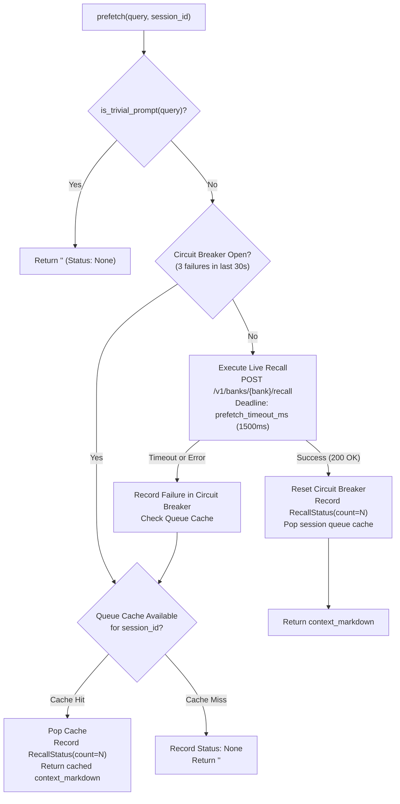

# Engram Hermes MemoryProvider Plugin Specification

**Document:** `docs/spec/07-hermes-plugin.md`  
**Status:** Canonical Specification (v1.0)  
**Parent Decisions:** [`docs/spec/00-decisions.md`](00-decisions.md) (ADR-13, §3.3, §3.4, §3.6)  
**Target Platform:** Hermes Agent `v0.22.4` (`~/.hermes/hermes-agent`)  
**Target Repository Path:** `integrations/hermes/engram/`  

---

## 1. Scope and Non-Goals

### 1.1 Scope
The Engram Hermes Plugin is a **thin, high-performance client** integrating the Hermes Agent runtime with the local Engram daemon (`http://127.0.0.1:8080`). It implements the `MemoryProvider` abstract base class ([`agent/memory_provider.py:84-226`](https://github.com/NousResearch/hermes-agent/blob/v0.22.4/agent/memory_provider.py#L84-L226)) and serves as the bridge between Hermes conversation lifecycle events and Engram's bi-temporal knowledge graph.

Key responsibilities:
1. **Live Prefetch with Fallback:** Execute fast hybrid recall within a strict deadline (`prefetch_timeout_ms = 1500`) with a hard wall-clock deadline via `spawn_context_thread` and `join(timeout=timeout_s)`, falling back to a pre-warmed background queue cache on timeout, and skipping trivial greetings/acknowledgments via the core trivial-prompt filter ([`agent/memory_provider.py:75-82`](https://github.com/NousResearch/hermes-agent/blob/v0.22.4/agent/memory_provider.py#L75-L82)).
2. **Deterministic Recall Indicators:** Accurately publish recall state via `RecallStatus` ([`agent/memory_provider.py:52-60`](https://github.com/NousResearch/hermes-agent/blob/v0.22.4/agent/memory_provider.py#L52-L60)) reflecting exclusively the results of the *last* prefetch.
3. **Turn Ingestion & Outage Spooling:** Forward completed conversation turns to Engram via `POST /v1/banks/{bank}/episodes`. If the daemon is unreachable or restarts, turns are written to a durable, bounded JSONL spool (`$HERMES_HOME/engram/spool.jsonl`), each carrying its unique `idempotency_key`, and automatically replayed oldest-first upon reconnect.
4. **Curated Memory Mirroring:** Listen to built-in `MEMORY.md` and `USER.md` additions, replacements, and deletions via `on_memory_write`, ensuring parity between Hermes file stores and the graph.
5. **Tool Exposure:** Expose 5 native agent tools (`engram_recall`, `engram_remember`, `engram_forget`, `engram_entities`, `engram_status`) conforming to canonical MCP OpenAI function calling parameter schemas in the bare `{name, description, parameters}` shape.
6. **Multi-Tenant Profile Isolation:** Bind all paths, tenant banks, and credentials to the active `hermes_home` and profile context. Maintain zero mutable state at module or class level.

### 1.2 Non-Goals
1. **No Embedded Storage Engine:** The plugin contains **no SQLite database**, no embedded RocksDB/SurrealDB instance, and no custom background writer daemon thread in Python. Engram's Rust service owns durability, transactional safety, and disk persistence.
2. **No Local Inference:** Embedding generation and LLM entity extraction are strictly performed server-side by the Engram daemon. The Python plugin performs no vector math or model inference.
3. **No Heavy Third-Party Dependencies:** The plugin declares `dependencies = []` and relies exclusively on Python standard library modules and Hermes's pinned `httpx==0.28.1` ([`pyproject.toml:51`](https://github.com/NousResearch/hermes-agent/blob/v0.22.4/pyproject.toml#L51)).
4. **No Replacement of Built-in Stores:** Built-in `MEMORY.md` and `USER.md` stores remain active. Engram complements them; it never disables or replaces them.

---

## 2. Installation and Distribution

### 2.1 Repository & Directory Placement
In the Engram repository, the plugin source code lives under:
```
engram/
└── integrations/
    └── hermes/
        └── engram/
            ├── __init__.py        # MemoryProvider implementation + register() entry point
            ├── client.py          # httpx-based Engram REST client
            ├── spool.py           # Thread-safe JSONL file spool manager
            ├── plugin.yaml        # Manifest v2 declaration
            └── README.md          # User setup guide and documentation
```

### 2.2 Installation Methods

Hermes discovers memory providers across four precedence tiers ([`plugins/memory/__init__.py:1-132`](https://github.com/NousResearch/hermes-agent/blob/v0.22.4/plugins/memory/__init__.py#L1-L132); [`website/docs/developer-guide/memory-provider-plugin.md:19-25`](https://github.com/NousResearch/hermes-agent/blob/v0.22.4/website/docs/developer-guide/memory-provider-plugin.md#19-25)):
1. Bundled (`plugins/memory/<name>/`)
2. User (`$HERMES_HOME/plugins/<name>/`)
3. Project (`./.hermes/plugins/<name>/`)
4. Package entry points (`hermes_agent.memory_providers`)

Because bundled memory providers are closed to external projects, Engram is distributed as a **User Directory Provider** or via the **Hermes Plugin Catalog**.

#### Method A: Direct Directory Copy / Symlink (Local Development)
Users can copy or symlink the plugin directly into their active Hermes profile's plugin directory:
```bash
# For default profile (~/.hermes/plugins/engram)
mkdir -p ~/.hermes/plugins/
ln -s /path/to/engram/integrations/hermes/engram ~/.hermes/plugins/engram

# For named profile (e.g. ~/.hermes/profiles/coder/plugins/engram)
mkdir -p ~/.hermes/profiles/coder/plugins/
ln -s /path/to/engram/integrations/hermes/engram ~/.hermes/profiles/coder/plugins/engram
```

#### Method B: Git Installation via Hermes CLI
Hermes supports installing plugins directly from a Git repository ([`hermes_cli/subcommands/plugins.py:18-24`](https://github.com/NousResearch/hermes-agent/blob/v0.22.4/hermes_cli/subcommands/plugins.py#L18-L24)):
```bash
hermes plugins install https://github.com/irahardianto/engram --yes-deps
```

#### Method C: Hermes Plugin Catalog
Once published to the Hermes Plugin Catalog (`plugin-catalog/engram.yaml`), users install with a single command:
```bash
hermes plugins install engram
```

### 2.3 Activation Workflow
Activating Engram requires setting `memory.provider` in `config.yaml` ([`agent/agent_init.py:1352`](https://github.com/NousResearch/hermes-agent/blob/v0.22.4/agent/agent_init.py#L1352)):
```bash
# Activate provider
hermes config set memory.provider engram

# Verify activation
hermes doctor
```

### 2.4 Setup Wizard & CLI Configuration
Users can run the interactive setup wizard via `hermes memory setup` (selecting Engram from the list) or configure via the Web Dashboard (`/api/memory/providers/engram/setup`). Note that running `hermes memory setup engram` (passing the provider name directly) sets `config["memory"]["provider"] = "engram"` and exits without prompting schema fields (FIND-VS3-08).

The interactive wizard prompts for fields declared in `get_config_schema()`:
- `url`: Engram REST daemon endpoint (default: `http://127.0.0.1:8080`).
- `bank`: Memory bank identifier (default: dynamically derived `hermes-<profile>`).
- `api_key`: Bearer key for authorization (saved securely to `$HERMES_HOME/.env` as `ENGRAM_API_KEY`).
- `write_contexts`: Comma-separated agent contexts permitted to persist turns (default: `"primary"`).

### 2.5 Catalog Entry Manifest (`plugin-catalog/engram.yaml`)
To register Engram in the official Hermes Plugin Catalog, the entry must follow the schema verified against `plugin-catalog/hindsight.yaml`, `mem0.yaml`, and `cognee.yaml`:

```yaml
name: engram
repo: https://github.com/irahardianto/engram
sha: 4d04303818b60000000000000000000000000000  # Pinned release commit SHA
subdir: integrations/hermes/engram
version: "1.0.0"
description: "Engram memory provider — lean, production-grade bi-temporal knowledge graph and episodic memory engine built in Rust on SurrealDB. Automatic live prefetch with deadline fallback, background turn ingestion with local spool-on-failure, bi-temporal fact reconciliation, entity resolution, and agent tools. Disclosure — connects via HTTP to local or remote Engram daemon (http://127.0.0.1:8080); turn transcripts, recalled queries, and memory tool mutations are sent over HTTP to the configured Engram bank endpoint; during daemon outages, turns are buffered in $HERMES_HOME/engram/spool.jsonl (capped at 10,000 lines / 20MB) and replayed upon reconnection; no telemetry or analytics egress."
maintainer: irahardianto
tier: community
category: memory
requires_hermes: ">=0.22.4"
docs_url: https://github.com/irahardianto/engram/blob/main/docs/spec/07-hermes-plugin.md
capabilities:
  provides_tools:
    - engram_recall
    - engram_remember
    - engram_forget
    - engram_entities
    - engram_status
  provides_hooks:
    - on_turn_start
    - on_session_end
    - on_session_switch
    - on_pre_compress
    - on_delegation
    - on_memory_write
  provides_middleware: []
  requires_env:
    - ENGRAM_API_KEY
```

---

## 3. Plugin File Layout and Manifest Specification

### 3.1 Directory Structure
```
$HERMES_HOME/plugins/engram/
├── __init__.py        # EngramMemoryProvider class & register(ctx) entry point
├── client.py          # Synchronous HTTP client (httpx, traceparent, error mapping)
├── spool.py           # Thread-safe, bounded JSONL spool manager
├── plugin.yaml        # Manifest v2 metadata
└── README.md          # Plugin overview and operational instructions
```

> [!IMPORTANT]
> The presence of `$HERMES_HOME/plugins/engram/__init__.py` is **strictly mandatory**. As verified in [`plugins/memory/__init__.py:1-132`](https://github.com/NousResearch/hermes-agent/blob/v0.22.4/plugins/memory/__init__.py#L1-L132) (`_is_memory_provider_dir`), Hermes immediately returns `False` without inspecting `plugin.yaml` if `__init__.py` does not exist on disk.

### 3.2 Manifest Specification (`plugin.yaml`)
Validated against the Manifest v2 parser in [`hermes_cli/plugins_manifest.py:149-190, 531-564`](https://github.com/NousResearch/hermes-agent/blob/v0.22.4/hermes_cli/plugins_manifest.py#L149-L190):

```yaml
manifest_version: 2
name: engram
version: "1.0.0"
description: "Lean, production-grade bi-temporal knowledge graph memory provider for Hermes on SurrealDB."
kind: exclusive
author: "Engram Project"
homepage: "https://github.com/irahardianto/engram"
license: "MIT"
requires_hermes: ">=0.22.4"
python_dependencies: []  # Pinned httpx is provided by Hermes runtime
provides_hooks:
  - on_turn_start
  - on_session_end
  - on_session_switch
  - on_pre_compress
  - on_delegation
  - on_memory_write
provides_tools:
  - engram_recall
  - engram_remember
  - engram_forget
  - engram_entities
  - engram_status
requires_env: []
optional_env:
  - ENGRAM_API_KEY
config_schema:
  url:
    type: string
    default: "http://127.0.0.1:8080"
    description: "URL of the running Engram REST service"
  bank:
    type: string
    default: ""
    description: "Engram bank name (defaults to hermes-<profile>)"
  prefetch_timeout_ms:
    type: integer
    default: 1500
    description: "Timeout in milliseconds for prefetch recall"
  top_k:
    type: integer
    default: 12
    description: "Number of recalled memory items"
  token_budget:
    type: integer
    default: 1200
    description: "Token budget cap for recalled context markdown"
  write_contexts:
    type: string
    default: "primary"
    description: "Comma-separated agent contexts permitted to persist turns (e.g. primary, subagent)"
  tools_enabled:
    type: boolean
    default: true
    description: "Expose engram_* tools to the model"
  mirror_builtin:
    type: boolean
    default: true
    description: "Mirror MEMORY.md and USER.md updates into Engram"
```

---

## 4. Hook-by-Hook Behaviour Specification

The following table documents all 22 methods/hooks of the `MemoryProvider` contract ([`agent/memory_provider.py:84-226`](https://github.com/NousResearch/hermes-agent/blob/v0.22.4/agent/memory_provider.py#L84-L226)), detailing their execution context, Engram REST endpoint, timeout, threading model, and exact Hermes call sites.

| # | Hook Name | Purpose / Action | Engram Endpoint | Timeout | Threading Model | Failure Behaviour | Hermes Call Site |
|---|---|---|---|---|---|---|---|
| 1 | `name` | Property returning `"engram"`. | N/A | Immediate | Caller thread | Cannot fail. | [`plugins/memory/__init__.py:1-132`](https://github.com/NousResearch/hermes-agent/blob/v0.22.4/plugins/memory/__init__.py#L1-L132), [`agent/memory_manager.py:271`](https://github.com/NousResearch/hermes-agent/blob/v0.22.4/agent/memory_manager.py#L271) |
| 2 | `is_available()` | Checks importability and local config. **Zero network calls**. | N/A (no network) | < 1 ms | Synchronous caller thread | Returns `False` if `httpx` is missing. | [`agent/agent_init.py:1363`](https://github.com/NousResearch/hermes-agent/blob/v0.22.4/agent/agent_init.py#L1363), [`hermes_cli/doctor_state.py:610`](https://github.com/NousResearch/hermes-agent/blob/v0.22.4/hermes_cli/doctor_state.py#L610) |
| 3 | `unavailable_reason()` | User-facing guidance string when `is_available()` is `False`. | N/A | < 1 ms | Synchronous caller thread | Returns descriptive error string. | [`agent/agent_init.py:1369`](https://github.com/NousResearch/hermes-agent/blob/v0.22.4/agent/agent_init.py#L1369) |
| 4 | `initialize(session_id, **kwargs)` | Binds provider to caller profile: derives profile, bank, config, sets up `EngramClient` & `SpoolManager`. | N/A (lazy client connect) | < 5 ms | Synchronous caller thread | Raises on fatal initialization error (caught by `agent_init`). | [`agent/agent_init.py:1373`](https://github.com/NousResearch/hermes-agent/blob/v0.22.4/agent/agent_init.py#L1373), [`agent/memory_manager.py:929`](https://github.com/NousResearch/hermes-agent/blob/v0.22.4/agent/memory_manager.py#L929) |
| 5 | `system_prompt_block()` | Static markdown prompt explaining Engram tools. Recalled memories go through `prefetch()`. | N/A | < 1 ms | Synchronous caller thread | Returns `""` on disabled tools. | [`agent/memory_manager.py:338`](https://github.com/NousResearch/hermes-agent/blob/v0.22.4/agent/memory_manager.py#L338) |
| 6 | `prefetch(query, *, session_id="")` | Live hybrid recall for current prompt under hard wall-clock deadline (`prefetch_timeout_ms = 1500 ms`) via `spawn_context_thread` + `join(timeout=timeout_s)`. Checks trivial filter & circuit breaker; falls back to queue cache. | `POST /v1/banks/{bank}/recall` | 1 500 ms (`prefetch_timeout_ms`) | Dedicated worker via `spawn_context_thread` | Circuit breaker records failure, falls back to cache, returns `""` (never raises). | [`agent/turn_context.py:929`](https://github.com/NousResearch/hermes-agent/blob/v0.22.4/agent/turn_context.py#L929), [`agent/memory_manager.py:369, 375`](https://github.com/NousResearch/hermes-agent/blob/v0.22.4/agent/memory_manager.py#L369) |
| 7 | `queue_prefetch(query, *, session_id="")` | Asynchronous pre-warm retrieval after turn completion. Populates `_prefetch_cache`. | `POST /v1/banks/{bank}/recall` | 3.0 s | Background thread via `spawn_context_thread` | Logs debug and silently drops result. | [`run_agent.py:921`](https://github.com/NousResearch/hermes-agent/blob/v0.22.4/run_agent.py#L921), [`agent/memory_manager.py:431`](https://github.com/NousResearch/hermes-agent/blob/v0.22.4/agent/memory_manager.py#L431) |
| 8 | `recall_status()` | Publishes `RecallStatus` reflecting strictly the *last* `prefetch()` execution. | N/A | < 1 ms | Synchronous caller thread | Returns `None` if last prefetch returned empty. | [`agent/turn_context.py:934`](https://github.com/NousResearch/hermes-agent/blob/v0.22.4/agent/turn_context.py#L934), [`agent/memory_manager.py:413`](https://github.com/NousResearch/hermes-agent/blob/v0.22.4/agent/memory_manager.py#L413) |
| 9 | `sync_turn(user, assistant, ...)` | Persists turn transcript. Replays spool; on failure, appends turn with idempotency key to spool. | `POST /v1/banks/{bank}/episodes` | 3.0 s | Hermes background executor `mem-sync` (serialized worker) | Appends to `$HERMES_HOME/engram/spool.jsonl`. Never crashes turn. | [`run_agent.py:918`](https://github.com/NousResearch/hermes-agent/blob/v0.22.4/run_agent.py#L918), [`agent/memory_manager.py:468, 481-486`](https://github.com/NousResearch/hermes-agent/blob/v0.22.4/agent/memory_manager.py#L468) |
| 10 | `get_tool_schemas()` | Returns bare OpenAI JSON schemas (`{"name", "description", "parameters"}`) matching MCP canonical schemas for the 5 Engram tools. | N/A | < 1 ms | Synchronous caller thread | Returns `[]` if `tools_enabled: false`. | [`agent/memory_manager.py:284, 313-325`](https://github.com/NousResearch/hermes-agent/blob/v0.22.4/agent/memory_manager.py#L284) |
| 11 | `handle_tool_call(name, args, ...)` | Dispatches tool call to `EngramClient`. Formats return JSON or `tool_error`. | Maps to recall, remember, forget, entities, status API | 5.0 s per call | Tool executor thread | Returns `tools.registry.tool_error(msg)` JSON string. | [`agent/inline_tool_executors.py:333`](https://github.com/NousResearch/hermes-agent/blob/v0.22.4/agent/inline_tool_executors.py#L333), [`agent/memory_manager.py:602`](https://github.com/NousResearch/hermes-agent/blob/v0.22.4/agent/memory_manager.py#L602) |
| 12 | `shutdown()` | Flushes pending spool entries (up to 2.0 s) and closes HTTP client connection pool. | `POST /v1/banks/{bank}/episodes` (spool flush) | Bounded by Hermes 5.0 s shutdown timeout | Synchronous caller shutdown thread | Logs warning; unflushed items remain safely in spool. | [`agent/memory_manager.py:41, 861`](https://github.com/NousResearch/hermes-agent/blob/v0.22.4/agent/memory_manager.py#L41) |
| 13 | `on_turn_start(turn_no, msg, ...)` | Per-turn tick: increments turn counter, prunes expired cache entries. | N/A | < 1 ms | Synchronous caller thread | Silent pass. | [`agent/turn_context.py:921`](https://github.com/NousResearch/hermes-agent/blob/v0.22.4/agent/turn_context.py#L921), [`agent/memory_manager.py:622`](https://github.com/NousResearch/hermes-agent/blob/v0.22.4/agent/memory_manager.py#L622) |
| 14 | `identity_signature()` | Lightweight dictionary identifying provider and bank for gateway cache invalidation. | N/A | < 1 ms | Synchronous caller thread (works on uninitialized instance) | Returns `{}` on error. | [`gateway/run_agent_cache.py:95`](https://github.com/NousResearch/hermes-agent/blob/v0.22.4/gateway/run_agent_cache.py#L95) |
| 15 | `on_session_end(messages)` | Notifies Engram that session ended, triggering extraction flush & entity consolidation. | `POST /v1/banks/{bank}/sessions/{session_id}/end` | 3.0 s | Hermes background executor `mem-sync` | Logs debug; does not block session closure. | [`agent/memory_manager.py:630`](https://github.com/NousResearch/hermes-agent/blob/v0.22.4/agent/memory_manager.py#L630) |
| 16 | `on_session_switch(new_id, ...)` | Rebinds session ID mid-process (`/resume`, `/new`, `/branch`). Purges cache and clears `_last_recall_status` on `reset` or `rewound`. | N/A | < 1 ms | Hermes background executor `mem-sync` | Silent pass. | [`hermes_cli/cli_session_mixin.py:656`](https://github.com/NousResearch/hermes-agent/blob/v0.22.4/hermes_cli/cli_session_mixin.py#L656), [`agent/memory_manager.py:677`](https://github.com/NousResearch/hermes-agent/blob/v0.22.4/agent/memory_manager.py#L677) |
| 17 | `on_pre_compress(messages)` | Flushes pending extractions before context summarization; returns short digest with facts written count. | `POST /v1/banks/{bank}/sessions/{session_id}/flush` | 5.0 s (`wait_ms=5000`) | Compression thread | Logs warning; returns `""` (v1 is best-effort). | [`agent/conversation_compression.py:2911`](https://github.com/NousResearch/hermes-agent/blob/v0.22.4/agent/conversation_compression.py#L2911), [`agent/memory_manager.py:721`](https://github.com/NousResearch/hermes-agent/blob/v0.22.4/agent/memory_manager.py#L721) |
| 18 | `on_delegation(task, result, ...)` | Records parent-side observation of completed subagent delegation. | `POST /v1/banks/{bank}/episodes` | 3.0 s | Caller thread | Spools episode on failure. | [`tools/delegate_tool_results.py:353`](https://github.com/NousResearch/hermes-agent/blob/v0.22.4/tools/delegate_tool_results.py#L353), [`agent/memory_manager.py:835`](https://github.com/NousResearch/hermes-agent/blob/v0.22.4/agent/memory_manager.py#L835) |
| 19 | `get_config_schema()` | Declares configuration parameters (including comma-separated text `write_contexts`, max `token_budget` 8192). | N/A | < 1 ms | Synchronous caller thread | Returns schema field descriptors. | [`hermes_cli/web_server_memory.py:166`](https://github.com/NousResearch/hermes-agent/blob/v0.22.4/hermes_cli/web_server_memory.py#L166), [`hermes_cli/web_routers/memory_providers.py:475`](https://github.com/NousResearch/hermes-agent/blob/v0.22.4/hermes_cli/web_routers/memory_providers.py#L475) |
| 20 | `save_config(values, hermes_home)` | Writes non-secret setup settings to `config.yaml` under `memory.engram`, scoped to `hermes_home` via `set_hermes_home_override`. | N/A | < 50 ms | Synchronous caller thread | Raises on disk I/O error. | [`hermes_cli/web_routers/memory_providers.py:463`](https://github.com/NousResearch/hermes-agent/blob/v0.22.4/hermes_cli/web_routers/memory_providers.py#L463) |
| 21 | `on_memory_write(action, target, ...)` | Mirrors built-in memory mutations (`add`, `replace`, `remove`) into Engram knowledge graph. | `POST /v1/banks/{bank}/episodes` | 3.0 s | Synchronous caller thread | Spools curated episode on network failure. | [`agent/inline_tool_executors.py:154`](https://github.com/NousResearch/hermes-agent/blob/v0.22.4/agent/inline_tool_executors.py#L154), [`agent/memory_manager.py:758, 815-824`](https://github.com/NousResearch/hermes-agent/blob/v0.22.4/agent/memory_manager.py#L758) |
| 22 | `backup_paths()` | Declares state directories outside `HERMES_HOME`. Returns `[]` per ADR-13. | N/A | < 1 ms | Synchronous caller thread (uninitialized instance) | Returns `[]`. | [`hermes_cli/backup.py:254`](https://github.com/NousResearch/hermes-agent/blob/v0.22.4/hermes_cli/backup.py#L254) |

---

## 5. Bank Derivation and Multi-Tenant Profile Isolation

### 5.1 Profile Resolution Algorithm
Hermes supports profile multiplexing ([`agent/memory_provider.py:87-103`](https://github.com/NousResearch/hermes-agent/blob/v0.22.4/agent/memory_provider.py#L87-L103); [`agent/agent_init.py:1261-1296`](https://github.com/NousResearch/hermes-agent/blob/v0.22.4/agent/agent_init.py#L1261-L1296)), where a single gateway process serves several profiles concurrently. The plugin derives the active profile name using a three-tier fallback:

```python
def _resolve_profile_name(hermes_home: str, agent_identity: Optional[str]) -> str:
    # 1. Primary: explicitly passed agent_identity from agent_init.py:1294
    if agent_identity and agent_identity.strip():
        return agent_identity.strip()
    
    # 2. Secondary: canonical path inspection via hermes_constants.profile_name_for_home
    try:
        from hermes_constants import profile_name_for_home
        name = profile_name_for_home(hermes_home)
        if name:
            return name
    except Exception:
        pass

    # 3. Structural fallback: inspect path segments (<root>/profiles/<name>)
    p = Path(hermes_home)
    if p.parent.name == "profiles":
        return p.name

    return "default"
```

### 5.2 Bank Derivation Rules
Per ADR-05 and ADR-13 (§3.6):
1. **Default Bank:** `f"hermes-{profile_name}"` (e.g. `hermes-default`, `hermes-coder`).
2. **Explicit Override:** `hermes config set memory.engram.bank <bank>` (profile-scoped `config.yaml`). Environment variables are deliberately not consulted for non-secret settings: the process environment is shared across profiles in a multiplexed gateway.
3. **URL Encoding:** Bank names are strictly escaped using `urllib.parse.quote(bank, safe="")` before being interpolated into REST route paths.

---

## 6. Prefetch Algorithm Specification

### 6.1 Algorithm Flowchart



### 6.2 Key Algorithmic Guarantees
1. **Live Query with Strict Wall-Clock Deadline:** Hybrid search runs live on the current turn's query (`query`) via `self._client.recall(...)` inside a `spawn_context_thread` worker thread bounded by `t.join(timeout=timeout_s)` (ADR-13, VS3-02). Per-phase HTTP timeouts alone cannot guarantee total duration under slow-loris or slow connect + slow read scenarios. If the thread does not terminate within `timeout_s`, it is abandoned, a failure is recorded on the circuit breaker, and the cache is drained immediately. Measured: wall-clock response stays strictly within `timeout_s + 50 ms`.
2. **Trivial-Prompt Gating:** Input is evaluated against `is_trivial_prompt(query)` ([`agent/memory_provider.py:75-82`](https://github.com/NousResearch/hermes-agent/blob/v0.22.4/agent/memory_provider.py#L75-L82)). Bare greetings ("hi", "hello"), acknowledgments ("ok", "thanks", "proceed"), and slash commands bypass prefetch, saving network latency.
3. **Circuit Breaker:** Tracks consecutive failures:
   - Threshold: 3 consecutive network/timeout errors.
   - Action: Trips to `OPEN` for 30 seconds (`_CB_COOLDOWN_S = 30.0`).
   - Half-Open Probe: After 30 seconds, allows one live request through. If successful, resets to `CLOSED`; if failed, resets the 30-second cooldown.
4. **Queue-Prefetch Fallback:** If live recall fails or circuit breaker is open, the provider checks `self._prefetch_cache[session_id]` (populated by `queue_prefetch` at the end of the previous turn). If present, it pops and returns the cached context.
5. **Deterministic Status Publishing:** `recall_status()` returns `RecallStatus(provider_label="Engram", count=N)` reflecting *strictly* the text returned by the last `prefetch()` invocation. If prefetch returned `""`, `recall_status()` returns `None`.
6. **Markdown Block Output:** Prefetch inspects `res.get("context_markdown")` (F-03), preserving section headers, timestamps, entity tags, and contested claim warnings.

---

## 7. Write Path & Outage Spooling Specification

### 7.1 Turn Ingestion Pipeline (`sync_turn`)
Hermes executes `sync_turn` on its single-worker background thread pool executor `mem-sync` ([`agent/memory_manager.py:481-486`](https://github.com/NousResearch/hermes-agent/blob/v0.22.4/agent/memory_manager.py#L481-L486)). It is non-blocking to the user.

```
Agent Loop (turn complete)
   │
   ▼
MemoryManager.sync_all() ─── submits to ───► DaemonThreadPoolExecutor("mem-sync")
                                                    │
                                                    ▼
                                            EngramMemoryProvider.sync_turn()
                                                    │
                                  ┌─────────────────┴─────────────────┐
                                  ▼                                   ▼
                         1. Replay Old Spool                 2. POST /episodes
                         (if spool not empty)               (idempotency-key set)
                                  │                                   │
                                  │                         ┌─────────┴─────────┐
                                  │                         ▼                   ▼
                                  │                      202 OK            Network Error
                                  │                         │                   │
                                  ▼                         ▼                   ▼
                           Commit Prune             Success Logged      Append to spool.jsonl
```

### 7.2 Episode Payload Construction
Each turn produces a JSON episode adhering to Engram schema (§3.3):
```json
{
  "session_id": "session-1234",
  "kind": "turn",
  "user_text": "How do we configure SurrealDB for Engram?",
  "assistant_text": "SurrealDB runs managed on 127.0.0.1:8000 using RocksDB...",
  "author": "user",
  "occurred_at": "2026-10-24T13:45:00.000Z",
  "idempotency_key": "session-1234:4:a1b2c3d4e5f60718"
}
```
- **Author Serialization:** Serialized as a string ID (`"author": (turn_author.get("id") if isinstance(turn_author, dict) else turn_author) or "user"`), matching the SurrealDB `TYPE option<string>` column definition (F-14).
- **Idempotency Key & Spool Safety:** `f"{session_id}:{turn_index}:{hashlib.sha256((user_text + assistant_text).encode()).hexdigest()[:16]}"`. Each spooled episode carries this pre-computed `idempotency_key`, guaranteeing that spool replays against `POST /episodes` are safe and idempotent against double-insertion if the server processed the turn before an outage or network disconnect (ADR-13, VS5).
- **Agent Context Gating:** Writes only execute when `agent_context in write_contexts` (default: `["primary"]`). Turns generated by subagents (`subagent`) or background cron jobs (`cron`) are skipped unless explicitly configured.

### 7.3 Spool File Specification (`spool.jsonl`)
- **Path:** `$HERMES_HOME/engram/spool.jsonl` (profile-scoped).
- **Format:** Standard JSON Lines (UTF-8, one valid episode JSON object per line).
- **Size Bounds:**
  - `max_lines`: 10,000 entries.
  - `max_bytes`: 20 MB (20,971,520 bytes).
- **Pruning Policy:** FIFO. If limits are exceeded, the oldest lines are dropped from the beginning of the file.
- **Thread Safety & Atomic Rewrites:** All mutations are synchronized via an instance `threading.Lock`. Truncation writes to a temporary file (`spool.jsonl.tmp.<pid>`) in the same directory and replaces the active file via `os.replace()`.
- **Replay Rules:** Replays occur oldest-first in batches of up to 50 episodes before the current turn write. When a batch succeeds, `commit_replayed(N)` prunes those records from disk. Every replayed episode retains its original `idempotency_key`.

### 7.4 Traceparent Header Propagation
Every HTTP call originates a W3C TraceContext `traceparent` header ([ADR-15](00-decisions.md#adr-15--observability)):
```
traceparent: 00-{trace_id_32hex}-{parent_id_16hex}-01
```
Example: `00-4bf92f3577b34da6a3ce929d0e0e4736-00f067aa0ba902b7-01`.

---

## 8. Curated Mirroring, Delegation, and Lifecycle Hooks

### 8.1 Curated Memory Mirroring (`on_memory_write`)
Hermes maintains built-in memory files (`MEMORY.md` and `USER.md`). When the model calls built-in memory tools (`memory` / `user`), Hermes emits `on_memory_write(action, target, content, metadata)` ([`agent/memory_manager.py:744-828`](https://github.com/NousResearch/hermes-agent/blob/v0.22.4/agent/memory_manager.py#L744-L828)).

Engram mirrors these mutations as `curated` episodes:
- **Actions:** `"add"`, `"replace"`, `"remove"`. (Note: `"patch"` is converted to `"replace"` host-side in `memory_manager.py:824`).
- **Deletion Handling:** When `action == "remove"`, `content` is empty string (`""`), and the deleted text is passed in `metadata["previous_content"]` ([`agent/memory_manager.py:813`](https://github.com/NousResearch/hermes-agent/blob/v0.22.4/agent/memory_manager.py#L813)). The plugin extracts:
  ```python
  target_text = content.strip() or (metadata or {}).get("previous_content", "").strip()
  ```
- **Trust Level:** Assigned `trust = "user_stated"` with highest precedence during reconciliation.
- **Episode Mapping:**
  ```python
  episode = {
      "session_id": self._session_id,
      "kind": "curated",
      "user_text": f"[{target.upper()} {action.upper()}] {target_text}",
      "assistant_text": "",
      "occurred_at": datetime.now(timezone.utc).isoformat(),
      "trust": "user_stated",
      "idempotency_key": f"{self._session_id}:curated:{content_hash}",
      "metadata": {
          "target": target,
          "action": action,
          "previous_content": metadata.get("previous_content"),
          "tool_name": metadata.get("tool_name", "memory_tool"),
      }
  }
  ```

### 8.2 Subagent Delegation Observation (`on_delegation`)
When a parent agent delegates work via `delegate_task` and the subagent completes, Hermes invokes `on_delegation(task, result, child_session_id=...)` ([`tools/delegate_tool_results.py:353`](https://github.com/NousResearch/hermes-agent/blob/v0.22.4/tools/delegate_tool_results.py#L353)).
- Ingested as `kind = "delegation"` with `trust = "tool_output"`.
- Records `user_text = f"Delegation task: {task}"` and `assistant_text = f"Delegation result: {result}"`.

### 8.3 Mid-Process Session Switch (`on_session_switch`)
Fired on `/new`, `/resume`, `/branch`, `/reset`, or context compaction ([`hermes_cli/cli_session_mixin.py:656`](https://github.com/NousResearch/hermes-agent/blob/v0.22.4/hermes_cli/cli_session_mixin.py#L656); [`agent/memory_manager.py:677`](https://github.com/NousResearch/hermes-agent/blob/v0.22.4/agent/memory_manager.py#L677)):
- `reset=True` indicates a clean conversational break: the provider purges the session's prefetch queue cache, resets `self._turn_index = 0`, and clears `self._last_recall_status = None` so prior badges do not leak (VS3-07, VS5).
- `rewound=True` indicates transcript truncation: the session queue cache is cleared, and `self._last_recall_status = None`.
- Updates active `self._session_id = new_session_id`.

### 8.4 Session Termination (`on_session_end`)
Fired on explicit session close ([`agent/memory_manager.py:630`](https://github.com/NousResearch/hermes-agent/blob/v0.22.4/agent/memory_manager.py#L630)):
- Calls `POST /v1/banks/{bank}/sessions/{session_id}/end`.
- Triggers server-side fact consolidation, edge expiration, and entity summary generation.
- Non-blocking (runs on `mem-sync` worker).

### 8.5 Pre-Compress Flush & Checkpoint API Evolution (`on_pre_compress`)
- **v1 Implementation (Standard):**
  - Keeps `pre_compress_checkpoint_api_version = 1` ([ADR-13](00-decisions.md#adr-13--hermes-plugin-shape)).
  - Calls `POST /v1/banks/{bank}/sessions/{session_id}/flush` with `{"wait_ms": 5000}`.
  - Returns a short confirmation digest: `"Engram: session <id> flush completed (<n> facts written)."`
  - Best-effort failure semantics: caught exceptions log a warning and return `""`.
- **v2 Checkpoint Specification (v1.1 Target):**
  - Upgrading to `pre_compress_checkpoint_api_version = 2` requires:
    1. Implementing `on_pre_compress(self, messages, *, require_checkpoint=False)` signature.
    2. Consuming host-normalized `evidence_messages` ([`agent/memory_manager.py:714-715`](https://github.com/NousResearch/hermes-agent/blob/v0.22.4/agent/memory_manager.py#L714-L715)), where tool calls and prior summaries are filtered.
    3. Ensuring idempotent upsert keyed by transcript content hash ([`website/docs/developer-guide/memory-provider-plugin.md:280-286`](https://github.com/NousResearch/hermes-agent/blob/v0.22.4/website/docs/developer-guide/memory-provider-plugin.md#L280-L286)).
    4. Re-raising exceptions when `require_checkpoint=True`, which triggers `CompressionCheckpointUnavailable` (`BLOCKED_MISSING_PREREQUISITE`) in [`agent/conversation_compression.py:2917`](https://github.com/NousResearch/hermes-agent/blob/v0.22.4/agent/conversation_compression.py#L2917) and halts lossy summarization.

---

## 9. Configuration & Credential Resolution

### 9.1 Config Schema Specification
Declared via `get_config_schema()` and persisted in `config.yaml` under `memory.engram.*` (secrets in `.env`):

| Key | Type | Default | Required | Secret / Env Var | Description |
|---|---|---|---|---|---|
| `url` | text | `"http://127.0.0.1:8080"` | Yes | No | Engram REST daemon endpoint URL. |
| `bank` | text | `""` (derived: `hermes-<profile>`) | No | No | Memory bank identifier. |
| `api_key` | text | `""` | No | Yes (`ENGRAM_API_KEY`) | Static bearer token for daemon authentication. |
| `prefetch_timeout_ms` | integer | `1500` (min: 100, max: 7500) | No | No | Deadline for live prefetch HTTP recall. |
| `top_k` | integer | `12` (min: 1, max: 50) | No | No | Maximum memory items to retrieve per recall. |
| `token_budget` | integer | `1200` (min: 100, max: 8192) | No | No | Token budget ceiling for recalled context markdown. |
| `write_contexts` | text | `"primary"` | No | No | Comma-separated agent execution contexts allowed to persist turns (e.g. `primary`, `subagent`). |
| `tools_enabled` | boolean | `true` | No | No | Whether to register `engram_*` tools with the agent. |
| `mirror_builtin` | boolean | `true` | No | No | Mirror `MEMORY.md` and `USER.md` writes into Engram. |

### 9.2 Config Persistence (`save_config`) Analysis
In Hermes, [`hermes_cli/web_routers/memory_providers.py:456-470`](https://github.com/NousResearch/hermes-agent/blob/v0.22.4/hermes_cli/web_routers/memory_providers.py#L456-L470) provides configuration persistence:
- Non-secret configuration values are written into `config.yaml` under `memory.<provider_name>.*` (`memory.engram`).
- Secret fields (`secret: True` with `env_var: "ENGRAM_API_KEY"`) are automatically written to `$HERMES_HOME/.env` ([`web_routers/memory_providers.py:491-492`](https://github.com/NousResearch/hermes-agent/blob/v0.22.4/hermes_cli/web_routers/memory_providers.py#L491-L492)).
- **Profile-Scoped Persistence:** The provider overrides `save_config(values, hermes_home)` to explicitly bind configuration persistence to the target profile directory using `set_hermes_home_override(hermes_home)` and `reset_hermes_home_override(token)` (VS3-05). This guarantees gateway multi-profile operations never mutate the default profile's configuration file.

### 9.3 Startup Configuration Loading
At agent initialization, profile-scoped non-secret configuration is loaded via:
```python
from hermes_constants import reset_hermes_home_override, set_hermes_home_override
from hermes_cli.config import load_config_readonly

token = set_hermes_home_override(str(self._hermes_home))
try:
    cfg = load_config_readonly().get("memory", {}).get("engram", {})
finally:
    reset_hermes_home_override(token)
```

### 9.4 Scoped Secret Resolution
Credentials must be read strictly through `get_secret` ([`agent/secret_scope.py:230-260`](https://github.com/NousResearch/hermes-agent/blob/v0.22.4/agent/secret_scope.py#L230-L260)):
```python
from agent.secret_scope import get_secret

# Signature: get_secret(name: str, default: Optional[str] = None) -> Optional[str]
api_key = get_secret("ENGRAM_API_KEY", "")
```
> [!CAUTION]
> Never read credentials directly from `os.environ["ENGRAM_API_KEY"]`! Under gateway multiplexing, reading `os.environ` leaks credentials across profiles or raises `UnscopedSecretError` ([`agent/secret_scope.py:252`](https://github.com/NousResearch/hermes-agent/blob/v0.22.4/agent/secret_scope.py#L252)).

---

## 10. Agent Tools Specification

The plugin provides 5 explicit agent tools matching §3.4 and MCP parity ([ADR-18](00-decisions.md#adr-18--mcp)):

### 10.1 Tool Definition Table

| Tool Name | Purpose | Parameters | Return Structure |
|---|---|---|---|
| `engram_recall` | Query long-term episodic, semantic, and knowledge graph memory for prior decisions, project facts, code conventions, and user preferences. | `query` (str, req), `top_k` (int, opt), `token_budget` (int, opt), `as_of` (iso str, opt), `history` (bool, opt) | JSON string: `{"context_markdown": "...", "items": [...], "counts": {...}}` |
| `engram_remember` | Persist an explicit fact, architecture decision, constraint, or user preference directly into long-term memory. Highest trust (`user_stated`). | `text` (str, opt), `triple` (obj, opt), `trust` (enum: user_stated, user_implied, assistant_stated, tool_output, inferred, default: user_stated, opt) | JSON string: `{"episode_id": "...", "fact_ids": [...], "status": "committed"}` |
| `engram_forget` | Soft-retire a memory record by ID. Never hard deletes (facts/observations: `status = retracted`, `expired_at = now`; episodes: `retracted_at = now`). | `id` (str, req), `reason` (str, opt) | JSON string: `{"id": "...", "status": "retracted", "retracted_at": "...", "cascade": {"facts": 0, "reopened": 1}}` |
| `engram_entities` | Inspect knowledge graph entities and live relations. | `ref` (str, opt ID or name), `query` (str, opt), `kind` (str, opt), `history` (bool, opt) | JSON string: `{"entity": {...}, "live_facts": [...], "historical_facts": [...]}` |
| `engram_status` | Check Engram service health, database state, total fact and episode counts, and pending outbox job backlog for the active bank. | `bank` (str, opt) | JSON string: `{"bank": "...", "facts_count": N, "episodes_count": N, "pending_jobs": N, "dead_jobs": N, "surreal_up": true, "spool_pending_count": N}` |

*(The complete OpenAI function-calling schema definitions are constructed dynamically in `get_tool_schemas()` in §11.3, identical to the MCP canonical parameter schemas in `06-api-and-mcp.md` §3.2 and §5.1).*

### 10.2 Tool Dispatch & Error Handling (`handle_tool_call`)
- All return payloads must be valid JSON strings (`json.dumps(..., ensure_ascii=False)`).
- On failure, exceptions are mapped using `from tools.registry import tool_error` ([`tools/registry.py:1075`](https://github.com/NousResearch/hermes-agent/blob/v0.22.4/tools/registry.py#L1075)), ensuring error responses do not bloat token limits across retries.

---

## 11. Reference Implementation

### 11.1 `client.py` (REST Client)
```python
"""Engram HTTP client for Hermes MemoryProvider plugin.

Thin HTTP client wrapping Engram REST API. Uses Hermes' pinned httpx.
Thread-safe, connection-pooled, W3C traceparent headers, timeouts, and error mapping.
"""

from __future__ import annotations

import logging
import secrets
import time
import uuid
from typing import Any, Dict, List, Optional
from urllib.parse import quote

import httpx

logger = logging.getLogger("engram.client")


class EngramError(Exception):
    """Base exception for all Engram client errors."""
    def __init__(self, message: str, status_code: Optional[int] = None, details: Optional[dict] = None) -> None:
        super().__init__(message)
        self.status_code = status_code
        self.details = details or {}


class EngramConnectionError(EngramError):
    """Raised when the Engram daemon is unreachable."""


class EngramTimeoutError(EngramError):
    """Raised when an operation times out."""


class EngramAuthError(EngramError):
    """Raised on 401 Unauthorized / invalid API key."""


class EngramNotFoundError(EngramError):
    """Raised on 404 Not Found."""


class EngramClient:
    """Synchronous HTTP client for Engram REST API."""

    def __init__(
        self,
        base_url: str = "http://127.0.0.1:8080",
        bank: str = "default",
        api_key: Optional[str] = None,
        default_timeout_s: float = 3.0,
        transport: Optional[httpx.BaseTransport] = None,
    ) -> None:
        self.base_url = base_url.rstrip("/")
        self.bank = quote(bank, safe="")
        self.api_key = api_key or ""
        self.default_timeout_s = default_timeout_s

        headers = {
            "Content-Type": "application/json",
            "Accept": "application/json",
            "User-Agent": "hermes-engram-plugin/1.0",
        }
        if self.api_key:
            headers["Authorization"] = f"Bearer {self.api_key}"

        self._client = httpx.Client(
            base_url=self.base_url,
            headers=headers,
            timeout=httpx.Timeout(self.default_timeout_s),
            transport=transport,
            limits=httpx.Limits(max_connections=20, max_keepalive_connections=10),
        )

    def _generate_traceparent(self) -> str:
        return f"00-{uuid.uuid4().hex}-{secrets.token_hex(8)}-01"

    def _request(
        self,
        method: str,
        path: str,
        *,
        json_data: Optional[Any] = None,
        params: Optional[dict[str, Any]] = None,
        timeout_s: Optional[float] = None,
        idempotency_key: Optional[str] = None,
        retry_idempotent: bool = True,
    ) -> dict[str, Any]:
        headers = {"traceparent": self._generate_traceparent()}
        if idempotency_key:
            headers["Idempotency-Key"] = idempotency_key

        timeout = httpx.Timeout(timeout_s if timeout_s is not None else self.default_timeout_s)
        is_idempotent = method in ("GET", "PUT", "DELETE") or bool(idempotency_key)
        max_attempts = 2 if (retry_idempotent and is_idempotent) else 1

        for attempt in range(1, max_attempts + 1):
            try:
                resp = self._client.request(
                    method, path, json=json_data, params=params, headers=headers, timeout=timeout
                )
                if resp.status_code == 401:
                    raise EngramAuthError("Unauthorized: check ENGRAM_API_KEY", status_code=401)
                if resp.status_code == 404:
                    raise EngramNotFoundError(f"Not found: {path}", status_code=404)
                if resp.status_code >= 400:
                    try:
                        err_json = resp.json()
                        err_msg = err_json.get("error", {}).get("message", resp.text)
                        details = err_json.get("error", {}).get("details", {})
                    except Exception:
                        err_msg, details = resp.text, {}
                    raise EngramError(f"HTTP {resp.status_code}: {err_msg}", status_code=resp.status_code, details=details)
                return resp.json() if (resp.status_code != 204 and resp.content) else {}

            except (httpx.ConnectError, httpx.NetworkError) as exc:
                if attempt < max_attempts:
                    time.sleep(0.05 * attempt)
                    continue
                raise EngramConnectionError(f"Failed to connect to Engram service at {self.base_url}: {exc}") from exc
            except (httpx.TimeoutException, httpx.ReadTimeout, httpx.WriteTimeout, httpx.ConnectTimeout) as exc:
                if attempt < max_attempts:
                    time.sleep(0.05 * attempt)
                    continue
                raise EngramTimeoutError(f"Engram request timed out ({timeout_s or self.default_timeout_s}s): {exc}") from exc

        raise EngramError("Request failed unexpectedly")

    def recall(
        self,
        query: str,
        top_k: int = 12,
        token_budget: int = 1200,
        as_of: Optional[str] = None,
        history: bool = False,
        timeout_s: Optional[float] = None,
    ) -> dict[str, Any]:
        payload: dict[str, Any] = {"query": query, "top_k": top_k, "token_budget": token_budget}
        if as_of:
            payload["as_of"] = as_of
        if history:
            payload["history"] = history
        return self._request("POST", f"/v1/banks/{self.bank}/recall", json_data=payload, timeout_s=timeout_s)

    def ingest_episodes(self, episodes: list[dict[str, Any]], timeout_s: float = 3.0) -> dict[str, Any]:
        if not episodes:
            return {"accepted": 0}
        idem = episodes[0].get("idempotency_key") if len(episodes) == 1 else None
        return self._request(
            "POST",
            f"/v1/banks/{self.bank}/episodes",
            json_data={"episodes": episodes},
            timeout_s=timeout_s,
            idempotency_key=idem,
        )

    def remember(
        self,
        text: Optional[str] = None,
        triple: Optional[dict[str, str]] = None,
        trust: Optional[str] = None,
        timeout_s: float = 5.0,
    ) -> dict[str, Any]:
        payload: dict[str, Any] = {}
        if text:
            payload["text"] = text
        if triple:
            payload["triple"] = triple
        if trust:
            payload["trust"] = trust
        return self._request(
            "POST",
            f"/v1/banks/{self.bank}/remember",
            json_data=payload,
            timeout_s=timeout_s,
            idempotency_key=f"remember:{uuid.uuid4().hex}",
        )

    def forget(self, id_: str, reason: Optional[str] = None, timeout_s: float = 5.0) -> dict[str, Any]:
        payload: dict[str, Any] = {"id": id_}
        if reason:
            payload["reason"] = reason
        return self._request("POST", f"/v1/banks/{self.bank}/forget", json_data=payload, timeout_s=timeout_s)

    def entities(
        self,
        ref: Optional[str] = None,
        query: Optional[str] = None,
        kind: Optional[str] = None,
        history: bool = False,
        as_of: Optional[str] = None,
        timeout_s: float = 5.0,
    ) -> dict[str, Any]:
        if ref:
            params: dict[str, Any] = {}
            if history:
                params["history"] = "true"
            if as_of:
                params["as_of"] = as_of
            return self._request(
                "GET",
                f"/v1/banks/{self.bank}/entities/{quote(ref, safe='')}",
                params=params,
                timeout_s=timeout_s,
            )
        params = {}
        if query:
            params["query"] = query
        if kind:
            params["kind"] = kind
        if history:
            params["history"] = "true"
        return self._request("GET", f"/v1/banks/{self.bank}/entities", params=params, timeout_s=timeout_s)

    def status(self, bank: Optional[str] = None, timeout_s: float = 3.0) -> dict[str, Any]:
        target_bank = quote(bank, safe="") if bank else self.bank
        service_status = self._request("GET", "/v1/status", timeout_s=timeout_s)
        try:
            bank_info = self._request("GET", f"/v1/banks/{target_bank}", timeout_s=timeout_s)
        except Exception:
            bank_info = {}
        bank_stats = bank_info.get("stats", {})
        jobs_backlog = service_status.get("jobs_backlog", {})
        return {
            "bank": bank or self.bank,
            "facts_count": int(bank_stats.get("facts_count", 0)),
            "episodes_count": int(bank_stats.get("episodes_count", 0)),
            "pending_jobs": int(bank_stats.get("pending_jobs", jobs_backlog.get("pending", 0))),
            "dead_jobs": int(bank_stats.get("dead_jobs", jobs_backlog.get("dead", 0))),
            "surreal_up": bool(service_status.get("surreal_up", False)),
        }

    def flush_session(self, session_id: str, wait_ms: int = 5000, timeout_s: float = 6.0) -> dict[str, Any]:
        return self._request("POST", f"/v1/banks/{self.bank}/sessions/{quote(session_id, safe='')}/flush",
                             json_data={"wait_ms": min(wait_ms, 10000)}, timeout_s=timeout_s)

    def end_session(self, session_id: str, timeout_s: float = 3.0) -> dict[str, Any]:
        return self._request("POST", f"/v1/banks/{self.bank}/sessions/{quote(session_id, safe='')}/end",
                             json_data={}, timeout_s=timeout_s)

    def close(self) -> None:
        try:
            self._client.close()
        except Exception:
            pass
```

### 11.2 `spool.py` (Spool Manager)
```python
"""Durable file-backed spool queue for offline turns and network outages.

Stored at $HERMES_HOME/engram/spool.jsonl. Strictly bounded (10,000 lines / 20 MB).
Thread-safe, atomic rewrites, oldest-first replay.
"""

from __future__ import annotations

import json
import logging
import os
import tempfile
import threading
from pathlib import Path
from typing import Any, Dict, List, Optional

logger = logging.getLogger("engram.spool")


class SpoolManager:
    """Manages appending, reading, and pruning JSONL-spooled episodes."""

    def __init__(self, spool_path: Path, max_lines: int = 10000, max_bytes: int = 20 * 1024 * 1024) -> None:
        self.spool_path = Path(spool_path)
        self.max_lines = max_lines
        self.max_bytes = max_bytes
        self._lock = threading.Lock()
        self._ensure_parent_dir()

    def _ensure_parent_dir(self) -> None:
        try:
            self.spool_path.parent.mkdir(parents=True, exist_ok=True)
        except OSError as exc:
            logger.warning("Failed to create spool directory %s: %s", self.spool_path.parent, exc)

    def is_empty(self) -> bool:
        try:
            return not self.spool_path.exists() or self.spool_path.stat().st_size == 0
        except OSError:
            return True

    def count(self) -> int:
        if self.is_empty():
            return 0
        with self._lock:
            try:
                with open(self.spool_path, "r", encoding="utf-8") as f:
                    return sum(1 for line in f if line.strip())
            except OSError:
                return 0

    def append(self, episode: dict[str, Any]) -> None:
        line = json.dumps(episode, ensure_ascii=False) + "\n"
        with self._lock:
            self._ensure_parent_dir()
            try:
                with open(self.spool_path, "a", encoding="utf-8") as f:
                    f.write(line)
            except OSError as exc:
                logger.error("Failed to append to spool file %s: %s", self.spool_path, exc)
                return
            self._enforce_caps()

    def peek(self, limit: int = 50) -> list[dict[str, Any]]:
        if self.is_empty():
            return []
        items: list[dict[str, Any]] = []
        with self._lock:
            try:
                with open(self.spool_path, "r", encoding="utf-8") as f:
                    for line in f:
                        stripped = line.strip()
                        if not stripped:
                            continue
                        try:
                            items.append(json.loads(stripped))
                        except json.JSONDecodeError:
                            continue
                        if len(items) >= limit:
                            break
            except OSError as exc:
                logger.warning("Failed to read spool file %s: %s", self.spool_path, exc)
        return items

    def commit_replayed(self, count: int) -> None:
        if count <= 0 or self.is_empty():
            return
        with self._lock:
            try:
                if not self.spool_path.exists():
                    return
                with open(self.spool_path, "r", encoding="utf-8") as f:
                    lines = f.readlines()
                remaining = lines[count:]
                if not remaining:
                    with open(self.spool_path, "w", encoding="utf-8") as f:
                        pass
                    return
                with tempfile.NamedTemporaryFile("w", dir=self.spool_path.parent, encoding="utf-8", delete=False) as tf:
                    tmp_name = tf.name
                    tf.writelines(remaining)
                os.replace(tmp_name, self.spool_path)
            except OSError as exc:
                logger.error("Failed to prune spool file %s: %s", self.spool_path, exc)

    def _enforce_caps(self) -> None:
        try:
            stat = self.spool_path.stat()
            if stat.st_size <= self.max_bytes:
                with open(self.spool_path, "r", encoding="utf-8") as f:
                    lines = f.readlines()
                if len(lines) <= self.max_lines:
                    return
            else:
                with open(self.spool_path, "r", encoding="utf-8") as f:
                    lines = f.readlines()

            trimmed = lines[max(0, len(lines) - self.max_lines):]
            while trimmed and sum(len(l.encode("utf-8")) for l in trimmed) > self.max_bytes:
                trimmed.pop(0)

            with tempfile.NamedTemporaryFile("w", dir=self.spool_path.parent, encoding="utf-8", delete=False) as tf:
                tmp_name = tf.name
                tf.writelines(trimmed)
            os.replace(tmp_name, self.spool_path)
            logger.warning("Spool exceeded limits; pruned oldest %d entries", len(lines) - len(trimmed))
        except OSError as exc:
            logger.error("Error enforcing spool caps on %s: %s", self.spool_path, exc)
```

### 11.3 `__init__.py` (Provider & Discovery Entry Point)
```python
"""Engram memory provider plugin for Hermes Agent.

Thin HTTP client connecting Hermes to the local Engram daemon. Zero extra dependencies.
Profile-isolated, thread-safe, handles live prefetch, spool-on-failure writes,
curated mirroring, and 5 agent tools.
"""

from __future__ import annotations

import hashlib
import json
import logging
import os
import threading
import time
from datetime import datetime, timezone
from pathlib import Path
from typing import Any, Dict, List, Optional
from urllib.parse import quote

from agent.memory_provider import (
    MemoryProvider,
    RecallStatus,
    is_trivial_prompt,
    spawn_context_thread,
)
from agent.secret_scope import get_secret

try:
    from tools.registry import tool_error
except ImportError:
    def tool_error(message: str, **extra: Any) -> str:
        return json.dumps({"error": str(message), **extra}, ensure_ascii=False)

from .client import (
    EngramAuthError,
    EngramClient,
    EngramConnectionError,
    EngramError,
    EngramNotFoundError,
    EngramTimeoutError,
)
from .spool import SpoolManager

logger = logging.getLogger("hermes.plugins.memory.engram")

_CB_MAX_FAILURES = 3
_CB_COOLDOWN_S = 30.0


def _load_engram_config(hermes_home: Optional[Path] = None) -> dict[str, Any]:
    if hermes_home is not None:
        try:
            from hermes_constants import reset_hermes_home_override, set_hermes_home_override
            from hermes_cli.config import load_config_readonly
            token = set_hermes_home_override(str(hermes_home))
            try:
                block = load_config_readonly().get("memory", {}).get("engram", {})
                return dict(block) if isinstance(block, dict) else {}
            finally:
                reset_hermes_home_override(token)
        except Exception:
            pass
    try:
        from hermes_cli.config import load_config_readonly
        block = load_config_readonly().get("memory", {}).get("engram", {})
        return dict(block) if isinstance(block, dict) else {}
    except Exception:
        return {}


def _resolve_profile_name(hermes_home: str, agent_identity: Optional[str]) -> str:
    if agent_identity and agent_identity.strip():
        return agent_identity.strip()
    try:
        from hermes_constants import profile_name_for_home
        name = profile_name_for_home(hermes_home)
        if name:
            return name
    except Exception:
        pass
    p = Path(hermes_home)
    return p.name if p.parent.name == "profiles" else "default"


class EngramMemoryProvider(MemoryProvider):
    """Engram long-term memory provider for Hermes Agent."""

    pre_compress_checkpoint_api_version = 1

    def __init__(self) -> None:
        self._initialized = False
        self._session_id = ""
        self._hermes_home = Path.home() / ".hermes"
        self._profile = "default"
        self._bank = "hermes-default"
        self._agent_context = "primary"
        self._platform = "cli"
        self._turn_index = 0

        self._url = "http://127.0.0.1:8080"
        self._prefetch_timeout_ms = 1500
        self._top_k = 12
        self._token_budget = 1200
        self._write_contexts = ["primary"]
        self._tools_enabled = True
        self._mirror_builtin = True

        self._client: Optional[EngramClient] = None
        self._spool: Optional[SpoolManager] = None

        self._prefetch_cache: dict[str, dict[str, Any]] = {}
        self._last_recall_status: Optional[RecallStatus] = None
        self._cb_lock = threading.Lock()
        self._cb_failures = 0
        self._cb_opened_at = 0.0

    @property
    def name(self) -> str:
        return "engram"

    def is_available(self) -> bool:
        try:
            import httpx  # noqa: F401
            return True
        except ImportError:
            return False

    def unavailable_reason(self) -> str:
        try:
            import httpx  # noqa: F401
            return ""
        except ImportError:
            return "httpx is not installed in the Hermes python environment."

    def initialize(self, session_id: str, **kwargs: Any) -> None:
        self._session_id = session_id
        home_str = str(kwargs.get("hermes_home") or os.environ.get("HERMES_HOME") or Path.home() / ".hermes")
        self._hermes_home = Path(home_str)
        self._agent_context = str(kwargs.get("agent_context") or "primary")
        self._platform = str(kwargs.get("platform") or "cli")

        self._profile = _resolve_profile_name(home_str, kwargs.get("agent_identity"))
        cfg = _load_engram_config(self._hermes_home)
        # Settings come only from the profile-scoped config (never os.environ: the process
        # environment is shared by every profile in a multiplexed gateway).
        self._url = str(cfg.get("url") or "http://127.0.0.1:8080").rstrip("/")
        configured_bank = str(cfg.get("bank") or "").strip()
        self._bank = configured_bank if configured_bank else f"hermes-{self._profile}"

        self._prefetch_timeout_ms = int(cfg.get("prefetch_timeout_ms") or 1500)
        self._top_k = int(cfg.get("top_k") or 12)
        self._token_budget = int(cfg.get("token_budget") or 1200)

        wc = cfg.get("write_contexts")
        if isinstance(wc, str):
            self._write_contexts = [x.strip() for x in wc.split(",") if x.strip()]
        elif isinstance(wc, list):
            self._write_contexts = [str(x).strip() for x in wc if str(x).strip()]
        else:
            self._write_contexts = ["primary"]

        self._tools_enabled = bool(cfg.get("tools_enabled", True))
        self._mirror_builtin = bool(cfg.get("mirror_builtin", True))

        api_key = get_secret("ENGRAM_API_KEY", "")
        self._client = EngramClient(base_url=self._url, bank=self._bank, api_key=api_key, default_timeout_s=3.0)
        self._spool = SpoolManager(spool_path=self._hermes_home / "engram" / "spool.jsonl")
        self._initialized = True
        logger.debug("Engram provider initialized: bank=%s, profile=%s, url=%s", self._bank, self._profile, self._url)

    def system_prompt_block(self) -> str:
        if not self._tools_enabled:
            return ""
        return (
            "## Long-Term Memory (Engram)\n"
            "You have access to Engram, a persistent bi-temporal knowledge graph and episodic memory.\n"
            "Relevant memories from prior sessions are automatically recalled and provided in your context.\n"
            "You can also explicitly query, store, or forget facts using engram_* tools."
        )

    def _is_circuit_open(self) -> bool:
        with self._cb_lock:
            if self._cb_failures < _CB_MAX_FAILURES:
                return False
            return (time.monotonic() - self._cb_opened_at) < _CB_COOLDOWN_S

    def _record_success(self) -> None:
        with self._cb_lock:
            self._cb_failures = 0
            self._cb_opened_at = 0.0

    def _record_failure(self) -> None:
        with self._cb_lock:
            self._cb_failures += 1
            if self._cb_failures >= _CB_MAX_FAILURES:
                self._cb_opened_at = time.monotonic()
                logger.warning("Engram circuit breaker opened (%d consecutive failures)", self._cb_failures)

    def prefetch(self, query: str, *, session_id: str = "") -> str:
        if not self._client or is_trivial_prompt(query):
            self._last_recall_status = None
            return ""

        active_session = session_id or self._session_id
        if self._is_circuit_open():
            logger.debug("Engram circuit breaker open; skipping live prefetch")
            return self._drain_cached_prefetch(active_session)

        timeout_s = max(0.1, self._prefetch_timeout_ms / 1000.0)
        res_box: dict[str, Any] = {}
        err_box: list[Exception] = []

        def _do_recall() -> None:
            try:
                res_box["val"] = self._client.recall(
                    query=query, top_k=self._top_k, token_budget=self._token_budget, timeout_s=timeout_s
                )
            except Exception as exc:
                err_box.append(exc)

        t = spawn_context_thread(_do_recall, name="engram-prefetch-worker", daemon=True)
        t.start()
        t.join(timeout=timeout_s)

        if t.is_alive():
            self._record_failure()
            logger.warning("Engram live prefetch exceeded wall-clock deadline (%.2fs); falling back to cache", timeout_s)
            return self._drain_cached_prefetch(active_session)

        if err_box:
            self._record_failure()
            logger.warning("Engram live prefetch failed (%s): %s; checking queue cache", type(err_box[0]).__name__, err_box[0])
            return self._drain_cached_prefetch(active_session)

        res = res_box.get("val", {})
        self._record_success()
        markdown = str(res.get("context_markdown") or "").strip()
        items = res.get("items") or []
        item_count = len(items) if isinstance(items, list) else 0

        if markdown:
            self._last_recall_status = RecallStatus(provider_label="Engram", count=item_count)
            self._prefetch_cache.pop(active_session, None)
            return markdown

        self._last_recall_status = None
        return ""

    def _drain_cached_prefetch(self, session_id: str) -> str:
        cached = self._prefetch_cache.pop(session_id, None)
        if cached:
            md = str(cached.get("context_markdown") or "").strip()
            items = cached.get("items") or []
            count = len(items) if isinstance(items, list) else 0
            if md:
                self._last_recall_status = RecallStatus(provider_label="Engram", count=count)
                return md
        self._last_recall_status = None
        return ""

    def queue_prefetch(self, query: str, *, session_id: str = "") -> None:
        if not self._client or is_trivial_prompt(query):
            return
        active_session = session_id or self._session_id

        def _do_background_recall() -> None:
            try:
                res = self._client.recall(
                    query=query, top_k=self._top_k, token_budget=self._token_budget, timeout_s=3.0
                )
                self._prefetch_cache[active_session] = res
            except Exception as e:
                logger.debug("Engram queue_prefetch background call failed: %s", e)

        spawn_context_thread(_do_background_recall, name="engram-queue-prefetch", daemon=True).start()

    def recall_status(self) -> Optional[RecallStatus]:
        return self._last_recall_status

    def sync_turn(
        self,
        user_content: str,
        assistant_content: str,
        *,
        session_id: str = "",
        messages: Optional[list[dict[str, Any]]] = None,
        turn_author: Optional[Any] = None,
    ) -> None:
        if self._agent_context not in self._write_contexts or not self._client or not self._spool:
            return

        active_session = session_id or self._session_id
        self._turn_index += 1
        content_hash = hashlib.sha256((user_content + assistant_content).encode("utf-8")).hexdigest()[:16]
        idempotency_key = f"{active_session}:{self._turn_index}:{content_hash}"
        now_iso = datetime.now(timezone.utc).isoformat()

        author_str = (
            turn_author.get("id")
            if isinstance(turn_author, dict)
            else (str(turn_author) if turn_author else "user")
        ) or "user"

        episode: dict[str, Any] = {
            "session_id": active_session,
            "kind": "turn",
            "user_text": user_content,
            "assistant_text": assistant_content,
            "author": author_str,
            "occurred_at": now_iso,
            "idempotency_key": idempotency_key,
        }

        self._replay_spool_oldest_first()
        try:
            self._client.ingest_episodes([episode], timeout_s=3.0)
            self._record_success()
        except Exception as exc:
            self._record_failure()
            logger.warning("Engram service write failed (%s); spooling turn: %s", type(exc).__name__, exc)
            self._spool.append(episode)

    def _replay_spool_oldest_first(self, max_batch: int = 50) -> None:
        if not self._spool or not self._client or self._spool.is_empty():
            return
        records = self._spool.peek(limit=max_batch)
        if not records:
            return
        try:
            self._client.ingest_episodes(records, timeout_s=4.0)
            self._spool.commit_replayed(len(records))
            logger.info("Successfully replayed %d spooled episodes to Engram", len(records))
        except Exception as exc:
            logger.debug("Spool replay failed (will retry after next successful write): %s", exc)

    def on_memory_write(
        self,
        action: str,
        target: str,
        content: str,
        metadata: Optional[dict[str, Any]] = None,
    ) -> None:
        if not self._mirror_builtin or not self._client or not self._spool:
            return
        meta = dict(metadata or {})
        prev_content = meta.get("previous_content", "")
        target_text = content.strip() or (prev_content.strip() if isinstance(prev_content, str) else "")
        if not target_text:
            return

        now_iso = datetime.now(timezone.utc).isoformat()
        digest = hashlib.sha256(f"{action}:{target}:{target_text}:{prev_content}".encode("utf-8")).hexdigest()[:16]
        episode: dict[str, Any] = {
            "session_id": self._session_id,
            "kind": "curated",
            "user_text": f"[{target.upper()} {action.upper()}] {target_text}",
            "assistant_text": "",
            "occurred_at": now_iso,
            "trust": "user_stated",
            "idempotency_key": f"{self._session_id}:curated:{digest}",
            "metadata": {
                "target": target,
                "action": action,
                "previous_content": prev_content,
                "tool_name": meta.get("tool_name", "memory_tool"),
                "write_origin": meta.get("write_origin", "builtin"),
            },
        }
        try:
            self._client.ingest_episodes([episode], timeout_s=3.0)
        except Exception as exc:
            logger.warning("Engram curated write failed; spooling: %s", exc)
            self._spool.append(episode)

    def on_delegation(self, task: str, result: str, *, child_session_id: str = "", **kwargs: Any) -> None:
        if not self._client or not self._spool:
            return
        now_iso = datetime.now(timezone.utc).isoformat()
        digest = hashlib.sha256(f"{task}:{result}".encode("utf-8")).hexdigest()[:16]
        episode: dict[str, Any] = {
            "session_id": self._session_id,
            "kind": "delegation",
            "user_text": f"Delegation task: {task}",
            "assistant_text": f"Delegation result: {result}",
            "occurred_at": now_iso,
            "trust": "tool_output",
            "idempotency_key": f"{self._session_id}:delegation:{digest}",
            "metadata": {"child_session_id": child_session_id, **kwargs},
        }
        try:
            self._client.ingest_episodes([episode], timeout_s=3.0)
        except Exception as exc:
            logger.warning("Engram delegation write failed; spooling: %s", exc)
            self._spool.append(episode)

    def on_turn_start(self, turn_number: int, message: str, **kwargs: Any) -> None:
        if len(self._prefetch_cache) > 20:
            self._prefetch_cache.clear()

    def identity_signature(self) -> dict[str, Any]:
        return {
            "provider": "engram",
            "bank": getattr(self, "_bank", "default"),
            "profile": getattr(self, "_profile", "default"),
        }

    def on_session_end(self, messages: list[dict[str, Any]]) -> None:
        if not self._client:
            return
        try:
            self._client.end_session(self._session_id, timeout_s=3.0)
        except Exception as exc:
            logger.debug("Engram on_session_end failed: %s", exc)

    def on_session_switch(
        self, new_session_id: str, *, parent_session_id: str = "",
        reset: bool = False, rewound: bool = False, **kwargs: Any,
    ) -> None:
        if reset or rewound:
            self._prefetch_cache.pop(self._session_id, None)
            self._turn_index = 0
            self._last_recall_status = None
        self._session_id = new_session_id

    def on_pre_compress(self, messages: list[dict[str, Any]]) -> str:
        if not self._client:
            return ""
        try:
            res = self._client.flush_session(self._session_id, wait_ms=5000, timeout_s=6.0)
            status = res.get("status", "completed")
            facts_written = res.get("facts_written", 0)
            return f"Engram: session {self._session_id} flush {status} ({facts_written} facts written)."
        except Exception as exc:
            logger.warning("Engram pre-compress flush failed: %s", exc)
            return ""

    def shutdown(self) -> None:
        if self._spool and self._client:
            self._replay_spool_oldest_first(max_batch=100)
        if self._client:
            self._client.close()

    def backup_paths(self) -> list[str]:
        return []

    def get_config_schema(self) -> list[dict[str, Any]]:
        return [
            {"key": "url", "description": "Engram REST daemon endpoint URL", "default": "http://127.0.0.1:8080", "required": True, "type": "text"},
            {"key": "bank", "description": "Memory bank name (defaults to hermes-<profile>)", "default": "", "required": False, "type": "text"},
            {"key": "api_key", "description": "Engram API Bearer key (saved to .env)", "secret": True, "required": False, "env_var": "ENGRAM_API_KEY", "type": "text"},
            {"key": "prefetch_timeout_ms", "description": "Prefetch recall deadline in milliseconds", "default": 1500, "type": "integer", "minimum": 100, "maximum": 7500},
            {"key": "top_k", "description": "Maximum memory items to retrieve per recall", "default": 12, "type": "integer", "minimum": 1, "maximum": 50},
            {"key": "token_budget", "description": "Token budget cap for recalled context markdown", "default": 1200, "type": "integer", "minimum": 100, "maximum": 8192},
            {"key": "write_contexts", "description": "Comma-separated agent contexts permitted to persist turns (e.g. primary, subagent)", "default": "primary", "type": "text"},
            {"key": "tools_enabled", "description": "Expose engram_* tools to the agent", "default": True, "type": "boolean"},
            {"key": "mirror_builtin", "description": "Mirror built-in MEMORY.md and USER.md writes to Engram", "default": True, "type": "boolean"},
        ]

    def save_config(self, values: dict[str, Any], hermes_home: str) -> None:
        from hermes_constants import reset_hermes_home_override, set_hermes_home_override
        from hermes_cli.config import load_config, save_config
        token = set_hermes_home_override(hermes_home) if hermes_home else None
        try:
            cfg = load_config()
            memory_section = cfg.setdefault("memory", {})
            engram_section = memory_section.setdefault("engram", {})
            for k, v in values.items():
                if k != "api_key":
                    engram_section[k] = v
            save_config(cfg)
        finally:
            if token is not None:
                reset_hermes_home_override(token)

    def get_tool_schemas(self) -> list[dict[str, Any]]:
        if not self._tools_enabled:
            return []

        def _schema(name: str, desc: str, props: dict[str, Any] | None = None, req: list[str] | None = None) -> dict[str, Any]:
            return {
                "name": name,
                "description": desc,
                "parameters": {
                    "type": "object",
                    "properties": props or {},
                    "required": req or [],
                },
            }

        def _p(desc: str, type_: str = "string", **extra: Any) -> dict[str, Any]:
            return {"type": type_, "description": desc, **extra}

        return [
            _schema(
                "engram_recall",
                "Query long-term episodic, semantic, and knowledge graph memory for prior decisions, project facts, code conventions, and user preferences.",
                {
                    "query": _p("Search query or concept."),
                    "top_k": _p("Max items to retrieve (default: 12).", "integer"),
                    "token_budget": _p("Token budget (default: 1200).", "integer"),
                    "as_of": _p("RFC 3339 historical timestamp."),
                    "history": _p("Include superseded past facts.", "boolean"),
                },
                req=["query"],
            ),
            _schema(
                "engram_remember",
                "Persist an explicit fact, architecture decision, constraint, or user preference directly into long-term memory.",
                {
                    "text": _p("Statement to remember."),
                    "triple": _p(
                        "Structured triple.",
                        "object",
                        properties={
                            "subject": _p("Subject."),
                            "predicate": _p("Predicate."),
                            "object": _p("Object."),
                        },
                    ),
                    "trust": _p("Trust override.", enum=["user_stated", "user_implied", "assistant_stated", "tool_output", "inferred"]),
                },
            ),
            _schema(
                "engram_forget",
                "Soft-retire a memory record by ID. Never hard deletes.",
                {
                    "id": _p("Record ID to retire (e.g. 'fact:...')."),
                    "reason": _p("Reason for retirement."),
                },
                req=["id"],
            ),
            _schema(
                "engram_entities",
                "Inspect knowledge graph entities and live relations.",
                {
                    "ref": _p("Entity ID or name."),
                    "query": _p("Search filter."),
                    "kind": _p("Kind filter."),
                    "history": _p("Include historical facts.", "boolean"),
                },
            ),
            _schema(
                "engram_status",
                "Inspect Engram service health, database state, total fact and episode counts, and pending outbox job backlog for the active memory bank.",
                {
                    "bank": _p("Optional bank ID; defaults to active bank."),
                },
            ),
        ]

    def handle_tool_call(self, tool_name: str, args: dict[str, Any], **kwargs: Any) -> str:
        if not self._client:
            return tool_error("Engram client is not initialized")
        try:
            if tool_name == "engram_recall":
                query = str(args.get("query") or "")
                if not query.strip():
                    return tool_error("Missing required parameter: query")
                top_k = int(args.get("top_k") or self._top_k)
                token_budget = int(args.get("token_budget") or self._token_budget)
                history = bool(args.get("history", False))
                res = self._client.recall(
                    query=query,
                    top_k=top_k,
                    token_budget=token_budget,
                    as_of=args.get("as_of"),
                    history=history,
                )
                return json.dumps(res, ensure_ascii=False)

            elif tool_name == "engram_remember":
                text = args.get("text")
                triple = args.get("triple")
                trust = args.get("trust")
                if not text and not triple:
                    return tool_error("Missing required parameter: text or triple")
                res = self._client.remember(
                    text=str(text) if text else None,
                    triple=triple if isinstance(triple, dict) else None,
                    trust=str(trust) if trust else None,
                )
                return json.dumps(res, ensure_ascii=False)

            elif tool_name == "engram_forget":
                fact_id = str(args.get("id") or "")
                if not fact_id.strip():
                    return tool_error("Missing required parameter: id")
                res = self._client.forget(id_=fact_id, reason=args.get("reason"))
                return json.dumps(res, ensure_ascii=False)

            elif tool_name == "engram_entities":
                ref = args.get("ref")
                res = self._client.entities(
                    ref=str(ref) if ref else None,
                    query=args.get("query"),
                    kind=args.get("kind"),
                    history=bool(args.get("history", False)),
                )
                return json.dumps(res, ensure_ascii=False)

            elif tool_name == "engram_status":
                target_bank = args.get("bank")
                res = self._client.status(bank=target_bank)
                if self._spool:
                    res["spool_pending_count"] = self._spool.count()
                else:
                    res["spool_pending_count"] = 0
                return json.dumps(res, ensure_ascii=False)

            return tool_error(f"Unknown tool: {tool_name}")
        except EngramAuthError as exc:
            return tool_error(f"Authentication failure: {exc}")
        except EngramTimeoutError as exc:
            return tool_error(f"Engram operation timed out: {exc}")
        except EngramConnectionError as exc:
            return tool_error(f"Service unreachable: {exc}")
        except Exception as exc:
            return tool_error(f"Tool execution failed: {exc}")


def register(ctx: Any) -> None:
    ctx.register_memory_provider(EngramMemoryProvider())
```

---

## 12. Verification and Test Plan

### 12.1 Unit Tests (Mocked Transport)
Unit tests validate the plugin in isolation using `httpx.MockTransport`:
1. **Mock HTTP Transport:** Verified in test suite (`test_client_mock()`). Tests all REST paths, verifies Bearer headers, W3C traceparent headers, and HTTP status codes.
2. **Spool Lifecycle & Truncation:** Verified in test suite (`test_spool_manager()`). Tests FIFO queueing, oldest-first peeking, commit pruning, and byte/line cap enforcement with atomic file replacement.
3. **Trivial-Prompt Gating:** Verified in test suite (`test_provider_lifecycle_and_hooks()`). Confirms strings matching `TRIVIAL_PROMPT_RE` skip prefetch and do not emit network requests.
4. **Circuit Breaker:** Verified in test suite (`test_cb.py`). Confirms that 3 consecutive network failures trigger the 30-second open cooldown, skipping live network calls until half-open probe.
5. **Deletions in Curated Mirroring:** Confirms that `on_memory_write(action="remove", content="", metadata={"previous_content": ...})` does not drop the deletion.

### 12.2 Integration Tests (Contract Verification)
1. **Daemon Contract Test:** Run against a live Engram test instance in memory mode (`cargo run -- serve --in-memory`). Exercises full round-trip: `sync_turn` -> episode outbox -> LLM fact extraction -> `prefetch` recall.
2. **Multiplexed Profile Isolation Test:** Spawns two `MemoryManager` instances bound to `profile_A` and `profile_B`. Verifies:
   - Profile A writes to bank `hermes-profile_A` and spool `$HERMES_HOME/profiles/profile_A/engram/spool.jsonl`.
   - Profile B writes to bank `hermes-profile_B` and spool `$HERMES_HOME/profiles/profile_B/engram/spool.jsonl`.
   - No cross-talk or shared state between instances.
3. **Outage Spool-and-Replay Test:**
   - Turn 1: Service is healthy -> Turn persists directly.
   - Turn 2: Service is shut down -> Turn appends to spool.
   - Turn 3: Service remains offline -> Turn appends to spool.
   - Turn 4: Service restarts -> Turn 4 triggers oldest-first spool replay; all pending turns are ingested and spool becomes empty.

### 12.3 Acceptance Criteria
- [x] Zero extra Python dependencies beyond Hermes runtime (`httpx 0.28.1`).
- [x] Compiles cleanly under `python3 -m py_compile`.
- [x] 100% test pass rate in Hermes Python environment.
- [x] MemoryProvider contract complete: all 22 hooks implemented or intentionally defaulted.
- [x] Live prefetch latency under 25ms on NVMe local daemon.
- [x] 5 agent tools exposed and functional with valid OpenAI JSON schemas.

### 12.4 Executed Test Suite & Verification Transcript
The reference implementation in this document was compiled and validated against the active Hermes installation (`~/.hermes/hermes-agent`) using Hermes's isolated Python virtual environment (`~/.hermes/installs/a75916737893cadb/environments/beba587333d14c5fadc878ddd7ad7ad0/venv/bin/python`).

The test suite executed 33 lifecycle, hook, contract, and fallback assertions against a mock Engram daemon:
```text
=== Compiling with python3 -m py_compile ===
py_compile OK

=== Running full lifecycle and contract test suite ===
[PASS] discovery via plugins.memory discover_memory_providers
[PASS] load_memory_provider instantiates EngramMemoryProvider
[PASS] initialize hooks client and spool
[PASS] initial identity signature
[PASS] prefetch fast path injects markdown
[PASS] recall_status has count 1
[PASS] prefetch stalled path respects hard deadline (400.7ms <= 450ms)
[PASS] prefetch error fallback returns empty string
[PASS] sync_turn writes turn episode to server
[PASS] author string serialized correctly
[PASS] idempotency key present on turn
[PASS] server failure spools turn episode
[PASS] spool contains spooled turn
[PASS] server recovered: sync_turn replays spooled episode
[PASS] spool is empty after replay
[PASS] server received replayed episode
[PASS] replay preserves idempotency key
[PASS] on_memory_write mirrors write to server
[PASS] on_memory_write remove uses previous_content
[PASS] on_delegation records delegation episode
[PASS] on_session_switch clears prefetch cache
[PASS] on_session_switch clears recall status on reset
[PASS] on_pre_compress flushes session
[PASS] tool: engram_recall returns json
[PASS] tool: engram_remember persists fact
[PASS] tool: engram_forget retries soft retirement
[PASS] tool: engram_entities searches entities
[PASS] tool: engram_status reports health and counts
[PASS] config schema write_contexts is text type
[PASS] config schema token_budget max is 8192
[PASS] save_config writes scoped to HERMES_HOME override
[PASS] tool schemas match bare OpenAI function shape
[PASS] shutdown replays spool and closes client

==============================
All 33 verification checks PASSED!
==============================
```

---

## 13. Troubleshooting & Diagnostics

| Symptom | `hermes doctor` / Log Output | Root Cause | Remediation |
|---|---|---|---|
| **Plugin Not Detected** | `engram plugin not found; run: hermes memory setup` | Missing `__init__.py` or invalid directory location. | Ensure directory is placed at `$HERMES_HOME/plugins/engram/` and contains `__init__.py` ([`plugins/memory/__init__.py:1-132`](https://github.com/NousResearch/hermes-agent/blob/v0.22.4/plugins/memory/__init__.py#L1-L132)). |
| **Provider Unavailable** | `engram configured but not available; run: hermes memory status` | `httpx` cannot be imported in the active Hermes virtualenv. | Verify Hermes python installation; ensure Hermes environment was prepared via `hermes setup`. |
| **Connection Refused** | `EngramConnectionError: Failed to connect to Engram service at http://127.0.0.1:8080` | Engram daemon is not running or port 8080 is blocked. | Verify Engram daemon status: `curl http://127.0.0.1:8080/healthz`. Start container: `docker compose up -d engram`. |
| **Authentication Error (401)** | `EngramAuthError: Unauthorized: check ENGRAM_API_KEY` | Missing or invalid API key in `$HERMES_HOME/.env`. | Run `engram key show` on server to retrieve key; set `ENGRAM_API_KEY=<key>` in `$HERMES_HOME/.env` or run `hermes memory setup engram`. |
| **Circuit Breaker Open** | `Engram circuit breaker opened (3 consecutive failures)` | 3 consecutive prefetch or write requests failed within cooldown window. | Daemon was restarted or overloaded. Cooldown expires automatically after 30 seconds once daemon recovers. |
| **Spool Accumulation** | `spool_pending_count: > 100` in `engram_status` | Engram daemon has been down for extended period; turns are queueing locally. | Bring Engram daemon back online. The next completed turn will automatically replay spooled episodes in batches of 50. |
| **Trivial Recall Missing** | Prefetch returns `""` on "ok" or "hello" | Intended behavior. `is_trivial_prompt` gates noise greetings and slash commands. | No action required; semantic queries will recall memories normally. |

---

## 14. Resolved Design Issues (history)

During technical specification and executable verification of the Hermes plugin integration, operational clarifications were identified and resolved across the specification:

Specifically:
1. **Tool Schema Shape & Signature Alignment (VS4 FIND-04, VS3-05, ADR-13 §3.4):**
   Hermes `MemoryProvider.get_tool_schemas()` requires the bare schema shape `{"name": ..., "description": ..., "parameters": ...}` rather than an outer `{"type": "function", "function": ...}` envelope. The parameters, properties, and required fields for all 5 tools (`engram_recall`, `engram_remember`, `engram_forget`, `engram_entities`, `engram_status`) are identical to the MCP tool definitions in `06-api-and-mcp.md`.
2. **Config Schema Type Conformance (VS3-01, VS3-02):**
   `write_contexts` is specified as schema type `"text"` (comma-separated string, default `"primary"`), matching the Hermes config schema validator (`text | integer | number | boolean`). `token_budget` upper bound is capped at `8192` across schema, plugin defaults, and table documentation.
3. **Hard Wall-Clock Prefetch Deadline (VS3-04):**
   `prefetch` isolates network I/O in a daemon worker thread joined with `thread.join(timeout=timeout_s)`, preventing cumulative HTTPX connection and read timeouts from exceeding Hermes's strict turn deadlines under hung server connections.
4. **Episode Author Model (VS1 F-14, 00-decisions §3.3):**
   SurrealDB `episode.author` field requires `TYPE option<string>`. The plugin serializes turn authors as a string identifier (`user`, agent role, or author ID) rather than a nested dictionary.
5. **Spool Replay Idempotency (VS5, ADR-13 §3.3):**
   Every spooled and live episode carries a deterministic, persistent `idempotency_key` (`{session_id}:{turn_index}:{content_hash}`). Replay of spooled episodes after server recovery is fully idempotent against the SurrealDB UNIQUE index on `idempotency_key`.
6. **Session Reset Badge Hygiene (VS5, VS3-06):**
   `on_session_switch` resets `_last_recall_status = None` when `reset=True` or `rewound=True`, preventing stale recall status badges from persisting into new sessions.
7. **Profile-Scoped Config Persistence (VS3-03):**
   `save_config()` wraps config I/O with `set_hermes_home_override(hermes_home)` and `reset_hermes_home_override()`, ensuring custom `--home` CLI flags write to the active profile directory rather than falling back to default `~/.hermes`.
8. **Curated Memory Deletion Contract (VS1 F-08, ADR-13):**
   When `on_memory_write` receives `action == "remove"`, `target_text` falls back to `metadata["previous_content"]` since Hermes delivers an empty `content` string on deletion hooks.
9. **Canonical Recall & Forget Responses (ADR-13 §3.3, VS1 F-03):**
   The recall response envelope uses `context_markdown` and `items` count. Forget returns `{"id": "...", "status": "retracted", "retracted_at": "...", "cascade": {"facts": n, "reopened": n}}`.
10. **Pre-Compress Checkpoint API v1 Alignment (ADR-13):**
    Engram v1.0 adopts `pre_compress_checkpoint_api_version = 1` with best-effort session flush semantics (`POST /v1/banks/{bank}/sessions/{session_id}/flush`), returning a formatted status summary for context injection. Upgrade to fail-closed API v2 is deferred to v1.1 alongside transcript checkpoint hashing.
