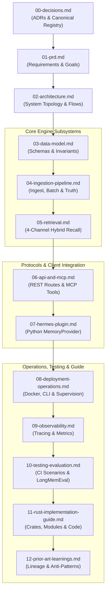

# Engram Specification Package

Welcome to the engineering specification for **Engram** — a unified, single-engine long-term memory service for autonomous AI agents, authored in Rust and built natively on SurrealDB. Documents, bi-temporal knowledge-graph facts, dense vector embeddings, BM25 full-text indexes, and provenance audits reside inside identical records under a single ACID transaction boundary. Engram packages this engine into a production-grade, all-in-one Docker image running the lean `engram` binary that supervises a local SurrealDB 3.3.4 child process. It serves Hermes Agent via a zero-dependency Python `MemoryProvider` plugin and external coding agents (Claude Code, Cursor, Codex, Gemini CLI) via Model Context Protocol (MCP) Streamable HTTP, eliminating poly-store coordination drift, silent overwrites, and temporal amnesia.

---

## Binding Precedence Rule

> [!IMPORTANT]
> **Single Source of Truth:** [`00-decisions.md`](00-decisions.md) is the absolute governing standard for the entire Engram specification package.
> 
> If any other specification document, schema definition, code comment, or migration contradicts [`00-decisions.md`](00-decisions.md), **`00-decisions.md` wins** and the disagreeing document is considered a bug. All canonical names, file paths, ports, configuration keys, database identifiers, and algorithmic budgets declared in [00-decisions.md §3](00-decisions.md#3-canonical-registry-names-every-document-must-use) are strictly binding.

---

## Reading Order for Implementers

Implementers and contributors should approach the specification package in the following structured sequence:

1. **Foundations & Registry:** Start with [`00-decisions.md`](00-decisions.md) to internalize the 19 binding Architectural Decision Records (ADRs) and the canonical registry of types, ports, and metrics.
2. **Product Requirements:** Read [`01-prd.md`](01-prd.md) for target personas, user stories, functional/non-functional requirements, and milestone exit gates.
3. **Architecture Blueprint:** Read [`02-architecture.md`](02-architecture.md) for end-to-end component topology, data flows, process boundaries, and failure isolation.
4. **Core Engine Subsystems:** Read [`03-data-model.md`](03-data-model.md) (SurrealDB record schemas and temporal invariants), [`04-ingestion-pipeline.md`](04-ingestion-pipeline.md) (episode hashing, candidate priming, batch extraction, and deterministic truth maintenance), and [`05-retrieval.md`](05-retrieval.md) (4-channel hybrid recall, Weighted RRF, MMR, and token packing).
5. **Consumer Interfaces:** Read [`06-api-and-mcp.md`](06-api-and-mcp.md) (REST endpoints and MCP Streamable HTTP tools) and [`07-hermes-plugin.md`](07-hermes-plugin.md) (native Hermes `MemoryProvider` lifecycle hooks and offline spooling).
6. **Operations & Observability:** Read [`08-deployment-operations.md`](08-deployment-operations.md) (process supervision, backup/export, migration rehearsals) and [`09-observability.md`](09-observability.md) (tracing spans, Prometheus metrics, and audit log schemas).
7. **Testing, Implementation & Lineage:** Read [`10-testing-evaluation.md`](10-testing-evaluation.md) (49 deterministic CI scenarios (`S01–S49`) and LongMemEval_S benchmark harness), [`11-rust-implementation-guide.md`](11-rust-implementation-guide.md) (concrete Rust module layouts, crate dependencies, and error types), and [`12-prior-art-learnings.md`](12-prior-art-learnings.md) (analysis of Hindsight, Cognee, Mem0, and Graphiti).

---

## Specification File Index

> [!NOTE]
> Reports in [`verification/`](verification/) are historical, point-in-time audit records produced during discovery; the numbered specification documents (`00` through `12`) and `0001_init.surql` are the authoritative ground truth.

| File Path | One-Line Purpose |
|---|---|
| [`00-decisions.md`](00-decisions.md) | Single source of truth containing all binding ADRs (ADR-01 to ADR-19) and canonical registries. |
| [`01-prd.md`](01-prd.md) | Product requirements, personas, user stories, functional/non-functional requirements, and milestones M0–M5. |
| [`02-architecture.md`](02-architecture.md) | High-level system architecture, component topology, concurrency model, and data flow diagrams. |
| [`03-data-model.md`](03-data-model.md) | Complete SurrealDB database schema, record definitions, bi-temporal fields, and relational invariants. |
| [`04-ingestion-pipeline.md`](04-ingestion-pipeline.md) | Episode ingestion, redaction, candidate entity priming, batch LLM extraction, and deterministic truth maintenance. |
| [`05-retrieval.md`](05-retrieval.md) | 4-channel hybrid retrieval (Vector, BM25, Graph, Recency), Weighted RRF, MMR diversification, and prompt packing. |
| [`06-api-and-mcp.md`](06-api-and-mcp.md) | HTTP REST API specification (`/v1/...`) and Model Context Protocol (MCP) Streamable HTTP endpoint (`/mcp`). |
| [`07-hermes-plugin.md`](07-hermes-plugin.md) | Native Hermes Agent Python `MemoryProvider` directory plugin, lifecycle hooks, and offline write spooling. |
| [`08-deployment-operations.md`](08-deployment-operations.md) | Child SurrealDB supervision, signal isolation, RocksDB storage, logical export/import, and Docker deployment. |
| [`09-observability.md`](09-observability.md) | Distributed tracing (`tracing`), Prometheus metrics registry, structured JSON logs, and audit trail retention. |
| [`10-testing-evaluation.md`](10-testing-evaluation.md) | 49 deterministic scenario tests (`S01–S49`), mock harnesses, and LongMemEval_S automated evaluation framework. |
| [`11-rust-implementation-guide.md`](11-rust-implementation-guide.md) | Concrete Rust crate structure, dependency allowlist, error types, store RPC client, and code patterns. |
| [`12-prior-art-learnings.md`](12-prior-art-learnings.md) | Empirical analysis of prior art (Hindsight, Cognee, Mem0, Graphiti) and 10 anti-patterns Engram deliberately avoids. |
| [`verification/README.md`](verification/README.md) | How to read the historical audit records. |
| [`verification/VS1-consistency.md`](verification/VS1-consistency.md) | Point-in-time cross-document consistency audit verifying alignment of names, ports, schemas, and configurations. |
| [`verification/VS1b-consistency-final.md`](verification/VS1b-consistency-final.md) | Final cross-document consistency audit confirming resolution of all 18 specification findings. |
| [`verification/VS2-storage-queries.md`](verification/VS2-storage-queries.md) | Point-in-time verification of SurrealQL queries, transactions, CBOR wire serialization, and index syntax. |
| [`verification/VS2b-storage-final.md`](verification/VS2b-storage-final.md) | Final storage query audit verifying CBOR serialization, SurrealQL transactions, and query catalog. |
| [`verification/VS3-hermes-compliance.md`](verification/VS3-hermes-compliance.md) | Point-in-time audit verifying compliance with Hermes Agent `MemoryProvider` contract and plugin discovery conventions. |
| [`verification/VS4-rust-mcp-docker.md`](verification/VS4-rust-mcp-docker.md) | Point-in-time verification of Rust dependency tree, binary footprint, MCP protocol compliance, and Docker packaging. |
| [`verification/VS5-coverage-quality.md`](verification/VS5-coverage-quality.md) | Point-in-time completeness and quality audit verifying PRD requirement coverage, edge cases, and benchmark claims. |
| [`../../migrations/0001_init.surql`](../../migrations/0001_init.surql) | Canonical baseline SurrealQL migration defining all tables, fields, HNSW vector indexes, and FTS analyzers. |
| [`../../prompts/extract.v1.md`](../../prompts/extract.v1.md) | Canonical versioned prompt and JSON Schema for single-call batch entity and fact extraction. |
| [`../../prompts/consolidate.v1.md`](../../prompts/consolidate.v1.md) | Canonical prompt for synthesizing high-level entity observations from corroborated facts. |
| [`../../Dockerfile`](../../Dockerfile) | Multi-stage production container build packaging Debian Bookworm Slim, `tini`, `engram`, and `surreal`. |
| [`../../docker-compose.yml`](../../docker-compose.yml) · [`../../docker-compose.external.yml`](../../docker-compose.external.yml) | Compose: all-in-one default (optional `with-ollama` profile) · external-SurrealDB topology. |
| [`../research/README.md`](../research/README.md) | Research synthesis index summarizing discovery findings from 7 prior art systems and verification audits. |

---

## Milestone Delivery Map (M0–M5)

The implementation of Engram is staged into six sequential milestones, each gated by automated integration tests and verified criteria:

| Milestone | Scope & Core Deliverables | Defining Documents |
|---|---|---|
| **M0: Foundation & Schema** | Rust binary skeleton (`engram serve`), managed SurrealDB process supervisor, embedded idempotent migrations (`0001_init.surql`), REST routing skeleton, unauthenticated `/healthz` & `/readyz`, and Hermes plugin discovery skeleton. | [`01-prd.md §10`](01-prd.md#m0--service-foundation--schema-bootstrap) [`02-architecture.md §2, §7`](02-architecture.md) [`08-deployment-operations.md §2`](08-deployment-operations.md) [`10-testing-evaluation.md §9`](10-testing-evaluation.md#9-milestone-acceptance-criteria-mapping) |
| **M1: Ingest & Outbox** | Episode ingestion endpoint (`POST /episodes`), transactional SHA-256 deduplication, regex secret redaction, transactional `job` outbox queue, and async embedding workers. | [`01-prd.md §10`](01-prd.md#m1--ingestion-pipeline--outbox-engine) [`04-ingestion-pipeline.md §2-§5`](04-ingestion-pipeline.md) [`10-testing-evaluation.md §9`](10-testing-evaluation.md#9-milestone-acceptance-criteria-mapping) |
| **M2: Hybrid Retrieval** | Multi-statement SurrealQL retrieval, 1-hop graph expansion with hub damping, English/Indonesian temporal expression parser, Rust Weighted RRF ($k=60$), MMR ($\lambda=0.7$), token packing, and Hermes live `prefetch()` with 1500 ms deadline. | [`01-prd.md §10`](01-prd.md#m2--hybrid-retrieval--hermes-read-path) [`05-retrieval.md`](05-retrieval.md) [`07-hermes-plugin.md §4`](07-hermes-plugin.md) [`10-testing-evaluation.md §9`](10-testing-evaluation.md#9-milestone-acceptance-criteria-mapping) |
| **M3: Extraction & Truth** | Batch extraction worker with integer handle candidate priming (`E1..En`), closed 15-predicate enforcement, entity resolution cascade (Jaro-Winkler + cosine), deterministic truth maintenance (ADR-08, authority guard, bi-temporal supersession), and explicit `remember`/`forget` tools. | [`01-prd.md §10`](01-prd.md#m3--structured-extraction--truth-maintenance) [`03-data-model.md §4`](03-data-model.md) [`04-ingestion-pipeline.md §6-§8`](04-ingestion-pipeline.md) [`10-testing-evaluation.md §9`](10-testing-evaluation.md#9-milestone-acceptance-criteria-mapping) |
| **M4: Consolidation & Resilience** | Background `observation` consolidation, Hermes `on_memory_write` mirroring for `MEMORY.md`/`USER.md`, `on_pre_compress` flush contract, offline write spooling (`spool.jsonl`), and logical backup (`engram export`/`import`). | [`01-prd.md §10`](01-prd.md#m4--consolidation-curated-mirroring--resilience) [`07-hermes-plugin.md §7-§8`](07-hermes-plugin.md) [`08-deployment-operations.md §6`](08-deployment-operations.md) [`10-testing-evaluation.md §9`](10-testing-evaluation.md#9-milestone-acceptance-criteria-mapping) |
| **M5: MCP, Evals & Release** | MCP Streamable HTTP server (`/mcp`) registering all 5 tools, automated LongMemEval_S evaluation harness, production multi-stage Docker build, 72-hour soak test, and final documentation. | [`01-prd.md §10`](01-prd.md#m5--mcp-interface-evaluation-harness--release-hardening) [`06-api-and-mcp.md §3`](06-api-and-mcp.md) [`10-testing-evaluation.md §9`](10-testing-evaluation.md#9-milestone-acceptance-criteria-mapping) [`08-deployment-operations.md §3`](08-deployment-operations.md) |

---

## Empirically Verified Facts

> [!NOTE]
> All technical assertions below were empirically tested and validated against real software artifacts on 2026-10-24:
> 
> 1. **SurrealDB 3.3.4 HTTP RPC & CBOR Requirement:** Tested directly against `surrealdb/surrealdb:v3.3.4`. Under `application/json`, bound parameter strings shaped like `ident:ident...` (e.g. `"User: Hello"`, `"Note:fix"`) are erroneously coerced into record IDs and truncated. Communicating via `application/cbor` using `ciborium` round-trips strings cleanly and preserves native SurrealDB types (tag 6 NONE, tag 8 RecordId, tag 12 Datetime) [ADR-02]. Multi-statement transactions (`BEGIN ... THROW ... COMMIT`) roll back atomically.
> 2. **SurrealQL Index & Search Syntax:** SurrealDB 3.x dropped `MTREE` and `SEARCH ANALYZER ... BM25`. Vector indexing requires `DEFINE INDEX ... HNSW DIMENSION 1024 DIST COSINE`. Full-text search requires `DEFINE INDEX ... FULLTEXT ANALYZER <name> BM25`. Each `FULLTEXT` index covers exactly one field. Vector KNN operator `<|k,ef|>` accepts only integer literals (bound params rejected).
> 3. **Search Fusion Functionality:** Native `search::rrf()` parses and executes correctly over HTTP RPC in SurrealDB 3.3.4.
> 4. **Migration Idempotency:** The canonical schema (`0001_init.surql`) uses `DEFINE ... OVERWRITE` and `IF NOT EXISTS` constructs, executing cleanly and idempotently across repeated restarts without schema or data corruption.
> 5. **Rust Crate Footprint:** A pruned Tokio/Axum stack compiles with **218 normal crates** in default build (Ceiling: $\le 300$) and **245 crates** with OTLP (Ceiling: $\le 340$). Clean-room client over `reqwest` avoids linking the official BSL-1.1 `surrealdb` SDK (which would add +124 normal crates, 7 BUSL-1.1 crates) and ensures 100% permissive licensing (Apache-2.0 / MIT).
> 6. **Binary & Container Footprint:** Stripped release binary measures **7.41 MB** (measured on the VS4 vertical slice with current stack incl. ciborium; 7.41 MB with OTLP), well below the 25 MB ceiling. The official `surreal` v3.3.4 binary alone measures 352 MB uncompressed / 105 MB gzipped; the complete Debian slim image measures **584 MB uncompressed / 140.76 MB compressed pull**, strictly satisfying the $\le 650\text{ MB} / \le 160\text{ MB}$ budget [ADR-16].
> 7. **Hermes MemoryProvider Integration:** Plugin lifecycle hooks (16 ABC methods, `spawn_context_thread`, `is_trivial_prompt`, multiplexing profile isolation) were verified directly against Hermes Agent `0.22.4` at `~/.hermes/hermes-agent`.

---

## Open Items Deferred to v1.1

The following capabilities were explicitly evaluated during discovery and scheduled for post-v1 releases:

1. **`stdio` MCP Bridge (`engram mcp-stdio`):** A lightweight local bridge process wrapping the Streamable HTTP endpoint for desktop MCP hosts that only support standard IO pipes.
2. **Per-Bank Scoped API Keys:** Per-bank scoped API keys restricting a given agent key to designated banks (v1 deliberately has one full-access key, ADR-14).
3. **Pre-Compress Checkpoint v2:** Upgraded `on_pre_compress` protocol returning incremental fact diffs and state hash digests rather than a static summary string.
4. **Embedded SurrealDB Engine Option:** Direct in-process linkage to `surrealdb-core` behind an optional Cargo feature for users who prefer a single operating system process and accept longer compile times.
5. **Local Embedded Vector Models:** Optional embedded ONNX Runtime / candle inference for environments where hosting an external Ollama or OpenAI-compatible endpoint is prohibited.
6. **Default Cross-Encoder Reranking:** Enabling local or hosted cross-encoder reranking out of the box once lightweight sub-50 MB cross-encoder weights are validated for English and Indonesian multilingual queries.
